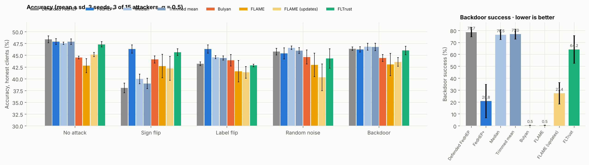
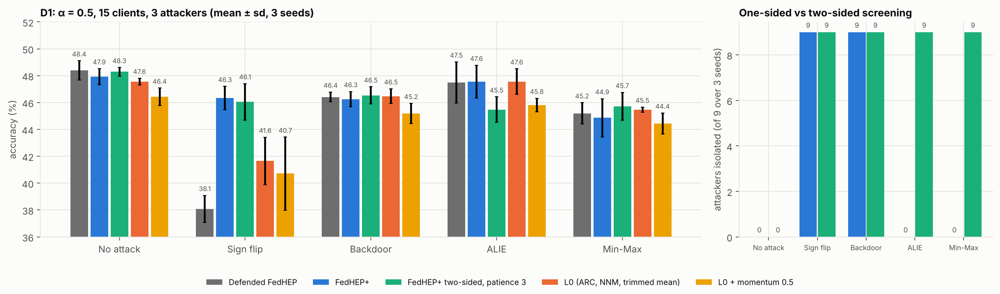
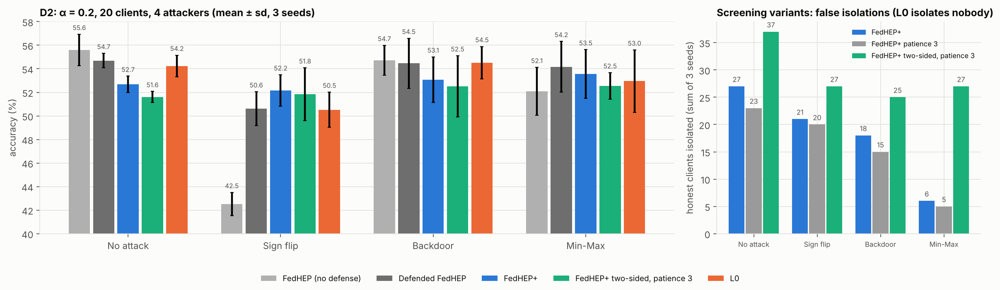
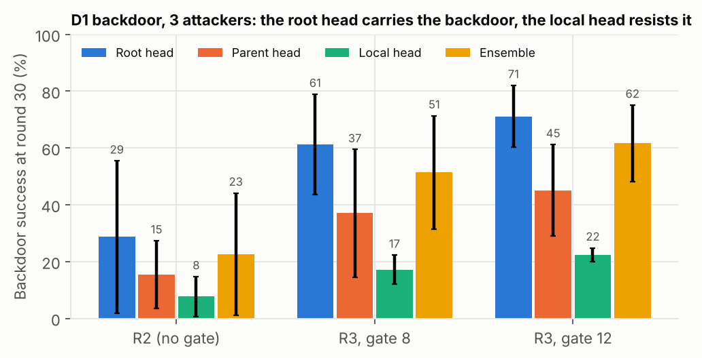
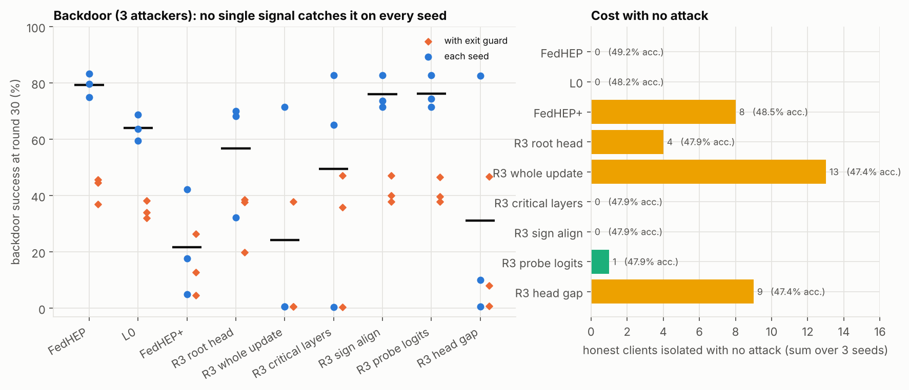

# RFL Lab

A modular PyTorch framework for robust federated learning research. It reproduces **FedHEP** (*Federated Hierarchical Ensemble Personalization*) and its defended variant (**Defended FedHEP**), benchmarks them against established robust aggregation rules under untargeted, adaptive, and backdoor poisoning attacks, and serves as the test bench for **FedHEP+** and **FedHEP-Guard**.

**Start with the research report, [`docs/report/00_index.md`](docs/report/00_index.md).** It explains federated learning, every model from FedHEP to FedHEP-Guard (formulas, legends, diagrams, what each changes, what improved and what failed), the canonical benchmark, and every configuration key. It also has a presenting kit that maps each question to its chart and table.

All results, including negative ones and closed explorations, are recorded in [`docs/EXPERIMENT_LOG.md`](docs/EXPERIMENT_LOG.md). No number in this repository is reported without the run that produced it (`outputs/<run>/metrics.json` and `config.yaml`).

---

## Status & Latest Results

### Research Progress by Phase

| Phase | Scope | Outcome |
|---|---|---|
| **1. Reproduction** | Reference parity | `FedAvg`, `FedHEP`, and `Defended FedHEP` match the authors' code (bit-identical unit parity tests; 3-seed CIFAR-100 means within 2 SE). Five baselines (`FedProx`, `SCAFFOLD`, `Ditto`, `FedRep`, `Multi-Krum`) pass parity tests. |
| **2. Benchmark Harness** | Attack & metric suite | 7 attacks (`sign_flip`, `label_flip`, `gradient_ascent`, `random_noise`, `backdoor`, `alie`, `minmax`), attacker placement control, per-round detection metrics, backdoor ASR, resumable sweeps. |
| **3. FedHEP+** | Robust z-score screening | Median reference + MAD/relative-floor scaling, EMA evidence, permanent isolation, and weight-only regrouping. Beats `Defended FedHEP` on all 3 seeds at $\alpha = 0.5$ under sign flip (+8.3 pts), label flip (+3.1 pts), and backdoor (78.7% → 20.8% ASR) at −0.5 clean cost. |
| **4. Drill-Down Defense** | Parent → member attribution | Parent-level permutation test detects poisoned groups, but member-level leave-one-out attribution overlaps honest intra-group alignment. Closed (`D26`, `D28`). |
| **5. Classic Rules in FedHEP** | Global-step replacement | `Median`, `Trimmed Mean`, `Bulyan`, `FLAME`, and `FLTrust` inside FedHEP's Global step (`D29`). None beats `FedHEP+` overall; `Bulyan` and `FLAME` reduce backdoor ASR to 0.5% but cost 3.9–5.6 clean points. |
| **Follow-up Diagnostics** | Heterogeneity & adaptive stress | Two-sided screening catches 100% of `ALIE` and `Min-Max` attackers (`H1`). However, at strong skew ($\alpha = 0.2$, 20 clients), un-gated `FedHEP+` falsely isolates ~9/20 honest clients and loses 2.0 clean points. Stop-tests show implanted backdoors keep growing after poisoning stops. |
| **6. FedHEP-Guard** | Layered bound + gated screen | **Completed on D1 ($\alpha = 0.5$) & D2 ($\alpha = 0.2$):** Base layer **L0** (`ARC + NNM + Trimmed Mean`, no momentum per `D33`) + **Two-Sided Screen** + **Gap Gate 12 (`R3`)** cuts false isolations from 27 → 2 at $\alpha = 0.2$ while restoring clean (+2.05 pts over `FedHEP+`) and sign-flip (+2.04 pts) accuracy. Per-head localization proves the backdoor resides in the shared root head; head-agreement inference (`P11`), model rewind (`H8`), and layer signals (`C1–C6`) are active. |

---

### Headline Benchmark 1: Phase 5 Baselines (`D1`: CIFAR-100, α = 0.5, 15 clients, 3 attackers)

30 rounds, 5 local epochs, mean ± sd over 3 seeds (`42`, `123`, `7`) on Mac (`mps`). Accuracy is pooled over honest clients' test sets; backdoor ASR is measured on honest clients:

| Method | No attack (Clean ↑) | Sign flip (↑) | Label flip (↑) | Backdoor ASR (↓) | Honest isolated (3 seeds) |
|---|---|---|---|---|---|
| **Defended FedHEP** *(published)* | **48.39 ± 0.72** | 38.08 ± 1.01 | 43.23 ± 0.40 | 78.7% | 0 |
| **FedHEP+** *(Phase 3, one-sided)* | 47.92 ± 0.60 | **46.34 ± 0.87** | **46.34 ± 0.87** | 20.8% | 9 (clean) |
| **Bulyan** *(in FedHEP Global)* | 44.52 ± 0.28 | 44.13 ± 0.76 | 43.94 ± 1.23 | **0.5%** | — |
| **FLAME** *(in FedHEP Global)* | 42.81 ± 1.49 | 42.72 ± 2.50 | 41.61 ± 2.28 | **0.5%** | — |

> `FedHEP+` produces identical accuracy under sign flip and label flip (`46.34 ± 0.87`) because it isolates all 3 attackers from round 1 in both settings, leaving the 12 honest clients to train identically.



---

### Headline Benchmark 2: Phase 6 FedHEP-Guard Ablation Ladder (`D1` & Held-Out `D2`)

To prevent false isolations under strong heterogeneity ($\alpha = 0.2$) while bounding adaptive attackers (`ALIE`, `Min-Max`), Phase 6 layers **L0** (`arc_nnm_tm`: Adaptive Robust Clipping → Nearest-Neighbour Mixing → Coordinate Trimmed Mean) beneath **Two-Sided Screening** and a **Bimodality Gap Gate** (`plus.gap_gate`, which blocks blame unless the round's sorted score gaps split cleanly).

#### Setting D1: Moderate Heterogeneity (α = 0.5, 15 clients, 3 attackers, 3 seeds, Mac `mps`)

| Rung / Method | No attack (↑) | Sign flip (↑) | ALIE (↑) | Min-Max (↑) | Backdoor Acc (ASR ↓) | Honest isolated *(clean / sign / ALIE / Min-Max)* |
|---|---|---|---|---|---|---|
| **Defended FedHEP** | **48.39** | 38.08 | 47.49 | 45.19 | 46.40 (78.7%) | 0 / 0 / 0 / 0 |
| **FedHEP+** *(one-sided)* | 47.92 | **46.34** | 47.55 | 44.87 | 46.26 (**20.8%**) | 3.0 / 1.7 / 2.0 / 1.0 *(per run)* |
| **L0 alone** *(`arc_nnm_tm`)* | 47.56 | 41.65 | **47.56** | 45.47 | 46.48 (62.5%) | **0 / 0 / 0 / 0** |
| **R2: L0 + Two-Sided Screen** | 46.99 | 46.00 | 45.65 | 45.96 | 46.44 (22.6%) | 4.3 / 1.7 / 3.0 / 3.7 *(per run)* |
| **R3: R2 + Gap Gate 8** | 47.36 | 46.14 | 45.74 | 46.02 | 46.84 (51.4%) | 1.0 / 0.7 / 0.7 / 0.7 *(per run)* |
| **R3: R2 + Gap Gate 12** | 47.31 | 46.20 | 45.87 | **46.07** | **47.03** (61.6%) | **0.0 / 0.7 / 0.0 / 0.3** *(per run)* |



#### Setting D2: Strong Heterogeneity (α = 0.2, 20 clients, 4 attackers, 3 seeds, Mac `mps`)

| Rung / Method | No attack (↑) | Sign flip (↑) | Min-Max (↑) | Backdoor Acc (ASR ↓) | Honest isolated *(total over 3 seeds: clean / sign / Min-Max / backdoor)* |
|---|---|---|---|---|---|
| **FedHEP (no defense)** | **55.59** | 42.51 | 52.10 | 54.72 (46.9%) | 0 / 0 / 0 / 0 |
| **Defended FedHEP** | 54.70 | 50.62 | **54.16** | 54.47 (44.3%) | 0 / 0 / 0 / 0 |
| **FedHEP+** *(one-sided)* | 52.68 | 52.15 | 53.55 | 53.08 (43.3%) | 27 / 21 / 6 / 18 |
| **L0 alone** *(`arc_nnm_tm`)* | 54.23 | 50.52 | 52.96 | 54.51 (**37.7%**) | **0 / 0 / 0 / 0** |
| **R2: L0 + Two-Sided Screen** | 52.13 | 51.86 | 52.62 | 52.49 (44.1%) | 38 / 29 / 29 / 33 |
| **R3: R2 + Gap Gate 8** | 54.72 | **54.26** | 53.34 | 54.46 (45.3%) | 3 / 6 / 8 / 7 |
| **R3: R2 + Gap Gate 12** | **54.73** | 54.19 | 52.51 | 54.49 (45.3%) | **2 / 1 / 0 / 6** |



#### Where the Backdoor Lives: Per-Head Localization

Evaluating each head independently (`history[*].asr_heads`) reveals that the backdoor is carried by the **shared root head**, while each client's **personal local head** (trained only on clean local labels) strongly resists it:

| Setting & Rung | Root Head ASR | Parent Head ASR | Local Head ASR | Blended Ensemble ASR |
|---|---|---|---|---|
| **D1 ($\alpha = 0.5$): R2 (no gate)** | 29% | 15% | **8%** | 23% |
| **D1 ($\alpha = 0.5$): R3, Gate 8** | 61% | 37% | **17%** | 51% |
| **D1 ($\alpha = 0.5$): R3, Gate 12** | 71% | 45% | **22%** | 62% |
| **D2 ($\alpha = 0.2$): R2 / R3** | 86% | 48–62% | **12–15%** | 44–45% |

This motivates the two active Phase 6 backdoor mechanisms: **Head-Agreement Inference** (`fedhep.head_agreement`, where personal heads overrule an unsupported root prediction at test time) and **Shared-Layer Rewind on Isolation** (`plus.rewind: trunk_root`, hypothesis `H8`).



---

### Latest Results (2026-11-18): Screening Signals on the GPU Server

186 runs on 4 × RTX PRO 4500 (CUDA, deterministic; `D1`, 3 seeds) compared six screening signals on top of rung R3, with fresh baselines. Full tables in [`docs/EXPERIMENT_LOG.md`](docs/EXPERIMENT_LOG.md); predictions checked in [`docs/PREDICTIONS.md`](docs/PREDICTIONS.md).



- **No single signal catches the backdoor on every seed.** The whole-update signal catches all three attackers on two seeds (0.6% success) and misses the third (71%); the critical-layer signal catches exactly the seed the whole-update signal misses; the head-gap signal catches two. Their union covers all three seeds, which points to a multi-signal screen as the next rung.
- **Signals that see the backdoor cost honest clients:** whole update 13 and head gap 9 false isolations over 3 seeds with no attack; critical layers, sign alignment and probe logits isolate nobody (and, except critical layers once, miss the backdoor).
- **A backdoor that is missed never fades** (100 rounds, attackers stop at round 50: 64–75% to the end), and **one caught by round 10 stays out** (FedHEP+, whole-update signal: 0–5% for 100 rounds). See [`docs/figures/phase6_durability.png`](docs/figures/phase6_durability.png).
- **The depth-exit guard halves any backdoor that gets through** (79% → 42%, 64% → 35%) at 0.3 points of accuracy; head-agreement inference does little.
- **Rewind on isolation is cheap insurance against a late catch** (Acer, 100 rounds): with the whole-update screen, one seed caught its attackers only after part of the backdoor had reached the trunk, and it grew to 17% after the attack ended; with the trunk-and-root rewind all three seeds stay at 0–1% (cost 0.4 points). See [`docs/figures/phase6_rewind.png`](docs/figures/phase6_rewind.png).

- **An adaptive backdoor that hides inside the honest spread** (Mac, D1) is as strong as the plain one without a defense (71–83%), beats FedHEP+ (56–75%) and the whole-update screen on one seed (61%), but not the union screen (0.2–0.5% on every seed, at 14 honest isolations over 3 runs). See [`docs/figures/phase6_stealth.png`](docs/figures/phase6_stealth.png).
- **A wrong guess of the attacker count barely moves R3** (union screen; f = 1, 3 or 6: within 1.5 points, every attacker caught), while L0 under sign flip ranges from 35.7 (f = 1) to 41.9 (f = 6). The union screen's cost is 4–6 honest clients isolated per run with no attack. See [`docs/figures/phase6_fmis.png`](docs/figures/phase6_fmis.png).

**Running next (GPU server):** the large grid `gpu_grid_n{15,30,50}` (1,872 runs: 15/30/50 clients × α 0.1/0.5 × five attack settings at 10/20/30% attackers × 8 methods × 3 seeds), including the union screen `plus.signal: weights_critical` that the result above points to. Plan and predictions P17–P19 in the log.

## Documentation Guide

The repository documentation is organized into the **research report** and **four notebook tracks**:

### 0. The Research Report (start here)
| Document | Purpose |
|---|---|
| [`docs/report/00_index.md`](docs/report/00_index.md) | Reading guide, research path, models at a glance, and the presenting kit (question to chart and table). |
| [`docs/report/01_federated_learning.md`](docs/report/01_federated_learning.md) … [`08_configuration_reference.md`](docs/report/08_configuration_reference.md) | Chapters 1–8: FL and attacks, FedHEP, Defended FedHEP, FedHEP+, ideas that did not work, FedHEP-Guard, the canonical benchmark, every configuration key. |

### 1. Research Overview
| Document | Purpose |
|---|---|
| [`docs/RESEARCH_SUMMARY.md`](docs/RESEARCH_SUMMARY.md) | Earlier plain-language walkthrough (to Phase 6, 2026-11-15); superseded by the report. |
| [`docs/PAPER_PLAN.md`](docs/PAPER_PLAN.md) | Paper claims (`C1`–`C9`) and their verification status, closest published work, section outline mapped to figures/runs, and submission checklist. |
| [`docs/LITERATURE_REVIEW.md`](docs/LITERATURE_REVIEW.md) | Synthesis of 170 sources across robust aggregation, adaptive/backdoor attacks, personalized & hierarchical FL, and the seven open gaps. |

### 2. Defense Design, Hypotheses & Decision Registry
| Document | Purpose |
|---|---|
| [`docs/RESEARCH_PLAN.md`](docs/RESEARCH_PLAN.md) | Technical specification of **FedHEP-Guard** (`L0` influence bound, `L1` multi-signal screen + gap gate, `L2` two-vantage trust, `L3` soft quarantine), hypotheses `H1`–`H8`, and ablation stages. |
| [`docs/PREDICTIONS.md`](docs/PREDICTIONS.md) | Pre-registered predictions (`P1`–`P19`), confidence levels, and refutation thresholds written before the multi-GPU campaign (`C1`–`C6`). |
| [`docs/IDEAS.md`](docs/IDEAS.md) | Ranked candidate mechanisms and their mathematical grounding: Part A (robust FL signals, depth exits, unlearning) and Part B (sign election, neural collapse, spectral geometry). |
| [`docs/DECISIONS.md`](docs/DECISIONS.md) | Indexed registry of all 33 design decisions (`D1`–`D33`) grouped by status (`Active`, `Superseded`, `Closed`), plus the 2026-11-12 screening review archive. |

### 3. Empirical Record & Mathematical Reference
| Document | Purpose |
|---|---|
| [`docs/EXPERIMENT_LOG.md`](docs/EXPERIMENT_LOG.md) | Complete chronological laboratory notebook: method equations, Mermaid round flowcharts, every completed sweep table, diagnostic plots, and negative results. |
| [`docs/methods_page/rfl_lab_methods.html`](docs/methods_page/rfl_lab_methods.html) | Self-contained HTML reference sheet with rendered method diagrams and equations (also inspectable live in the visualizer's **Mathematical inspection** tab). |

### 4. Engineering Architecture, Operations & Visualizer
| Document | Purpose |
|---|---|
| [`docs/ARCHITECTURE.md`](docs/ARCHITECTURE.md) | The 5-layer package hierarchy, plug-in interfaces (`Partitioner`, `ClientTrainer`, `Attack`, `Grouper`, `Detector`, `Aggregator`), and `import-linter` contract. |
| [`docs/OPERATIONS.md`](docs/OPERATIONS.md) | Multi-machine operations manual for **Mac (`mps`)**, **Acer (`xpu`)**, and **Lab GPU Server (`cuda`, 4 × RTX PRO 4500, Slurm)**: environment setup, sweep queues, `sync_acer.sh`, and manifest publishing. |
| [`visualizer/README.md`](visualizer/README.md) | Setup, execution architecture, captured round playback, curated experiment history, and Netlify deployment for the **RFL Lab Visualizer** workbench. |

---

## Repository Layout

```text
RFL_Lab/
├── src/rfl/
│   ├── core/          # Layer 1: shared types, flat state-vector layout, plug-in interfaces
│   ├── data/          # Layer 2: CIFAR-100 loader, seeded subsets, IID & Dirichlet partitioners
│   ├── models/        # Layer 2: ResNet-9 and three-head MultiHeadResNet9
│   ├── attacks/       # Layer 2: label_flip, sign_flip, gradient_ascent, random_noise, backdoor, ALIE, Min-Max
│   ├── client/        # Layer 3: local trainers (SGD, FedProx, SCAFFOLD, Ditto, FedRep, FedHEP + head agreement)
│   ├── grouping/      # Layer 3: similarity grouping (chunked 256-D random projection + k-means)
│   ├── defense/       # Layer 3: SCCF, trust ledger, z-score screening, gap gate, layer/probe signals, exit guard
│   ├── aggregation/   # Layer 3: FedAvg, adaptive parent momentum, Multi-Krum, L0 (ARC+NNM+TM), sign election
│   ├── evaluation/    # Layer 3: pooled/client/bottom-10% accuracy, per-head backdoor ASR, detection F1/AUROC
│   ├── server/        # Layer 4: round orchestration (FedAvg, FedHEP, Defended, FedHEP+, Robust FedHEP)
│   └── experiment/    # Layer 5: typed YAML config, mechanism registry, seeded runner, resumable sweeps
├── configs/           # Base method YAMLs + configs/sweeps/ (phase2..6, followup_*, mac_*, acer_*, gpu_*)
├── scripts/           # CLI entrypoints: run.py, sweep.py, gpu_sweep.py, summarize.py, plot_*.py, check.sh
├── tests/             # Property-based (Hypothesis) and reference parity test suites
├── docs/              # Markdown documentation, Mermaid sources (diagrams/), and generated charts (figures/)
├── outputs/           # Tracked run artifacts (<run_name>_s<seed>/config.yaml and metrics.json)
└── visualizer/        # Interactive Next.js + FastAPI research workbench (frontend/, backend/, scripts/)
```

---

## Installation

Requires **Python ≥ 3.10** and **PyTorch ≥ 2.2**.

```bash
git clone https://github.com/BinhPhamTieSinger/RFL_Lab.git
cd RFL_Lab
python3 -m venv .venv && source .venv/bin/activate
pip install -e ".[dev]"
bash scripts/check.sh
```

- **Dataset path**: By default, CIFAR-100 is read from `../Paper_Reproduction/data` (or downloaded automatically into `data.root` if missing). Override with `--set data.root=/path/to/data`.
- **Accelerator selection**: `run.device: auto` (the default) selects the first available backend in the order **`cuda` → `xpu` (Intel Arc/Iris) → `mps` (Apple Silicon) → `cpu`**. Override explicitly with `--set run.device=cpu` (or `mps`, `xpu`, `cuda`).

---

## Running Experiments

### 1. Single Configuration Across Three Seeds

```bash
# Undefended FedHEP at extreme label skew (alpha = 0.05)
python scripts/run.py configs/cifar100_fedhep.yaml --seeds 42 123 7 \
    --set data.alpha=0.05 name=cifar100_fedhep_a0.05

# Defended FedHEP under 3-client sign-flipping attack
python scripts/run.py configs/cifar100_fedhep_defended.yaml --seeds 42 123 7 \
    --set attack.kind=sign_flip attack.count=3 name=cifar100_def_sign_flip
```

Each seed writes `outputs/<name>_s<seed>/config.yaml` and `metrics.json` containing per-round pooled accuracy, mean-client accuracy, bottom-10% accuracy, overall and per-head backdoor ASR, detection precision/recall/F1, false-isolation rate, wall-clock/memory resources, and the execution device.

### 2. Resumable Experiment Sweeps

```bash
# Preview the expanded run grid without executing
python scripts/sweep.py configs/sweeps/phase6_ladder_d1.yaml --dry-run

# Run sequentially (finished runs with metrics.json are skipped automatically on resume)
python scripts/sweep.py configs/sweeps/phase6_ladder_d1.yaml

# Multi-GPU parallel sweep on the Slurm server (4 GPUs, one run per GPU)
python scripts/gpu_sweep.py configs/sweeps/gpu_grid_n15.yaml --procs 1 --set data.root=data
```

### 3. Summarizing & Plotting Results

```bash
python scripts/summarize.py outputs --filter p6__      # Print mean ± sd tables across seeds
python scripts/plot_results.py outputs                 # Regenerate Phase 1–5 figures in docs/figures/
python scripts/plot_followup.py outputs                # Regenerate follow-up diagnostic figures
python scripts/plot_phase6.py outputs                  # Regenerate Phase 6 ladder & head ASR figures
```

---

## Quality Gates

`bash scripts/check.sh` runs all five gates; every gate must pass before new code or results are committed.

| Gate | Scope & Guarantee |
|---|---|
| **`ruff`** | Fast linting, import sorting, and common bug-pattern checks across `src/`, `scripts/`, and `tests/`. |
| **`mypy`** | Strict static type checking across all mechanism interfaces and configuration dataclasses. |
| **`import-linter`** | Enforces the 5-layer dependency DAG in [`docs/ARCHITECTURE.md`](docs/ARCHITECTURE.md); any upward or sibling-layer import fails the build. |
| **`pytest` + `Hypothesis`** | Property-based tests verifying mathematical invariants (e.g., zero-trust weight removes a sender, ARC clips exactly $k$ largest rows, permutation invariance) plus direct parity tests against `../Topology-aware-FDL` (or `$RFL_REFERENCE`). |
| **`graphify`** | Regenerates the AST dependency graph in `graphify-out/` so architectural drift is immediately visible. |

---

## Reproducibility & Cross-Device Behavior (`cuda` / `xpu` / `mps` / `cpu`)

### Standard Protocol
- **Self-contained artifacts**: Every run directory stores its exact resolved `config.yaml`, seed, and `metrics.json`.
- **Matched conditions**: For any given seed (`42`, `123`, `7`), all compared methods share identical training/test subsets, client Dirichlet partitions, initial model parameters, attacker identities, and round budgets.
- **Improvement bar (`D23`)**: A defense variant counts as an improvement only when its paired per-seed difference has the same sign across all three seeds and its mean gain exceeds the baseline seed spread (~1.0–1.5 points).

### Why `mps`, Intel `xpu`, `cuda`, and `cpu` Produce Different Numbers

Running the exact same configuration and seed on Apple Silicon (`mps`), Intel Arc/Iris (`xpu`), NVIDIA GPUs (`cuda`), and `cpu` produces **different training trajectories from the first round**, because the mini-batch order is drawn on the device (row 4 below): for training, a different device acts much like a different shuffling seed. **Measured on 2026-11-18:** 105 runs exist with the same configuration and seed on the Mac (`mps`) and the GPU server (`cuda`). Final accuracy differs by 0.72 points on average (largest 2.75; CUDA higher by 0.30 on average), which is the same size as the seed-to-seed spread of one configuration on one device (standard deviation 0.79). A ranking of methods survives the change of device when they are more than about a point apart (sign flip: identical order) and can swap when they are within half a point (no attack, ALIE, Min-Max). See `docs/figures/phase6_devices.png` and the pairs in `docs/results/device_pairs.json`. Runs on the GPU server use deterministic kernels (`run.deterministic: true`): two jobs with the same configuration give identical numbers, which the Mac and the Acer do not guarantee. The causes:

| Stage / Operation | Behavior Across `cuda`, `xpu`, `mps`, `cpu` | Technical Cause in Code |
|---|---|---|
| **1. Data subsets & Dirichlet split** | **100% Bit-Identical** | Drawn on CPU via `np.random.RandomState(seed)` in [`cifar100.py`](src/rfl/data/cifar100.py) and [`partition.py`](src/rfl/data/partition.py) before moving tensors to `device`. |
| **2. Initial model weights (`ResNet9`)** | **100% Bit-Identical** | Instantiated on CPU after `torch.manual_seed(seed)` in [`runner.py`](src/rfl/experiment/runner.py) prior to `.to(device)`. |
| **3. Attacker IDs & random projection $R$** | **100% Bit-Identical** | Sampled via seeded `np.random.RandomState` on CPU ([`similarity.py`](src/rfl/grouping/similarity.py)). |
| **4. Mini-batch shuffling (`randperm`)** | **Differs by backend** | [`fedhep.py`](src/rfl/client/fedhep.py) and [`sgd.py`](src/rfl/client/sgd.py) call `torch.randperm(n, device=device)`. PyTorch uses distinct PRNG algorithms on CPU, CUDA, MPS, and XPU, so clients see different mini-batch permutations starting in Round 1. |
| **5. Conv2d & BatchNorm2d reductions** | **Differs by ~`1e-6`–`1e-5` / step** | Parallel floating-point atomic adds and kernel reductions are non-associative and execute in different orders across Apple Metal, Intel oneDNN/SYCL, cuDNN, and CPU SIMD. |
| **6. Screening & regrouping thresholds** | **Amplifies small cosine diffs** | Hard thresholds (`z_cut = 2.5`, `evidence_cut = 1.5`, `gap_gate = 8` or `12`, k-means regrouping) mean a borderline score (e.g. `gap_ratio = 7.98` vs `8.02`) can trigger isolation on one backend a round earlier than another. |

> **Golden Rule for Comparisons (`docs/OPERATIONS.md`):**
> **Never mix devices within a comparison table.** All methods compared against one another must run on the **same machine and backend**. Each machine's sweep files (`mac_*.yaml` for `mps`, `acer_*.yaml` for `xpu`, `gpu_*.yaml` for `cuda`) carry their own matched baselines, and every run records `"device"` inside `metrics.json`.
