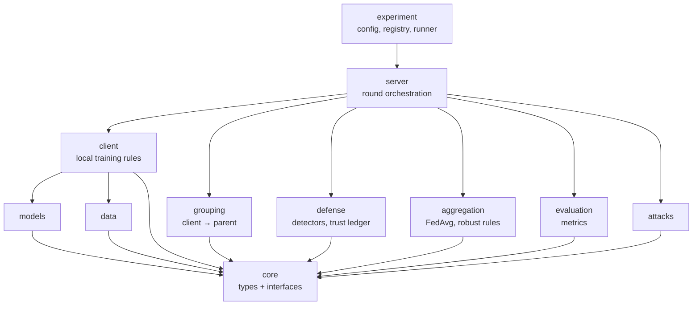
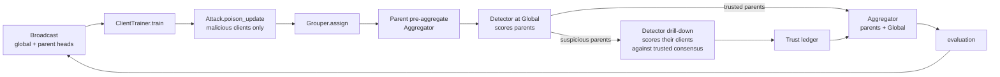

# Architecture

## Principle
Every mechanism is one small class that implements one interface from `src/rfl/core/interfaces.py`. The server only composes mechanisms; it holds no algorithm logic. An experiment is a YAML file that names which mechanism fills each slot. Swapping an aggregator or a detector means changing one line of YAML, not editing the training loop.

## Layers
A package may import only from layers below it. `scripts/check.sh` enforces this with import-linter, so a violation fails the build.

| Layer | Packages | May import |
|---|---|---|
| 5 | `experiment` | everything below |
| 4 | `server` | layers 1–3 |
| 3 | `client`, `grouping`, `defense`, `aggregation`, `evaluation` (siblings, independent of each other) | layers 1–2 |
| 2 | `models`, `data`, `attacks` (siblings, independent of each other) | layer 1 |
| 1 | `core` | nothing from `rfl` |

## Interfaces (the plug-in slots)
| Slot | Interface | Examples to implement |
|---|---|---|
| Data split | `Partitioner` | IID, Dirichlet label skew |
| Local training | `ClientTrainer` | plain SGD, FedProx, Ditto, FedRep, FedHEP (three heads trained jointly) |
| Malicious behaviour | `Attack` | label flip, sign flip, gradient ascent, Gaussian noise, adaptive attacks |
| Parent assignment | `Grouper` | random, update similarity (random projection + k-means), label oracle |
| Malicious detection | `Detector` | soft-cosine trust (SCCF), norm outlier, Krum score, drill-down |
| Combining updates | `Aggregator` | FedAvg, median, trimmed mean, Multi-Krum, trust-weighted |

`Detector` has one contract for both levels. Inside a parent it scores clients; at Global it scores parents, where each "update" is that parent's pre-aggregate. The drill-down defense is built by composing two detectors.

## One round

## Adding a mechanism
1. Write one class in the right package that satisfies the interface.
2. Register its name in the experiment registry (Phase 1).
3. Add property tests that state its invariants (see `tests/test_fedavg.py`), then run `scripts/check.sh`.
