# Experiment log

Every run that counts as evidence. Accuracy is pooled over all clients' test images, as in the authors' code (D6). "±" is the standard deviation over seeds; "SE" is the standard error of the difference between two 3-seed means.

Charts live in `docs/figures/` and are redrawn from the runs with `python scripts/plot_results.py outputs`. Error bars are ± one standard deviation over seeds.

## At a glance
**Reproduction (Phase 1) is done.** RFL Lab matches the authors' code wherever both were run, and the paper wherever the authors' code matches it. FedAvg is the one place the paper is higher than both implementations.

**First new results (Phase 2, 2026-11-07):** a controlled benchmark of four methods under five attacks, including a backdoor the paper doesn't test, with detection scored every round. Headline: Defended FedHEP is the most accurate under every attack, but it never actually removes attackers and does nothing against backdoors; Multi-Krum blocks every attack but at half the accuracy. Details in the Phase 2 entry at the end.

**First confirmed improvement (Phase 3b, 2026-11-08):** FedHEP+ with screening (median reference + regrouping) beats Defended FedHEP on all three seeds under sign flipping (+8.3 points), label flipping (+3.1) and backdoors (success 79% → 21%), at a small cost with no attack (−0.5). Details in the Phase 3b entry.

**Drill-down defense (Phase 4, 2026-11-09): not an improvement.** The parent check finds the parent holding coordinated backdoor attackers (precision 0.85), but the stricter member cut can't tell them from their honest neighbours, and leaving them out for single rounds delayed their isolation (backdoor success 21.5% → 39.7%). A second design (Phase 4b) that turns the parent flag into evidence against members sharing the parent's direction cut backdoor success to 1.9%, but it also isolated honest groups: members of a FedHEP parent are genuinely alike (−1.1 to −1.7 accuracy). Phase 4 is closed; FedHEP+ stays the best method. Details in the Phase 4 and 4b entries.

**Phase 5 (2026-11-12): established rules inside FedHEP, three seeds.** No rule beats FedHEP+ overall. Bulyan and FLAME stop backdoors completely (0.5%, even with 5 attackers or a 3× boost) but leave out 3–6 honest clients per round (−3.9 to −5.6 with no attack); FedHEP+'s gain grows with 5 sign flippers (+12.6) but disappears at α = 0.05. Answers to the professor's questions and the pending runs are in the last two entries.

**Follow-up (2026-11-14): the improvement does not generalize yet.** At α = 0.5 with 15 clients, the measured MAD does not shrink (it grows sixfold after round 14), patience 3 cuts false isolations by 42%, and no defense isolates ALIE or Min-Max attackers because their z is far *above* the others (two-sided screening now implemented and queued). In the held-out setting (α = 0.2, 20 clients) FedHEP+ isolated 10 of 20 honest clients with no attack and lost to Defended FedHEP in four of five settings; three development seeds confirm it (−2.0 with no attack on every seed, about 9 of 20 honest clients isolated per run), while with 5–6 of 15 sign flippers it is 9–15 points ahead. Telling honest-but-different clients from attackers is the problem the next method must solve.

## How the methods work (reference for every entry below)
A visual version of this section (all diagrams, rendered formulas and key charts in one page) is `docs/methods_page/rfl_lab_methods.html`; open it in a browser. Rebuild it with `python docs/methods_page/build.py . docs/methods_page/rfl_lab_methods.html`. Diagram sources: `docs/diagrams/*.mmd`.

Diagrams are Mermaid and formulas are LaTeX; both render on GitHub. Values are the ones used in every run unless an entry says otherwise.

### Setting
15 clients, CIFAR-100 (10,000 training / 3,000 test images split across clients by a Dirichlet(α) label partition; α = 0.5 is moderately non-IID, α = 0.05 very non-IID), ResNet-9 with **three classifier heads** on one shared trunk: **root** (shared by everyone through Global), **parent** (shared within a group) and **local** (private to the client). 3 groups ("parents"), 30 rounds, 5 local epochs. Attackers: exactly 3 of 15 (D15) unless stated; the authors' rule instead makes each client an attacker with probability q.

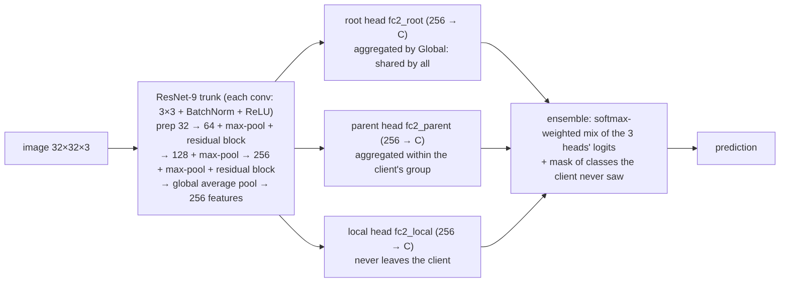

### 1 · FedHEP: one round

Diagram source (Mermaid)

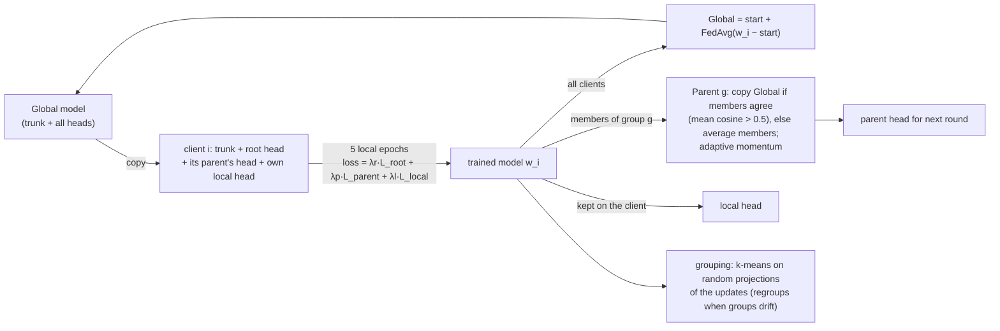

- **Label skew** of client i: $r_i = \dfrac{e^{H(y_i)} - 1}{C - 1}$ ($H$ = label entropy, $C$ = 100): 1 for uniform labels, 0 for a single class.
- **Head loss weights** (binomial): $\lambda_l = (1-r)^2$, $\lambda_p = 2r(1-r)$, $\lambda_r = a + (1-a)r^2$ with $a = \max(\tfrac{1}{2K}, |Y_i|/C)$. Skewed clients lean on their local head, balanced ones on the root head.
- **Prediction**: each client mixes its three heads' logits with weights $\mathrm{softmax}\big((-H_h - \beta\,\ell_h + \log\alpha_h)/T\big)$ (confidence, recent loss, learned prior $\alpha$); near-uniform clients use the root head only; classes the client never saw are masked out.
- **Accuracy reported** = pooled over all honest clients' own test images, each predicted by its own personalised ensemble (attackers are not scored; honest clients that a defense wrongly isolates **are** scored).
- Finding (Phase 1b): the grouping cosine runs on the full state, where BatchNorm's batch counters dominate, so in practice parents always copy Global.

### 2 · Defended FedHEP (the authors' defense): what changes
Every aggregation (parents and Global) is replaced by **SCCF**, soft-cosine consensus filtering, plus a trust ledger. Groups are random and fixed.

Diagram source (Mermaid)

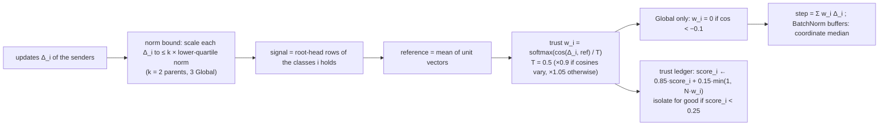

If the mean unit vector is short (norm < 0.2: no consensus), everyone gets $w_i = 1/N$. Phase 2 found the ledger **never isolates anyone**: attackers keep 0.5–0.8 of an equal share, so their score never falls below 0.25.

### 3 · FedHEP+ (Phase 3): what changes from Defended FedHEP
SCCF aggregation is kept; the trust ledger is replaced by **screening**, which decides who enters both tiers; groups are re-formed by weight-only similarity (BatchNorm buffers left out).

Diagram source (Mermaid)

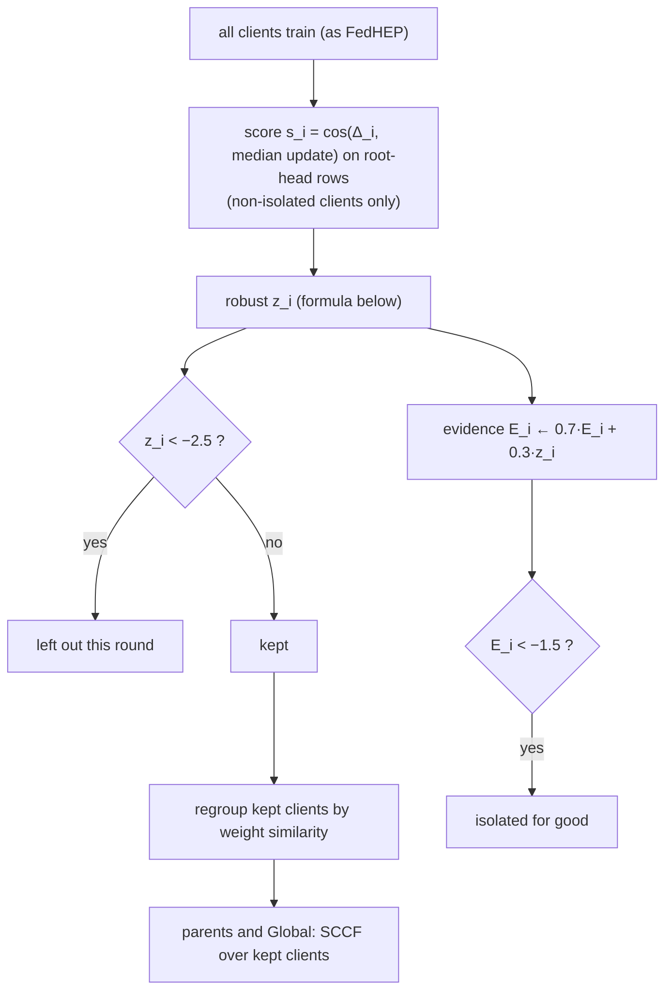

**Robust z.** With $s_i$ the cosine of client i's (norm-bounded) update to the coordinate-wise median update,
$$z_i = \frac{s_i - \operatorname{med}(s)}{\max\big(1.4826\cdot\mathrm{MAD}(s),\ 0.1\,|\operatorname{med}(s)|\big)}, \qquad \mathrm{MAD}(s) = \operatorname{med}_j\,|s_j - \operatorname{med}(s)|.$$
- $1.4826\cdot\mathrm{MAD}$ estimates the standard deviation from the middle of the data, so a few attackers cannot inflate it (a plain standard deviation would grow with them and hide them).
- **Why a z-score:** it is unchanged when every cosine shrinks together late in training (property-tested), which is exactly what made Defended FedHEP's fixed temperature and fixed 0.25 cut fade.
- **Floor** $0.1\,|\operatorname{med}(s)|$: stops a very tight consensus (tiny MAD) from turning small differences into huge z. Fewer than 5 senders are not screened.
- **Evidence** $E_i$ is an exponential moving average, so one bad round is not enough: two rounds at $z = -3$ give $E = -1.53$.

**Population variants tested (Phase 3b/3c):**
- *kept* (used): median and MAD over the clients not isolated. Removing a client shrinks this population, which can shrink the MAD.
- *full population*: median, MAD and reference over every client not banned, isolated ones included, so the yardstick never shrinks: $z_i = (s_i - \operatorname{med}_{\mathcal{A}} s) / \max(1.4826\,\mathrm{MAD}_{\mathcal{A}}(s),\ 0.1|\operatorname{med}_{\mathcal{A}} s|)$ with $\mathcal{A}$ = all non-banned clients. Did not reduce false isolations and let the last backdoor attacker stay in.
- *readmission* (isolated clients come back once $E_i > -0.75$) and a *cap* (at most a third left out per round): both worse (attackers came back late in training).

**Follow-up options (2026-11-12, defaults off):** absolute floor `plus.mad_floor` (scale $\ge$ floor), and *patience*: isolate only after $z < -1.5$ in this many consecutive rounds *and* $E_i < -1.5$.

### 4 · Drill-down (Phase 4/4b, off by default): extra steps after screening
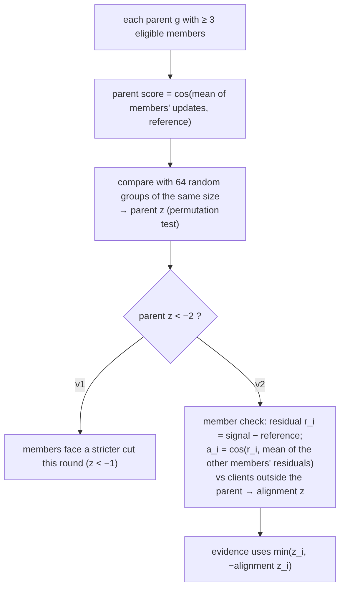

Diagram source (Mermaid)

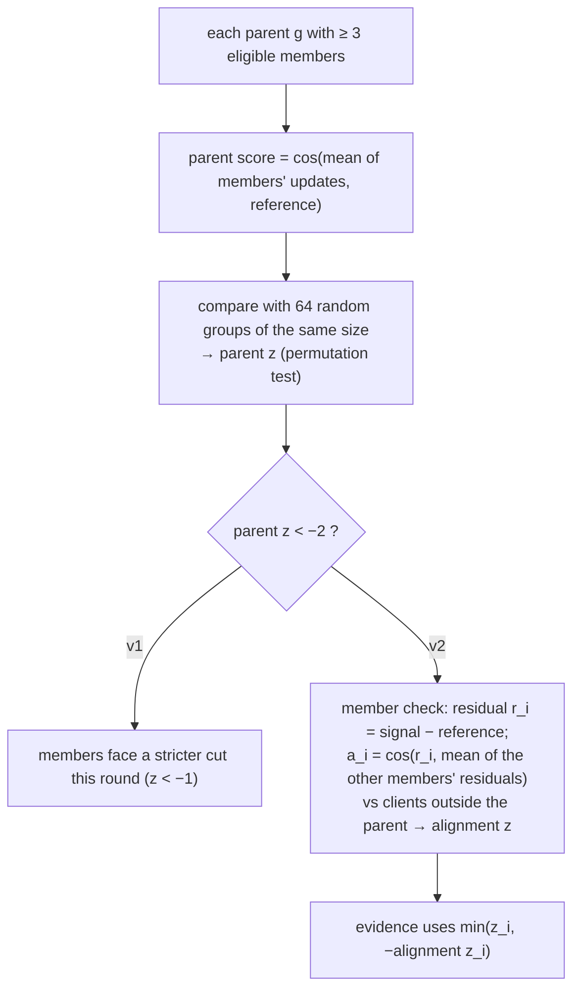

Neither version was adopted (D26, D28): honest members of a FedHEP parent are genuinely alike, so the member check also blames honest groups.

### 5 · Established rules in FedHEP's Global step (Phase 5)

Same FedHEP, Global replaced by one rule on weight updates (parents: SCCF over the clients the rule accepts): **median** and **trimmed mean** (drop 3 per side) [Yin et al. 2018]; **Bulyan** (f = 3: pick 9 by repeated Krum, then average the 3 values nearest the median per coordinate) [El Mhamdi et al. 2018]; **FLAME** (HDBSCAN on cosine distances keeps the majority cluster, clip to the median norm, add noise 0.001·S) [Nguyen et al. 2022]; **FLTrust** (trust = ReLU(cos(update, server update on 100 clean images)), rescale to the server norm) [Cao et al. 2021]. Design choices in D29.

### Attacks (what an attacker uploads)
With $w$ the round-start Global model and $\hat w_i$ the attacker's honestly trained model, $\Delta_i = \hat w_i - w$:
- **Sign flip:** upload $w - 1.5\,\Delta_i$. **Gradient ascent:** $w - 5\,\Delta_i$. **Random noise:** $w + \mathcal{N}(0, 2^2)$ per weight.
- **Label flip:** train on label $C - 1 - y$ instead of $y$, upload the result.
- **Backdoor (BadNets):** stamp a 3×3 white patch in the corner of 50% of its images and relabel them as class 0; optionally scale the update (×3 = "boosted").
- **ALIE** (Baruch et al. 2019): all attackers upload $w + \mu - z\,\sigma$, with $\mu, \sigma$ the per-weight mean and standard deviation of the attackers' own honest updates and $z = \Phi^{-1}\big((n - s)/n\big)$, $s = \lfloor n/2 + 1\rfloor - m$ ($z = 0.43$ for $n = 15$, $m = 3$): small enough to sit inside the honest spread.
- **Min-Max** (Shejwalkar & Houmansadr 2021): upload $w + \mu - \gamma\,\sigma$ (statistics of the honest updates) with the largest $\gamma$ such that $\max_j \|\Delta_{mal} - \Delta_j\| \le \max_{j,k} \|\Delta_j - \Delta_k\|$: as far as possible while never looking further from anyone than two honest clients do from each other.

### Comparison methods
- **No defense:** FedAvg (one ResNet-9, weighted average of all uploads) and undefended FedHEP (above).
- **Multi-Krum** (Blanchard et al. 2017, authors' setting): score each update by the summed squared distance to its $n - f - 2$ nearest others, average the $m = 3$ best.
- **Phase 5 rules** inside FedHEP (section 5).

### Detection metrics
Per round, flagged set $F$ (left out or isolated), attackers $A$, honest clients $H$: precision $= |F\cap A|/|F|$, recall $= |F\cap A|/|A|$, **false-isolation rate** $= |F\cap H|/|H|$; parent level the same with "malicious parent" = attacker majority. AUROC from each method's trust scores.

## 2026-11-06 · Phase 1a · FedAvg on CIFAR-100 (your Mac, MPS)
Setup: `configs/cifar100_fedavg.yaml`, 15 clients, 10,000 training / 3,000 test images, 25 rounds, 3 local epochs, seeds 42, 123, 7. About 4.5 min per run.

| Regime | RFL Lab per seed (42, 123, 7) | RFL Lab | Authors' code on your Mac | Difference | Paper |
|---|---|---|---|---|---|
| IID | 40.47, 38.17, 38.47 | **39.04 ± 1.25** | 38.04 ± 0.94 | +1.00 (1.1 SE) | 41.46 ± 0.36 |
| α = 0.05 | 28.83, 30.97, 28.53 | **29.44 ± 1.33** | 29.07 ± 2.05 | +0.37 (0.3 SE) | 36.29 |

Bottom-10% (IID): 33.75 vs the authors' 33.25.

**Verdict: pass.** Both regimes are within 2 SE of the authors' code. Neither implementation reaches the paper's FedAvg numbers; that gap is between the authors' released code and their paper (their archived "1st run" settings aren't in the archive), not a flaw in this code.

## 2026-11-06 · Phase 1b · FedHEP port: parity tests (cloud workspace, CPU)
100 tests in `tests/test_parity_fedhep.py` call the authors' functions directly:
- identical: multi-head model structure and initial weights, label skew r_skew, class mask and counts, head loss weights, random initial groups, k-means groups (low, medium and high noise), parent momentum (all three clip regimes);
- one full local round (5 epochs, all heads, ensemble-weight updates) from the same weights and seed ends at the same weights (to 1e-5), same ensemble weights and same last losses;
- the test-time ensemble gives the same per-client accuracy and the same test loss, for a skewed client (blended heads) and a near-uniform one (root head only).

Planted one-line deviations (prior mix, gradient anchor, class weights, IID threshold, temperature clamps, loss weight in head scoring, momentum clips, k-means cut to 1 or 2 iterations) each break at least one test. Cutting k-means to 3 iterations is not caught: on 15 points it has converged by then.

## 2026-11-06 · Finding · BatchNorm batch counters dominate FedHEP's grouping signal
The authors group clients, and decide whether parents average or copy the global model, by cosine similarity of the **full** flattened update. That vector includes BatchNorm's batch counter, which grows by the number of local steps (5 epochs × ⌈n/32⌉ ≈ 105 per layer for a CIFAR-100 client), identically signed for every client.

Measured on three synthetic clients with disjoint classes (one local round, `scripts/diag_update_norms.py`):

| Part of the update | Norm |
|---|---|
| weights | 5.2 – 6.3 |
| BatchNorm running statistics | 24 – 25 |
| batch counters | 99 – 113 |

| Cosine between clients computed on | values |
|---|---|
| full vector (authors) | 0.984, 0.985, 0.984 |
| without counters | 0.73, 0.68, 0.72 |
| weights only | 0.05, 0.05, 0.17 |

Checked on CIFAR-100 with the per-round `diagnostics` in `metrics.json` (Phase 1b runs below, all 3 seeds):
1. **Confirmed.** The first similarity grouping happens at round 2 in every seed.
2. **Confirmed.** Member agreement is 0.995–0.999 in every round of every seed, so parents copy the round-start global model in all 25 rounds and never average their members. The parent head is a momentum-smoothed copy of the global one. No later regrouping ever happens.
3. **Not supported.** I expected groups to follow dataset size (number of local steps); they don't (seed 42: one group spans 60 to 190 steps). Groups are lopsided, though: each seed has a one-client group and an 11- or 7-client group.

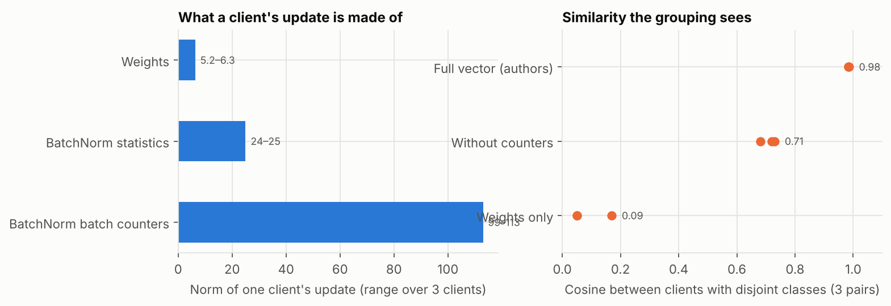

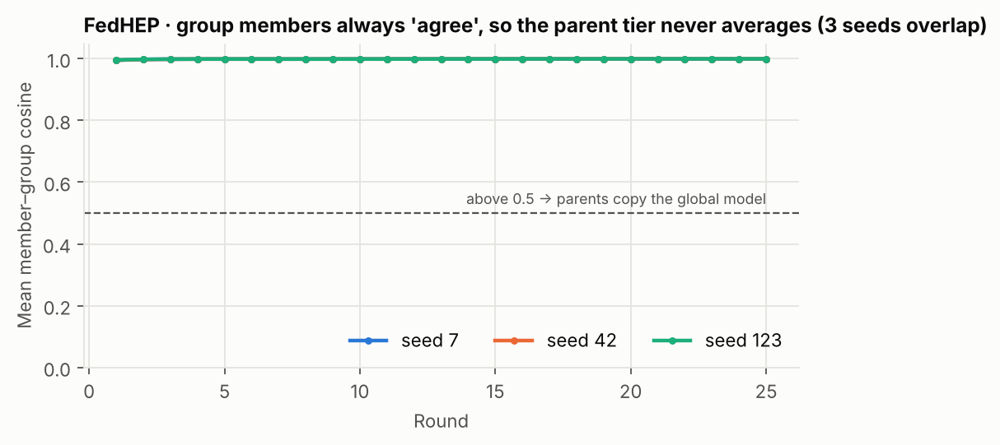

So FedHEP's middle tier, as run in the authors' code, contributes no group-specific information. It is kept unchanged in the faithful port (Phase 1). It is the first candidate fix for Phase 3: group on weights only.

## 2026-11-06 · Phase 1b · FedHEP on CIFAR-100, α = 0.05 (your Mac, MPS)
Setup: `configs/cifar100_fedhep.yaml`, 15 clients, 25 rounds, 5 local epochs, 3 groups, seeds 42, 123, 7. 12–13.5 min per run.

| Metric | RFL Lab per seed (42, 123, 7) | RFL Lab | Authors' code on your Mac | Difference | Paper |
|---|---|---|---|---|---|
| Accuracy | 65.87, 64.60, 66.07 | **65.51 ± 0.80** | 65.68 ± 0.57 | −0.17 (0.3 SE) | 65.49 ± 0.61 |
| Bottom-10% | 48.28, 48.66, 51.76 | **49.57 ± 1.91** | 50.23 ± 1.50 | −0.66 (0.5 SE) | 53.92 ± 0.63 |

**Verdict: pass.** Both metrics within 2 SE of the authors' code. Accuracy also matches the paper; bottom-10% is below the paper in both implementations.

## 2026-11-06 · Phase 1c · Defended FedHEP port: parity tests (cloud workspace, CPU)
149 tests in `tests/test_parity_defense.py` call the authors' functions directly:
- identical attacker choice (4 seeds × 4 rates) and identical uploads for all four attacks (same noise draw for random noise);
- a label-flipping attacker's full local round ends at the same weights and losses as their `_update_hep`;
- SCCF aggregation identical to their `DeltaSpaceRobustAggregator` with each tier's settings (parent: k = 2, no hard rejection; Global: k = 3, reject cosine < -0.1), with and without class masks, for honest groups, sign-flipped attackers, an inflated update and no consensus, for 1, 4 and 7 senders;
- trust weights identical over 80 random sender mixes that cross the no-consensus cut, the temperature switch and the hard-rejection threshold from both sides.

Planted deviations (quartile anchor, both temperature factors, variance switch, consensus cut, hard threshold, even-count median, class masking, sign-flip factor) each break at least one test. Not caught: a 1% change in the attacker-probability comparison.

### What the authors' Defended FedHEP actually does (read from their code, now ported as is)
- **Groups are random and never change.** The defended engine never calls the similarity grouping, so `cluster_method: update_similarity` in its config has no effect.
- **Trust looks only at the root head.** With class masks (always present), the cosine is computed on the root head's weight rows for the classes a sender holds; the trunk, the other heads and BatchNorm play no part in trust. BatchNorm buffers are combined by median.
- **Isolation is permanent and shared across tiers.** A score below 0.25 after the parent tier also removes the client from that same round's Global step.
- **Label flipping and class masks interact.** Flipped targets that fall in classes the attacker doesn't hold get logit -1e9 in the parent and local losses (loss values near 1e9; the gradients stay finite) and zero weight in the local loss.

## 2026-11-06 · Phase 1c · Defended FedHEP on CIFAR-100, α = 0.5, 30 rounds (your Mac, MPS)
Setup: `configs/cifar100_fedhep_defended.yaml`, 15 clients, 5 local epochs, 3 random groups, seeds 42, 123, 7. 7–8 min per run. Targets are the paper's attack table (the authors' archived runs, 3 seeds).

| Setting | Attackers (s42 / s123 / s7) | RFL Lab per seed (42, 123, 7) | RFL Lab | Paper | Difference | Bottom-10%: ours / paper |
|---|---|---|---|---|---|---|
| No attack | – | 49.07, 47.63, 48.47 | **48.39 ± 0.72** | 47.88 ± 0.46 | +0.51 (1.0 SE) | 41.44 / 41.57 |
| Sign flip, q = 0.2 | 3 / 1 / 3 | 38.80, 46.05, 37.39 | **40.75 ± 4.65** | 40.22 ± 3.24 | +0.53 (0.2 SE) | 33.63 / 33.17 |
| Random noise, q = 0.3 | 6 / 3 / 5 | 42.31, 45.30, 46.28 | **44.63 ± 2.07** | 44.53 ± 1.86 | +0.10 (0.1 SE) | 37.15 / 38.36 |

**Verdict: pass.** All three within 2 SE of the paper. The large sign-flip spread comes from the attacker count (one attacker for seed 123, three for the others).

### Finding · the trust ledger never isolates anyone; robustness comes from down-weighting

From the per-round `diagnostics` (global tier; "share" = trust × number of senders, 1 = an equal share):
- **No client was isolated in any of the 9 runs**, attackers included.
- **The signal is there.** Sign-flip attackers get a 0.47–0.56 share and noise attackers 0.77–0.86, against 0.96–1.28 for honest clients, from round 1 on.
- **But it can't reach the isolation threshold.** A score settles at the average of min(1, share), so an attacker is isolated only if its average share stays below 0.25. A share of 0.5 settles near 0.5, so attackers keep about half an equal share every round, which is what costs accuracy (48.4 → 40.8 under sign flip).
- **Late in training the defense can switch off.** At round 30, sign flip seed 42: all shares exactly 1.0 (the honest updates no longer agree enough, so everyone gets the same weight). Random noise seed 42: attackers get *more* weight than the least-trusted honest client (1.07–1.21 vs 0.69). Sign flip seed 7, by contrast, rejected its attackers outright at round 30.

These are the first targets for Phase 4: a detection rule that turns the existing separation into exclusion, and a reference that doesn't fade when honest updates get small.

## 2026-11-06 · Phase 1d · Baselines: parity tests (cloud workspace, CPU)
43 tests in `tests/test_parity_baselines.py`: two federated rounds of FedAvg, FedProx, Ditto, FedRep and SCAFFOLD clients (clean and label-flipping) end at the authors' uploads and personal models; three rounds of two SCAFFOLD clients match theirs (control variates active); Krum scores and Multi-Krum's selection match. Planted deviations in the FedProx and Ditto penalties, SCAFFOLD's control-variate step and server mean, and Krum's neighbour count each break a test. Real-data check deferred.

Noted while porting: the authors' Multi-Krum sets f from the **true** number of attackers (an oracle), averages only m = 3 of 15 models, and measures distances on the full state vector including BatchNorm batch counters. Kept as is in the port.

## 2026-11-06 · Phase 2 · Backdoor sanity check (synthetic data, CPU)
The backdoor works end to end: one attacking client alone reaches 100% attack success with 100% clean accuracy; six of six attacking clients reach 100% by round 9. With two of six attackers (50% of their images poisoned), FedAvg on the synthetic data washes it out (0% after round 1); a 3x boost gives an unstable 0–57%. Synthetic classes are far easier than CIFAR-100, so this says nothing about CIFAR-100 strength; the Phase 2 sweep includes a 3x-boosted row in case the plain backdoor is too weak there.

## 2026-11-06 · Fix · SCAFFOLD control-variate rounding
`test_scaffold_two_clients_identical` failed on your Mac (uploads 3e-4 apart by round 2) though it passed in the cloud. Cause: our control-variate step computed (w_start − w_end) / (steps × lr); the authors compute (1 / (steps × lr)) × (w_start − w_end). The two differ by one rounding step, and SCAFFOLD's local training amplifies that: at a higher learning rate the gap reached 3.6e-2 in one round. Now written the authors' way, the gap is below 1e-4 at both learning rates, and the test uses the higher-learning-rate schedule so it catches this kind of drift on any machine. Planted logic errors (step count, server mean) still fail it. No effect on the running Phase 2 sweep (no SCAFFOLD runs in it).

## 2026-11-07 · Phase 2 · Core benchmark on CIFAR-100 (your Mac, MPS)
Setup: `configs/sweeps/phase2_core.yaml`. α = 0.5, 15 clients, 30 rounds, each method with its own preset (FedAvg and Multi-Krum 3 local epochs, FedHEP variants 5). Exactly 3 of 15 clients attack (D15), the same 3 for every method in a given seed (seed 42: clients 0, 9, 11; seed 123: 4, 7, 10; seed 7: 5, 8, 10). Seeds 42, 123, 7; 72 runs. Defended FedHEP's clean runs reproduce Phase 1c to the digit (same seeds, same config): the pipeline is deterministic on your Mac.

### Accuracy
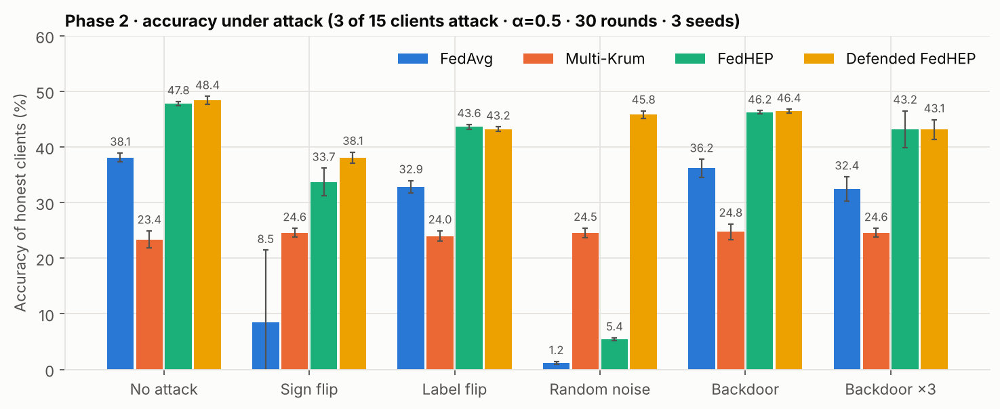

| Method | No attack | Sign flip | Label flip | Random noise | Backdoor | Backdoor ×3 |
|---|---|---|---|---|---|---|
| FedAvg | 38.1 ± 0.8 | 8.5 ± 12.9 (−29.6) | 32.9 ± 1.1 (−5.2) | 1.2 ± 0.3 (−36.9) | 36.2 ± 1.6 (−1.9) | 32.4 ± 2.2 (−5.7) |
| Multi-Krum | 23.4 ± 1.6 | 24.6 ± 0.8 (+1.2) | 24.0 ± 1.0 (+0.6) | 24.5 ± 0.9 (+1.2) | 24.8 ± 1.4 (+1.4) | 24.6 ± 0.8 (+1.2) |
| FedHEP | 47.8 ± 0.4 | 33.7 ± 2.5 (−14.1) | 43.6 ± 0.4 (−4.2) | 5.4 ± 0.3 (−42.3) | 46.2 ± 0.3 (−1.5) | 43.2 ± 3.3 (−4.6) |
| Defended FedHEP | 48.4 ± 0.7 | 38.1 ± 1.0 (−10.3) | 43.2 ± 0.4 (−5.2) | 45.8 ± 0.7 (−2.6) | 46.4 ± 0.4 (−2.0) | 43.1 ± 1.8 (−5.3) |

In brackets: change from the same method without attack.

### Backdoor success (lower is better)

| Method | Backdoor | Backdoor ×3 |
|---|---|---|
| FedAvg | 88.0 ± 2.3 | 92.0 ± 1.5 |
| Multi-Krum | 0.6 ± 0.0 | 0.7 ± 0.2 |
| FedHEP | 79.1 ± 4.9 | 75.2 ± 8.8 |
| Defended FedHEP | 78.7 ± 4.0 | 80.3 ± 7.3 |

0.6% is chance level for 100 classes. The plain backdoor is already strong on CIFAR-100 (unlike on the synthetic data); the 3× boost adds little.

### Detection

| Method | Measure (mean over rounds) | Sign flip | Label flip | Random noise | Backdoor | Backdoor ×3 |
|---|---|---|---|---|---|---|
| Multi-Krum | AUROC | 1.00 | 0.85 | 1.00 | 0.80 | 1.00 |
| Multi-Krum | recall / precision | 1.00 / 0.25 | 1.00 / 0.25 | 1.00 / 0.25 | 1.00 / 0.25 | 1.00 / 0.25 |
| Defended FedHEP | AUROC | 0.97 | 0.87 | 0.72 | **0.36** | 0.56 |
| Defended FedHEP | recall | 0.10 | 0.00 | 0.00 | 0.00 | 0.03 |

### What this shows
1. **Defended FedHEP is the most accurate method under every attack**, and the only one that survives random noise without giving up accuracy (45.8 vs 48.4 clean). Undefended FedHEP collapses under noise (5.4) like FedAvg (1.2): the personal heads don't protect the shared trunk.
2. **Its defense works by down-weighting, not removal, and only for some attacks.** Against label flipping and backdoors it is no better than undefended FedHEP (43.2 vs 43.6; success rate 78.7 vs 79.1). Its gain over FedHEP comes from sign flipping (+4.4) and noise (+40.4), where norm bounding and the BatchNorm median do the work.
3. **Its trust scores often rank attackers correctly but never act on it.** AUROC 0.97 for sign flip and 0.87 for label flip, yet recall stays near zero: the 0.25 isolation threshold is never reached, and late in training the scores lose their separation (trust chart). An adaptive cut on the same scores might remove most sign and label flippers: a concrete Phase 4 target.
4. **Backdoor attackers look *more* trustworthy than honest clients** to Defended FedHEP (AUROC 0.36). Half their data is normal, so their updates point with the consensus. Catching them needs a different signal than the direction of the root-head update.
5. **Multi-Krum "blocks everything" by throwing most clients away.** It always keeps 3 of 15, so each round it excludes all 3 attackers and 9 honest clients, and its accuracy stays near 24% with or without attack. It is also told the true number of attackers (the authors' oracle setting). Useful as a robustness reference, not an accuracy one.
6. **FedHEP's lower backdoor success than FedAvg (79 vs 88)** is probably its inference mask (clients without the target class can't predict it). Not yet checked per client.
7. **FedAvg under sign flipping is unstable across seeds** (8.5 ± 12.9): one seed recovers, two collapse.

Everything above describes existing methods. No new method has been tested yet; Phases 3 and 4 will be compared against these rows.

## 2026-11-07 · Phase 2 follow-up · Two questions answered from the logged runs
### How does Multi-Krum "know" the attackers, and why does it exclude clients with no attack?
It doesn't know them. Each round it scores every client by the summed squared distance to its nearest neighbours and **keeps** the m = 3 most central ones; the other 12 are left out every round, attack or not. That fixed m = 3 is why its accuracy sits at 23–25% with or without attack: each round's model is the average of only 3 clients.

Which 3? Distances are taken on the authors' full flat vector, where BatchNorm's batch counters dominate (same issue as FedHEP's grouping). A client's counters grow with its number of local steps, i.e. its dataset size, so Multi-Krum keeps the **median-sized** clients, mostly the same 3–4 every round:

Attackers are left out because they are never among the 3 most central: sign flipping and noise wreck their counters and weights, label flipping and backdoors move their weights. The perfect recall is mostly a side effect of keeping so few; the AUROC (0.80–0.85 for label flip and backdoor) is the real measure of separation.

### Why does Defended FedHEP's defense fade during training?
Three mechanisms, all visible in the logged trust values:

1. **Fixed temperature on shrinking cosines.** Weights are softmax(cosine / 0.5). As training goes on, honest clients drift apart (right panel: the spread of their weights doubles from 0.27 to 0.6), every cosine to the consensus shrinks, and the gap between attackers and honest clients in weight terms shrinks with it. Nothing in the rule adapts to that.
2. **No-consensus fallback.** When the mean direction of all updates gets short (< 0.2), SCCF gives everyone equal weight. That happens in 7–73% of runs in each of the last five rounds (left panel), i.e. no defense at the end of training.
3. **An isolation cut that is never reached.** A client is only removed when its momentum-averaged share stays below 0.25; attackers' shares sit at 0.5–0.8, so in 9 runs out of 9 (Phase 1c) and 15 of 15 (Phase 2) nobody was ever removed.

## 2026-11-07 · Phase 3 · FedHEP+: fixes to test (code done, runs need your Mac)
New method `fedhep_plus` (`src/rfl/server/fedhep_plus_server.py`, `src/rfl/defense/screening.py`): Defended FedHEP with its trust ledger replaced by **screening**, which answers each failure above:
- **Relative cut instead of fixed temperature and fixed threshold.** Each round, a client's cosine is turned into a robust z-score (distance from the median in units of the median absolute deviation, floored at 10% of the median so a tight consensus doesn't magnify tiny differences). The z-score is unchanged when all cosines shrink together (property-tested). Clients below z = −2.5 are left out that round; a running average of z below −1.5 removes them for good.
- **No fallback to equal weights:** screening always ranks.
- **Robust reference (option):** the coordinate-wise median update instead of the mean direction, which a coordinated minority can pull (tested).
- **Wider signal (option):** the whole weight update instead of only the root head's rows.
- **Regrouping by weight similarity (option):** real groups instead of random ones, with BatchNorm counters left out of the comparison. The same counter fix is available for plain FedHEP (`fedhep.similarity_on: weights`).
Parents and Global still aggregate the kept clients with SCCF exactly as Defended FedHEP does, so any difference comes from who is kept.

Plan: **screen with one seed** (seed 42, whose Phase 2 rows are the baseline with the same 3 attackers), then confirm the best variants with seeds 123 and 7.
- `configs/sweeps/phase3_screen.yaml`: 4 variants × 5 settings = 20 runs.
- `configs/sweeps/phase3_ceiling.yaml`: 3 clean runs on how high accuracy itself can go (weights-only grouping at α = 0.5 and α = 0.05; Defended FedHEP for 50 rounds instead of 30).

**On the 50–60% goal.** A perfect defense brings accuracy under attack back to the clean level of the same method (48.4% for Defended FedHEP at α = 0.5), not above it, since 3 of 15 clients' data is lost either way. Going higher needs a better clean model: the ceiling runs test two levers (a working parent tier, more rounds). For reference, FedHEP reaches 65.5% at α = 0.05 because each client then has only a few classes; at α = 0.5 with 10,000 training images in total, 60% would be a large jump, and the ceiling runs will show whether it is in reach.

## 2026-11-07 · Phase 3 · Screening runs, seed 42 (your Mac, MPS)
Setup: `phase3_screen.yaml` (20 runs) and `phase3_ceiling.yaml` (3 runs). α = 0.5, 30 rounds, attackers 0, 9 and 11 in every attacked run, the same as the seed-42 Phase 2 rows used as baseline. **One seed only:** treat differences under about 1.5 points (the Phase 2 seed spread) as unconfirmed.

| Variant (seed 42) | No attack | Sign flip | Label flip | Random noise | Backdoor (acc. / success) |
|---|---|---|---|---|---|
| Defended FedHEP (baseline) | 49.07 | 38.59 | 42.77 | 45.25 | 46.79 / 80.1% |
| robust z | 46.70 | 46.34 | 46.39 | 45.69 | 43.50 / 80.2% |
| z + median reference | 49.07 | 45.94 | 45.94 | 45.29 | 46.79 / **33.0%** |
| z + median, all weights | 47.43 | 44.60 | 42.97 | 44.27 | 45.33 / **0.3%** |
| z + median + regroup | 48.43 | **47.16** | **47.16** | 45.45 | **46.87 / 29.0%** |

What worked:
1. **Screening catches the attackers the old defense couldn't.** Every variant isolates the sign flippers in round 1 and the label flippers and noise attackers by round 2 (attackers' z between −3.6 and −10.8; honest clients stay above about −2 while all are present). Accuracy under sign flipping rises from 38.6 to 47.2 and under label flipping from 42.8 to 47.2.
2. **The median reference also exposes the backdoor**, which the mean-direction reference (and Defended FedHEP) cannot: attackers are isolated by rounds 9–13 and success falls from 80% to 29–33%. Scoring the whole weight update blocks it almost completely (0.3%) but isolates honest clients too.
3. **47.2 is the ceiling under attack here:** with the 3 attackers out in round 1, "z + median + regroup" under sign and label flipping is exactly the run of the 12 honest clients (identical numbers for both attacks, because the attackers never contribute anything).

What went wrong — a false-isolation cascade:

After the attackers are out (or with no attackers at all, for the mean-direction reference), honest clients start getting isolated from round 10–18 on, one after another: robust z with no attack ends with 9 of 15 isolated, and the noise and sign-flip runs end with 4–5 clients doing all the training. Each isolation shrinks the scored group, which shrinks its spread (MAD), which makes the next z more extreme (down to −37 in one run). With the median reference and all 15 honest clients present, z never went below −1.8 (no-attack runs), so the margin is real but thin.

Clean-accuracy ceiling (seed 42):

- Grouping on weights only (BatchNorm counters left out) lifts FedHEP from 47.6 to 48.8 at α = 0.5, and is within noise at α = 0.05 (65.1 vs 65.9). Worth confirming on three seeds.
- **Training longer doesn't help:** Defended FedHEP for 50 rounds peaks at 49.6 (round 40) and ends at 47.6; with 30 rounds it ends at 49.1. Its learning-rate schedule spreads over the run, so 30 rounds is already near the top.
- So at α = 0.5 with this data, clean accuracy sits at about 48–49% for all FedHEP variants, and the best possible result under attack is about 47% (12 honest clients). **50% would need a better base model, and 60% is not in reach in this setting**; it is in the α = 0.05 setting (65%), where each client has few classes.

## 2026-11-07 · Phase 3b · Stopping the cascade (code done, runs need your Mac)
Two changes to screening, both switchable:
- **Readmission:** isolated clients keep being scored every round, against the reference and spread of the clients currently kept, and come back once their evidence recovers above half the cut. Attackers (z of −4 to −11) stay out; an honest client wrongly removed can return.
- **Cap:** at most a third of the clients can be left out in one round (the lowest evidence go first), which bounds the damage of any cascade.
Plan: `phase3b.yaml` runs four variants on all three seeds (55 runs: "z + median + regroup" plus its readmission, readmission-and-cap and no-regroup versions), and `phase3b_fedhep_w.yaml` confirms the weights-only grouping on seeds 123 and 7 (2 runs).

## 2026-11-08 · Phase 3b · Three-seed results (your Mac, MPS)
Setup: `phase3b.yaml` (55 runs) and `phase3b_fedhep_w.yaml` (2 runs). α = 0.5, 30 rounds, 3 of 15 clients attack, seeds 42, 123, 7; Defended FedHEP's rows are the Phase 2 runs with the same seeds and attackers.

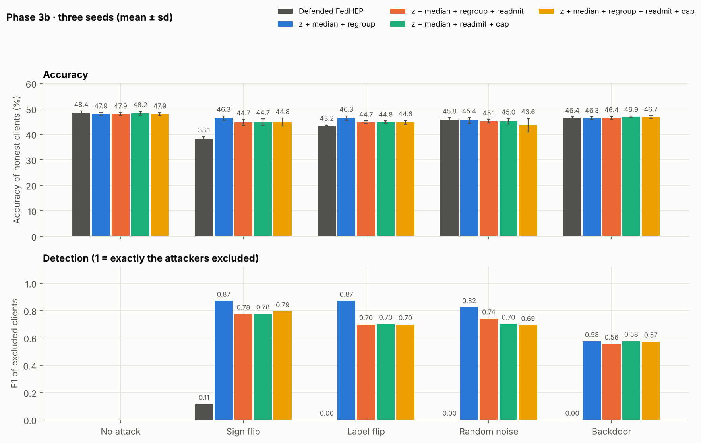

| Method (mean ± sd, 3 seeds) | No attack | Sign flip | Label flip | Random noise | Backdoor acc. | Backdoor success |
|---|---|---|---|---|---|---|
| Defended FedHEP | 48.39 ± 0.72 | 38.08 ± 1.01 | 43.23 ± 0.40 | 45.80 ± 0.70 | 46.42 ± 0.37 | 78.7% |
| **z + median + regroup** | 47.92 ± 0.60 | **46.34 ± 0.87** | **46.34 ± 0.87** | 45.41 ± 1.15 | 46.26 ± 0.56 | **20.8%** |
| ... + readmit | 47.91 ± 0.61 | 44.67 ± 1.16 | 44.69 ± 0.55 | 45.14 ± 0.67 | 46.40 ± 0.63 | 39.4% |
| z + median + readmit + cap (random groups) | 48.19 ± 0.82 | 44.71 ± 1.29 | 44.78 ± 0.47 | 45.05 ± 1.09 | 46.87 ± 0.25 | 62.1% |
| ... + regroup + readmit + cap | 47.93 ± 0.58 | 44.81 ± 1.49 | 44.62 ± 0.78 | 43.60 ± 2.64 | 46.71 ± 0.53 | 59.0% |

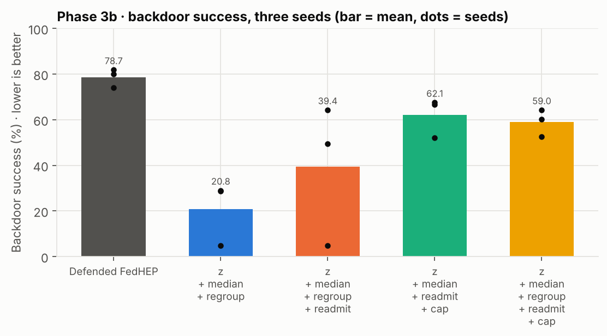

**Improvement over Defended FedHEP, paired by seed (z + median + regroup minus Defended FedHEP):**

| | seed 42 | seed 123 | seed 7 | mean |
|---|---|---|---|---|
| No attack | −0.63 | −0.37 | −0.40 | −0.47 |
| Sign flip | +8.57 | +7.69 | +8.51 | **+8.26** |
| Label flip | +4.39 | +2.90 | +2.03 | **+3.11** |
| Random noise | +0.20 | −0.04 | −1.31 | −0.38 |
| Backdoor accuracy | +0.08 | +0.08 | −0.64 | −0.16 |
| Backdoor success | −51.1 | −69.4 | −53.1 | **−57.9** |

The gains under sign flipping, label flipping and backdoors hold on every seed, by much more than the seed spread: this is the first confirmed improvement. The cost with no attack is small but also on every seed: false isolations (seed 123 isolates 7 honest clients with no attacker present).

What the two 3b changes did — both made things **worse**:
1. **Readmission brings attackers back.** Sign flippers isolated in round 1 returned in rounds 22–23 (seed 42). Late in training every update is small and its direction says little, so an attacker's z drifts back towards normal. Backdoor success rose from 21% to 39%, and sign-flip accuracy fell by 1.7.
2. **It doesn't stop the cascade either.** A removed honest client is judged against the same shrunken group that removed it, so it rarely qualifies to return.
3. **The cap lets backdoor attackers back in**: once false isolations fill the five places, attackers with milder evidence are put back (backdoor success 59–62%).
4. **Regrouping makes no clear difference** (readmit + cap with vs without regrouping: within 0.2 points everywhere except noise, where one seed fell to 40.6).
5. **Weights-only grouping for plain FedHEP:** 48.12 vs 47.78 on three seeds (+0.3); the +1.2 on seed 42 was mostly seed noise.

Root causes of the remaining false isolations, read from the logs:
- **Persistently atypical honest clients.** In the no-attack seed-123 run, client 6 scored z ≈ −1.5 every round from round 1 and crossed the evidence cut in round 7 with all 15 clients present: a genuine honest outlier, plausibly one with unusual classes.
- **The shrinking yardstick.** After that, each removal shrinks the scored group and its spread, so later z values get more extreme (down to −5.6).
Backdoor attackers sit at z ≈ −0.3 to −2.4, the same range as such honest outliers, so at this signal the evidence cut trades backdoor detection against false isolations.

## 2026-11-08 · Phase 3c · Full-population yardstick (code done, runs need your Mac)
New option `plus.population: all`: the median reference, median and spread behind z are taken over every client not banned, isolated ones included, so removing a client never shrinks the yardstick (median and MAD tolerate a minority of attackers in that population). Isolation stays permanent. `phase3c.yaml` (45 runs, three seeds) tests it with random groups at the current evidence cut (1.5), with a stricter cut (2.0, fewer honest removals, possibly fewer backdoor catches), and with regrouping for a direct comparison with the 3b winner.

## 2026-11-09 · Phase 3c · Full-population yardstick: three-seed results (your Mac, MPS)
Setup: `phase3c.yaml`, 45 runs, same seeds and attackers as before.

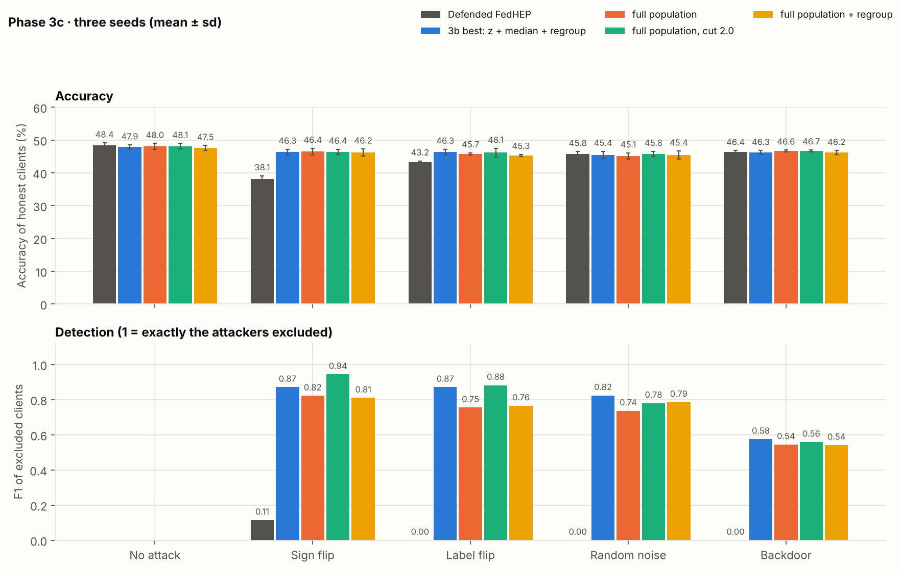

| Method (mean, 3 seeds) | No attack | Sign flip | Label flip | Noise | Backdoor acc. | Backdoor success | Honest clients isolated (sum over 15 runs) |
|---|---|---|---|---|---|---|---|
| Defended FedHEP | 48.39 | 38.08 | 43.23 | 45.80 | 46.42 | 78.7% | 0 |
| **3b best: z + median + regroup** | 47.92 | 46.34 | **46.34** | 45.41 | 46.26 | **20.8%** | 46 |
| full population | 48.00 | **46.44** | 45.72 | 45.13 | 46.65 | 54.1% | 87 |
| full population, cut 2.0 | **48.09** | 46.41 | 46.12 | **45.76** | **46.70** | 74.2% | **36** |
| full population + regroup | 47.54 | 46.17 | 45.30 | 45.43 | 46.17 | 52.1% | 82 |

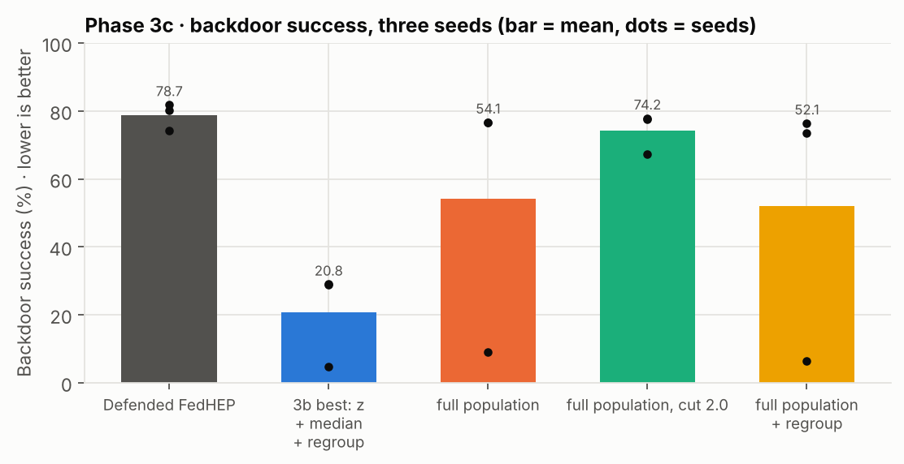

**No further improvement.** The full-population yardstick did not reduce false isolations (87 vs 46 with cut 1.5) and it lost most of the backdoor protection. All variants keep the sign- and label-flip gains (+8 and +2 to +3 on every seed).

Why the backdoor got through: a backdoor needs only **one** remaining attacker. In seed 42, two backdoor attackers were isolated in round 10 under both yardsticks, but the third (z ≈ −0.5) stayed in with the full-population yardstick, so success stayed at 77%. With the 3b yardstick the group shrank after the first two removals and the third attacker's z fell to −1.8; it was isolated in round 13 and success fell to 29%. The shrinking yardstick that causes false isolations is the same thing that catches the last mild attacker. At this signal, catching backdoors and protecting unusual honest clients pull against each other.

Two more observations:
- Wrongly isolated honest clients lose almost nothing themselves (+0.4 personal accuracy on average vs Defended FedHEP, across 46 such cases); they still train their own heads on the global model. The cost is the data the others lose (−0.5 accuracy with no attack).
- The fairness gain is large: bottom-10% accuracy under sign flipping goes from 31.2 (Defended FedHEP) to 40.8.

### Phase 3 conclusion
**FedHEP+ = Defended FedHEP with screening (median reference, robust z on the kept clients, permanent isolation) and regrouping** is the Phase 3 result. Against the paper's Defended FedHEP, on every seed: sign flip +8.3, label flip +3.1, backdoor success 79% → 21%; no change under noise; −0.5 with no attack. It is a solid, reproducible improvement in robustness, not a breakthrough in accuracy: clean accuracy stays at about 48% (the ceiling runs showed the base model, not the defense, sets that limit).

## 2026-11-09 · Phase 4 · Drill-down defense (result: not an improvement)
Built on FedHEP+ (`plus.drill_down: true`):
1. Clients are screened as in FedHEP+.
2. **Parent check.** Each parent's mean update (over its kept members) is scored against the same reference and compared with random groups of the same size (a permutation test, 64 draws, its own random generator so training randomness is untouched). A parent is flagged when its z < −2.
3. **Drill-down.** Members of a flagged parent face a stricter cut that round (z < −1 instead of −2.5).

Why it might help: attackers pushing one direction (one backdoor) stand out more together than one by one. In a synthetic test, three such attackers each looked normal (z > −0.4, far from the −2.5 cut) while their parent scored z between −2.5 and −4.3 in 8 of 8 trials; honest parents averaged about −0.8, though one of 16 reached −2.3 (it would be flagged; its members would then face the stricter cut for that round).

Plan: `phase4.yaml`, 42 runs on three seeds, FedHEP+ with and without the drill-down (random groups, so attacker placement holds), under sign flipping, label flipping and backdoors, with all three attackers in one parent (concentrated: a malicious parent) or one per parent (spread: the drill-down should add nothing). Parent-level precision/recall/F1 are recorded every round.

### Results (42 runs on your Mac, seeds 42 / 123 / 7, 30 rounds, 3 of 15 attackers, 3 random parents)
"Base" = FedHEP+ screening without regrouping (random groups, so the placement holds); "drill" = the same plus the drill-down. Same seed = same data, attackers and groups, so the differences are paired.

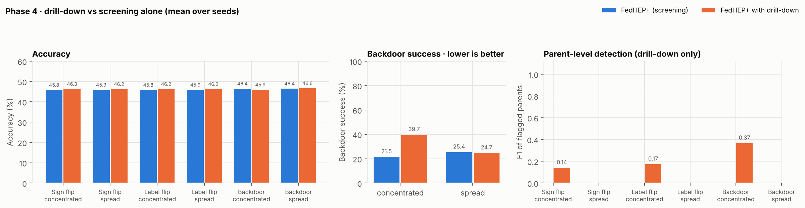

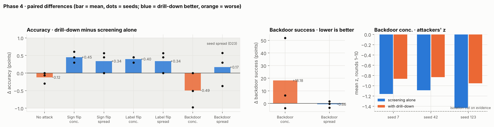

| Setting | Base acc. | Drill acc. | Δ per seed (42 / 123 / 7) | Backdoor success base → drill | Honest clients isolated (3 seeds) base → drill | Parent flags: rounds flagged / precision / recall |
|---|---|---|---|---|---|---|
| No attack | 48.07 | 47.94 | −0.30 / −0.07 / 0.00 | | 10 → 8 | 11, 11, 3 of 30 / **0** / – |
| Sign flip, concentrated | 45.81 | 46.26 | +0.61 / +0.45 / +0.30 | | 14 → 10 | 7, 3, 9 / 0.66* / 0.14 |
| Sign flip, spread | 45.85 | 46.19 | +0.57 / +0.45 / 0.00 | | 23 → 17 | 9, 3, 5 / 0 / – |
| Label flip, concentrated | 45.81 | 46.21 | +0.45 / +0.45 / +0.30 | | 14 → 17 | 9, 4, 10 / 0.67* / 0.18 |
| Label flip, spread | 45.85 | 46.19 | +0.57 / +0.45 / 0.00 | | 23 → 17 | 9, 3, 5 / 0 / – |
| Backdoor, concentrated | 46.41 | 45.92 | −0.97 / 0.00 / −0.51 | **21.5% → 39.7%** (22.0→73.9, 2.4→8.8, 40.2→36.5) | 9 → 10 | 11, 11, 17 / **0.85** / 0.37 |
| Backdoor, spread | 46.43 | 46.60 | −0.37 / +0.57 / +0.30 | 25.4% → 24.7% | 18 → 18 | 6, 4, 5 / 0 / – |

\* Sign and label flippers are isolated by screening in round 1 (their z is far below −2.5), so from round 2 on these runs contain honest clients only (sign- and label-flip base rows are identical for that reason). Parent 0 still counts as "malicious" because its isolated attackers stay assigned to it, so those precision values say little.

**Verdict under D23: not an improvement.** No setting clears the bar (same sign on all three seeds and a mean above ~1 point):
- Sign and label flipping: +0.3 to +0.45 on average, with one seed at 0.00 in the spread cases. The attackers were already gone after round 1, so this is not better defense; it is the drill-down changing which honest clients get left out (fewer honest isolations, 14 → 10 and 23 → 17), and it is inside the seed spread.
- **Concentrated backdoor, the case the drill-down was designed for, got worse**: success 21.5% → 39.7% on average (seed 42: 22% → 74%) and accuracy −0.5.
- With no attack it flags parents in up to 11 of 30 rounds (all false), costing −0.12.

### Why it did not work
1. **The parent check works; the member check doesn't.** For the concentrated backdoor the attacker parent stands out clearly (group z −2.3 to −7.3 in rounds 1–14, parent precision 0.85, and 1.0 on seed 42). Inside it, though, attackers and honest members have similar individual z (about −0.5 to −1.5), so the −1 cut leaves out some attackers, some honest members, and misses attackers in other rounds. The coordination is visible only in the sum.
2. **Leaving attackers out for one round made them harder to catch.** Over rounds 1–10 the attackers' mean z was −1.09 / −1.44 / −1.16 with screening alone and −0.83 / −0.95 / −0.86 with the drill-down (paired chart, right). It moved toward normal on all three seeds. Evidence therefore built up more slowly. Attackers were isolated later (seed 123: round 7 → 14), and on seed 42 one of them (client 0) was never isolated, which is why its backdoor reached 74%. A likely reason, not yet tested: when the backdoor is in the global model, honest training on clean data partly undoes it, so honest updates point *against* the attackers and the contrast is large. Keeping the backdoor out of the global model removes that contrast. Whatever the cause, the one-round exclusion trades the evidence the permanent isolation needs for a short-term cleaner average.
3. **Honest parents look "coordinated" too under non-IID data.** The permutation test assumes members are exchangeable with random clients, but a fixed group of honest clients with the same data stays atypical round after round. False flags came from a 2-member parent (seed 42, 11 rounds) and a 5-member parent (seed 123, 11 rounds). Random group sizes were uneven (2 / 5 / 8 on seed 42), and a 2-member mean is barely a group.

### What did hold up
- Parent-level detection of a coordinated backdoor is real: precision 0.85, recall 0.37 on average over rounds (recall is limited because the flags stop once attackers are isolated or their parent's mean drifts back).
- The drill-down never hurt sign/label-flip defense: screening catches those attackers first.

The drill-down stays in the code as an option (`plus.drill_down`, off by default). FedHEP+ (Phase 3) remains the best method.

## 2026-11-09 · Phase 4b · Drill-down v2 (result: not an improvement)
A redesign aimed at the three reasons v1 failed (`plus.drill_mode: evidence`):
1. **No one-round exclusion.** v1's single-round removals made backdoor attackers look more normal and delayed their isolation. In v2 a flagged parent removes nobody directly; it only adds evidence, and the permanent-isolation rule (evidence below −1.5) decides.
2. **A member check that looks for the shared direction.** For each member of a flagged parent: residual = its update minus the reference; score = cosine of that residual with the mean of the *other* members' residuals (leave-one-out, so a member can't line up with itself). The null is the same cosine for clients outside the parent against each leave-one-out direction. A member's alignment z is measured against that null, and its evidence update uses min(z, −alignment z). Attackers that share a backdoor line up with each other; an honest member next to them doesn't; and if one odd honest client makes a parent look odd, nobody lines up with anybody.
3. **Parents need at least 3 eligible members** (v1's false flags included a 2-member parent).

Synthetic check (`tests/test_fedhep_plus.py`, 3 coordinated attackers + 2 honest in a parent, 8 trials): attackers' alignment z ≥ 4.6 even with a weak shared direction (≥ 22.9 at medium strength), honest members average 0.8 (max 3.0 at the weakest strength). With one very atypical honest client in a parent, no member exceeds 1.7.

Runs: `phase4b.yaml`, 24 runs: v2 with the parent flag as a gate, and v2 checking every parent (does the flag help at all?), under no attack, concentrated label flipping, and concentrated and spread backdoors, seeds 42 / 123 / 7. Baseline = the Phase 4 `p4__base` runs (identical config, so not rerun).

**Success criteria, set before the runs:** concentrated-backdoor success clearly below screening alone (21.5%) on average, with no seed more than 2 points worse; accuracy no more than 1 point below screening alone in any setting (D23); no more honest clients isolated than screening alone with no attack.

*(Results in the next entries.)*

## 2026-11-09 · Fix · Phase 4b sweep stopped after 12 runs
The `p4b__v2_all` runs crashed in round 1: `plus.group_cut: -1.0e9` was read as text, because PyYAML only reads exponent notation as a number when the exponent has a sign (`-1.0e+9`). The 12 `p4b__v2` runs had already finished and are valid (their cut is 2.0). Fixed in the sweep file. Config loading now rejects text in any numeric setting, and a test loads every sweep file, so this kind of mistake fails before any run starts.

The same check run also hit a rare case in an older randomised test: with five almost identical scores (spread about 2e-12), `robust_z`'s fixed "no spread" cutoff of 1e-12 gave different answers for the same scores at half the scale. The cutoff is now relative to the scores' size (1e-9 of the largest). Real cosine scores never come near this, so no earlier result changes.

## 2026-11-09 · Phase 4b · Drill-down v2: three-seed results (your Mac, MPS)
24 runs (`phase4b.yaml`), compared with the Phase 4 runs of screening alone and v1 (same config, seeds 42 / 123 / 7, same attackers and random groups).

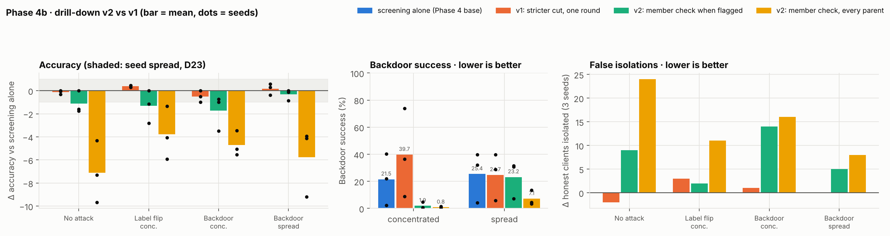

| Setting | Measure | Screening alone | v1 | **v2 (when flagged)** | v2 (every parent) |
|---|---|---|---|---|---|
| No attack | accuracy | 48.07 | 47.95 | 46.95 (0.00 / −1.60 / −1.77) | 40.97 |
| | honest clients isolated (3 seeds) | 10 | 8 | 19 | 34 |
| Label flip, conc. | accuracy | 45.81 | 46.21 | 44.49 (0.00 / −2.82 / −1.14) | 42.03 |
| Backdoor, conc. | accuracy | 46.42 | 45.92 | 44.69 (−0.73 / −3.48 / −0.98) | 41.73 |
| | **backdoor success** | 21.5% (22.0 / 2.4 / 40.2) | 39.7% | **1.9% (0.4 / 0.6 / 4.8)** | 0.8% |
| | attackers isolated in round | 7–13 | 7–14, one never | **2–3** (one at 6, one at 12) | |
| | honest clients isolated | 9 | 10 | 23 | 25 |
| Backdoor, spread | accuracy | 46.43 | 46.60 | 46.11 | 40.68 |
| | backdoor success | 25.4% | 24.7% | 23.2% | 7.1% |

**Against the criteria set before the runs:**
- Concentrated-backdoor success clearly lower, no seed more than 2 points worse: **met** (21.5% → 1.9%, lower on every seed).
- Accuracy no more than 1 point below screening alone in any setting: **not met** (−1.1 with no attack, −1.3 label flip, −1.7 backdoor).
- No more false isolations than screening alone with no attack: **not met** (19 vs 10).

**Verdict: not an improvement.** v2 fixes what v1 got wrong about backdoors, but it costs accuracy everywhere, including with no attack. Checking every parent is much worse (−7 with no attack, 34 honest clients isolated), so the parent flag is a necessary gate, but not enough of one.

### What worked
The member check finds coordinated backdoor attackers. With all members present (rounds 1–5), the attackers' alignment z had median 3.1 against 0.5 for honest clients in the same runs. Once evidence replaced the one-round exclusion, attackers were isolated in rounds 2–3 instead of 7–13, before the backdoor could take hold. This confirms the Phase 4 reasoning: exclusion hid the attackers, evidence doesn't.

### What failed: honest members of the same parent line up with each other too
- With no attack and every parent checked, honest members' alignment z has median 1.0 (top 10%: 2.6), where the null (clients outside the parent) is centred on 0 by construction. Members of a parent are systematically more alike than random clients, attack or not. In parents flagged by mistake, it is higher still (median 2.8 in v2 with no attack), so whole parents get isolated together: seed 123 lost clients 9, 11 and 13 in round 8, and seed 7 lost 8 and 12 in round 8.
- This overlaps the attackers' range (median 3.0–3.6), so no cutoff separates them. Raising the cut would let attackers through, and lowering it would isolate more honest parents.
- The likely cause, not tested directly: in FedHEP, members of a parent train from the same parent head, and that head shapes the shared trunk's update. Their root-head updates therefore share a parent-specific component. This would also explain v1's repeated false flags of honest parents. The synthetic tests missed it because their honest clients were independent by construction.
- Each false isolation also shrinks the population that the next z-scores are measured against, the cascade seen in Phase 3. Most extra honest isolations come in rounds 8–25, after the attackers are already gone.

### Phase 4 conclusion
Two drill-down designs, 66 CIFAR-100 runs. Detecting the parent works, and v2 shows that finding the members who share a parent's unusual direction is possible. But in FedHEP, members of a parent are genuinely alike, so the same check that catches coordinated attackers also blames honest groups. Neither design met the criteria. **FedHEP+ (Phase 3) remains the best method.** Both drill-down modes stay in the code as options, off by default.

## 2026-11-09 · Phase 5 · Established rules inside FedHEP (code done, runs need your Mac)
New method `fedhep_robust` (`src/rfl/defense/classic.py`, `src/rfl/server/robust_fedhep_server.py`): Defended FedHEP with its Global step replaced by one established rule. Design choices in D29.

| Rule | Paper | What it does here |
|---|---|---|
| Median | Yin et al., ICML 2018 | coordinate-wise median of the weight updates |
| Trimmed mean | Yin et al., ICML 2018 | per coordinate, drop the 3 largest and 3 smallest, average the rest |
| Bulyan | El Mhamdi et al., ICML 2018 | pick 9 updates by repeated Krum (f = 3); per coordinate, average the 3 closest to the median |
| FLAME | Nguyen et al., USENIX Security 2022 | HDBSCAN on cosine distances (min cluster 8 of 15) keeps the majority cluster; clip to the median update norm; average; add N(0, (0.001 S)²) |
| FLTrust | Cao et al., NDSS 2021 | server trains on 100 clean images; trust = ReLU(cos(update, server update)); updates rescaled to the server's norm; trust-weighted average |

Checks (`tests/test_robust_rules.py`, 13 tests): median and trimmed mean of identical updates return that update; trimmed mean drops exactly k extremes per coordinate; Bulyan keeps n − 2f honest updates and refuses n < 4f + 3; FLAME rejects sign-flipped updates, never exceeds the median norm, and adds noise of the stated size; FLTrust gives opposed updates zero trust, and with nobody trusted takes no step; each rule runs end to end inside FedHEP; FLTrust's server training leaves the clients' random draws untouched (identical uploads to a median run).

Noted while testing: FLAME's HDBSCAN also leaves out some honest updates as noise (4 of 12 in the synthetic test), as the paper reports. It only guarantees that a majority is admitted.

Plan: `phase5_screen.yaml`, seed 42, 30 runs, the same five settings and attackers as Phase 2/3b. Rules that look competitive with FedHEP+ get seeds 123 and 7.

Charts will compare each rule with Defended FedHEP and FedHEP+ once the runs exist.

## 2026-11-10 · Phase 5 · Screen results, seed 42 (your Mac, MPS)
30 runs (`phase5_screen.yaml`), same seed and attackers (0, 9, 11) as the Phase 2/3b baselines. **One seed only**: differences under about 1.5 points are unconfirmed. Each cell: accuracy / backdoor success; "fp" = honest clients flagged in the last round; "rec" = mean detection recall over rounds. (No chart yet: `plot_results.py` has no Phase 5 figure; to add next session.)

| Method | No attack | Sign flip | Label flip | Noise | Backdoor |
|---|---|---|---|---|---|
| Defended FedHEP | **49.07** | 38.59 (rec 0.13) | 42.77 (rec 0) | 45.25 | 46.79 / 80.1% |
| **FedHEP+ (Phase 3)** | 48.43 | **47.16** (rec 1.0) | **47.16** (rec 1.0) | 45.45 (fp 7) | **46.87** / 29.0% |
| Median | 47.70 | 39.56 (rec 0) | 44.27 | **46.51** | 46.63 / 76.4% |
| Trimmed mean | 48.33 | 39.44 | 43.99 | 45.69 | 46.02 / 77.5% |
| Bulyan | 44.23 (fp 6) | 43.54 | 43.70 | 44.64 | 45.29 / **0.5%** |
| FLAME (models) | 41.10 (fp 7) | 44.15 | 42.28 | 44.15 | 44.76 / **0.4%** |
| FLAME (updates) | 45.60 (fp 7) | 44.27 | 42.77 | 43.30 | 44.39 / 26.4% |
| FLTrust | 47.90 | 45.86 (fp 8) | 43.14 (rec 0.41) | 45.86 | 45.45 / 73.8% |

**Verdict: no established rule beats FedHEP+ overall.** FedHEP+ is best under sign and label flipping (by 1.3 to 3.6 points over the best rule) and has the best accuracy under backdoor. Noise is within one-seed noise for all methods.
- **Median and trimmed mean** are no better than Defended FedHEP: they never exclude anyone, so the sign flippers and backdoor attackers stay in (backdoor success 76–78%).
- **Bulyan and FLAME (models) block the backdoor almost completely** (0.5% / 0.4%, vs 29% for FedHEP+), but they pay for it everywhere: −4.8 / −8.0 points with no attack (vs Defended FedHEP), because each round they leave out 6–7 honest clients (Bulyan always keeps 9 of 15; FLAME's HDBSCAN marks some honest clients as noise).
- **FLAME on models beats FLAME on updates for backdoors** (0.4% vs 26.4%), so the paper's equations are the better reading here; on updates it keeps more accuracy with no attack.
- **FLTrust** keeps clean accuracy (47.90) but catches label flippers poorly (recall 0.41) and does not stop the backdoor (73.8%). With 100 images for 100 classes, its server update is a weak reference.

**Direction for next steps:** FedHEP+ is still the method to beat. Its weak spot (backdoor 29%) is exactly where Bulyan/FLAME are strong, so a hybrid is the natural candidate: FedHEP+ screening plus a FLAME-style cluster check used only to add evidence (not to exclude every round). Before that, confirm Bulyan and FLAME (models) on seeds 123 and 7.

## 2026-11-12 · Phase 5 · Three-seed results and harder settings (your Mac, MPS)
105 runs: every rule on seeds 42 / 123 / 7 (`phase5_screen`, `phase5_confirm`, `phase5_rest`), plus FedHEP+, Defended FedHEP and FLAME under harder settings (`phase5_extra`). Same attackers per seed for every method. Charts: `python scripts/plot_followup.py outputs`.

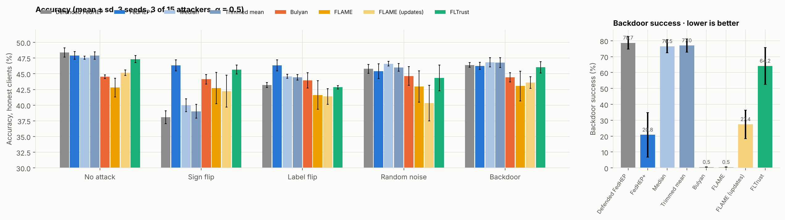

| Method (mean ± sd, 3 seeds) | No attack | Sign flip | Label flip | Noise | Backdoor acc. | Backdoor success | Honest flagged / round |
|---|---|---|---|---|---|---|---|
| Defended FedHEP | **48.39 ± 0.72** | 38.08 ± 1.01 | 43.23 ± 0.40 | 45.80 ± 0.70 | 46.42 ± 0.37 | 78.7% | 0 |
| **FedHEP+** | 47.92 ± 0.60 | **46.34 ± 0.87** | **46.34 ± 0.87** | 45.41 ± 1.15 | 46.26 ± 0.56 | 20.8% | 1.1–1.9 |
| Median | 47.57 ± 0.26 | 39.97 ± 1.03 | 44.59 ± 0.32 | **46.59 ± 0.37** | 46.82 ± 0.73 | 76.5% | 0 |
| Trimmed mean | 47.91 ± 0.59 | 39.03 ± 1.12 | 44.44 ± 0.44 | 46.01 ± 0.60 | 46.77 ± 0.80 | 77.0% | 0 |
| Bulyan | 44.52 ± 0.28 | 44.13 ± 0.76 | 43.94 ± 1.23 | 44.64 ± 1.50 | 44.44 ± 0.75 | **0.5%** | 3.0–6.0 |
| FLAME (models) | 42.81 ± 1.49 | 42.72 ± 2.50 | 41.61 ± 2.28 | 42.97 ± 2.50 | 43.05 ± 2.37 | **0.5%** | 2.6–5.1 |
| FLAME (updates) | 45.16 ± 0.45 | 42.24 ± 2.55 | 41.39 ± 1.24 | 40.31 ± 2.83 | 43.60 ± 0.92 | 27.4% | 2.3–6.4 |
| FLTrust | 47.33 ± 0.55 | 45.66 ± 0.71 | 42.85 ± 0.25 | 44.34 ± 2.06 | 46.04 ± 0.90 | 64.2% | 2.6–3.6 |

**Verdict: FedHEP+ remains the best all-round method; no established rule beats it.**
- FedHEP+ is best under sign and label flipping (+0.7 to +7.3 over every rule). Under noise all methods are within about 1 point.
- **Bulyan and FLAME stop the backdoor on every seed (0.5%)**, but they leave out 3–6 honest clients every round, costing 3.9 to 5.6 points with no attack (vs Defended FedHEP). FedHEP+ lets 21% through on average.
- Median and trimmed mean never remove anyone: sign flippers and backdoors get through.
- FLTrust keeps clean accuracy but is weak against label flipping and backdoors; 100 root images for 100 classes is a thin reference.
- FLAME is much better on models than on updates for backdoors (0.5% vs 27.4%): the paper's equations are the right reading here.

### Harder settings
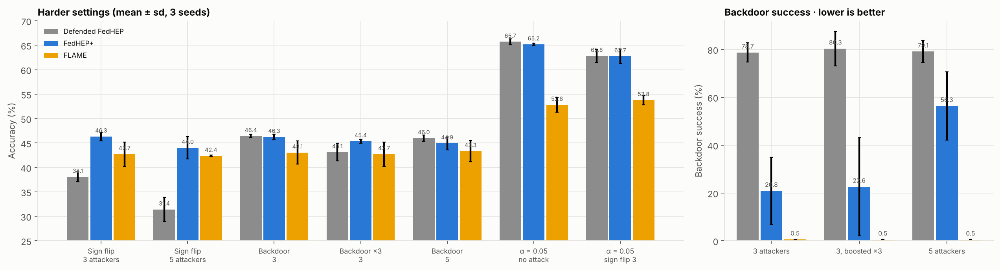

| Setting (3 seeds) | Defended FedHEP | FedHEP+ | FLAME |
|---|---|---|---|
| Sign flip, **5** attackers | 31.41 ± 2.46 | **44.01 ± 2.28** | 42.36 ± 0.15 |
| Backdoor ×3 boost: acc. / success | 43.12 / 80.3% | **45.37** / 22.6% | 42.72 / **0.5%** |
| Backdoor, **5** attackers: acc. / success | **45.98** / 79.1% | 44.93 / 56.3% | 43.35 / **0.5%** |
| α = 0.05, no attack | **65.71 ± 0.60** | 65.18 ± 0.22 | 52.81 ± 1.51 |
| α = 0.05, sign flip 3 | 62.81 ± 1.30 | 62.75 ± 1.48 | 53.79 ± 0.99 |

- FedHEP+'s sign-flip gain **grows** with more attackers (+12.6 at 5 of 15).
- Its backdoor protection **weakens** with 5 attackers (56% success): five colluders move the median reference toward themselves. FLAME holds at 0.5%.
- At **α = 0.05 the gain disappears** (62.75 vs 62.81). There, each client's personal heads carry most of the accuracy, so even Defended FedHEP loses only 2.9 points to sign flipping. FLAME collapses at α = 0.05 (−13 points with no attack): with very different clients, HDBSCAN's majority cluster leaves out many honest ones (7 per round with no attack).

**Direction:** FedHEP+'s weak spot (backdoor, worse with more colluders) is FLAME/Bulyan's strength, and their weak spot (honest clients left out) is FedHEP+'s strength. A hybrid that uses a FLAME-style cluster check only as *evidence* in FedHEP+'s screening is the natural next candidate.

## 2026-11-12 · Answers to the professor's questions
Partly from a follow-up session on your Mac (`docs/DECISIONS.md`, screening review, code and tests verified here: all 81 tests pass), partly new. Full-scale runs still pending are marked "Pending:".

**1. False-isolation cascade: is it the MAD shrinking?** *Plausible, not yet proven.* The historical runs logged z but not the raw scores or the MAD, so the denominator cannot be recovered. What the logs do show:
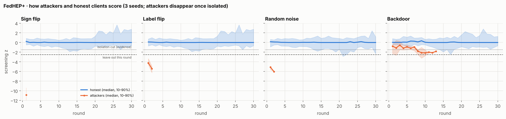
- The spread of honest clients' z widens from about round 20 (the blue band), which is what a shrinking MAD would produce.
- But the first false isolations are not all MAD effects: in the no-attack seed-123 run, client 6 scored z ≈ −1.5 every round from round 1 and was isolated in round 7 with all 15 clients present, a persistently atypical honest client.
- A floor already exists ($0.1\,|\operatorname{med}\,s|$), but it is relative, so it shrinks with the scores. The follow-up added an absolute floor (`plus.mad_floor`) and per-round logging of median, MAD and effective denominator. Pending: `followup_diagnostics.yaml` (36 runs) measures the MAD per round at full scale and tests floors 0.01 and 0.03.

**2. Temporal rule / gradual down-weighting.** The evidence average is already temporal, but one extreme round can still isolate. The follow-up added *patience* (isolate only after k consecutive low rounds and low evidence); Pending: tested with k = 3 in the same sweep. Gradual down-weighting is partly there already (SCCF weights kept clients continuously); a soft weight such as $\sigma(z_i)$ instead of removal is not implemented yet.

**3. Which honest clients get isolated?**

At α = 0.5 the isolated honest clients are **more skewed** (median R_skew 0.46 vs 0.55 for those kept). At α = 0.05 there is no difference. Caveats: the same clients appear in several runs (same seed, same partition), so these are not independent observations; R_skew here is computed offline from the true labels. As you note, a client's own R_skew is self-reported and forgeable, so a skew-aware threshold would need a server-side estimate (for example a small trusted validation set, as FLTrust uses). Not enabled.

**4. Adaptive attacks (ALIE, Min-Max).** Not in any earlier run. Implemented in the follow-up and checked here: attackers train honestly, then upload mean − z·std (ALIE, with the paper's z = 0.43 for 15 clients and 3 attackers; the follow-up had used 1.0) or the Min-Max point at the edge of the honest updates' spread. On the toy task, ALIE already slips past FLAME and Bulyan unflagged. Pending: `followup_attacks.yaml` (24 runs) on CIFAR-100 against Defended FedHEP, FedHEP+, FLAME and Bulyan.

**5. Other settings.** See the harder-settings table: the sign-flip gain holds and grows at 5 attackers; backdoor protection weakens at 5 attackers; the gain disappears at α = 0.05. Pending: `followup_q.yaml` (36 runs) uses the authors' rule with q = 0.1 / 0.3 / 0.4 (1–10 attackers depending on the seed; q = 0.4 gives an attacker majority on seed 42). Pending: `followup_holdout.yaml` (10 runs) is a setting never used in development: α = 0.2, 20 clients, 4 attackers, seed 2026.

**6. Reporting.** Yes, accuracy includes the honest clients that were wrongly isolated; they keep training their own heads and are scored on their own test images. Precision, recall and false-isolation rate separately:
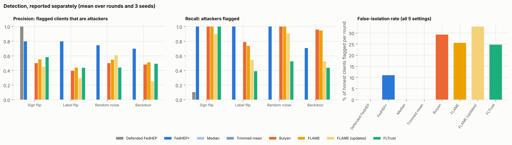
FedHEP+ flags about 11% of honest clients per round on average, against 25–33% for Bulyan, FLAME and FLTrust. Defended FedHEP, median and trimmed mean flag no one, so they have no false isolations but also no recall.

**Why only 15 clients and 3 attackers?** 15 clients is the paper's setup, and the paper's q = 0.2 means 3 attackers on average. We fixed exactly 3 (D15) so that every method faces the same attackers in a given seed; the authors' random rule gives 1 to 3 depending on the seed, which made their attack table hard to compare. Nothing in the code limits this: Phase 5 already ran 5 attackers, and the queued sweeps cover 1–10 attackers (q) and 20 clients.

**Why does Defended FedHEP keep high accuracy without removing attackers?**

It does drop: **sign flipping costs Defended FedHEP 10.3 points** (48.4 → 38.1), the size of drop you expected, against 1.6 for FedHEP+. The other attacks cost it little for specific reasons:
- *Random noise:* norm bounding scales each upload to at most 3× the lower-quartile norm, and BatchNorm buffers are taken by median, so the noise is shrunk and averages out (−2.6).
- *Label flip:* 3 of 15 clients with flipped labels still produce updates that point roughly with the consensus, so SCCF only partly down-weights them (−5.2).
- *Backdoor:* designed to keep normal accuracy; its damage is the 79% backdoor success, not accuracy.
- *Personalisation:* each client's local and parent heads are trained on its own data, and unseen classes are masked out at prediction. That alone halves the damage: undefended FedHEP loses 14.1 to sign flipping, FedAvg 29.6.

**Weights-only grouping vs the defense.** Agreed: weights-only grouping changed clean accuracy by +0.3 over three seeds, while the defense changed sign-flip accuracy by +8.3 (+12.6 with 5 attackers) and backdoor success by −58 points. The defense is the more promising direction.

### Run plan for your Mac (superseded by the 2026-11-13 run plan below)
1. `followup_diagnostics.yaml`: MAD per round at full scale, absolute floor 0.01 / 0.03, patience 3 (36 runs).
2. `followup_attacks.yaml`: ALIE and Min-Max vs Defended FedHEP, FedHEP+, FLAME, Bulyan (24 runs).
3. `followup_q.yaml`: q = 0.1 / 0.3 / 0.4 (36 runs).
4. `followup_holdout.yaml`: held-out setting (10 runs).

`followup_generalization.yaml` (108 runs) is superseded by 2 and 3: about 30 of its runs repeat existing ones.

## 2026-11-12 · Finding · Why honest z-scores get extreme mid-training
The professor asked why the MAD shrinks and z goes down in FedHEP+. Raw scores were not logged in the historical runs, but two things that were logged identify the mechanism (all 15 FedHEP+ runs: 5 settings × 3 seeds):
- **Which term set z's denominator.** Without the floor, the MAD of a round's z-scores is exactly $1/1.4826 = 0.674$ (using torch's median, as screening does). A smaller value means the floor $0.1\,|\operatorname{med} s|$ was larger than $1.4826\cdot\mathrm{MAD}$ and set the scale that round.
- **The spread of cosines.** SCCF's logged weights are $w_i = \mathrm{softmax}(c_i/T)$, so $T\ln w_i$ recovers each client's cosine $c_i$ up to a constant ($T \approx 0.5$; reference = mean direction rather than median, same root-head signal). Their spread is a proxy for the spread of the screening scores.

**What the data shows: the MAD does not shrink. The consensus does.**
1. In rounds 1–13, the floor sets the scale in 85–100% of runs: honest updates agree strongly, so $0.1\,|\operatorname{med} s|$ exceeds $1.4826\cdot\mathrm{MAD}$, and z stays small.
2. As training goes on, each client's update follows its own data. The spread of cosines **doubles** (0.055 → 0.085 by round 12, 0.12 by round 28), and the median cosine falls.
3. Between rounds 14 and 18 the floor stops binding in every run, so z is divided by the raw MAD from then on.
4. **False isolations peak in exactly those rounds** (7 new honest isolations in round 14; none before round 7). The clients that cross the cut are the persistently atypical ones, which at α = 0.5 are the more skewed ones (skew chart).
5. By rounds 27–30 there is no consensus left: SCCF falls back to equal weights in 80–87% of runs.

So "the MAD shrinks" is not what happens. What changes is that the protection from the relative floor disappears when the median cosine falls. That points to a fix: a floor that does not fall with the median (the absolute `plus.mad_floor`, queued), or a cut that adapts to how much consensus is left. Caveat: step 2 relies on the SCCF proxy; the queued `followup_diagnostics` runs log the real median, MAD and scale every round.

## 2026-11-12 · Professor's requests: no-defense baselines, larger experiments (code done, runs need your Mac)
- **No-defense baselines** added to the queued sweeps: undefended FedHEP in `followup_attacks` (FedAvg can't run ALIE/Min-Max: those need FedHEP's upload hook) and FedAvg + undefended FedHEP in `followup_q`. The main Phase 2 settings already have both (`p2__fedavg`, `p2__fedhep`).
- **Larger experiments:** `followup_scale.yaml`, 30 clients with 6 / 9 / 12 attackers (20 / 30 / 40%), sign flip and backdoor, for FedAvg, undefended FedHEP, Defended FedHEP, FedHEP+ and FLAME (105 runs). A toy check at 12 of 30 shows FedHEP+'s first-round margin is thin at 40% (attackers' z ≈ −3 against the −2.5 cut, 8 of 12 left out in round 1); all 12 were isolated in round 2.

### Run plan (2026-11-13: split into self-contained chunks)
Measured on your Mac: about 11–14 minutes per run (the earlier estimate of 8 was too low), so the full queue is about 2 days of GPU time. Each file below contains its own baselines (no-defense FedAvg and undefended FedHEP where they apply), so every file can run on either machine without mixing devices inside one comparison. Run them in priority order; each can be stopped and resumed.

| Priority | Sweep | Runs | About | Question it answers |
|---|---|---|---|---|
| 1 | `followup_diagnostics.yaml` (running; 9 of 36 done) | 36 | 5 h left | real MAD per round; absolute floor 0.01 / 0.03; patience 3 |
| 2 | `followup_attacks.yaml` | 30 | 6 h | ALIE and Min-Max vs no defense, Defended FedHEP, FedHEP+, FLAME, Bulyan |
| 3 | `followup_n20_sign.yaml` | 45 | 8 h | 20 clients, 5 / 7 sign flippers (25 / 35%), plus no attack |
| 4 | `followup_n20_backdoor.yaml` | 30 | 6 h | 20 clients, 5 / 7 backdoor attackers |
| 5 | `followup_holdout.yaml` | 10 | 2 h | held-out setting: α = 0.2, 20 clients, 4 attackers, seed 2026 |
| 6 | `followup_q_sign.yaml` | 36 | 6 h | q = 0.1 / 0.3 / 0.4, sign flip |
| 7 | `followup_q_backdoor.yaml` | 36 | 6 h | q = 0.1 / 0.3 / 0.4, backdoor |
| 8 | `followup_n30_sign.yaml` | 60 | 11 h | 30 clients, 6 / 9 / 12 sign flippers (20–40%), plus no attack |
| 9 | `followup_n30_backdoor.yaml` | 45 | 8 h | 30 clients, 6 / 9 / 12 backdoor attackers |

`followup_generalization.yaml` is superseded (kept for the record; do not run).

**Two machines (decided 2026-11-13).** The Acer benchmark took 53 s for 2 rounds including start-up, data loading and evaluation (device `xpu`), so one round takes about 25 s or less: the same speed as the Mac. The files are therefore shared alternately down the priority list.

| Machine | Sweeps, in order | About |
|---|---|---|
| Mac (MPS) | `followup_diagnostics` → `followup_n20_sign` → `followup_holdout` → `followup_q_backdoor` → `followup_n30_backdoor` | 27 h |
| Acer (XPU) | `followup_attacks` → `followup_n20_backdoor` → `followup_q_sign` → `followup_n30_sign` | 29 h |

A file is never split between machines: results for the same seed differ slightly between Apple and Intel GPUs, so all methods in one comparison must run on the same device. Each run records its device in `metrics.json`. The Acer benchmark covers 2 rounds only; if full runs there take well over 15 minutes (heat throttling on a thin laptop), the split should be revisited.

**Setting up the Acer as a second runner** (Ubuntu, Core Ultra 5 226V, Intel Arc 130V, 16 GB). Its integrated GPU is reached through PyTorch's `xpu` device, which RFL Lab now picks automatically (`run.device: auto` tries cuda, then xpu, then mps, then cpu).
1. Install Intel's GPU driver packages for Ubuntu (Intel's "client GPU" instructions), then PyTorch with XPU support: `pip install torch torchvision --index-url https://download.pytorch.org/whl/xpu`. Check with `python -c "import torch; print(torch.xpu.is_available())"`.
2. `git clone https://github.com/BinhPhamTieSinger/RFL_Lab.git` into `/srv/projects`, install with `pip install -e ".[dev]"`, and copy CIFAR-100 from the Mac (`Paper_Reproduction/data/cifar-100-python`, 178 MB) to the matching `../Paper_Reproduction/data` path.
3. Benchmark 2 rounds: `time python scripts/run.py configs/cifar100_fedhep_defended.yaml --set run.rounds=2 run.eval_every=2 name=bench run.output_dir=outputs_bench`. One round on the Mac takes about 25 s (12 min / 30 rounds). The Acer is worth using if its round takes under about 1 minute; on CPU alone it will be far slower. Result (2026-11-13): 53 s for the 2-round benchmark.
4. Run sweeps from the bottom of the list, then copy their run folders back into the Mac's `outputs/` (`scp -r`). Every run folder holds only `metrics.json` and `config.yaml`.

## 2026-11-14 · Follow-up results: screening diagnostics, adaptive attacks, held-out setting (your Mac, MPS)
91 runs: `followup_diagnostics` (36, `outputs_followup_full/`), `followup_attacks` (30, `outputs/`), `followup_holdout` (10, single seed 2026, `outputs_followup_holdout/`), plus the matching earlier runs. Re-running FedHEP+ inside `followup_diagnostics` reproduced the Phase 5 numbers to two decimals (47.92 ± 0.60, 46.34 ± 0.87, 46.26 ± 0.56, backdoor success 20.8%), so runs on the Mac are deterministic. Charts: `python scripts/plot_adaptive.py outputs outputs_followup_full`.

### 1. Screening diagnostics: the MAD does not shrink; patience helps, floors do not
CIFAR-100, α = 0.5, 15 clients, 3 attackers, 3 seeds. FI = honest clients isolated, summed over the 3 seeds (45 honest client-runs with no attack, 36 with attack).

| FedHEP+ variant | No attack | Sign flip | Backdoor | Backdoor success |
|---|---|---|---|---|
| as in Phase 5 | 47.92 ± 0.60 (FI 9) | 46.34 ± 0.87 (FI 5) | 46.26 ± 0.56 (FI 10) | 20.8% |
| absolute floor 0.01 | identical to the row above | identical | identical | 20.8% |
| absolute floor 0.03 | 48.02 ± 0.80 (FI 11) | 46.16 ± 0.78 (FI 5) | 46.37 ± 0.43 (FI 7) | 23.4% |
| patience 3 | 48.21 ± 0.33 (FI 7) | 46.01 ± 1.34 (FI 3) | 46.72 ± 0.88 (FI 4) | 28.0% |

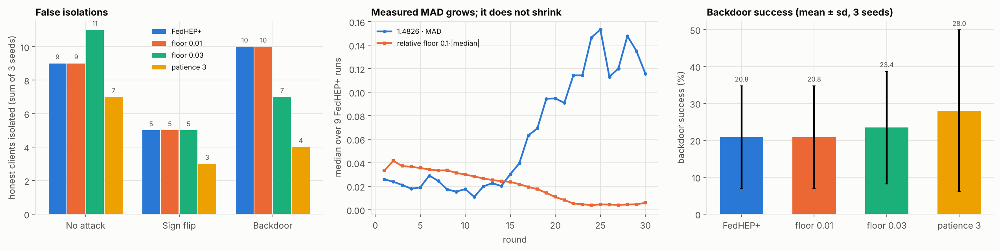

- **The measured MAD does not shrink.** Taking the median over the 9 runs, $1.4826\cdot\mathrm{MAD}$ stays near 0.01–0.03 for rounds 1–14 and then grows six- to eightfold (to 0.12–0.15 by rounds 24–28). The relative floor $0.1\,|\operatorname{med} s|$ falls steadily from 0.04 to 0.005 as the median cosine falls. The two cross at rounds 14–15. This confirms, with directly logged values, the 2026-11-12 reading that came from the SCCF proxy.
- **Where false isolations come from.** All 24 honest isolations (seeds 123 and 7; seed 42 had none) happen in rounds 7–30. They are of two kinds. (a) Rounds 7–20: the scale is 0.02–0.07, and a client whose cosine is 0.05–0.30 below the median gets z between −2.1 and −5.1. (b) Rounds 24–30: the median cosine is near zero (−0.02 to 0.03), so the relative floor is gone, and z reaches −11.4. Because the evidence average puts weight 0.3 on the new z, a client whose evidence was near 0 is isolated for good by a single round with z ≤ −5.
- **The absolute floor 0.01 never set the scale** (identical runs). Floor 0.03 binds in 3–8 rounds per run, mostly late, but barely changed false isolations (23 vs 24).
- **Patience 3** (three consecutive bad rounds before exclusion or isolation) cut false isolations from 24 to 14 and gave the best no-attack accuracy (48.21 ± 0.33). Its cost: sign-flip attackers are isolated in round 3 instead of round 1, and backdoor success rose from 20.8% to 28.0% with a very wide spread (39, 42 and 2.7%).
- **The same honest clients are isolated across attacks.** In seed 123, clients 6, 8 and 14 are isolated with no attack, under sign flip and under backdoor; in seed 7, clients 9 and 11 in all three. Their behaviour is a property of their data, not of the attack.

### 2. Adaptive attacks: no defense isolated a single attacker
ALIE (z = 0.43, colluders' own statistics) and Min-Max (omniscient), 3 of 15 attackers, α = 0.5, 3 seeds.

| Method | No attack | ALIE | Min-Max |
|---|---|---|---|
| FedHEP, no defense | 47.78 ± 0.39 | 47.76 ± 0.07 | 45.08 ± 1.18 |
| Defended FedHEP | 48.39 ± 0.72 | 47.49 ± 1.53 | 45.19 ± 0.79 |
| FedHEP+ | 47.92 ± 0.60 | 47.55 ± 1.22 | 44.87 ± 1.42 |
| Bulyan | 44.52 ± 0.28 | 42.26 ± 1.15 | 37.47 ± 2.74 |
| FLAME | 42.81 ± 1.49 | 40.80 ± 0.80 | 42.72 ± 2.50 |

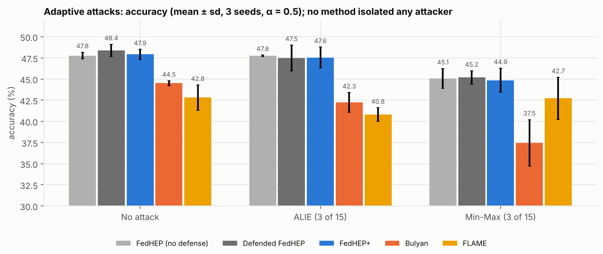

- **ALIE barely hurts FedHEP** (47.76 vs 47.78 undefended). With z = 0.43 the crafted update is close to the honest mean, and FedHEP's local and parent heads absorb what is left. **Min-Max costs about 3 points** whatever the defense, except FLAME (−0.1, but FLAME starts 5 points lower).
- **Bulyan is the worst rule under Min-Max** (−7.1 against its own no-attack accuracy), as Shejwalkar and Houmansadr (2021) designed the attack to do against such rules.
- **No method isolated any attacker** in any of the 30 runs. FedHEP+ instead isolated honest clients: 6 under ALIE and 3 under Min-Max (seeds 123 and 7).
- **Why FedHEP+ misses them: their z is too high, not too low.** Over all rounds, attackers' z has median +5.2 under ALIE and +2.9 under Min-Max; honest clients' median is −0.2 and −0.4. The screen only cuts below −2.5. A two-sided cut at 2.5 would have flagged 84% (ALIE) and 61% (Min-Max) of attacker-rounds, against 0.2% and 0% of honest-rounds under those attacks, 0.3% with no attack and 2.3% under sign flip. **Two-sided screening is now implemented** (`plus.two_sided`, acting on $-|z|$; logged z is unchanged) with a unit test, and queued as `followup_two_sided` together with patience 3.

### 3. Held-out setting: FedHEP+'s advantage does not carry over
The configuration reserved on 2026-11-12 and not used for any tuning: α = 0.2, 20 clients, 4 attackers, seed 2026 (one seed, so read differences under about 1.5 points as noise).

| Method | No attack | Sign flip | Backdoor (success) | ALIE | Min-Max |
|---|---|---|---|---|---|
| Defended FedHEP | **52.27** | 48.79 | **50.02** (56%) | **51.17** | **49.46** |
| FedHEP+ | 50.27 | **49.94** | 46.00 (58%) | 50.30 | 48.03 |
| FedHEP+ honest clients isolated (of 20 / 16) | 10 | 4 | 8 | 6 | 5 |

- With no attack, FedHEP+ isolated **10 of 20 honest clients**, the first in round 4.
- Under the backdoor it isolated 8 honest clients (rounds 4–19) before any attacker, and the 4 attackers only in rounds 20–29, after the backdoor had taken hold (success 15% at round 20, 58% at round 30). It gave no protection: Defended FedHEP's success was 56%.
- It still won under sign flip (+1.2), where all 4 attackers were isolated in round 1.
- Again the same honest clients recur: clients 0–4 and 12 were isolated with no attack, under the backdoor and under ALIE.

**Conclusion.** FedHEP+'s Phase 3 improvement was measured at α = 0.5 with 15 clients. At α = 0.2 with 20 clients, its one-sided, permanent screen mistakes honest clients with unusual data for attackers early in training, and that costs more than the protection it gives. Together with section 2 this names the problem the next method has to solve: **tell honest-but-different clients from attackers, on both sides of the consensus**, without a scale that collapses. The literature review (`docs/LITERATURE_REVIEW.md`) reaches the same conclusion from prior work, and `docs/RESEARCH_PLAN.md` sets out the method and experiments that follow from it.

**Held-out discipline.** Seed 2026 has now been used once and must not be used to tune. `followup_alpha02` reproduces the setting on the development seeds (42, 123, 7) so fixes can be tuned there; a new held-out seed will be reserved for the final check.

### Run plan update (2026-11-14)
The Mac ran `followup_diagnostics`, `followup_attacks` and `followup_holdout` (not the split planned on 2026-11-13), then stopped. New order:

| Machine | Next, in order | Runs | About |
|---|---|---|---|
| Mac | `followup_two_sided` (must be on the Mac: its baselines are Mac runs) → `followup_alpha02` → `followup_n20_sign` → `followup_q_backdoor` → `followup_n30_backdoor` | 15 + 60 + 45 + 36 + 45 | 3 + 12.5 + 9.5 + 7.5 + 9.5 h |
| Acer | `followup_n20_backdoor` → `followup_q_sign` → `followup_n30_sign` (skip `followup_attacks`: done on the Mac) | 30 + 36 + 60 | 6.5 + 7.5 + 12.5 h |

Bring the Acer's runs to the Mac with `bash scripts/sync_acer.sh` (rsync; never overwrites a Mac run), then commit and push from the Mac.

## 2026-11-14 (later) · First Acer results: 20-client backdoor; partial q and α = 0.2
New since the morning entry: `followup_n20_backdoor` (30 runs, Acer, XPU), the FedAvg part of `followup_q_sign` (9 runs, Acer) and the undefended-FedHEP part of `followup_alpha02` (6 runs, Mac). `followup_two_sided` has not run yet (the Mac went to `followup_alpha02` first). Every comparison below is within one device.

### 20 clients, α = 0.5, backdoor with 5 or 7 attackers (25%, 35%), 3 seeds, Acer

| Method | Acc, 5 attackers | Success, 5 | Acc, 7 attackers | Success, 7 | Attackers isolated | Honest isolated |
|---|---|---|---|---|---|---|
| FedAvg | 33.83 ± 0.18 | 90.0% | 32.51 ± 0.36 | 91.9% | – | – |
| FedHEP, no defense | 46.69 ± 0.59 | 79.9% | 46.25 ± 1.40 | 80.0% | – | – |
| Defended FedHEP | 46.97 ± 0.34 | 79.7% | 46.08 ± 0.94 | 79.6% | – | – |
| FedHEP+ | 46.81 ± 0.81 | 47.4% | 45.39 ± 0.61 | 71.6% | 15 of 15; 15 of 21 | 7; 6 |
| FLAME | 40.88 ± 0.79 | 0.6% | 41.94 ± 0.28 | 0.6% | – | – |

The no-attack runs for 20 clients are in `followup_n20_sign` (not yet run), so accuracy cost against a clean baseline is not available yet.

- **Defended FedHEP gives no backdoor protection at 20 clients** (79.7% vs 79.9% undefended).
- **FLAME stops the backdoor at both attacker counts** (0.6%), again at a large accuracy cost (4.3 to 5.8 points below undefended FedHEP under the same attack).
- **FedHEP+ halves success at 5 attackers but not at 7**, and isolates 13 honest client-runs.
- **The backdoor outlives the attackers.** FedHEP+ isolated all 5 attackers by rounds 11–15 in every seed, yet success, measured only on honest clients' models, kept rising: seed 42 from 19% at round 15 to 52% at round 30, seed 7 from 19% to 66%. Across the five runs in which every attacker was isolated, success rose by 17 to 47 points after the last isolation. Detection that arrives after round 10 does not undo the backdoor; the shared layers keep it. This becomes hypothesis H8 (recovery after isolation) in the research plan, decision D32.

### Attack rate q (the authors' rule), FedAvg only so far, Acer
q = 0.1 gives 1 / 0 / 2 attackers for seeds 42 / 123 / 7: FedAvg reaches 32.7 / 38.3 / 25.2 (no-attack FedAvg: 38.1). At q = 0.3 (6 / 3 / 5 attackers) it collapses to 1.0% in two seeds and 21.0% in the third; at q = 0.4 it collapses in all three. FedHEP and the defenses follow in the same sweep.

### α = 0.2, 20 clients, undefended FedHEP, Mac
No attack 55.59 ± 1.34; sign flip with 4 attackers 42.51 ± 0.99 (−13.1). Accuracy is higher than at α = 0.5 because stronger label skew makes each client's own task easier for the personalized heads. The defenses follow in the same sweep.

### Code added (Phase 6 start)
- **Layer L0** of the research plan as a Global-step rule `robust.rule: arc_nnm_tm` (ARC, then NNM, then trimmed mean) with optional worker momentum `robust.momentum` (D31). Unit and property tests: ARC clips exactly the k largest rows to the next norm and keeps their direction; NNM averages the n − f nearest rows; a huge minority moves the aggregate by a bounded amount; the rule is permutation invariant.
- **Resource measurement** in every run (`metrics.json → resources`): total and per-round wall time (GPU synchronized), peak process memory, peak device memory (exact peak on CUDA and XPU; sampled per round on MPS).
- Sweeps `phase6_l0.yaml` (D1, 30 runs) and `phase6_l0_a02.yaml` (D2, 24 runs), both for the Mac because their baselines are Mac runs.

## 2026-11-14 (evening) · α = 0.2 on three seeds; attack rate q
New: `followup_alpha02` (the FedHEP, Defended FedHEP and FedHEP+ parts, 36 runs, Mac; the patience-3 and two-sided variants are still running) and `followup_q_sign` (36 runs, Acer). Charts: `python scripts/plot_adaptive.py outputs outputs_followup_full outputs_followup_holdout`.

### α = 0.2, 20 clients, 4 attackers, 3 seeds (Mac): the held-out result is confirmed

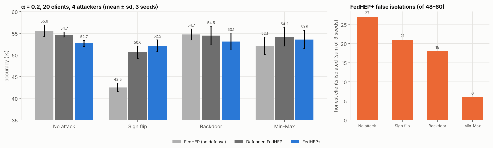

| Method | No attack | Sign flip | Backdoor (success) | Min-Max |
|---|---|---|---|---|
| FedHEP, no defense | **55.59 ± 1.34** | 42.51 ± 0.99 | **54.72 ± 1.27** (46.9%) | 52.10 ± 2.03 |
| Defended FedHEP | 54.70 ± 0.61 | 50.62 ± 1.43 | 54.47 ± 2.12 (44.3%) | **54.16 ± 2.16** |
| FedHEP+ | 52.68 ± 0.69 | **52.15 ± 1.34** | 53.08 ± 1.93 (43.3%) | 53.55 ± 2.07 |
| FedHEP+ minus Defended FedHEP, per seed (42, 123, 7) | −2.50, −1.63, −1.93 | +2.19, +1.50, +0.91 | −2.89, −0.77, −0.50 | +0.39, −1.05, −1.18 |

- **The single held-out seed (2026) was representative.** On three seeds FedHEP+ is worse than Defended FedHEP with no attack on every seed (−2.0 on average) and under the backdoor (−1.4), and better only under sign flip (+1.5, every seed). Held-out seed: −2.0, +1.2, −4.0, −1.4.
- **False isolations are systematic at α = 0.2:** 27 honest clients isolated with no attack over 3 seeds (9 of 20 per run on average), the first in round 5 of every seed. Bottom-10% accuracy with no attack drops from 42.25 (Defended FedHEP) to 38.37: the clients it isolates are the ones with unusual data, and they end up with worse models. For a personalized method this fairness cost matters as much as the average.
- **Patience 3 does not fix it at α = 0.2.** Two seeds finished so far: 17 honest clients isolated with no attack (8.5 per run, against 9 for FedHEP+), accuracy 52.32. The third seed and the two-sided variant are running.
- **No method stops the backdoor at α = 0.2** (43–47% success for all three, against about 80% at α = 0.5). Success is lower here for every method, including no defense, probably because fewer clients hold the target class, so FedHEP's inference mask blocks it on more clients (not yet checked per client).
- **Defended FedHEP isolates some attackers at α = 0.2** (4 of 12 Min-Max attackers and 3 of 12 sign flippers over 3 seeds, and no honest client), which it never did at α = 0.5 (Phase 1c). The cause is not yet checked; a likely one is that with more skewed data the honest clients' trust shares spread out, which moves the attackers' shares further below the isolation threshold.

### Attack rate q (the authors' rule), α = 0.5, 15 clients, sign flip, 3 seeds (Acer)
Each client attacks with probability q, so the attacker count differs by seed: 1 / 0 / 2 at q = 0.1, 6 / 3 / 5 at q = 0.3, 10 / 6 / 6 at q = 0.4 (seeds 42 / 123 / 7). Means over seeds mix different counts, so the chart plots each run against its own count.

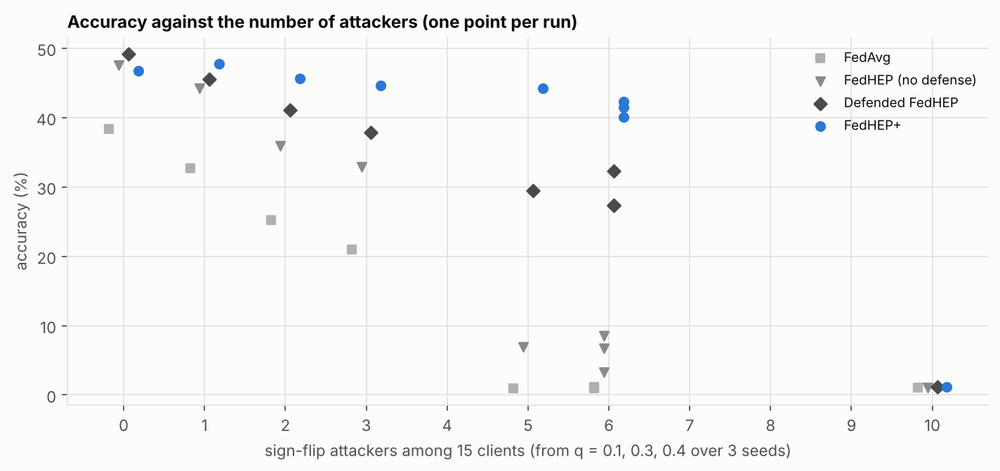

| Attackers (seed, q) | FedAvg | FedHEP | Defended FedHEP | FedHEP+ | Honest clients FedHEP+ kept |
|---|---|---|---|---|---|
| 0 (123, 0.1) | 38.3 | 47.6 | **49.2** | 46.8 | 11 of 15 |
| 1 (42, 0.1) | 32.7 | 44.2 | 45.5 | **47.8** | 13 of 14 |
| 2 (7, 0.1) | 25.2 | 36.0 | 41.1 | **45.7** | 9 of 13 |
| 3 (123, 0.3) | 21.0 | 32.9 | 37.9 | **44.6** | 7 of 12 |
| 5 (7, 0.3) | 1.0 | 6.9 | 29.5 | **44.2** | 4 of 10 |
| 6 (42, 0.3) | 1.0 | 6.7 | 27.3 | **40.1** | 9 of 9 |
| 6 (123, 0.4) | 1.2 | 8.5 | 32.3 | **41.5** | 5 of 9 |
| 6 (7, 0.4) | 1.0 | 3.3 | 27.4 | **42.3** | 4 of 9 |
| 10 (42, 0.4) | 1.0 | 1.1 | 1.2 | 1.2 | 0 of 5 |

- **Against many sign flippers FedHEP+ is far ahead**: with 5–6 attackers of 15 it keeps 40–44% where Defended FedHEP falls to 27–32% and undefended FedHEP and FedAvg collapse. It isolates every attacker in every run.
- **But it pays for that by isolating honest clients**: with 5–6 attackers it often keeps only 4–5 honest clients by the end, and with no attacker at all it isolated 4 of 15. That it still wins says sign flipping is so harmful that removing honest clients is the lesser cost; it does not mean the false isolations are harmless (see α = 0.2 above).
- **With 10 of 15 attackers every method fails** (about 1%), as expected when attackers are the majority; FedHEP+ isolated all 10 attackers and the 5 honest clients too.

### What this adds to the paper's story
1. FedHEP+'s screening is strong against crude attacks (sign flip, any attacker count up to 40%) and weak against heterogeneity: at α = 0.2 it costs 2 points and 4 points of bottom-10% accuracy with no attack.
2. Its false isolations are a property of the data distribution (the same clients, from round 5), not of the attack. This is now shown on 3 seeds plus a held-out seed.
3. Both results point at the same requirement as the research plan: a defense that separates "different" from "malicious" (bimodality gate, multiple signals) and bounds influence instead of relying on removal alone (L0, queued as `phase6_l0` and `phase6_l0_a02`).

### Code and plan added (2026-11-14, evening)
- **`attack.stop_round`** (FedHEP family): attackers train honestly on clean data after this round, the standard durability test. Test: label-flip attackers poison in round 1 only when `stop_round = 1`, and non-FedHEP methods refuse the option. Isolated clients were confirmed to be excluded from both parent and Global aggregation in FedHEP+, so the backdoor growth after isolation is not an aggregation leak; its cause is open.
- **`followup_backdoor_stop.yaml`** (6 runs, Acer, about 1.3 h): undefended FedHEP, 20 clients, 5 backdoor attackers who stop at round 10 or 15. If success still grows, the backdoor sustains itself in the shared layers. Durability work reports the opposite once poisoning stops: Chameleon (ICML 2023) measures backdoors fading, with lifespans of about 900 rounds for a pixel pattern on CIFAR-10.
- **`docs/PAPER_PLAN.md`**: claims C1–C9 with their status, the closest published work (Errami and Bergou, IJCAI 2024; Ajibuwa and Odeyomi, IPCCC 2025; HadAGG, IEEE TNSE 2026; FedCAP), the outline with figures mapped to runs, and the minimum experiments before submission.

### Run plan update (2026-11-14, evening)
Rebalanced so that every comparison stays on one machine and the decisive runs come first.

| Machine | In order | Runs | About |
|---|---|---|---|
| Mac | `followup_alpha02` (rest) → `phase6_l0` → `phase6_l0_a02` → `followup_two_sided` → `followup_q_backdoor` | ~20 + 30 + 24 + 15 + 36 | 4 + 6 + 5 + 3 + 7.5 h |
| Acer | `followup_backdoor_stop` → `followup_n30_sign` (resumes) → `followup_n20_sign` → `followup_n30_backdoor` | 6 + 60 + 45 + 45 | 1.3 + 12.5 + 9.5 + 9.5 h |

`followup_n20_sign` moved to the Acer because its no-attack runs are the clean baseline for the Acer's `followup_n20_backdoor`.

## 2026-11-15 · Phase 6 first results: two-sided screening, layer L0, the backdoor-stop test, 30 clients
141 new runs. Charts: `python scripts/plot_phase6.py outputs`. All comparisons within one device.

### 1. Two-sided screening catches every adaptive attacker (D1: α = 0.5, 15 clients, 3 attackers, Mac)
`ts__two_p3` = FedHEP+ with `plus.two_sided` and patience 3.

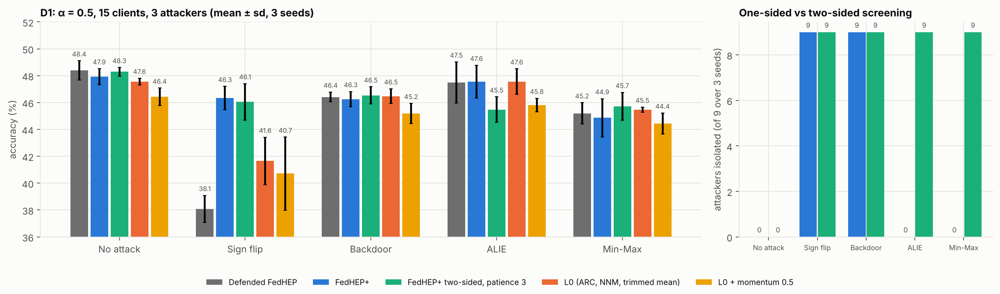

| Method | No attack | Sign flip | Backdoor (success) | ALIE | Min-Max | Attackers isolated (of 9) | Honest isolated |
|---|---|---|---|---|---|---|---|
| Defended FedHEP | **48.39** | 38.08 | 46.4 (78.7%) | 47.49 | 45.19 | – | – |
| FedHEP+ | 47.92 | **46.34** | 46.26 (20.8%) | 47.55 | 44.87 | 0 / 9 / 9 / 0 / 0 | 9, 5, 10, 6, 3 |
| FedHEP+ two-sided, patience 3 | 48.29 | 46.05 | **46.54** (27.8%) | 45.47 | **45.72** | 0 / 9 / 9 / **9** / **9** | 12, 4, 8, 5, 7 |
| L0 (ARC, NNM, trimmed mean) | 47.56 | 41.65 | 46.48 (62.5%) | **47.56** | 45.47 | isolates nobody | 0 |
| L0 + momentum 0.5 | 46.43 | 40.71 | 45.18 (64.5%) | 45.82 | 44.44 | isolates nobody | 0 |

- **Hypothesis H1 confirmed.** The two-sided screen isolates all 9 ALIE and all 9 Min-Max attackers, every one in round 3 (the earliest round patience 3 allows), where the one-sided screen isolated none. Under sign flip and the backdoor it isolates the same attackers as before.
- **But isolating them does not raise accuracy at α = 0.5.** Under ALIE, accuracy *fell* from 47.55 to 45.47 (ALIE with z = 0.43 barely hurt FedHEP in the first place, so removing 3 clients costs more than it saves), and under Min-Max it rose by only 0.85. Detection is right; the benefit is small because these attacks were weak here. Their value should show at α = 0.2 and with more attackers (pending).
- **False isolations did not improve** (36 vs 33 honest client-runs over the five settings): folding z onto −|z| exposes honest clients that are unusually *close* to the consensus too.
- **Layer L0 alone (hypothesis H7 holds, H4 partly):** no false isolations by construction, within 0.4 of FedHEP+ with no attack, and the best or equal method under ALIE, Min-Max and the backdoor in accuracy. But **it fails against sign flip** (41.65, −4.7 against FedHEP+): three sign flippers among 15 are inside the n − f = 12 nearest neighbours of many honest clients, so NNM mixes their reversed updates into honest ones, and the trimmed mean then drops only f = 3 per coordinate. And it gives **no backdoor protection** (62.5%). **Momentum 0.5 hurts** in every setting (−1.1 with no attack): with 30 rounds and one momentum step per round, the stale update slows learning. Momentum is dropped (D33).

### 2. Layer L0 at α = 0.2 is the best defense there so far (D2: α = 0.2, 20 clients, 4 attackers, Mac)

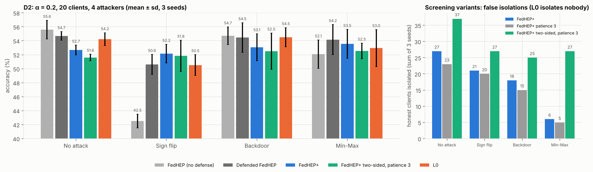

| Method | No attack | Sign flip | Backdoor (success) | Min-Max | Honest isolated, no attack |
|---|---|---|---|---|---|
| FedHEP, no defense | **55.59** | 42.51 | **54.72** (46.9%) | 52.10 | – |
| Defended FedHEP | 54.70 | 50.62 | 54.47 (44.3%) | **54.16** | 0 |
| FedHEP+ | 52.68 | **52.15** | 53.08 (43.3%) | 53.55 | 27 |
| FedHEP+ patience 3 | 52.69 | **52.15** | 53.07 (44.0%) | 53.72 | 23 |
| FedHEP+ two-sided, patience 3 | 51.61 | 51.85 | 52.52 (43.0%) | 52.55 | 37 |
| L0 | 54.23 | 50.52 | 54.51 (**37.7%**) | 52.96 | 0 |

- **L0 beats FedHEP+ with no attack by +1.56 (every seed: +2.07, +0.83, +1.77) and under the backdoor by +1.43 (every seed)**, is within 0.5 of Defended FedHEP with no attack, and gives the lowest backdoor success of any method at α = 0.2 (37.7%). It loses to FedHEP+ under sign flip by 1.6 and to Defended FedHEP under Min-Max by 1.2.
- **Bottom-10% accuracy with no attack:** L0 42.70, Defended FedHEP 42.25, FedHEP+ 38.37. L0 keeps the unusual clients that FedHEP+ removes.
- **Patience 3 and two-sided screening do not fix false isolations at α = 0.2:** 23 and 37 honest clients isolated with no attack against 27. Two-sided screening isolated all 12 Min-Max attackers here, as at α = 0.5, but accuracy fell by 1.0.
- **Reading across D1 and D2:** screening wins when the attack is crude and the data is moderately skewed; influence bounding wins when the data is strongly skewed. Neither alone is enough; the research plan's layered design (L0 as the base, screening on top with a gate that stops it from firing on honest spread) is what the data asks for.

### 3. The backdoor grows after poisoning stops (undefended FedHEP, 20 clients, 5 attackers, Acer)

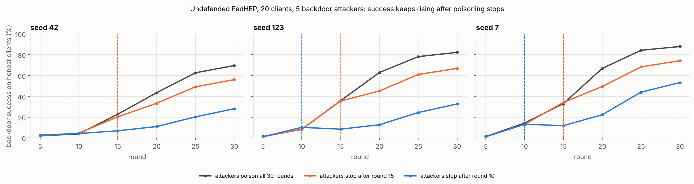

| Attackers poison | Round 10 | Round 15 | Round 20 | Round 30 |
|---|---|---|---|---|
| all 30 rounds | 4 / 8 / 14 | 23 / 36 / 33 | 43 / 63 / 67 | 70 / 82 / 88 |
| until round 15, then honest | 5 / 8 / 13 | 20 / 35 / 34 | 33 / 45 / 49 | 56 / 67 / 74 |
| until round 10, then honest | 4 / 10 / 13 | 7 / 8 / 12 | 11 / 13 / 22 | 28 / 33 / 53 |

(seeds 42 / 123 / 7; success on honest clients only.)

- **Confirmed: this is not an isolation leak and not a defense artefact.** With no defense at all, after the attackers switch to honest training on clean data at round 10 (success 4–13% at that point), success still climbs to 28–53% by round 30; after a stop at round 15 it reaches 56–74%. The published picture (Chameleon, ICML 2023: backdoors fade once poisoning stops) does not hold for FedHEP in this setting. Honest training amplifies the implanted feature instead of erasing it.
- **Why, is open.** FedHEP carries per-client state across rounds that the Global model never overwrites (each client's local head and head memory), and the shared trunk keeps learning from clients whose personalized heads already respond to the trigger. To locate the backdoor, per-head success (root, parent, local heads separately) is now logged at every evaluation for the FedHEP family, and `followup_backdoor_heads` (Acer, 12 runs) repeats the stop test with it, for undefended FedHEP and FedHEP+.
- **Consequence for the paper:** detection-then-isolation cannot be the whole backdoor defense for FedHEP; either the backdoor is blocked at aggregation time (L0 lowered success to 37.7% at α = 0.2; FLAME's clustering to 0.6%) or the shared layers are rewound after detection (hypothesis H8).

### 4. 30 clients, α = 0.5, sign flip with 6 / 9 / 12 attackers (20 / 30 / 40%), Acer, partly done

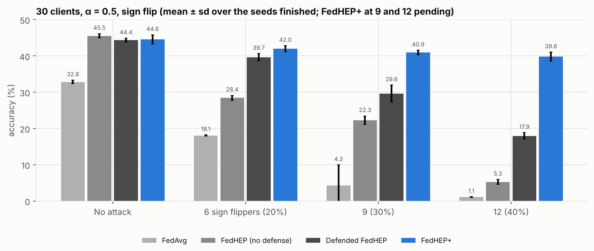

| Method | No attack | 6 attackers | 9 attackers | 12 attackers |
|---|---|---|---|---|
| FedAvg | 32.83 | 18.08 | 4.31 | 1.06 |
| FedHEP, no defense | **45.53** | 28.44 | 22.26 | 5.26 |
| Defended FedHEP | 44.37 | 39.67 | 29.64 | 17.93 |
| FedHEP+ | 44.58 | **41.96** | 41.57 (1 seed) | pending |

FedHEP+ isolated all 18 attackers with 6 attackers (and 23 honest clients), and in the one finished 9-attacker seed all 9 attackers and 1 honest client. Defended FedHEP's trust-weighting degrades steadily with the attacker share; FedHEP+ holds at about 42. The remaining runs are queued.

### 5. Attack rate q, backdoor (partly done, Mac)
q = 0.1 (1 / 0 / 2 attackers): undefended FedHEP 48.25, success 42.3%. The rest of the sweep follows.

### Decisions
- **D33:** worker momentum is dropped from L0 (hurts in every setting with one step per round).
- The L0 result settles the first rung of the ablation ladder: L0 is the base layer, and the next rung adds screening *on top of L0* with the bimodality gate, instead of the planned order R1–R4 then R5. Rationale: at α = 0.2 screening alone loses to no defense; the gate is what has to be shown to work, and it should be measured against L0's floor, not FedHEP+'s.

### Code added (2026-11-15)
- `plus.global_rule: arc_nnm_tm` with `plus.global_f`: FedHEP+'s Global step aggregates the kept clients with layer L0 instead of the SCCF trust-weighted mean, with f reduced by the clients already excluded. Test: screening unchanged, step differs.
- `plus.gap_gate`: a round contributes bad evidence only if its scores split, measured as the largest gap between neighbouring sorted scores divided by the median gap (`gap_ratio`, logged in `score_stats`). From seed-42 diagnostics at α = 0.2: attack-free rounds 3–8×, sign-flip rounds 1–2 10–23× with exactly the attackers below the gap, Min-Max rounds 8–22× with the attackers above it. Thresholds 8 and 12 are tested; this is a hypothesis (H2), not a result.
- Per-head backdoor success (`history[*].asr_heads`: root, parent, local) for the FedHEP family.
- `docs/OPERATIONS.md`: setup, running, syncing and publishing for both machines.

### Run plan update (2026-11-15)
| Machine | In order | Runs | About |
|---|---|---|---|
| Mac | `phase6_ladder_d1` → `phase6_ladder_d2` → `followup_q_backdoor` (rest) | 45 + 36 + ~24 | 9.5 + 7.5 + 5 h |
| Acer | `followup_backdoor_heads` → `followup_n30_sign` (rest) → `followup_n20_sign` → `followup_n30_backdoor` | 12 + ~8 + 45 + 45 | 2.5 + 1.7 + 9.5 + 9.5 h |

## 2026-11-15 (night) · Gap found: no defense has ever run on non-skewed data
Every defense so far ran on Dirichlet label skew (α = 0.05, 0.2, 0.5); IID data appeared only in Phase 1, for FedAvg. IID is where honest updates are most alike, so it shows whether screening flags honest clients when there is nothing to separate, and how far each attack moves the model when the honest spread is smallest. One property of the code matters here: clients with $r_{\text{skew}} \ge 0.85$ predict with the root head alone, and under IID every client has $r_{\text{skew}}$ between 0.91 and 0.95 (computed with `label_stats` for 15 clients), so FedHEP's personalization is off at test time under IID.

- **`followup_iid.yaml`** (72 runs, Acer, about 15 h): FedAvg, FedHEP, Defended FedHEP, FedHEP+, FedHEP+ two-sided with patience 3, and L0, under no attack, sign flip, backdoor and Min-Max, 3 seeds. Self-contained.
- Bug fixed: `predict_head` lacked `@torch.no_grad()` (evaluation built unused gradient graphs; results unaffected).

### Visualizer started
The RFL Lab visualizer (a tool that runs the real code and shows each step) has completed Stage 1 and Stage 2: `visualizer/docs/01_REPOSITORY_INVENTORY.md` (execution specification of all ten methods from the source code, formulas, configuration, metrics, seven discrepancies between documents and code) and `visualizer/docs/02_ARCHITECTURE.md`. A spike shows that observing a run from outside leaves its results bit-identical (FedHEP+, Defended FedHEP, FedHEP with a backdoor).

### Run plan update
Acer: after `followup_backdoor_heads`, run `followup_iid` before `followup_n30_sign`, `followup_n20_sign` and `followup_n30_backdoor`. Mac: `phase6_ladder_d1` → `phase6_signal` → `phase6_ladder_d2` → `followup_q_backdoor` (updated 2026-11-15 late).

## 2026-11-15 (late) · Ladder rungs R2 and R3 on D1: the gap gate works
23 new runs from `phase6_ladder_d1` (Mac): `p6__r2` = L0 Global step + two-sided screen, patience 3 (15 runs, all done); `p6__r3g8` = R2 + gap gate 8 (8 of 15 done: no attack, sign flip, two seeds of backdoor); `p6__r3g12` not yet run. D1: α = 0.5, 15 clients, 3 attackers, 3 seeds.

| Method | No attack | Sign flip | Backdoor (success) | ALIE | Min-Max | Honest isolated (no attack / sign / backdoor) |
|---|---|---|---|---|---|---|
| FedHEP+ (reference) | 47.92 | 46.34 | 46.26 (20.8%) | 47.55 | 44.87 | 9 / 5 / 10 |
| L0 alone | 47.56 | 41.65 | 46.48 (62.5%) | 47.56 | 45.47 | 0 / 0 / 0 |
| R2: L0 + two-sided screen | 46.99 | 46.00 | 46.44 (22.6%) | 45.65 | **45.96** | 13 / 5 / 12 |
| **R3: R2 + gap gate 8** | 47.36 | 46.14 | 46.57 (54.8%, 2 seeds) | pending | pending | **3 / 2 / 2** |

- **The gate cuts false isolations by three quarters** (13 → 3 with no attack, 5 → 2 under sign flip, 12 → 2 under the backdoor so far) **while keeping sign-flip detection intact**: all 9 sign flippers isolated in round 3, as without the gate. This is the hypothesis H2 result. The mechanism is visible in the diagnostics: sign-flip rounds 1–3 have gap ratios of 25–134, attack-free rounds mostly 2–8, so the gate (threshold 8) blocks 16–26 of 30 rounds in attack-free runs and the first three rounds are never blocked under sign flip.
- **R3 is within noise of FedHEP+ on accuracy** (−0.6 with no attack, −0.2 under sign flip; per-seed differences of both signs) **and recovers L0's sign-flip weakness** (+4.5 over L0 alone, every seed). So the combination does what neither part did: L0's zero-false-isolation behaviour under benign conditions, screening's protection against crude attacks, and the gate keeping the two from conflicting.
- **The cost: the gate also blocks backdoor detection.** Backdoor attackers' z under the screen are only −1 to −2.5 in rounds 1–10 and only occasionally split off (seed 42 round 13: z = −8.0, −7.2, −3.1), so their rounds rarely pass the gate; R3's backdoor success is 54.8% (2 seeds) against 22.6% for R2 and 20.8% for FedHEP+. Backdoor attackers do not form a separate mode in cosine space; they look like unusual honest clients. This is the same conclusion as Phase 2 and Phase 4: cosine screening is the wrong tool for this backdoor, and the paper needs the aggregation-time block (L0 reduced success at α = 0.2; FLAME blocks it) or recovery (H8) instead of detection.
- **R2 (no gate) under ALIE loses 1.9 to FedHEP+**: isolating the 3 ALIE attackers in round 3 removes 20% of clients to stop an attack that costs 0.02 points. With the gate (pending), the ALIE rounds may or may not pass: their gap ratios were 8–22 at α = 0.2. Under Min-Max, R2 is +1.1 over FedHEP+ and the best of all methods at D1.

**Reading.** The gate converts "two-sided screening" from a net loss into a net neutral-to-positive on benign and crude-attack settings. The remaining problem is the backdoor, which no cosine-based rung will solve. Next: finish R3 on D1 (ALIE, Min-Max, gate 12), run the same rungs on D2 (`phase6_ladder_d2`, queued), and start H8 recovery once `followup_backdoor_heads` says which head carries the backdoor.

### Why the backdoor escapes the screen, and a cheap test (2026-11-15)
Two existing results point the same way:
- **FLAME rejects the backdoor attackers in 27–28 of 30 rounds** (`p5__flame__backdoor`, 3 seeds), with cosine distances on *whole models*, pairwise, admitting the majority cluster. Its cost is the 2–4 honest clients per round it also rejects.
- **Phase 3, seed 42:** screening the *whole weight update* (`plus.signal: weights`) instead of the root-head rows gave backdoor success **0.3%** (vs 33% with root-head rows), but was dropped because it isolated 6 honest clients with no attack (D-level decision at the time: the cascade problem).

So the backdoor *is* separable in cosine space; it lives in the trunk, not in the root-head rows that FedHEP+ screens (the backdoor-critical layers are convolutional, as Zhuang et al. 2024 report). What stopped the whole-update signal in Phase 3 was exactly the false-isolation problem the gap gate now addresses. `phase6_signal.yaml` (15 runs, Mac) tests R3 with `plus.signal: weights`: if the gate holds false isolations at 2–3 while the whole-update signal catches the backdoor, the ladder's backdoor gap closes without any new mechanism. Per-head success (`followup_backdoor_heads`, Acer) will confirm independently where the backdoor sits.

## 2026-11-16 · New signals and the depth-exit guard (code, no results yet)
Research and ideas in [`IDEAS.md`](IDEAS.md). Implemented and tested, waiting for the A1000:
- **Screening signals** (`plus.signal`): `critical` (score on the k most disputed shared layers, after FedSurrogate), `sign_align` (AlignIns' masked principal sign alignment), `probe_logits` and `head_gap` (outputs of each uploaded model on 200 probe images). Unit tests: an attack hidden in one small layer stands out under `critical` (z < −2.5) while the whole-update cosine stays above −2.5; sign flippers rank lowest under `sign_align`, and scaling an update leaves it unchanged; all four rank sign flippers lowest from round 1 on the 6-client toy and isolate them by round 2 (`critical` in round 1, `probe_logits` by round 3).
- **Depth-exit guard** (`fedhep.exit_guard`, after Orion, IJCAI 2023): per honest client, three linear classifiers on pooled trunk features after `res1`, `layer2`, `layer3`, fitted on the client's own data; predictions the exits do not support are re-decided by the exits; threshold = 95th percentile on the client's held-out 20%. Evaluation-only: a test shows every main metric is identical with the guard on; the guarded accuracy, bottom-10%, backdoor success and clean flag rate are recorded next to them.
- **`a1000_d1_signals.yaml`**: 150 runs on the A1000 with fresh CUDA baselines (FedHEP, Defended FedHEP, FedHEP+, L0, R3) and R3 with each of the six signals, guard on everywhere.
- **Toy check of the guard** (synthetic data, 8 clients, 2 backdoor attackers, 10 rounds, CPU; a mechanical test, not evidence for CIFAR-100, where shallow exits are much weaker): backdoor success 93.6% → 6.4% with the guard, accuracy 100.0 → 99.6, 9% of clean test images re-decided by the exits.
- Housekeeping: half-finished `probe.py` from the previous session repaired (its docstring broke the module), and its placeholder test replaced by a real one.

## 2026-11-16 · R3 ladder on D1 complete (gates 8 and 12); visualizer history verified
All 15 runs of each of `p6__r3g8` and `p6__r3g12` are done (Mac, MPS). D1: α = 0.5, 15 clients, 3 attackers, mean of 3 seeds. Honest isolated = honest clients isolated by round 30 (mean per run); attackers isolated out of 3.

| Rung | No attack | Sign flip | ALIE | Min-Max | Backdoor (success) | Honest isolated (no attack / sign / ALIE / Min-Max / backdoor) | Attackers isolated (sign / ALIE / Min-Max / backdoor) |
|---|---|---|---|---|---|---|---|
| L0 alone | **47.56** | 41.65 | **47.56** | 45.47 | 46.48 (62.5%) | 0 / 0 / 0 / 0 / 0 | 0 / 0 / 0 / 0 |
| R2: L0 + two-sided screen | 46.99 | 46.00 | 45.65 | 45.96 | 46.44 (**22.6%**) | 4.3 / 1.7 / 3.0 / 3.7 / 4.0 | 3 / 3 / 3 / 3 |
| R3, gate 8 | 47.36 | 46.14 | 45.74 | 46.02 | 46.84 (51.4%) | 1.0 / 0.7 / 0.7 / 0.7 / 0.7 | 3 / 3 / 3 / 2 |
| R3, gate 12 | 47.31 | **46.20** | 45.87 | **46.07** | **47.03** (61.6%) | **0 / 0.7 / 0 / 0.3 / 1.0** | 3 / 3 / 3 / 2 |

- **Gate 12 nearly removes false isolation at D1** (none with no attack or under ALIE) while still isolating every sign-flip, ALIE and Min-Max attacker. Gate 8 and gate 12 differ by at most 0.2 points on accuracy; the higher gate costs only in the backdoor rate (51% → 62%), which is already the failure case for both.
- **Unexpected: isolating ALIE attackers lowers accuracy.** L0 alone, which isolates nobody, beats both R3 gates under ALIE on every seed (by 1.0, 1.8 and 2.3 points with gate 12). All three attackers are caught in round 3, so this is the cost of removing them, not of missing them. Under Min-Max, isolation helps on two seeds of three (+1.5, +0.7, −0.4). Not yet explained. Candidates to test: (a) isolation triggers regrouping, which reshuffles parents mid-training; (b) ALIE's updates sit near the honest mean, so removing them removes useful averaging without removing harm. A run of R3 with `plus.regroup: false` under ALIE separates the two.
- **Backdoor stays the open problem**: only R2 (no gate) keeps success near FedHEP+'s 21%, at the price of 4 honest isolations per run. Next steps unchanged: the whole-update and layer-level signals (`phase6_signal`, `a1000_d1_signals`) and recovery (H8).

**Visualizer history check.** Every built history file was compared with its `metrics.json`: 794 entries, all completed, none differing. Fixed on the way: one run (`p2__fedhep__q40_sign_s42`, NaN in an undefined diagnostic) showed as unreadable on Netlify and returned an error locally; the local archive was empty for 15 minutes after a reboot; 23 finished Phase 6 runs were uncommitted and absent; 7 non-research entries (smoke tests, benchmark harness, a CPU timing test, two placeholders) were listed; and backdoor success was not charted on a run's page. Details in the commits of 2026-11-16.

## 2026-11-16 · Where the backdoor lives: per-head success, and predictions for the GPU campaign
The nine backdoor runs of R2, R3 gate 8 and R3 gate 12 (D1, Mac) record success per prediction head. In every run the shared root head carries the backdoor most, the parent head less, and the client's local head least:

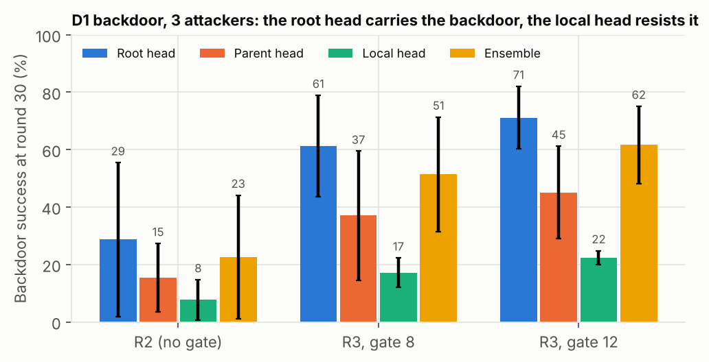

| Rung | Root | Parent | Local | Ensemble |
|---|---|---|---|---|
| R2 (no gate) | 29 | 15 | 8 | 23 |
| R3, gate 8 | 61 | 37 | 17 | 51 |
| R3, gate 12 | 71 | 45 | 22 | 62 |

Qin et al. (KDD 2023) report the same mechanism in FedRep: the shared trunk learns the trigger features, but a classifier trained only on clean local data never maps them to the target label. Two consequences, both now written as predictions in `PREDICTIONS.md` before the GPU runs: (1) a zero-cost prediction-time defense, letting the personal heads overrule the root head when they disagree (idea 9 in `IDEAS.md`); (2) recovery (H8) should rewind the trunk and the root head, not the trunk alone. `PREDICTIONS.md` also states the expected outcome of every queued experiment, the ALIE accuracy puzzle's three candidate explanations with the run that separates them, the model we expect to publish, and a 2,700-run campaign plan ordered so that method decisions come before scale.

## 2026-11-16 · Run plan for the lab GPU server (campaign C1–C6, 351 runs)
Written into the code today, all tested (104 tests pass): head-agreement inference (`fedhep.head_agreement`, idea 9), the rewind on isolation (`plus.rewind`, H8 variant a), and `plus.global_f_fixed` for the ALIE puzzle. Sweeps, to be submitted in this order with `scripts/gpu_sweep.py` once the pilot has set `--procs`:

| Order | Sweep | Runs | Tests |
|---|---|---|---|
| 1 | `gpu_d1_signals` | 150 | P1–P7, P11: the six signals, the exit guard and head-agreement inference on fresh CUDA baselines |
| 2 | `gpu_c2_alie` | 24 | the ALIE puzzle: regrouping off, f held fixed, both, and gate 12 |
| 3 | `gpu_c4_d2` | 120 | the D2 ladder on CUDA with the whole-model signals |
| 4 | `gpu_c5_recovery` | 36 | P8–P10: rewind trunk / trunk + root head / all, with the backdoor on and stopped at round 10 |
| 5 | `gpu_c6_durability` | 21 | P13: 100 rounds, backdoor stopped at round 50; lifespan |

Every run also records the depth-exit guard and head-agreement metrics, so no separate runs are needed for them. Results are compared only with other CUDA runs. The predictions each sweep is checked against are in `PREDICTIONS.md`.

## 2026-11-17 · D2 ladder complete: the gate holds at α = 0.2; backdoor by attacker share
All 36 runs of `phase6_ladder_d2` are done (Mac, MPS). D2: α = 0.2, 20 clients, 4 attackers, mean of 3 seeds. Honest isolated is the sum over 3 seeds of honest clients isolated by round 30.

| Method | No attack | Sign flip | Min-Max | Backdoor (success) | Honest isolated (no attack / sign / Min-Max / backdoor) |
|---|---|---|---|---|---|
| FedHEP (no defense) | **55.59** | 42.51 | 52.10 | 54.72 (46.9%) | 0 |
| Defended FedHEP | 54.70 | 50.62 | **54.16** | 54.47 (44.3%) | 0 |
| FedHEP+ | 52.68 | 52.15 | 53.55 | 53.08 (43.3%) | 27 / 21 / 6 / 18 |
| L0 alone | 54.23 | 50.52 | 52.96 | 54.51 (**37.7%**) | 0 |
| R2: L0 + two-sided | 52.13 | 51.86 | 52.62 | 52.49 (44.1%) | 38 / 29 / 29 / 33 |
| R3, gate 8 | 54.72 | **54.26** | 53.34 | 54.46 (45.3%) | 3 / 6 / 8 / 7 |
| R3, gate 12 | **54.73** | 54.19 | 52.51 | 54.49 (45.3%) | 2 / 1 / 0 / 6 |

- **The gate works at strong heterogeneity.** R3 with gate 12 is within 0.9 points of the undefended model with no attack and isolates 2 honest clients over 3 seeds, where FedHEP+ isolated 27 and lost 2.9 points. Under sign flip it is the best method by 2 points (54.2 vs FedHEP+ 52.2, Defended 50.6), catching all 4 attackers on every seed. This is the D2 result the Phase 5 follow-up was missing: FedHEP+'s advantage now carries over to α = 0.2.
- **Min-Max is the one attack where isolation costs:** gate 12 isolates the attackers in 1 of 3 seeds and scores 52.5, below Defended FedHEP (54.2) and L0 (53.0). The same pattern as ALIE at D1: when attackers sit near the mean, bounding beats isolating. The ALIE-puzzle runs (`mac_c2_alie`) test the explanation.
- **The backdoor is untouched by every rung at D2** (44–45% success; L0 alone 38%; no defense 47%). Per head: root 86%, parent 48–62%, local 12–15%, a wider gap than at D1 (root 29–71%, local 8–22%). The personal heads resist more at α = 0.2 because each sees fewer classes. Head-agreement inference (P11) should gain more here, and it is on in every new run.

**Backdoor by attacker share** (D1, 15 clients, 30 rounds; FedHEP+ = `zmr`):

| Attackers | FedAvg | FedHEP | Defended | FedHEP+ (honest / attackers isolated) |
|---|---|---|---|---|
| 10% (1–2) | 43.1% | 42.3% | 36.2% | **1.3%** (3.7 / 1.0) |
| 30% (4–5) | 90.9% | 83.9% | 83.8% | 50.2% (3.3 / 4.7) |
| 40% (6) | 93.4% | 87.3% | 86.5% | 74.9% (2.3 / 4.7) |

FedHEP+ stops the backdoor at 10% attackers and degrades with the share; FedHEP's hierarchy alone gives at most 7 points over FedAvg. Accuracy: FedHEP+ loses 2.7 points to Defended at 40% (42.7 vs 46.1).

**Sign-election pilots** (`frontier_pilot_*`, seed 42, synthetic data): a colleague's first pass at idea 10 in `IDEAS.md`, Part B; the rule is in the Mac working tree, not yet committed. On the synthetic problem sign election matches L0 with no attack (3.6 vs 3.7) and beats ARC+NNM under ALIE (3.5 vs 3.1). CIFAR-100 runs are on the Acer (`acer_frontier_first`).

**Run plan while the GPU server is unavailable** (each machine compares only with its own runs):

| Machine | Sweep | Runs | Hours | Tests |
|---|---|---|---|---|
| Mac | `mac_c2_alie` | 24 | 5 | the ALIE puzzle (a, b, c) against the Mac's own `p6__r3g8` and `p6__l0` |
| Mac | `mac_c5_recovery` | 42 | 9 | rewind trunk / trunk + root / all on the root-head and whole-update signals; backdoor on, and stopped at round 10 |
| Acer | `acer_c6_durability` | 21 | 16 | 100 rounds, backdoor stopped at round 50: lifespan under each defense and the rewind |

Every run records head-agreement inference and the exit guard, so P6 and P11 get their first CIFAR-100 answer from these runs. The GPU sweeps stay queued for the server; their runs are not duplicated here (different device, different names).

## 2026-11-17 · GPU server pilot: one run per GPU, and CUDA is not repeatable by default
Lab GPU server, NVIDIA RTX PRO 4500 Blackwell (32 GB), PyTorch 2.7.1 + CUDA 12.8 in the lab's container (`/scratch/containers/pytorch/pytorch-2.7.1-cu128.sif`), commit `802eb85`. Sweep `gpu_pilot`: rung R3 with the exit guard and head agreement on, 5 rounds, seeds 42, 123, 7, 2026, run with 1, 2 and 4 runs at a time on one GPU each (`outputs_pilot/p1`, `p2`, `p4`).

| Runs at once on one GPU | Seconds per round, per run | Runs finished per GPU-hour (relative) | Peak GPU memory per run |
|---|---|---|---|
| 1 | 3.1 | 1.0 | 2.1 GB |
| 2 | 5.6–6.2 | 1.0 | 2.1 GB |
| 4 | 11.3–12.5 | 1.0 | 2.1 GB |

- **One run already fills the GPU.** Running 2 or 4 at once makes each run 2 or 4 times slower, so throughput does not change. The campaign uses `--procs 1` on each of the 4 GPUs. A 30-round D1 run should take about 2 minutes (3.1 s per round plus evaluation), against about 13 minutes on the Mac: roughly 6 times faster per GPU, 24 times with all four. The second round is slow in every run (8 s alone): one-off start-up work, not a recurring cost.
- **The same run gives different numbers on CUDA.** Same seed, same configuration, same GPU model: final accuracy after 5 rounds differs by up to 0.67 points between the three jobs (seed 7: 30.93, 31.27, 31.60). The cause is cuDNN and atomic GPU additions, which sum in an order that changes from run to run. Runs on the server now use deterministic kernels (`run.deterministic: true`, added to every `gpu_*` sweep and to `device_parity`), so a rerun reproduces its numbers exactly; the cost in speed is measured by the next pilot (`outputs_pilot/det_a` and `det_b`, two identical jobs).
- **Fixed:** the launcher read the commit with `git`, which the container lacks (all three first jobs stopped at start-up); it now reads `.git` directly. Jobs started in the same second also shared log files, because the container hides Slurm's job number; log names now include the process id.

## 2026-11-17 · ALIE puzzle (C2 on the Mac): regrouping is not the cause, holding f fixed makes it worse
`mac_c2_alie`, D1 (α = 0.5, 15 clients, 3 ALIE attackers, z = 0.43), 3 seeds, Mac (MPS); baselines `p6__l0` and `p6__r3g8` from the same machine. Every variant isolates all three ALIE attackers in round 3.

| Variant of R3 (gate 8) | No attack | ALIE | ALIE, per seed (123 / 42 / 7) | Honest isolated, ALIE |
|---|---|---|---|---|
| L0 alone (isolates nobody) | 47.56 | **47.56** | 48.47 / 47.64 / 46.57 | 0 |
| R3 as before | 47.36 | 45.74 | 46.30 / 46.63 / 44.28 | 0.7 |
| (a) no regrouping after isolation | 47.59 | 46.09 | 47.03 / 47.12 / 44.12 | 0.3 |
| (c) f held at 3 after isolation | 47.16 | 44.65 | 45.15 / 45.86 / 42.93 | 1.3 |
| (a) and (c) | 47.40 | 44.67 | 45.28 / 45.25 / 43.48 | 0 |

- **(a) Regrouping explains a little:** turning it off recovers 0.35 of the 1.8-point gap (2 of 3 seeds), as predicted (at most 0.5).
- **(c) was wrong in direction:** keeping f = 3 after the three attackers are gone makes the trimmed mean discard 3 honest clients per side every round, which costs another 1.1 points. The current rule (f falls with each isolation) is the right one.
- **(b) is what remains:** about 1.4 points that neither regrouping nor the trimmed mean explains. ALIE updates are honest updates shifted by 0.43 standard deviations, so they still carry three clients' data; L0 bounds the shift and keeps the data, isolation discards both. Not proven by these runs (no variant restores the attackers' data); the direct test is L0 with the three ALIE clients' data trained honestly, which is the no-attack L0 run with 15 clients against one with 12.
- **Consequence:** for attacks that stay near the mean, bounding beats isolating. This supports soft, reversible trust (H3) over permanent isolation for these attackers.

**Prediction-time defenses, first CIFAR-100 numbers** (19 runs above, no backdoor, so this is their cost only): head-agreement inference overrules 3.0% of inputs and costs 0.18 points of accuracy on average (worst run 0.61), 0.22 on the bottom 10%; the depth-exit guard flags 3.1% of clean inputs and costs 0.33 (worst 0.53). Both are inside the costs predicted (P6: 0.5–1.5; P11: below 0.5). Their effect on the backdoor comes from `mac_c5_recovery` and the GPU runs.

## 2026-11-17 · Durability, recovery, and 20–30 clients (Acer and Mac, 157 runs)
**Durability (Acer, `acer_c6_durability`, 100 rounds, backdoor by 3 attackers for rounds 1–50, D1).** Done so far: FedHEP and FedHEP+ (3 seeds), L0 (2 seeds); the R3 rungs are still running.

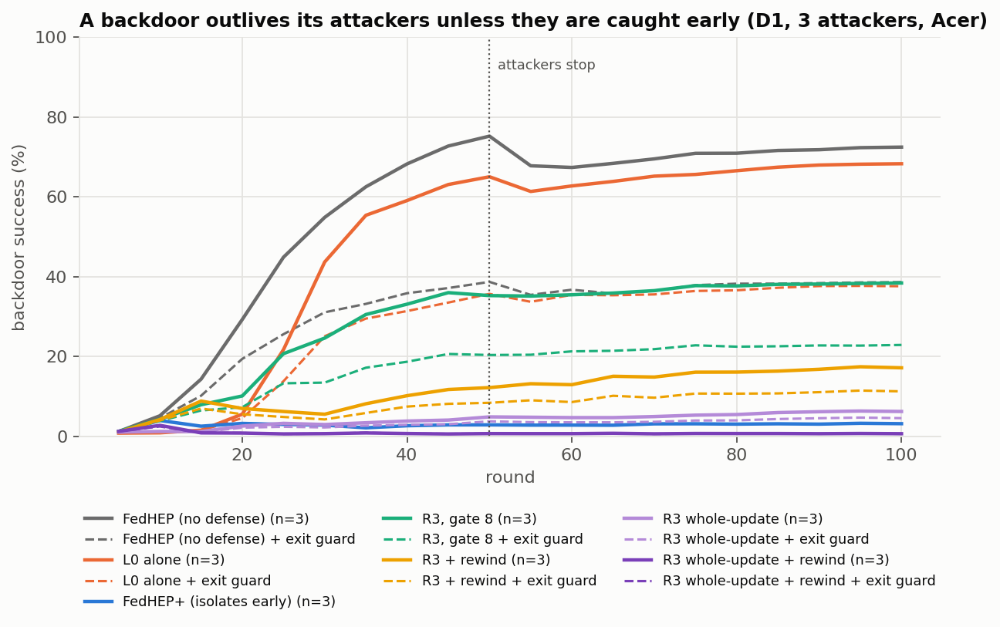

| Method | Success at round 50 | at 100 | Rounds above 50% after the attack stops | Attackers isolated (first round) | With exit guard at 100 | Honest isolated |
|---|---|---|---|---|---|---|
| FedHEP (no defense) | 75% | 72% | all 50 | none | 39% | 0 |
| L0 alone | 65% | 67% | all 50 | none | 39% | 0 |
| FedHEP+ | 3% | **3%** | none | 3 of 3 (rounds 4, 9, 10) | 3% | **8 per run** |

- **A backdoor that is not caught never fades.** With no defense or with L0, success stays at 64–75% for all 50 rounds after the attackers stop training on poisoned data. The honest clients do not erase it.
- **Catching the attackers early keeps it out for good:** FedHEP+ isolates all three by round 10 and success stays at 2–5% for 100 rounds. The price is the one we know: 8 honest clients isolated per run over 100 rounds (more rounds, more chances for a false isolation).
- **The exit guard halves an undetected backdoor and keeps it halved:** 72% → 39% (FedHEP), 67% → 39% (L0), stable from round 50 to 100, at 0.3–0.7 points of accuracy.

**Recovery (Mac, `mac_c5_recovery`, R3 gate 8 on the root-head signal, D1, backdoor all 30 rounds).** Rewinds fire only when an attacker is isolated, so the effect depends on the seed:

| Seed | No rewind | Rewind trunk | Trunk + root head | All shared weights | All + exit guard | Rewinds (round → rewound to) |
|---|---|---|---|---|---|---|
| 123 (caught round 14) | 35.6% | 22.5% | 18.6% | 16.3% | **12.7%** | 14 → 9, then more after false isolations |
| 7 (caught round 12) | 44.6% | 30.0% | 28.7% | 26.9% | **17.6%** | 12 → 9 |
| 42 (never caught) | 73.9% | 73.9% | 73.9% | 73.9% | 35.4% | none |

- **When an attacker is caught, the rewind cuts backdoor success by 13–19 points**, more the more it rewinds (trunk < trunk + root < all). Accuracy: −1.3 points on seed 123, where false isolations triggered extra rewinds; ±0.5 elsewhere.
- **It cannot go below what was implanted before the first suspicious round:** the attackers poison from round 1, but their first suspicious round is 9, so rounds 1–8 stay in the model. That is why success stays at 16–30% instead of below 15 (prediction P8 not met).
- **On seed 42 nobody is caught and nothing is rewound.** Detection is the bottleneck: the gated root-head screen misses the backdoor on this seed, which is what the whole-update and layer signals (`gpu_d1_signals`, `m6__r3w_*` still running) are meant to fix.
- **Head agreement helps little against the backdoor** (73.9% → 65.2% on seed 42; 3–6 points on the others). The parent head carries the backdoor too (63% on seed 42), so the two personal heads rarely agree against the ensemble on a triggered input. The exit guard does far more.

**More clients (Acer).** 20 clients (`n20__`, α = 0.5, 5 or 7 sign flippers) and 30 clients (`n30__`, 6, 9 or 12 attackers), 3 seeds:

| | 20 clients: no attack | sign 5 | sign 7 | 30 clients: no attack | sign 6 | sign 9 | sign 12 | backdoor 6 / 9 / 12 (success) |
|---|---|---|---|---|---|---|---|---|
| FedAvg | 37.0 | 10.9 | 1.1 | 32.8 | 18.1 | 4.3 | 1.1 | 89 / 92 / 93% |
| FedHEP | 47.3 | 30.2 | 17.0 | **45.5** | 28.4 | 22.3 | 5.3 | 73 / 74 / 76% |
| Defended FedHEP | **47.5** | 36.2 | 29.2 | 44.4 | 39.7 | 29.6 | 17.9 | 72 / 74 / 75% |
| FLAME | 41.4 | 41.9 | 41.4 | 37.8 | 38.3 | 36.5 | 36.3 | **0.5 / 0.7 / 0.9%** |
| FedHEP+ | 47.4 | **46.4** | **45.3** | 44.6 | **42.0** | **40.9** | **39.8** | 60 / 68 / 73% |

- **FedHEP+ holds under sign flipping up to 40% attackers**: it isolates every sign flipper on every seed (5/5, 7/7, 6/6, 9/9, 12/12) and loses at most 1.1 points at 20 clients and 4.8 at 30 clients with 12 attackers, where Defended FedHEP falls to 17.9. Cost with no attack: 3 honest clients isolated at 20 clients, 3.7 at 30; accuracy within 0.2 of Defended.
- **FLAME is the only rule that stops the backdoor at scale** (under 1% at every attacker share) and pays 6.6–7.7 points with no attack. FedHEP+ reduces the backdoor only at 20% attackers (60% vs 72%).
- **Backdoor with stop (`n20h__`, 20 clients, 5 attackers):** FedHEP 80% (full) and 37% (stopped at round 10); FedHEP+ 45% and 32%.

**Sign-election pilot** (`acer_frontier__`, a colleague's implementation of idea 10, seed 42 only, Acer): sign election vs L0: no attack 47.83 vs 47.83; ALIE 47.77 vs 48.09; Min-Max 43.01 vs 44.27; sign flip **44.15 vs 42.00**. Better than L0 under sign flip, worse under Min-Max; one seed, so no conclusion yet.

## 2026-11-18 · GPU batch 1: six screening signals, fresh CUDA baselines, device comparison (186 runs)
Lab GPU server, 4 × RTX PRO 4500, PyTorch 2.7.1 + CUDA 12.8, deterministic kernels; `gpu_d1_signals` (150 runs), `gpu_c2_alie` (24), `device_parity` (12). D1: α = 0.5, 15 clients, 3 attackers, 30 rounds, seeds 42, 123, 7. Every run also records the exit guard and head-agreement inference.

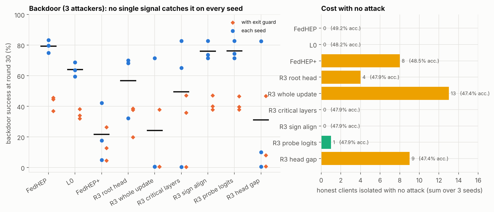

**Accuracy (mean ± sd over 3 seeds) and backdoor success:**

| Method | No attack | Sign flip | ALIE | Min-Max | Backdoor (acc.) | Backdoor success per seed (123 / 42 / 7) | Honest isolated, no attack (sum of 3) |
|---|---|---|---|---|---|---|---|
| FedHEP | **49.19 ± 0.47** | 33.76 ± 2.71 | 47.58 ± 0.51 | 45.53 ± 0.88 | 46.99 | 75 / 80 / 83% | 0 |
| Defended FedHEP | 48.68 ± 0.98 | 38.78 ± 1.52 | 47.50 ± 0.24 | 45.25 ± 0.85 | 47.47 | 75 / 80 / 82% | 0 |
| FedHEP+ | 48.48 ± 1.21 | **46.28 ± 1.28** | **47.84 ± 0.65** | 44.67 ± 2.11 | 46.69 | **5 / 18 / 42%** | 8 |
| L0 alone | 48.21 ± 0.75 | 41.58 ± 1.39 | 47.29 ± 0.20 | 45.78 ± 0.86 | 46.95 | 60 / 64 / 69% | 0 |
| R3, root-head signal | 47.89 ± 0.55 | 46.12 ± 0.59 | 46.33 ± 0.51 | 46.22 ± 0.56 | 46.18 | 32 / 70 / 68% | 4 |
| R3, whole update | 47.36 ± 0.13 | 45.81 ± 0.67 | 45.41 ± 1.23 | 46.13 ± 1.35 | 44.76 | **0.6** / 71 / **0.6%** | 13 |
| R3, critical layers | 47.89 ± 0.50 | 46.12 ± 0.59 | 46.33 ± 0.51 | 46.03 ± 1.50 | 46.11 | 65 / **0.5** / 83% | 0 |
| R3, sign alignment | 47.89 ± 0.50 | 46.12 ± 0.59 | 46.33 ± 0.51 | **46.44 ± 0.93** | 46.02 | 74 / 71 / 83% | 0 |
| R3, probe logits | 47.91 ± 0.51 | 46.16 ± 0.45 | 47.30 ± 0.28 | 46.09 ± 1.04 | 45.83 | 74 / 71 / 83% | 1 |
| R3, head gap | 47.44 ± 0.39 | 46.16 ± 0.45 | 47.32 ± 0.31 | 45.79 ± 0.80 | 46.17 | 10 / **0.7** / 83% | 9 |

Attackers isolated (of 3, mean over seeds): every R3 signal isolates all sign flippers except probe logits and head gap (0); all R3 signals isolate all Min-Max attackers; root head, whole update, critical layers and sign alignment isolate all ALIE attackers, probe logits and head gap almost none (and score 1 point higher under ALIE for it: the ALIE lesson again). Backdoor attackers: root head 2.7, whole update 2.0, critical layers 1.7, head gap 2.3, sign alignment and probe logits 0.

- **No signal catches the backdoor on every seed, but they fail on different seeds.** Whole update catches seeds 123 and 7, critical layers catches 42, head gap catches 123 and 42. A screen that acts on the most suspicious of the whole-update and critical-layer signals would have caught all three. On the Mac the whole-update signal caught all three seeds (0.5–0.9%, below), so the seed it misses is not fixed; detection is close to a threshold in both cases.
- **Seeing the backdoor costs honest clients.** The two signals that catch it (whole update, head gap) isolate 13 and 9 honest clients over 3 no-attack runs and lose 0.5 points against the root-head signal; the three that never isolate anyone also never see the backdoor (except critical layers on one seed). This is the screening dilemma of the whole project in one table.
- **Identical rows are expected, not a bug:** runs are deterministic, and when two signals make the same isolation decisions (nobody with no attack, the three sign flippers in round 3) the runs are bit-identical.
- **FedHEP+ (no gate, one-sided) remains the best overall** on CUDA: best under sign flip and ALIE, and the lowest backdoor success, at 8 honest isolations with no attack.
- **Prediction-time defenses:** the exit guard cuts every undetected backdoor by about half (FedHEP 79 → 42%, Defended 79 → 42%, L0 64 → 35%, R3 57 → 32%) and costs 0.3 points with no attack (3% of clean inputs flagged). Head-agreement inference costs 0.1–0.4 points and removes 0.5–19 points of backdoor success.
- **ALIE puzzle on CUDA (`c2__`) reproduces the Mac result:** no regrouping 46.53 (+0.20 over R3), f held fixed 45.09 (−1.24), both 45.36; with no attack all within 0.3.

**The same experiments on two devices.** 105 runs have identical configuration and seed on the Mac (MPS) and the GPU server (CUDA):

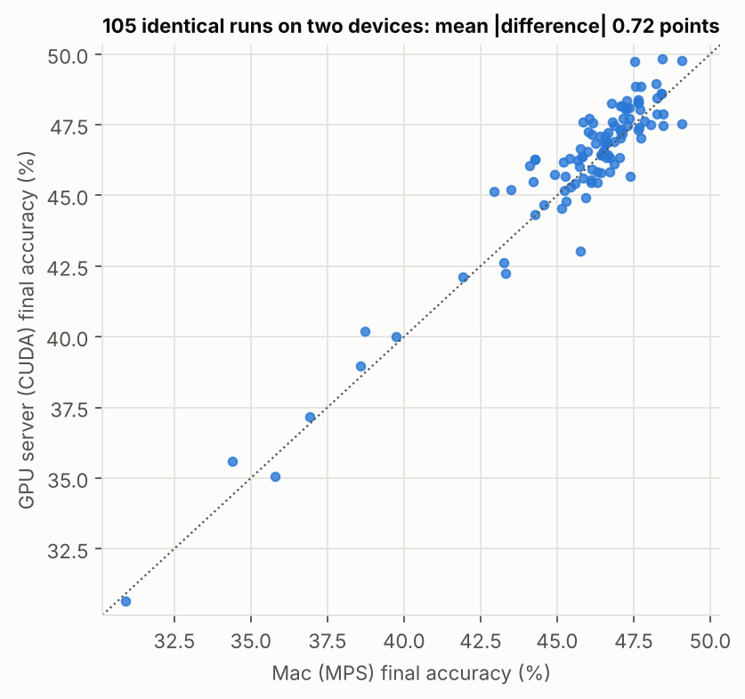

Mean |difference| 0.72 points (CUDA higher by 0.30 on average, largest 2.75); the seed-to-seed standard deviation of one configuration on the Mac is 0.79. A device change moves a run about as much as a seed change. Method rankings with gaps of a point or more survive (sign flip: identical order), rankings within half a point can swap (no attack, ALIE, Min-Max). The device rule stands: one device per comparison table. Pairs: `docs/results/device_pairs.json`. Four Mac/Acer pairs (seed 42) differ by 0.46 on average.

**Whole-update signal with rewind (Mac, `mac_c5_recovery`, D1 backdoor):**

| Variant | Backdoor success (123 / 42 / 7) | Attackers caught (round) | Honest isolated | Accuracy |
|---|---|---|---|---|
| R3, root head, no rewind (`p6__r3g8`) | 36 / 74 / 45% | 3, 0, 3 (12–14) | 0.7 | 46.84 |
| R3, whole update, no rewind | 0.5 / 0.5 / 0.9% | 3, 3, 3 (3–6) | 0, 2, 5 | 46.10 |
| … rewind trunk | 0.5 / 0.5 / 0.3% | same | 3, 0, 5 | 45.74 |
| … rewind trunk + root head | 0.2 / 0.4 / 0.3% | same | 2, 0, 5 | 45.83 |
| … rewind all shared weights | 0.3 / 0.5 / 0.3% | same | 3, 0, 3 | 45.24 |

Detected by round 6, the backdoor never takes hold, so the rewind has nothing left to remove; each rewind triggered by a false isolation costs accuracy instead (rewinding everything: −0.9). Runs with the attack stopped at round 10 are identical to the full runs because every attacker was already isolated.

**100 rounds, attackers stop at round 50 (Acer, `acer_c6_durability`, now 17 of 21 runs):**

| Method | Backdoor success at round 100 (123 / 42 / 7) | Attackers caught (first round) | Honest isolated | Accuracy |
|---|---|---|---|---|
| FedHEP | 69 / 74 / 75% | none | 0 | 43.55 |
| L0 | 64 / 70 / 71% | none | 0 | 44.38 |
| R3, root head | 23 / **71** / 21% | 3, 2 (round 40), 3 | 0, 0, 1 | 43.63 |
| R3, whole update | 1 / 17 / 1% | 3, 3, 3 (3–14) | 8, 6, 4 | 42.19 |
| R3, whole update + rewind (2 seeds) | 0 / 1% | 3, 3 | 4, 4 | 42.90 |
| FedHEP+ | 2 / 5 / 2% | 3, 3, 3 (4–10) | 8, 8, 8 | 43.68 |

Over 100 rounds the price of the whole-update signal shows: 4–8 honest clients isolated and 1.4–2.2 points of accuracy. The root-head screen does not climb past 80% as predicted (P13): where it catches the attackers by round 14 the backdoor stays near 20%.

## 2026-11-18 · Run plan: the large GPU grid (1,872 runs) and the union screen
The pilot and batch 1 settled the two open questions about the GPU server (one run per GPU, about 50 runs per hour on four; deterministic reruns), so the server now runs one large grid instead of small staged batches. A grid that covers every candidate component stays valid whatever the final method turns out to be, and it resumes if interrupted.

- **Grid** (`configs/sweeps/gpu_grid_n15.yaml`, `_n30`, `_n50`, written by `scripts/make_gpu_grid.py`): 15 / 30 / 50 clients × α 0.1 / 0.5 × (no attack + sign flip, ALIE, Min-Max, backdoor at about 10 / 20 / 30% attackers: 2/3/5, 3/6/9, 5/10/15) × 8 methods × seeds 42, 123, 7. Methods: FedHEP, Defended FedHEP, FedHEP+, L0, R3 (root head, gate 8), R3 whole update, R3 union screen, FLAME. 30 rounds, deterministic kernels, exit guard and head-agreement inference recorded in every run.
- **ALIE z** per (n, m) from Baruch et al.: s = ⌊n/2 + 1⌋ − m, z = Φ⁻¹((n − s)/n): 0.253 / 0.431 / 0.842 (n 15), 0.168 / 0.431 / 0.728 (n 30), 0.202 / 0.468 / 0.772 (n 50).
- **Assumption:** the robust rules are told the true attacker count (f = m), as in every earlier table; with no attack they assume the middle share. A mis-specified f is a separate, smaller follow-up.
- **Run order:** methods innermost, so the job finishes whole cells (8 methods × 3 seeds) one after another; a stopped job still leaves complete comparisons. The 15-client, α 0.5, 3-attacker cell repeats batch 1 under new names, which doubles as a determinism check across jobs and code versions.
- **New arm, the union screen** (`plus.signal: weights_critical`): each of the two signals is z-scored and gap-gated on its own, and a client's z is the lower of the two, so either signal can exclude or isolate it. Motivation: in batch 1 the whole update caught the backdoor on seeds 123 and 7 and the critical layers on seed 42. Test: `test_weights_critical_takes_the_lower_z_of_both_screens`. Predictions P17–P19.
- **Fix:** `gpu_c4_d2` ALIE used z = 0.43 (the 15-client value); corrected to 0.39 for 20 clients and 4 attackers before it ran.
- **Expected time:** about 40 hours on four GPUs at the pilot's speed; 30- and 50-client runs may be slower (more clients per round of screening and evaluation). The job then continues with `gpu_c4_d2`, `gpu_c2_alie`, `gpu_c5_recovery` and `gpu_c6_durability`.

## 2026-11-18 · Run plan: Mac and Acer while the GPU grid runs
The GPU server works through the large grid (about 40 hours on two GPUs). The Mac and the Acer take two questions the grid leaves out. Each study runs its own baselines on its own device, so no table mixes devices.

- **Mac, `mac_c7_stealth` (84 runs, about 16 hours), adaptive attack.** New attack `stealth_backdoor` (`rfl.attacks.adaptive.StealthBackdoorAttack`): BadNets training, then each attacker's update is pulled toward the honest mean, m + λ(u − m), with the largest λ in [0, 1] that keeps it within Min-Max's bound (no farther from any honest update than the farthest honest pair). It sees the honest updates (omniscient) but not the screen's own statistic. 7 methods (FedHEP, Defended FedHEP, FedHEP+, L0, R3 whole update, R3 union screen, FLAME) × {plain backdoor, stealth backdoor} × {3, 5 attackers} × 3 seeds, D1. Tests: `test_stealth_blend_keeps_an_inside_update_and_pulls_a_far_one_to_the_bound`, `test_stealth_backdoor_changes_only_attackers_parameters`, `test_stealth_backdoor_runs_end_to_end_and_reports_success`. Prediction P20.
- **Acer, `acer_c8_fmis` (72 runs, about 19 hours), mis-specified f.** Every table so far told the robust rules the true attacker count. Here f = 1, 3 or 6 with 3 attackers (or none): L0 and R3 with the union screen × no attack, sign flip, ALIE, backdoor × 3 seeds, D1. Prediction P21.
- **Then on both:** `device_parity` (12 runs) into `outputs_parity/mps` and `outputs_parity/xpu`, which measures how far each device moves from the GPU server's numbers and from itself.
- **Earlier queues finished:** Mac `mac_c5_recovery` (66 runs), Acer `acer_c6_durability`; their analysis follows once the Acer's last runs are synced.

## 2026-11-18 · Rewind over 100 rounds, recovery with the whole-update signal, and the first Mac and Acer baselines
The Acer finished the 100-round durability queue (`acer_c6_durability`, 21 runs) and the Mac the recovery queue (`mac_c5_recovery`, 66 runs). D1 (15 clients, α 0.5, 3 backdoor attackers), seeds 123 / 42 / 7. Figures: `docs/figures/phase6_rewind.png` (new, per seed) and `docs/figures/phase6_durability.png` (updated with the whole-update arm).

**Durability, Acer: attackers plant the backdoor for 50 rounds, then train honestly to round 100.** Backdoor success at round 100:

| Method | Seeds 123 / 42 / 7 | Mean | With exit guard | Accuracy | Honest isolated (3 seeds) |
|---|---|---|---|---|---|
| FedHEP (no defense) | 69 / 74 / 75 | 72.4 | 38.6 | 43.55 | 0 |
| L0 | 64 / 70 / 71 | 68.3 | 37.6 | 44.38 | 0 |
| FedHEP+ | 2 / 5 / 2 | 3.1 | 2.8 | 43.68 | 24 |
| R3, root head, gate 8 | 23 / 71 / 21 | 38.4 | 22.9 | 43.63 | 1 |
| R3, root head + rewind | 8 / 28 / 15 | 17.1 | 11.2 | 42.54 | 2 |
| R3, whole update | 1 / 17 / 1 | 6.2 | 4.5 | 42.19 | 18 |
| **R3, whole update + rewind** | **0 / 1 / 0** | **0.6** | 0.6 | 41.81 | 12 |

- **The rewind matters when the catch is late.** On seed 42 the whole-update screen isolated all three attackers, but only after part of the backdoor had reached the shared trunk. It kept growing: 7% at round 20, 13% when the attackers stopped, 17% at round 100. With the trunk-and-root rewind the same seed stayed at 1%. On the other two seeds the catch was early and the rewind changed nothing that matters (1% → 0%).
- **With the root-head signal the rewind halves the backdoor but does not remove it** (38 → 17% on average, at 1.1 points of accuracy). The screen catches the attackers late (seed 42: after the backdoor reached 13%), and what remains still grows after the attack ends (seed 42: 21% → 28%).
- **Cost:** the rewind costs 0.4 points with the whole-update signal and 1.1 with the root head. Over 100 rounds the whole-update screen isolates 4–6 honest clients per run, more than over 30 rounds (2–4). FedHEP+ isolates 8 per run.
- **A backdoor nobody catches stays at 64–75% for 50 rounds after the attack ends**, as before. The exit guard roughly halves whatever gets through.

**Recovery, Mac: attackers plant the backdoor in rounds 1–10, then train honestly to round 30.** Backdoor success at round 30:

| Variant | Seeds 123 / 42 / 7 | Attackers caught (of 9) | Accuracy |
|---|---|---|---|
| R3, root head | 19 / 3 / 47 (trunk-only rewind, trunk-and-root, all: within 2 points of each other) | 1 | 46.7–48.1 |
| R3, whole update, no rewind | 0.5 / 0.5 / 0.9 | 9 | 46.10 |
| R3, whole update + trunk rewind | 0.5 / 0.5 / 0.3 | 9 | 45.74 |
| R3, whole update + trunk-and-root rewind | 0.2 / 0.4 / 0.3 | 9 | 45.83 |
| R3, whole update + rewind all | 0.3 / 0.5 / 0.3 | 9 | 45.27 |

Within 30 rounds the whole-update screen catches every attacker by rounds 3–6, so there is little backdoor to rewind; rewinding everything costs about 0.8 points for nothing. With the root-head signal two of three seeds catch nobody, and a rewind only fires on a catch.

**Taken together:** the strongest configuration so far is R3 with the whole-update signal plus the trunk-and-root rewind (0–1% backdoor success for 100 rounds on all three seeds, about 1.8 points below undefended FedHEP). The union screen should behave the same or better and is the arm to pair with the rewind on the GPU next.

**First results of the new queues (interim, same device only):**
- Mac `mac_c7_stealth`, plain backdoor with 3 attackers (21 of 84 runs): FedHEP 74–84%, Defended FedHEP 74–82%, L0 54–68%, FedHEP+ 5–29%, **R3 whole update 0.5–0.9% and R3 union screen 0.5–1.4%** (all attackers caught on every seed, 6–7 honest isolations over 3 runs), FLAME 0.4–0.6% at 3 points of accuracy. On CUDA the whole-update screen missed seed 123 (71%); on the Mac it catches it, so that seed sits close to the screen's threshold. The stealth-backdoor runs come next.
- Acer `acer_c8_fmis`, matched f = 3 (14 of 72 runs): no attack, L0 47.43 and R3 union 46.82 (11 honest isolations over 3 runs); sign flip, **L0 40.73 (−6.7) and R3 union 45.28 (−1.5)** with all 9 attackers isolated. L0's trimmed mean alone does not hold sign flip at D1; the screen does. The f = 6 and f = 1 arms follow.

## 2026-11-19 · Stealth backdoor (Mac) and mis-specified f (Acer)
D1 (15 clients, α 0.5), seeds 123 / 42 / 7, 30 rounds, each study on one device. Figures: `docs/figures/phase6_stealth.png`, `docs/figures/phase6_fmis.png`. From today the Mac runs no sweeps; it analyses and writes code, and the Acer and the GPU server run everything.

**Stealth backdoor, Mac (`mac_c7_stealth`, 69 of 84 runs).** The stealth attacker trains the backdoor as usual, then pulls its update toward the honest mean until it sits inside Min-Max's distance bound. Backdoor success at round 30 (%):

| Method | Plain, 3 attackers | Stealth, 3 attackers | Stealth, 5 attackers | Accuracy, stealth 3 | Honest isolated, stealth 3 |
|---|---|---|---|---|---|
| FedHEP | 74 / 80 / 84 | 71 / 77 / 83 | 73 / 81 / 84 | 46.43 | 0 |
| Defended FedHEP | 74 / 80 / 82 | 73 / 80 / 81 | 73 / 81 / 82 | 46.43 | 0 |
| L0 | 54 / 66 / 68 | 61 / 70 / 75 | 69 / 79 / 80 | 46.88 | 0 |
| FedHEP+ | 5 / 29 / 29 | 56 / 75 / 65 | 71 / 79 / 80 | 46.13 | 13 |
| R3, whole update | 0.5 / 0.5 / 0.9 | 0.2 / **61** / 0.9 | 2.9 / 9.5 / 3.0 | 45.77 | 9 |
| **R3, union screen** | 0.5 / 0.5 / 1.4 | **0.2 / 0.5 / 0.4** | 2.9 / 9.5 / 1.7 | 45.20 | 14 |
| FLAME | 0.6 / 0.4 / 0.5 | 1.5 / 0.4 / 0.4 | 1.7 / 3.0 / 1.8 | 43.59 | — |

- **Hiding costs the attacker almost nothing.** Without a defense the stealth backdoor reaches 71–83%, the same as the plain one (74–84%). The blend toward the honest mean shrinks the update but keeps its direction.
- **It defeats the screens that rely on one view of the update.** FedHEP+ goes from 5–29% to 56–75%. The whole-update screen misses one seed (61%).
- **The union screen catches every stealth attacker on every seed** (9 of 9; 0.2–0.5%). On the seed the whole-update screen misses, the critical-layer screen flags the attackers, which is the case the union was built for. It costs more honest isolations (14 over 3 runs, against 9 for the whole-update screen) and 1.2 points against undefended FedHEP.
- **With 5 attackers (33%)** both R3 screens catch all 15, and success stays at 2–10%. FedHEP+ catches 12 of 15 but too late (71–80%). FLAME holds (2–3%) at about 3 points of accuracy.
- **Not finished:** the plain backdoor with 5 attackers has only FedHEP and Defended FedHEP (73–84%). The Mac stopped running sweeps, and the other 15 runs cannot move to another device without mixing devices. `gpu_c7_stealth` repeats the comparison on the GPU server, at 15 and 30 clients and α 0.1 and 0.5.

**Mis-specified f, Acer (`acer_c8_fmis`, 72 runs, complete).** The defender assumes f = 1, 3 or 6 while 3 attack (or none). Accuracy, and backdoor success:

| Attack | L0, f = 1 / 3 / 6 | R3 union, f = 1 / 3 / 6 | R3 union, honest isolated (3 runs each) |
|---|---|---|---|
| None | 48.10 / 47.43 / 47.56 | 46.07 / 46.82 / 45.64 | 18 / 11 / 16 |
| Sign flip | **35.73** / 40.73 / 41.89 | 44.35 / 45.28 / 43.77 | 10 / 10 / 16 |
| ALIE (z 0.43) | 47.75 / 47.53 / 46.19 | 44.50 / 44.09 / 44.93 | 12 / 14 / 14 |
| Backdoor (success) | 70–78% / 60–69% / 58–62% | 0.5–0.6% / 0.4–0.5% / 0.4–1.5% | 16 / 15 / 17 |

- **The screen makes R3 indifferent to f.** It isolates all 9 attackers under every attack and every f, and its accuracy moves within 1.5 points.
- **L0 depends on f under sign flip:** told 1 attacker it loses 12.4 points against no attack; told the right number, 6.7. Over-estimating f costs L0 nothing with no attack (47.56 against 47.43).
- **The union screen's cost is honest isolations.** It isolates 4–6 honest clients per run with no attack, so it scores 0.6–2.0 points below L0 when nobody attacks. Under ALIE it is 1.3–3.4 points below L0, because ALIE with 3 attackers barely hurts L0 while the screen still removes honest clients. Cutting these isolations is the main open problem for the candidate method.

**Predictions:** P20 refuted in its premise (the stealth backdoor carries as much backdoor as the plain one) and confirmed in its effect on single screens (FedHEP+, and the whole-update screen on one seed); the union screen holds. P21 half refuted: over-estimating f costs L0 nothing with no attack, while R3 loses 1.2 points; under-estimating lets sign flip through L0 (−5 points against matched f), as predicted.

**Next:** Acer `acer_c9_final_durability` (18 runs of 100 rounds): the union screen with and without the rewind against both backdoors. GPU server after the grid: `gpu_c7_stealth` (168 runs).

## 2026-11-20 · Documentation rebuilt as a report; canonical benchmark planned
The organized account now lives in `docs/report/` (chapters 0–8: federated learning and attacks, FedHEP, Defended FedHEP, FedHEP+, ideas that did not work, FedHEP-Guard, the canonical benchmark, the configuration reference). Each model is described with its formulas, a legend of every symbol, a diagram coloured by what it changes against the previous model, and its results by machine. This log, the decisions and the predictions stay as the dated lab notebook.

- **FedHEP-Guard is fixed as:** R3 (L0 + two-sided screen + patience 3 + gap gate 8) with the union screen (`plus.signal: weights_critical`) and the trunk-and-root rewind; the depth-exit guard is an optional prediction-time add-on.
- **Canonical benchmark** (`configs/sweeps/bench_fedhep_family.yaml`, 546 runs; `bench_fedavg_family.yaml`, 48 runs; GPU server only): 15 models (FedAvg, Multi-Krum, FedHEP, Defended FedHEP, FedHEP+, drill-down v2, Median, Trimmed mean, Bulyan, FLAME, FLTrust, L0, R2, R3, FedHEP-Guard) × 7 attacks (none, sign flip, label flip, ALIE, Min-Max, backdoor, stealth backdoor) × D1 and D2 × 3 seeds, 30 rounds, deterministic kernels. It is the first table with every model on one machine. `scripts/plot_benchmark.py` draws its figures and writes its tables into chapter 7. Every model/attack combination was smoke-tested on synthetic data at D2 before submission.
- **New figure scripts:** `scripts/plot_report_figures.py` (where each mechanism acts in the model); diagram sources in `docs/report/diagrams/`.

## 2026-11-20 · Stealth study complete (Mac, 84 of 84): the plain backdoor with 5 attackers
The Mac's last runs fill the plain-backdoor, 5-attacker column (seeds 123 / 42 / 7): FedHEP 75 / 82 / 84%, Defended FedHEP 74 / 81 / 82%, L0 69 / 77 / 79%, FedHEP+ 40 / 64 / 65%, R3 whole update 20 / 4.4 / 3.8%, R3 union screen 20 / 4.0 / 0.7%, FLAME 0.4 / 0.6 / 0.4%. Both R3 screens isolate all 15 attackers, but on seed 123 the plain backdoor gets in before the catch. With a third of the clients attacking, FLAME is the only model under 1% on every seed (at about 3 points of accuracy). Report chapter 6.10 and `docs/figures/phase6_stealth.png` are updated. This was the Mac's last sweep: from now on it designs and analyses, and the Acer and the GPU server run.

## 2026-11-21 · GPU grid at 15 and 30 clients (1,239 runs): strong against poisoning, honest isolations grow with n

The GPU server's `gpu_grid_n15` and `gpu_grid_n30` parts are in: 8 models at α 0.5 and 0.1, 10/20/30% attackers, 3 seeds, 30 rounds (prefixes `gg15_*`, `gg30_*`). The 50-client part is still to run. Its FedHEP-Guard column (`r3wc`) is the union screen without the rewind.

- **Model poisoning:** the union screen has the best worst-case accuracy over sign flip, ALIE and Min-Max in 3 of 4 settings (43.3, 57.8, 40.2, 54.4) and stays within 1–4 points of its no-attack accuracy. R3 with the root-head signal collapses under sign flip at α 0.1 (29.9 at 15 clients, 40.3 at 30).
- **Backdoor:** at α 0.5 the union screen holds 0.4 / 0.6 / 12% (15 clients) and 0.5 / 0.9 / 1.2% (30 clients) at 10/20/30% attackers. At α 0.1 it lets through up to 31%. FLAME holds every backdoor (0.4–3.5%) but costs 6–11 points with no attack.
- **P17 held exactly:** 0.6 / 0.5 / 0.6% on the three seeds where the whole-update screen alone gave 0.6 / 71.4 / 0.6%, with 13 honest isolations over 3 runs. The 15-client, α 0.5 cell repeats GPU batch 1 and gives the same whole-update numbers, so the server reproduces itself across jobs. P18 half refuted (see PREDICTIONS).
- **Honest isolations grow with n:** 4.3 per run at 15 clients, 14.7 at 30 (α 0.5, no attack). Diagnosis: the fixed gap gate (ratio ≥ 8) opens by chance more often with more scores: 18% at 15, 51% at 30, 81% at 50 for normal scores with no attacker. Logged gate-open rates in the no-attack runs agree (whole update 32% → 44%, critical layers 14% → 43%, from 15 to 30 clients). Proposed next experiment: a size-calibrated gate γ(n) at the 95th percentile of the null gap ratio (about 12, 19 and 28 at 15, 30 and 50 clients), calibrated on real honest rounds.

New charts: `docs/figures/phase6_isolation_rounds_n15.png` and `_n30.png` (cumulative honest isolations per round, `scripts/plot_phase6.py`). Report chapters 6.12 and 6.13 are updated.

## 2026-11-21 · Analysis: why raising the gap gate is not the fix; team code review; run plan for Phase 7

**The gap gate (GPU grid logs, no new runs).** For every round of the 15- and 30-client grid, the gap ratio of both union-screen signals was set against what the largest gap separated (`fig_gap_gate_tradeoff` in `scripts/plot_phase6.py`):

| Rounds | 15 clients: median / 95th percentile | 30 clients: median / 95th percentile |
|---|---|---|
| no attack (honest rounds, R3 with every signal) | 5.3 / 13.7 | 6.2 / 20.8 |
| backdoor, largest gap separates exactly the attackers (r3wc) | 8.6 / 24.5 | 14.1 / 33.1 |
| sign flip, ALIE, Min-Max, same | 62 / 571 | 129 / 500 |

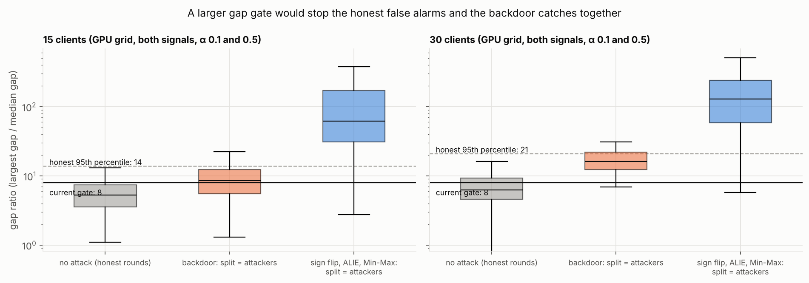

A gate at the honest 95th percentile (14 and 21) would remove most chance openings, and also about three quarters of the backdoor catches. Model poisoning is far above either threshold. The size-calibrated gate proposed in the previous entry is therefore expected to trade backdoor protection for fewer honest isolations, and is not run first. Report 6.12 is corrected.

**Team code (Topology-aware-FDL).**
- The attached "Updated FedHEP" changelog describes `topo_v4`: E = 3, cached Stage-2 local head, a Newton simplex for the head blend, root-head clustering with Hungarian ID alignment and a leave-one-out parent gate.
  - It is not on GitHub (latest commit 2026-11-12), so it cannot be run here yet.
  - Its own notes say the defended engine still runs the old round loop, and falsely isolated 14–15 of 15 clients at q = 0.4 (seed 42).
  - Its ablation finds K = 1 within 0.1–1 point of K = 3 at every α, as our 2.5 (parents always copy Global) predicts.
- The `oreh` package (2026-11-11/12) adds IPM (an ε-cosine variant of Xie et al.), an "adaptive cosine" attack and a delayed-onset attack against Defended FedHEP. Its K sweep (1–15 groups) moves accuracy by at most 1 point.
  - Their adaptive-cosine update reduces to $(1-2w)\mu$, a scaled reversed mean, since $\operatorname{sign}(\mu)\lvert\mu\rvert = \mu$.
  - IPM and delayed onset are not in RFL_Lab yet. They are candidates for the GPU after the benchmark.

**Literature read for this step:**
- BoBa (arXiv 2407.09658): compare clients only within groups of similar inferred data, because under non-IID honest outliers look like attackers.
- FedMAST (arXiv 2609.27760): seven structural evidence axes. Its benign false-positive rate is 24–29% under non-IID, the same weakness as ours.
- FedSurrogate (arXiv 2605.11122): already the source of our critical-layer signal. It rescues suspects with time-accumulated scores.

**Run plan: Phase 7, the peer reference (Acer, `configs/sweeps/acer_c10_peer.yaml`, prefix `x10_`, 24 runs, about 7–8 hours).**
- Each client is scored against the coordinate median of the third of clients whose class masks are most similar (Jaccard), instead of the global median (`plus.reference: peer`, report 6.15).
- Every run also logs the other reference's scores without acting (`plus.shadow_reference`), so the two are compared on identical updates.
- Setting: union screen without rewind, 15 clients, α 0.1 and 0.5, no attack and 3 backdoor attackers, seeds 42 / 123 / 7.
- Predictions P22–P25 were written before the runs.
- Charts: `python scripts/plot_phase7.py outputs` writes `docs/figures/phase7_peer_paired.png` and `phase7_peer_outcomes.png`.
- Tests: `tests/test_peer_reference.py`, 9 tests covering peer choice, the colluder limit, critical layers, and shadow runs being identical to plain runs.

## 2026-11-23 · Acer: FedHEP-Guard's first runs (x9, 100 rounds), Phase 7 refuted (x10), and why honest clients are isolated in whole groups

All 42 runs synced from the Acer (XPU): `acer_c9_final_durability` (18 runs, 100 rounds) and `acer_c10_peer` (24 runs, 30 rounds). Seeds 42, 123, 7.

**FedHEP-Guard over 100 rounds (x9).** D1, 3 attackers until round 50. These are the first runs of the full model: union screen + trunk-and-root rewind (`r3wc_tr`). Backdoor success at round 100, seeds 123 / 42 / 7:

| Model | Plain backdoor | Stealth backdoor | Accuracy, plain / stealth | Honest isolated, plain / stealth (3 runs) |
|---|---|---|---|---|
| FedHEP (no defense) | 67 / 75 / 77% | 67 / 73 / 77% | 43.06 / 43.51 | 0 / 0 |
| Union screen, no rewind | 0.3 / 0.4 / 0.6% | 0.5 / 1.6 / 0.4% | 43.47 / 42.30 | 8 / 16 |
| **FedHEP-Guard** | **0.3 / 0.3 / 0.3%** | 0.4 / 0.4 / **33.8%** | 41.66 / 43.96 | 18 / 10 |

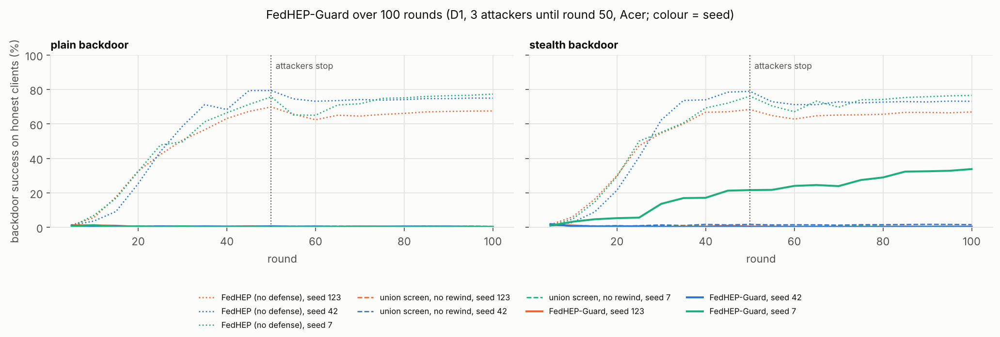

- **The plain backdoor is held on every seed,** including seed 42, which defeated the root-head and whole-update screens (x6). The union screen isolates seed 42's attackers in rounds 3–4.
- **Stealth seed 7 got through FedHEP-Guard.** The attackers were isolated late, in rounds 15–18, and the rewinds reached back only to rounds 15–16. The poisoning from rounds 1–14 stayed in and grew to 33.8% after the attack ended (17.9% with the exit guard).
  - In the run without rewind, the same seed's attackers were caught in round 6. XPU runs are not bit-for-bit repeatable, so the two runs part ways early.
  - In the FedHEP-Guard run, an honest pair was isolated in round 7 and the model rewound to round 5. Whether that rewind delayed the catch cannot be told from one run.
  - One seed is not enough to say whether this is systematic. The Phase 8 durability runs repeat it.

**Phase 7: the peer reference is refuted (x10).** Charts: `figures/phase7_peer_paired.png`, `figures/phase7_peer_outcomes.png`.
- **On identical updates it separates worse** at α 0.1: AUROC 0.60–0.65 against 0.66–0.69 for the global median.
- **Acting on it:**
  - honest isolations rose: 4.0 → 7.0 per run at α 0.5, 0.3 → 0.7 at α 0.1;
  - backdoor success rose: 11.3 → 26.9% at α 0.1, and one α 0.5 seed reached 43.8%.
- **Likely reasons:**
  - A per-client reference is the median of only 5 peers. It is much noisier than the median of 15, so it adds more noise than the heterogeneity it removes.
  - At α 0.5 nearly every client holds nearly every class, so Jaccard similarities are almost tied and the peers are close to arbitrary.
- P22–P25 outcomes are in `PREDICTIONS.md`. The peer reference is dropped (report 5.4, 6.15).

**Why honest clients are isolated: whole parent groups.**
- At α = 0.5, about half of the union screen's honest isolations are a whole parent group isolated in one round. A "group" event means at least 3 honest members of one group in the same round.

  | Screen (GPU grid, α = 0.5) | Share of honest isolations in group events, 15 clients | 30 clients |
  |---|---|---|
  | union screen | 51% | 56% |
  | whole update alone | 53% | 73% |
  | FedHEP+ | 2–3% | 2–3% |
  | root head | 0% | 0% |

- On the Acer, x9's three mass isolations (rounds 13, 14 and 16) were exactly group 2, mostly group 2, and exactly group 1.
- **The cause:** the whole-update signal includes the personal heads (`fc2_parent`, `fc2_local`; the critical-layer signal leaves them out). Members of one parent train the same parent head, so as training goes on a group's updates drift away together.
  - The whole-update gap ratio grows from about 3 to about 20 over rounds 9–13.
  - The group's z-scores fall together until they all pass the cut.
- It also explains why mild skew is worse. At α = 0.5 the clients' own data differ little, so the group direction dominates.

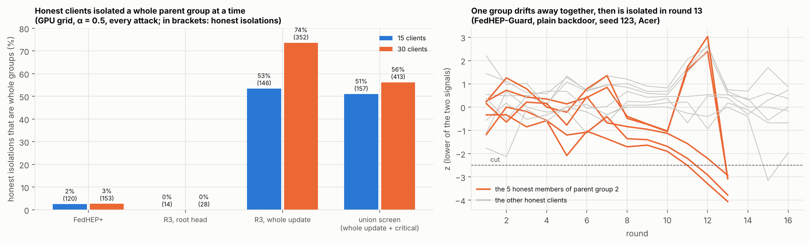

**Run plan: Phase 8, the shared signal (Acer).** A new signal, `plus.signal: shared`, is the whole update without the personal heads; `shared_critical` is its union with the critical layers (report 6.16, diagram 18). Tests are in `tests/test_shared_signal.py`. Predictions P26–P29 were written before the runs.

| Sweep | Runs | Prefix | Approx. time | Purpose |
|---|---|---|---|---|
| `acer_c11_shared.yaml` | 21 | `x11_` | 7 h | no attack, sign flip, ALIE, Min-Max and backdoor at α 0.5; no attack and backdoor at α 0.1 |
| `acer_c11_control.yaml` | 3 | — | 1 h | the union screen under Min-Max, the one missing Acer control |
| `acer_c12_shared_durability.yaml` | 6 | `x12_` | 6 h | FedHEP-Guard with the shared signal, 100 rounds, both backdoors |

Controls already on the Acer: `x10_*__r3wc_shp`, `x8_f3__*__r3wc` and `x9__*__r3wc_tr`.
