# Experiment log

Every run that counts as evidence. Accuracy is pooled over all clients' test images, as in the authors' code (D6). "±" is the standard deviation over seeds; "SE" is the standard error of the difference between two 3-seed means.

Charts live in `docs/figures/` and are redrawn from the runs with `python scripts/plot_results.py outputs`. Error bars are ± one standard deviation over seeds.

## At a glance
**Reproduction (Phase 1) is done.** RFL Lab matches the authors' code wherever both were run, and the paper wherever the authors' code matches it. FedAvg is the one place the paper is higher than both implementations.

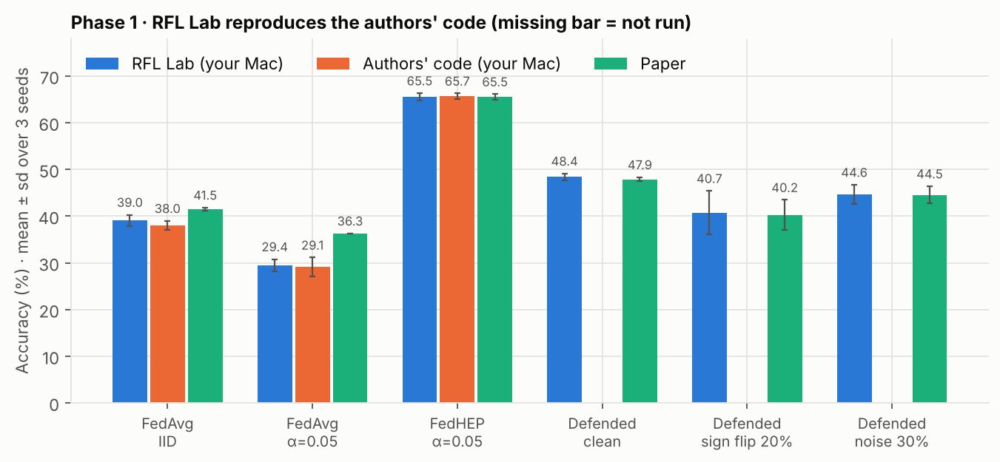

**First new results (Phase 2, 2026-11-07):** a controlled benchmark of four methods under five attacks, including a backdoor the paper doesn't test, with detection scored every round. Headline: Defended FedHEP is the most accurate under every attack, but it never actually removes attackers and does nothing against backdoors; Multi-Krum blocks every attack but at half the accuracy. Details in the Phase 2 entry at the end.

**First confirmed improvement (Phase 3b, 2026-11-08):** FedHEP+ with screening (median reference + regrouping) beats Defended FedHEP on all three seeds under sign flipping (+8.3 points), label flipping (+3.1) and backdoors (success 79% → 21%), at a small cost with no attack (−0.5). Details in the Phase 3b entry.

**Drill-down defense (Phase 4, 2026-11-09): not an improvement.** The parent check finds the parent holding coordinated backdoor attackers (precision 0.85), but the stricter member cut can't tell them from their honest neighbours, and leaving them out for single rounds delayed their isolation (backdoor success 21.5% → 39.7%). A second design (Phase 4b) that turns the parent flag into evidence against members sharing the parent's direction cut backdoor success to 1.9%, but it also isolated honest groups: members of a FedHEP parent are genuinely alike (−1.1 to −1.7 accuracy). Phase 4 is closed; FedHEP+ stays the best method. Details in the Phase 4 and 4b entries.

**Phase 5 (2026-11-12): established rules inside FedHEP, three seeds.** No rule beats FedHEP+ overall. Bulyan and FLAME stop backdoors completely (0.5%, even with 5 attackers or a 3× boost) but leave out 3–6 honest clients per round (−3.9 to −5.6 with no attack); FedHEP+'s gain grows with 5 sign flippers (+12.6) but disappears at α = 0.05. Answers to the professor's questions and the pending runs are in the last two entries.

## How the methods work (reference for every entry below)
A visual version of this section (all diagrams, rendered formulas and key charts in one page) is `docs/methods_page/rfl_lab_methods.html`; open it in a browser. Rebuild it with `python docs/methods_page/build.py . docs/methods_page/rfl_lab_methods.html`. Diagram sources: `docs/diagrams/*.mmd`.

Diagrams are Mermaid and formulas are LaTeX; both render on GitHub. Values are the ones used in every run unless an entry says otherwise.

### Setting
15 clients, CIFAR-100 (10,000 training / 3,000 test images split across clients by a Dirichlet(α) label partition; α = 0.5 is moderately non-IID, α = 0.05 very non-IID), ResNet-9 with **three classifier heads** on one shared trunk: **root** (shared by everyone through Global), **parent** (shared within a group) and **local** (private to the client). 3 groups ("parents"), 30 rounds, 5 local epochs. Attackers: exactly 3 of 15 (D15) unless stated; the authors' rule instead makes each client an attacker with probability q.

### 1 · FedHEP: one round
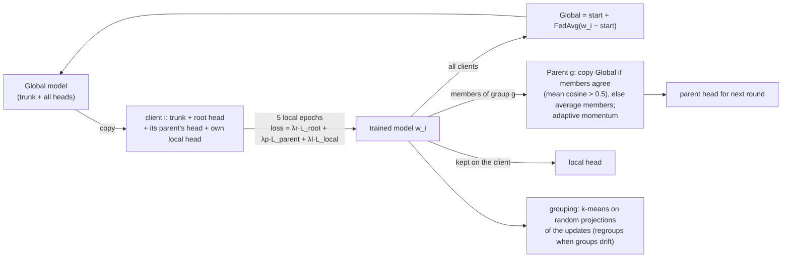

Diagram source (Mermaid)

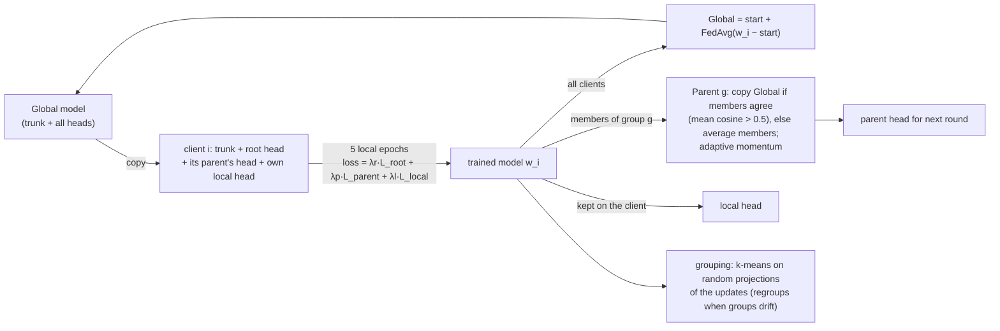

- **Label skew** of client i: $r_i = \dfrac{e^{H(y_i)} - 1}{C - 1}$ ($H$ = label entropy, $C$ = 100): 1 for uniform labels, 0 for a single class.
- **Head loss weights** (binomial): $\lambda_l = (1-r)^2$, $\lambda_p = 2r(1-r)$, $\lambda_r = a + (1-a)r^2$ with $a = \max(\tfrac{1}{2K}, |Y_i|/C)$. Skewed clients lean on their local head, balanced ones on the root head.
- **Prediction**: each client mixes its three heads' logits with weights $\mathrm{softmax}\big((-H_h - \beta\,\ell_h + \log\alpha_h)/T\big)$ (confidence, recent loss, learned prior $\alpha$); near-uniform clients use the root head only; classes the client never saw are masked out.
- **Accuracy reported** = pooled over all honest clients' own test images, each predicted by its own personalised ensemble (attackers are not scored; honest clients that a defense wrongly isolates **are** scored).
- Finding (Phase 1b): the grouping cosine runs on the full state, where BatchNorm's batch counters dominate, so in practice parents always copy Global.

### 2 · Defended FedHEP (the authors' defense): what changes
Every aggregation (parents and Global) is replaced by **SCCF**, soft-cosine consensus filtering, plus a trust ledger. Groups are random and fixed.

Diagram source (Mermaid)

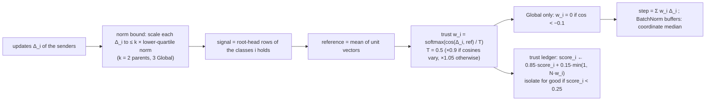

If the mean unit vector is short (norm < 0.2: no consensus), everyone gets $w_i = 1/N$. Phase 2 found the ledger **never isolates anyone**: attackers keep 0.5–0.8 of an equal share, so their score never falls below 0.25.

### 3 · FedHEP+ (Phase 3): what changes from Defended FedHEP
SCCF aggregation is kept; the trust ledger is replaced by **screening**, which decides who enters both tiers; groups are re-formed by weight-only similarity (BatchNorm buffers left out).

Diagram source (Mermaid)

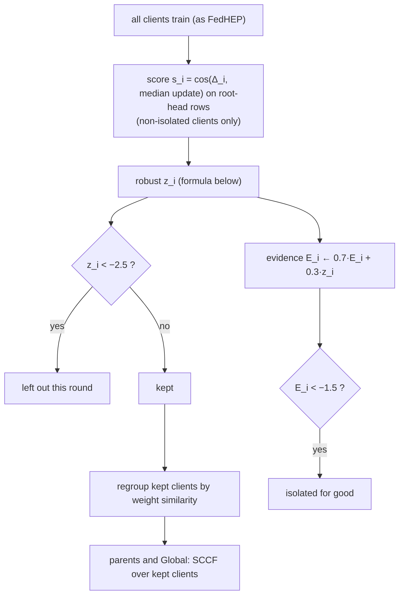

**Robust z.** With $s_i$ the cosine of client i's (norm-bounded) update to the coordinate-wise median update,
$$z_i = \frac{s_i - \operatorname{med}(s)}{\max\big(1.4826\cdot\mathrm{MAD}(s),\ 0.1\,|\operatorname{med}(s)|\big)}, \qquad \mathrm{MAD}(s) = \operatorname{med}_j\,|s_j - \operatorname{med}(s)|.$$
- $1.4826\cdot\mathrm{MAD}$ estimates the standard deviation from the middle of the data, so a few attackers cannot inflate it (a plain standard deviation would grow with them and hide them).
- **Why a z-score:** it is unchanged when every cosine shrinks together late in training (property-tested), which is exactly what made Defended FedHEP's fixed temperature and fixed 0.25 cut fade.
- **Floor** $0.1\,|\operatorname{med}(s)|$: stops a very tight consensus (tiny MAD) from turning small differences into huge z. Fewer than 5 senders are not screened.
- **Evidence** $E_i$ is an exponential moving average, so one bad round is not enough: two rounds at $z = -3$ give $E = -1.53$.

**Population variants tested (Phase 3b/3c):**
- *kept* (used): median and MAD over the clients not isolated. Removing a client shrinks this population, which can shrink the MAD.
- *full population*: median, MAD and reference over every client not banned, isolated ones included, so the yardstick never shrinks: $z_i = (s_i - \operatorname{med}_{\mathcal{A}} s) / \max(1.4826\,\mathrm{MAD}_{\mathcal{A}}(s),\ 0.1|\operatorname{med}_{\mathcal{A}} s|)$ with $\mathcal{A}$ = all non-banned clients. Did not reduce false isolations and let the last backdoor attacker stay in.
- *readmission* (isolated clients come back once $E_i > -0.75$) and a *cap* (at most a third left out per round): both worse (attackers came back late in training).

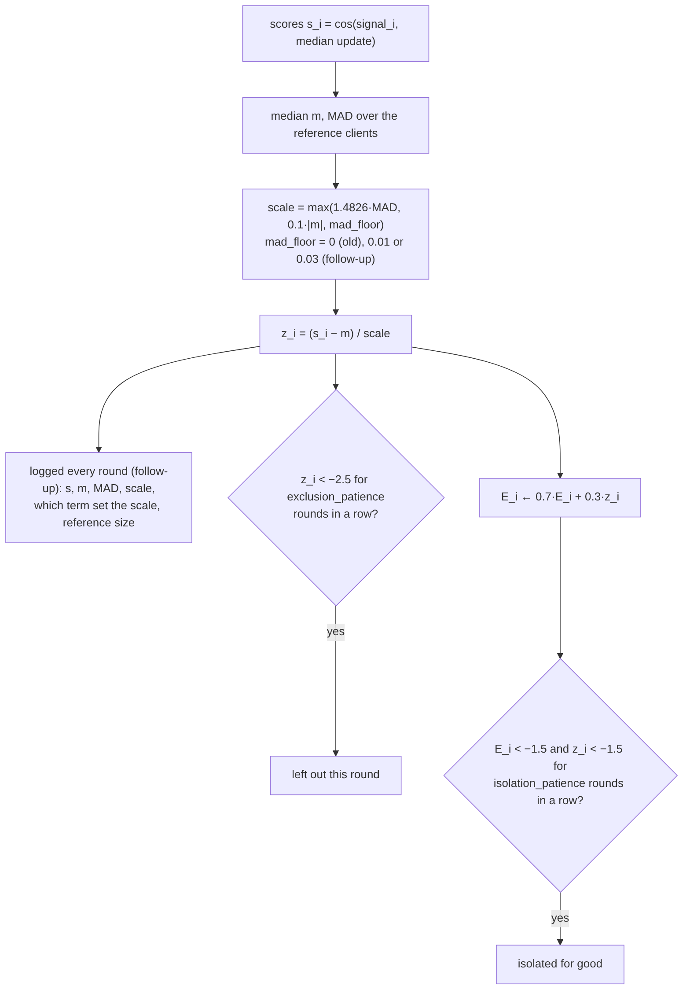

**Follow-up options (2026-11-12, defaults off):** absolute floor `plus.mad_floor` (scale $\ge$ floor), and *patience*: isolate only after $z < -1.5$ in this many consecutive rounds *and* $E_i < -1.5$.

### 4 · Drill-down (Phase 4/4b, off by default): extra steps after screening

Diagram source (Mermaid)

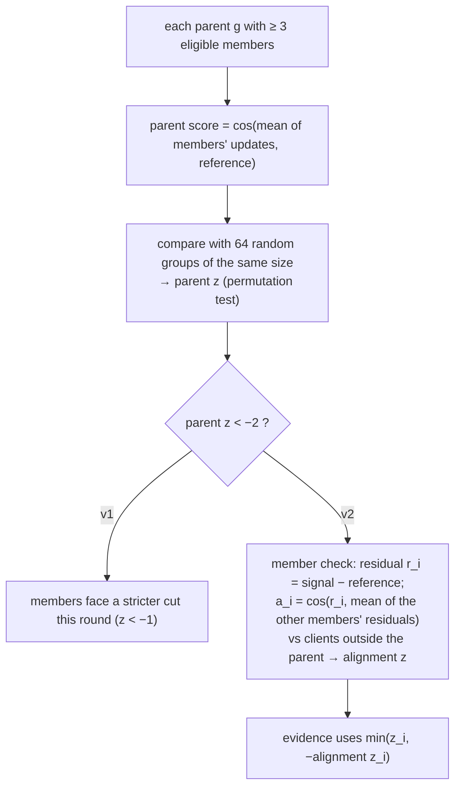

Neither version was adopted (D26, D28): honest members of a FedHEP parent are genuinely alike, so the member check also blames honest groups.

### 5 · Established rules in FedHEP's Global step (Phase 5)
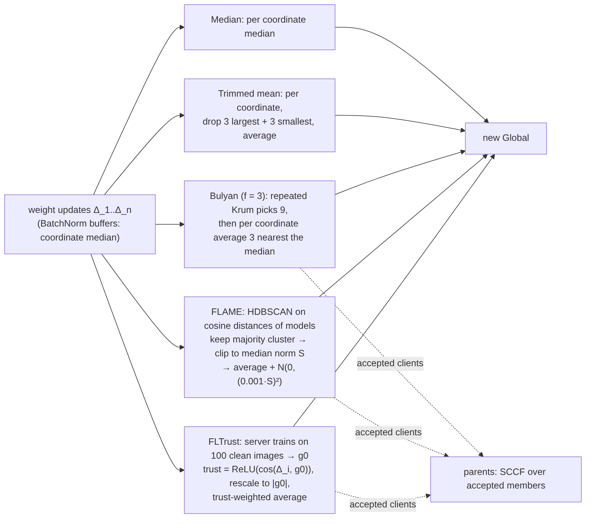

Same FedHEP, Global replaced by one rule on weight updates (parents: SCCF over the clients the rule accepts): **median** and **trimmed mean** (drop 3 per side) [Yin et al. 2018]; **Bulyan** (f = 3: pick 9 by repeated Krum, then average the 3 values nearest the median per coordinate) [El Mhamdi et al. 2018]; **FLAME** (HDBSCAN on cosine distances keeps the majority cluster, clip to the median norm, add noise 0.001·S) [Nguyen et al. 2022]; **FLTrust** (trust = ReLU(cos(update, server update on 100 clean images)), rescale to the server norm) [Cao et al. 2021]. Design choices in D29.

### Attacks (what an attacker uploads)
With $w$ the round-start Global model and $\hat w_i$ the attacker's honestly trained model, $\Delta_i = \hat w_i - w$:
- **Sign flip:** upload $w - 1.5\,\Delta_i$. **Gradient ascent:** $w - 5\,\Delta_i$. **Random noise:** $w + \mathcal{N}(0, 2^2)$ per weight.
- **Label flip:** train on label $C - 1 - y$ instead of $y$, upload the result.
- **Backdoor (BadNets):** stamp a 3×3 white patch in the corner of 50% of its images and relabel them as class 0; optionally scale the update (×3 = "boosted").
- **ALIE** (Baruch et al. 2019): all attackers upload $w + \mu - z\,\sigma$, with $\mu, \sigma$ the per-weight mean and standard deviation of the attackers' own honest updates and $z = \Phi^{-1}\big((n - s)/n\big)$, $s = \lfloor n/2 + 1\rfloor - m$ ($z = 0.43$ for $n = 15$, $m = 3$): small enough to sit inside the honest spread.
- **Min-Max** (Shejwalkar & Houmansadr 2021): upload $w + \mu - \gamma\,\sigma$ (statistics of the honest updates) with the largest $\gamma$ such that $\max_j \|\Delta_{mal} - \Delta_j\| \le \max_{j,k} \|\Delta_j - \Delta_k\|$: as far as possible while never looking further from anyone than two honest clients do from each other.

### Comparison methods
- **No defense:** FedAvg (one ResNet-9, weighted average of all uploads) and undefended FedHEP (above).
- **Multi-Krum** (Blanchard et al. 2017, authors' setting): score each update by the summed squared distance to its $n - f - 2$ nearest others, average the $m = 3$ best.
- **Phase 5 rules** inside FedHEP (section 5).

### Detection metrics
Per round, flagged set $F$ (left out or isolated), attackers $A$, honest clients $H$: precision $= |F\cap A|/|F|$, recall $= |F\cap A|/|A|$, **false-isolation rate** $= |F\cap H|/|H|$; parent level the same with "malicious parent" = attacker majority. AUROC from each method's trust scores.

## 2026-11-06 · Phase 1a · FedAvg on CIFAR-100 (your Mac, MPS)
Setup: `configs/cifar100_fedavg.yaml`, 15 clients, 10,000 training / 3,000 test images, 25 rounds, 3 local epochs, seeds 42, 123, 7. About 4.5 min per run.

| Regime | RFL Lab per seed (42, 123, 7) | RFL Lab | Authors' code on your Mac | Difference | Paper |
|---|---|---|---|---|---|
| IID | 40.47, 38.17, 38.47 | **39.04 ± 1.25** | 38.04 ± 0.94 | +1.00 (1.1 SE) | 41.46 ± 0.36 |
| α = 0.05 | 28.83, 30.97, 28.53 | **29.44 ± 1.33** | 29.07 ± 2.05 | +0.37 (0.3 SE) | 36.29 |

Bottom-10% (IID): 33.75 vs the authors' 33.25.

**Verdict: pass.** Both regimes are within 2 SE of the authors' code. Neither implementation reaches the paper's FedAvg numbers; that gap is between the authors' released code and their paper (their archived "1st run" settings aren't in the archive), not a flaw in this code.

## 2026-11-06 · Phase 1b · FedHEP port: parity tests (cloud workspace, CPU)
100 tests in `tests/test_parity_fedhep.py` call the authors' functions directly:
- identical: multi-head model structure and initial weights, label skew r_skew, class mask and counts, head loss weights, random initial groups, k-means groups (low, medium and high noise), parent momentum (all three clip regimes);
- one full local round (5 epochs, all heads, ensemble-weight updates) from the same weights and seed ends at the same weights (to 1e-5), same ensemble weights and same last losses;
- the test-time ensemble gives the same per-client accuracy and the same test loss, for a skewed client (blended heads) and a near-uniform one (root head only).

Planted one-line deviations (prior mix, gradient anchor, class weights, IID threshold, temperature clamps, loss weight in head scoring, momentum clips, k-means cut to 1 or 2 iterations) each break at least one test. Cutting k-means to 3 iterations is not caught: on 15 points it has converged by then.

## 2026-11-06 · Finding · BatchNorm batch counters dominate FedHEP's grouping signal
The authors group clients, and decide whether parents average or copy the global model, by cosine similarity of the **full** flattened update. That vector includes BatchNorm's batch counter, which grows by the number of local steps (5 epochs × ⌈n/32⌉ ≈ 105 per layer for a CIFAR-100 client), identically signed for every client.

Measured on three synthetic clients with disjoint classes (one local round, `scripts/diag_update_norms.py`):

| Part of the update | Norm |
|---|---|
| weights | 5.2 – 6.3 |
| BatchNorm running statistics | 24 – 25 |
| batch counters | 99 – 113 |

| Cosine between clients computed on | values |
|---|---|
| full vector (authors) | 0.984, 0.985, 0.984 |
| without counters | 0.73, 0.68, 0.72 |
| weights only | 0.05, 0.05, 0.17 |

Checked on CIFAR-100 with the per-round `diagnostics` in `metrics.json` (Phase 1b runs below, all 3 seeds):
1. **Confirmed.** The first similarity grouping happens at round 2 in every seed.
2. **Confirmed.** Member agreement is 0.995–0.999 in every round of every seed, so parents copy the round-start global model in all 25 rounds and never average their members. The parent head is a momentum-smoothed copy of the global one. No later regrouping ever happens.
3. **Not supported.** I expected groups to follow dataset size (number of local steps); they don't (seed 42: one group spans 60 to 190 steps). Groups are lopsided, though: each seed has a one-client group and an 11- or 7-client group.

So FedHEP's middle tier, as run in the authors' code, contributes no group-specific information. It is kept unchanged in the faithful port (Phase 1). It is the first candidate fix for Phase 3: group on weights only.

## 2026-11-06 · Phase 1b · FedHEP on CIFAR-100, α = 0.05 (your Mac, MPS)
Setup: `configs/cifar100_fedhep.yaml`, 15 clients, 25 rounds, 5 local epochs, 3 groups, seeds 42, 123, 7. 12–13.5 min per run.

| Metric | RFL Lab per seed (42, 123, 7) | RFL Lab | Authors' code on your Mac | Difference | Paper |
|---|---|---|---|---|---|
| Accuracy | 65.87, 64.60, 66.07 | **65.51 ± 0.80** | 65.68 ± 0.57 | −0.17 (0.3 SE) | 65.49 ± 0.61 |
| Bottom-10% | 48.28, 48.66, 51.76 | **49.57 ± 1.91** | 50.23 ± 1.50 | −0.66 (0.5 SE) | 53.92 ± 0.63 |

**Verdict: pass.** Both metrics within 2 SE of the authors' code. Accuracy also matches the paper; bottom-10% is below the paper in both implementations.

## 2026-11-06 · Phase 1c · Defended FedHEP port: parity tests (cloud workspace, CPU)
149 tests in `tests/test_parity_defense.py` call the authors' functions directly:
- identical attacker choice (4 seeds × 4 rates) and identical uploads for all four attacks (same noise draw for random noise);
- a label-flipping attacker's full local round ends at the same weights and losses as their `_update_hep`;
- SCCF aggregation identical to their `DeltaSpaceRobustAggregator` with each tier's settings (parent: k = 2, no hard rejection; Global: k = 3, reject cosine < -0.1), with and without class masks, for honest groups, sign-flipped attackers, an inflated update and no consensus, for 1, 4 and 7 senders;
- trust weights identical over 80 random sender mixes that cross the no-consensus cut, the temperature switch and the hard-rejection threshold from both sides.

Planted deviations (quartile anchor, both temperature factors, variance switch, consensus cut, hard threshold, even-count median, class masking, sign-flip factor) each break at least one test. Not caught: a 1% change in the attacker-probability comparison.

### What the authors' Defended FedHEP actually does (read from their code, now ported as is)
- **Groups are random and never change.** The defended engine never calls the similarity grouping, so `cluster_method: update_similarity` in its config has no effect.
- **Trust looks only at the root head.** With class masks (always present), the cosine is computed on the root head's weight rows for the classes a sender holds; the trunk, the other heads and BatchNorm play no part in trust. BatchNorm buffers are combined by median.
- **Isolation is permanent and shared across tiers.** A score below 0.25 after the parent tier also removes the client from that same round's Global step.
- **Label flipping and class masks interact.** Flipped targets that fall in classes the attacker doesn't hold get logit -1e9 in the parent and local losses (loss values near 1e9; the gradients stay finite) and zero weight in the local loss.

## 2026-11-06 · Phase 1c · Defended FedHEP on CIFAR-100, α = 0.5, 30 rounds (your Mac, MPS)
Setup: `configs/cifar100_fedhep_defended.yaml`, 15 clients, 5 local epochs, 3 random groups, seeds 42, 123, 7. 7–8 min per run. Targets are the paper's attack table (the authors' archived runs, 3 seeds).

| Setting | Attackers (s42 / s123 / s7) | RFL Lab per seed (42, 123, 7) | RFL Lab | Paper | Difference | Bottom-10%: ours / paper |
|---|---|---|---|---|---|---|
| No attack | – | 49.07, 47.63, 48.47 | **48.39 ± 0.72** | 47.88 ± 0.46 | +0.51 (1.0 SE) | 41.44 / 41.57 |
| Sign flip, q = 0.2 | 3 / 1 / 3 | 38.80, 46.05, 37.39 | **40.75 ± 4.65** | 40.22 ± 3.24 | +0.53 (0.2 SE) | 33.63 / 33.17 |
| Random noise, q = 0.3 | 6 / 3 / 5 | 42.31, 45.30, 46.28 | **44.63 ± 2.07** | 44.53 ± 1.86 | +0.10 (0.1 SE) | 37.15 / 38.36 |

**Verdict: pass.** All three within 2 SE of the paper. The large sign-flip spread comes from the attacker count (one attacker for seed 123, three for the others).

### Finding · the trust ledger never isolates anyone; robustness comes from down-weighting

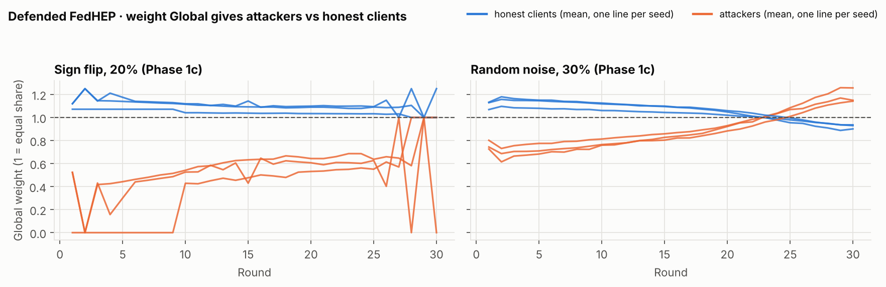

From the per-round `diagnostics` (global tier; "share" = trust × number of senders, 1 = an equal share):
- **No client was isolated in any of the 9 runs**, attackers included.
- **The signal is there.** Sign-flip attackers get a 0.47–0.56 share and noise attackers 0.77–0.86, against 0.96–1.28 for honest clients, from round 1 on.
- **But it can't reach the isolation threshold.** A score settles at the average of min(1, share), so an attacker is isolated only if its average share stays below 0.25. A share of 0.5 settles near 0.5, so attackers keep about half an equal share every round, which is what costs accuracy (48.4 → 40.8 under sign flip).
- **Late in training the defense can switch off.** At round 30, sign flip seed 42: all shares exactly 1.0 (the honest updates no longer agree enough, so everyone gets the same weight). Random noise seed 42: attackers get *more* weight than the least-trusted honest client (1.07–1.21 vs 0.69). Sign flip seed 7, by contrast, rejected its attackers outright at round 30.

These are the first targets for Phase 4: a detection rule that turns the existing separation into exclusion, and a reference that doesn't fade when honest updates get small.

## 2026-11-06 · Phase 1d · Baselines: parity tests (cloud workspace, CPU)
43 tests in `tests/test_parity_baselines.py`: two federated rounds of FedAvg, FedProx, Ditto, FedRep and SCAFFOLD clients (clean and label-flipping) end at the authors' uploads and personal models; three rounds of two SCAFFOLD clients match theirs (control variates active); Krum scores and Multi-Krum's selection match. Planted deviations in the FedProx and Ditto penalties, SCAFFOLD's control-variate step and server mean, and Krum's neighbour count each break a test. Real-data check deferred.

Noted while porting: the authors' Multi-Krum sets f from the **true** number of attackers (an oracle), averages only m = 3 of 15 models, and measures distances on the full state vector including BatchNorm batch counters. Kept as is in the port.

## 2026-11-06 · Phase 2 · Backdoor sanity check (synthetic data, CPU)
The backdoor works end to end: one attacking client alone reaches 100% attack success with 100% clean accuracy; six of six attacking clients reach 100% by round 9. With two of six attackers (50% of their images poisoned), FedAvg on the synthetic data washes it out (0% after round 1); a 3x boost gives an unstable 0–57%. Synthetic classes are far easier than CIFAR-100, so this says nothing about CIFAR-100 strength; the Phase 2 sweep includes a 3x-boosted row in case the plain backdoor is too weak there.

## 2026-11-06 · Fix · SCAFFOLD control-variate rounding
`test_scaffold_two_clients_identical` failed on your Mac (uploads 3e-4 apart by round 2) though it passed in the cloud. Cause: our control-variate step computed (w_start − w_end) / (steps × lr); the authors compute (1 / (steps × lr)) × (w_start − w_end). The two differ by one rounding step, and SCAFFOLD's local training amplifies that: at a higher learning rate the gap reached 3.6e-2 in one round. Now written the authors' way, the gap is below 1e-4 at both learning rates, and the test uses the higher-learning-rate schedule so it catches this kind of drift on any machine. Planted logic errors (step count, server mean) still fail it. No effect on the running Phase 2 sweep (no SCAFFOLD runs in it).

## 2026-11-07 · Phase 2 · Core benchmark on CIFAR-100 (your Mac, MPS)
Setup: `configs/sweeps/phase2_core.yaml`. α = 0.5, 15 clients, 30 rounds, each method with its own preset (FedAvg and Multi-Krum 3 local epochs, FedHEP variants 5). Exactly 3 of 15 clients attack (D15), the same 3 for every method in a given seed (seed 42: clients 0, 9, 11; seed 123: 4, 7, 10; seed 7: 5, 8, 10). Seeds 42, 123, 7; 72 runs. Defended FedHEP's clean runs reproduce Phase 1c to the digit (same seeds, same config): the pipeline is deterministic on your Mac.

### Accuracy

| Method | No attack | Sign flip | Label flip | Random noise | Backdoor | Backdoor ×3 |
|---|---|---|---|---|---|---|
| FedAvg | 38.1 ± 0.8 | 8.5 ± 12.9 (−29.6) | 32.9 ± 1.1 (−5.2) | 1.2 ± 0.3 (−36.9) | 36.2 ± 1.6 (−1.9) | 32.4 ± 2.2 (−5.7) |
| Multi-Krum | 23.4 ± 1.6 | 24.6 ± 0.8 (+1.2) | 24.0 ± 1.0 (+0.6) | 24.5 ± 0.9 (+1.2) | 24.8 ± 1.4 (+1.4) | 24.6 ± 0.8 (+1.2) |
| FedHEP | 47.8 ± 0.4 | 33.7 ± 2.5 (−14.1) | 43.6 ± 0.4 (−4.2) | 5.4 ± 0.3 (−42.3) | 46.2 ± 0.3 (−1.5) | 43.2 ± 3.3 (−4.6) |
| Defended FedHEP | 48.4 ± 0.7 | 38.1 ± 1.0 (−10.3) | 43.2 ± 0.4 (−5.2) | 45.8 ± 0.7 (−2.6) | 46.4 ± 0.4 (−2.0) | 43.1 ± 1.8 (−5.3) |

In brackets: change from the same method without attack.

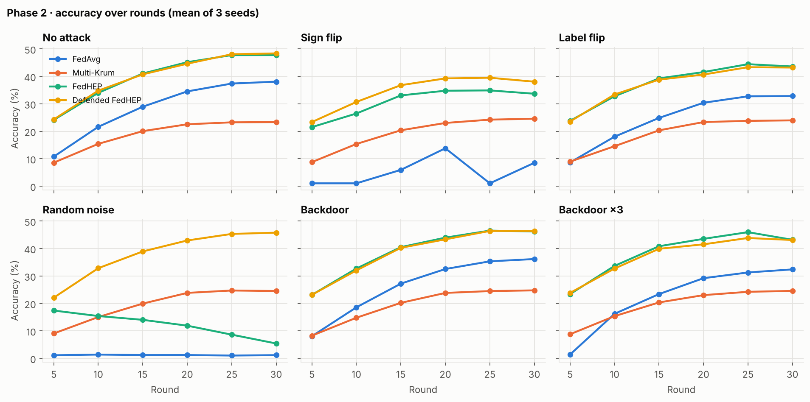

### Backdoor success (lower is better)
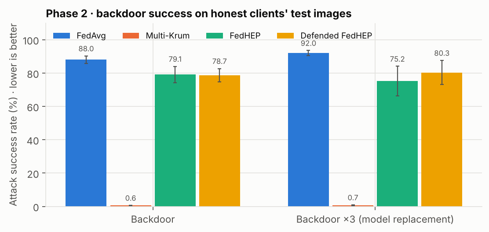

| Method | Backdoor | Backdoor ×3 |
|---|---|---|
| FedAvg | 88.0 ± 2.3 | 92.0 ± 1.5 |
| Multi-Krum | 0.6 ± 0.0 | 0.7 ± 0.2 |
| FedHEP | 79.1 ± 4.9 | 75.2 ± 8.8 |
| Defended FedHEP | 78.7 ± 4.0 | 80.3 ± 7.3 |

0.6% is chance level for 100 classes. The plain backdoor is already strong on CIFAR-100 (unlike on the synthetic data); the 3× boost adds little.

### Detection
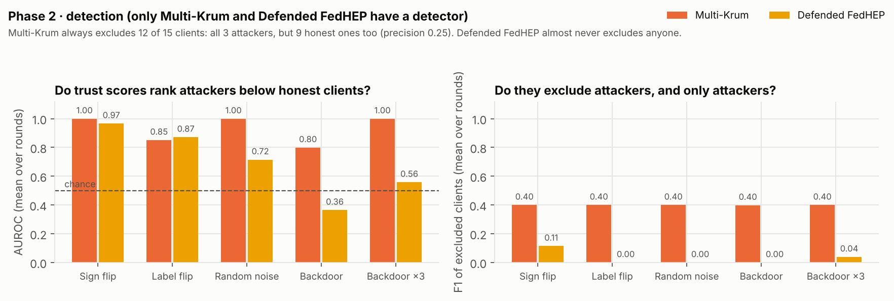

| Method | Measure (mean over rounds) | Sign flip | Label flip | Random noise | Backdoor | Backdoor ×3 |
|---|---|---|---|---|---|---|
| Multi-Krum | AUROC | 1.00 | 0.85 | 1.00 | 0.80 | 1.00 |
| Multi-Krum | recall / precision | 1.00 / 0.25 | 1.00 / 0.25 | 1.00 / 0.25 | 1.00 / 0.25 | 1.00 / 0.25 |
| Defended FedHEP | AUROC | 0.97 | 0.87 | 0.72 | **0.36** | 0.56 |
| Defended FedHEP | recall | 0.10 | 0.00 | 0.00 | 0.00 | 0.03 |

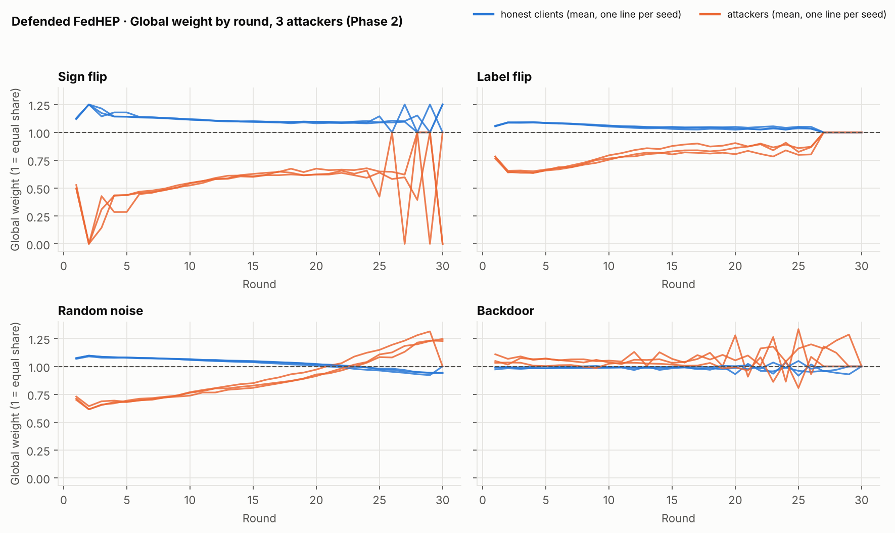

### What this shows
1. **Defended FedHEP is the most accurate method under every attack**, and the only one that survives random noise without giving up accuracy (45.8 vs 48.4 clean). Undefended FedHEP collapses under noise (5.4) like FedAvg (1.2): the personal heads don't protect the shared trunk.
2. **Its defense works by down-weighting, not removal, and only for some attacks.** Against label flipping and backdoors it is no better than undefended FedHEP (43.2 vs 43.6; success rate 78.7 vs 79.1). Its gain over FedHEP comes from sign flipping (+4.4) and noise (+40.4), where norm bounding and the BatchNorm median do the work.
3. **Its trust scores often rank attackers correctly but never act on it.** AUROC 0.97 for sign flip and 0.87 for label flip, yet recall stays near zero: the 0.25 isolation threshold is never reached, and late in training the scores lose their separation (trust chart). An adaptive cut on the same scores might remove most sign and label flippers: a concrete Phase 4 target.
4. **Backdoor attackers look *more* trustworthy than honest clients** to Defended FedHEP (AUROC 0.36). Half their data is normal, so their updates point with the consensus. Catching them needs a different signal than the direction of the root-head update.
5. **Multi-Krum "blocks everything" by throwing most clients away.** It always keeps 3 of 15, so each round it excludes all 3 attackers and 9 honest clients, and its accuracy stays near 24% with or without attack. It is also told the true number of attackers (the authors' oracle setting). Useful as a robustness reference, not an accuracy one.
6. **FedHEP's lower backdoor success than FedAvg (79 vs 88)** is probably its inference mask (clients without the target class can't predict it). Not yet checked per client.
7. **FedAvg under sign flipping is unstable across seeds** (8.5 ± 12.9): one seed recovers, two collapse.

Everything above describes existing methods. No new method has been tested yet; Phases 3 and 4 will be compared against these rows.

## 2026-11-07 · Phase 2 follow-up · Two questions answered from the logged runs
### How does Multi-Krum "know" the attackers, and why does it exclude clients with no attack?
It doesn't know them. Each round it scores every client by the summed squared distance to its nearest neighbours and **keeps** the m = 3 most central ones; the other 12 are left out every round, attack or not. That fixed m = 3 is why its accuracy sits at 23–25% with or without attack: each round's model is the average of only 3 clients.

Which 3? Distances are taken on the authors' full flat vector, where BatchNorm's batch counters dominate (same issue as FedHEP's grouping). A client's counters grow with its number of local steps, i.e. its dataset size, so Multi-Krum keeps the **median-sized** clients, mostly the same 3–4 every round:

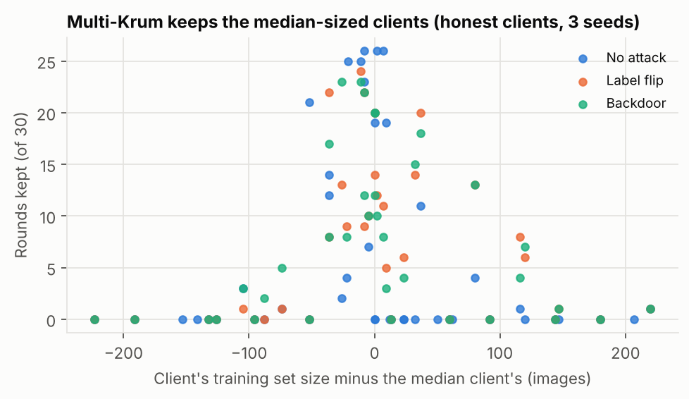

Attackers are left out because they are never among the 3 most central: sign flipping and noise wreck their counters and weights, label flipping and backdoors move their weights. The perfect recall is mostly a side effect of keeping so few; the AUROC (0.80–0.85 for label flip and backdoor) is the real measure of separation.

### Why does Defended FedHEP's defense fade during training?
Three mechanisms, all visible in the logged trust values:

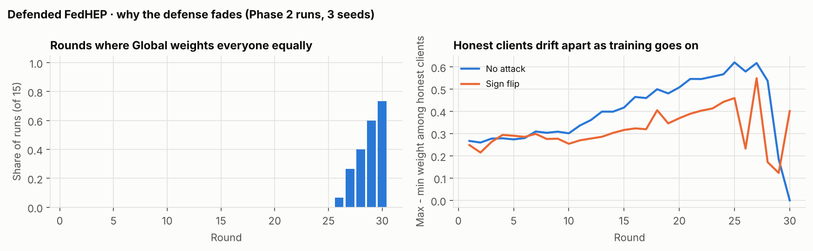

1. **Fixed temperature on shrinking cosines.** Weights are softmax(cosine / 0.5). As training goes on, honest clients drift apart (right panel: the spread of their weights doubles from 0.27 to 0.6), every cosine to the consensus shrinks, and the gap between attackers and honest clients in weight terms shrinks with it. Nothing in the rule adapts to that.
2. **No-consensus fallback.** When the mean direction of all updates gets short (< 0.2), SCCF gives everyone equal weight. That happens in 7–73% of runs in each of the last five rounds (left panel), i.e. no defense at the end of training.
3. **An isolation cut that is never reached.** A client is only removed when its momentum-averaged share stays below 0.25; attackers' shares sit at 0.5–0.8, so in 9 runs out of 9 (Phase 1c) and 15 of 15 (Phase 2) nobody was ever removed.

## 2026-11-07 · Phase 3 · FedHEP+: fixes to test (code done, runs need your Mac)
New method `fedhep_plus` (`src/rfl/server/fedhep_plus_server.py`, `src/rfl/defense/screening.py`): Defended FedHEP with its trust ledger replaced by **screening**, which answers each failure above:
- **Relative cut instead of fixed temperature and fixed threshold.** Each round, a client's cosine is turned into a robust z-score (distance from the median in units of the median absolute deviation, floored at 10% of the median so a tight consensus doesn't magnify tiny differences). The z-score is unchanged when all cosines shrink together (property-tested). Clients below z = −2.5 are left out that round; a running average of z below −1.5 removes them for good.
- **No fallback to equal weights:** screening always ranks.
- **Robust reference (option):** the coordinate-wise median update instead of the mean direction, which a coordinated minority can pull (tested).
- **Wider signal (option):** the whole weight update instead of only the root head's rows.
- **Regrouping by weight similarity (option):** real groups instead of random ones, with BatchNorm counters left out of the comparison. The same counter fix is available for plain FedHEP (`fedhep.similarity_on: weights`).
Parents and Global still aggregate the kept clients with SCCF exactly as Defended FedHEP does, so any difference comes from who is kept.

Plan: **screen with one seed** (seed 42, whose Phase 2 rows are the baseline with the same 3 attackers), then confirm the best variants with seeds 123 and 7.
- `configs/sweeps/phase3_screen.yaml`: 4 variants × 5 settings = 20 runs.
- `configs/sweeps/phase3_ceiling.yaml`: 3 clean runs on how high accuracy itself can go (weights-only grouping at α = 0.5 and α = 0.05; Defended FedHEP for 50 rounds instead of 30).

**On the 50–60% goal.** A perfect defense brings accuracy under attack back to the clean level of the same method (48.4% for Defended FedHEP at α = 0.5), not above it, since 3 of 15 clients' data is lost either way. Going higher needs a better clean model: the ceiling runs test two levers (a working parent tier, more rounds). For reference, FedHEP reaches 65.5% at α = 0.05 because each client then has only a few classes; at α = 0.5 with 10,000 training images in total, 60% would be a large jump, and the ceiling runs will show whether it is in reach.

## 2026-11-07 · Phase 3 · Screening runs, seed 42 (your Mac, MPS)
Setup: `phase3_screen.yaml` (20 runs) and `phase3_ceiling.yaml` (3 runs). α = 0.5, 30 rounds, attackers 0, 9 and 11 in every attacked run, the same as the seed-42 Phase 2 rows used as baseline. **One seed only:** treat differences under about 1.5 points (the Phase 2 seed spread) as unconfirmed.

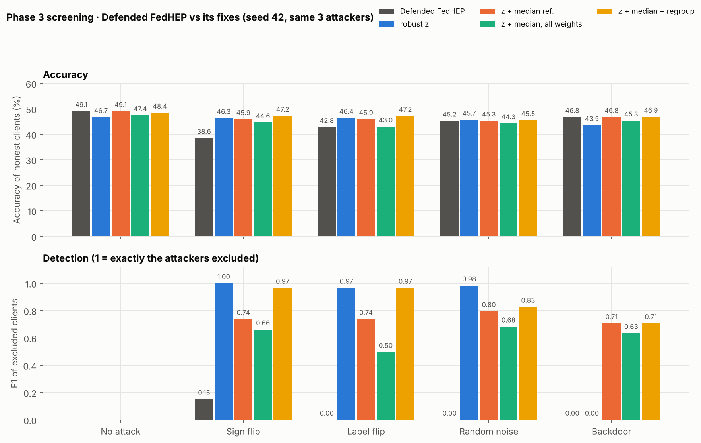

| Variant (seed 42) | No attack | Sign flip | Label flip | Random noise | Backdoor (acc. / success) |
|---|---|---|---|---|---|
| Defended FedHEP (baseline) | 49.07 | 38.59 | 42.77 | 45.25 | 46.79 / 80.1% |
| robust z | 46.70 | 46.34 | 46.39 | 45.69 | 43.50 / 80.2% |
| z + median reference | 49.07 | 45.94 | 45.94 | 45.29 | 46.79 / **33.0%** |
| z + median, all weights | 47.43 | 44.60 | 42.97 | 44.27 | 45.33 / **0.3%** |
| z + median + regroup | 48.43 | **47.16** | **47.16** | 45.45 | **46.87 / 29.0%** |

What worked:
1. **Screening catches the attackers the old defense couldn't.** Every variant isolates the sign flippers in round 1 and the label flippers and noise attackers by round 2 (attackers' z between −3.6 and −10.8; honest clients stay above about −2 while all are present). Accuracy under sign flipping rises from 38.6 to 47.2 and under label flipping from 42.8 to 47.2.
2. **The median reference also exposes the backdoor**, which the mean-direction reference (and Defended FedHEP) cannot: attackers are isolated by rounds 9–13 and success falls from 80% to 29–33%. Scoring the whole weight update blocks it almost completely (0.3%) but isolates honest clients too.
3. **47.2 is the ceiling under attack here:** with the 3 attackers out in round 1, "z + median + regroup" under sign and label flipping is exactly the run of the 12 honest clients (identical numbers for both attacks, because the attackers never contribute anything).

What went wrong — a false-isolation cascade:

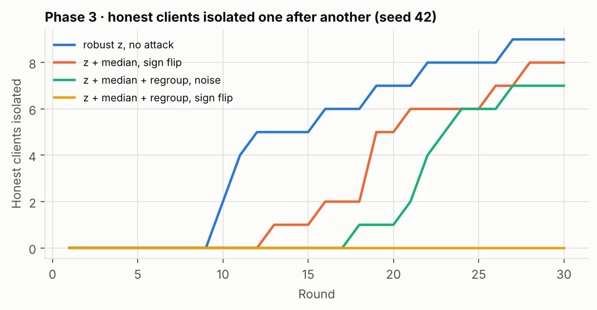

After the attackers are out (or with no attackers at all, for the mean-direction reference), honest clients start getting isolated from round 10–18 on, one after another: robust z with no attack ends with 9 of 15 isolated, and the noise and sign-flip runs end with 4–5 clients doing all the training. Each isolation shrinks the scored group, which shrinks its spread (MAD), which makes the next z more extreme (down to −37 in one run). With the median reference and all 15 honest clients present, z never went below −1.8 (no-attack runs), so the margin is real but thin.

Clean-accuracy ceiling (seed 42):

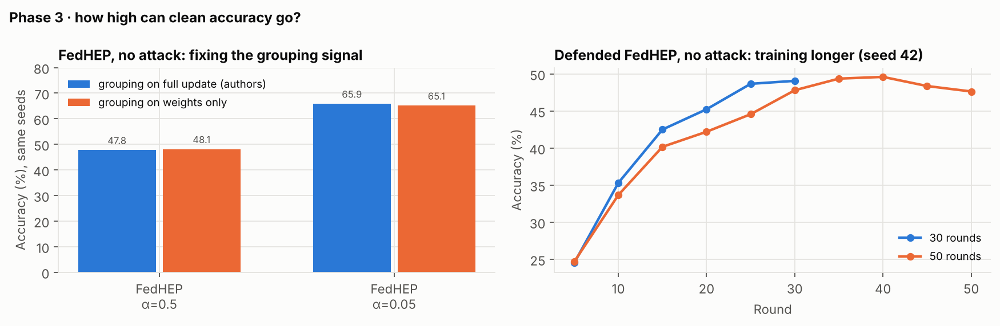

- Grouping on weights only (BatchNorm counters left out) lifts FedHEP from 47.6 to 48.8 at α = 0.5, and is within noise at α = 0.05 (65.1 vs 65.9). Worth confirming on three seeds.
- **Training longer doesn't help:** Defended FedHEP for 50 rounds peaks at 49.6 (round 40) and ends at 47.6; with 30 rounds it ends at 49.1. Its learning-rate schedule spreads over the run, so 30 rounds is already near the top.
- So at α = 0.5 with this data, clean accuracy sits at about 48–49% for all FedHEP variants, and the best possible result under attack is about 47% (12 honest clients). **50% would need a better base model, and 60% is not in reach in this setting**; it is in the α = 0.05 setting (65%), where each client has few classes.

## 2026-11-07 · Phase 3b · Stopping the cascade (code done, runs need your Mac)
Two changes to screening, both switchable:
- **Readmission:** isolated clients keep being scored every round, against the reference and spread of the clients currently kept, and come back once their evidence recovers above half the cut. Attackers (z of −4 to −11) stay out; an honest client wrongly removed can return.
- **Cap:** at most a third of the clients can be left out in one round (the lowest evidence go first), which bounds the damage of any cascade.
Plan: `phase3b.yaml` runs four variants on all three seeds (55 runs: "z + median + regroup" plus its readmission, readmission-and-cap and no-regroup versions), and `phase3b_fedhep_w.yaml` confirms the weights-only grouping on seeds 123 and 7 (2 runs).

## 2026-11-08 · Phase 3b · Three-seed results (your Mac, MPS)
Setup: `phase3b.yaml` (55 runs) and `phase3b_fedhep_w.yaml` (2 runs). α = 0.5, 30 rounds, 3 of 15 clients attack, seeds 42, 123, 7; Defended FedHEP's rows are the Phase 2 runs with the same seeds and attackers.

| Method (mean ± sd, 3 seeds) | No attack | Sign flip | Label flip | Random noise | Backdoor acc. | Backdoor success |
|---|---|---|---|---|---|---|
| Defended FedHEP | 48.39 ± 0.72 | 38.08 ± 1.01 | 43.23 ± 0.40 | 45.80 ± 0.70 | 46.42 ± 0.37 | 78.7% |
| **z + median + regroup** | 47.92 ± 0.60 | **46.34 ± 0.87** | **46.34 ± 0.87** | 45.41 ± 1.15 | 46.26 ± 0.56 | **20.8%** |
| ... + readmit | 47.91 ± 0.61 | 44.67 ± 1.16 | 44.69 ± 0.55 | 45.14 ± 0.67 | 46.40 ± 0.63 | 39.4% |
| z + median + readmit + cap (random groups) | 48.19 ± 0.82 | 44.71 ± 1.29 | 44.78 ± 0.47 | 45.05 ± 1.09 | 46.87 ± 0.25 | 62.1% |
| ... + regroup + readmit + cap | 47.93 ± 0.58 | 44.81 ± 1.49 | 44.62 ± 0.78 | 43.60 ± 2.64 | 46.71 ± 0.53 | 59.0% |

**Improvement over Defended FedHEP, paired by seed (z + median + regroup minus Defended FedHEP):**

| | seed 42 | seed 123 | seed 7 | mean |
|---|---|---|---|---|
| No attack | −0.63 | −0.37 | −0.40 | −0.47 |
| Sign flip | +8.57 | +7.69 | +8.51 | **+8.26** |
| Label flip | +4.39 | +2.90 | +2.03 | **+3.11** |
| Random noise | +0.20 | −0.04 | −1.31 | −0.38 |
| Backdoor accuracy | +0.08 | +0.08 | −0.64 | −0.16 |
| Backdoor success | −51.1 | −69.4 | −53.1 | **−57.9** |

The gains under sign flipping, label flipping and backdoors hold on every seed, by much more than the seed spread: this is the first confirmed improvement. The cost with no attack is small but also on every seed: false isolations (seed 123 isolates 7 honest clients with no attacker present).

What the two 3b changes did — both made things **worse**:
1. **Readmission brings attackers back.** Sign flippers isolated in round 1 returned in rounds 22–23 (seed 42). Late in training every update is small and its direction says little, so an attacker's z drifts back towards normal. Backdoor success rose from 21% to 39%, and sign-flip accuracy fell by 1.7.
2. **It doesn't stop the cascade either.** A removed honest client is judged against the same shrunken group that removed it, so it rarely qualifies to return.
3. **The cap lets backdoor attackers back in**: once false isolations fill the five places, attackers with milder evidence are put back (backdoor success 59–62%).
4. **Regrouping makes no clear difference** (readmit + cap with vs without regrouping: within 0.2 points everywhere except noise, where one seed fell to 40.6).
5. **Weights-only grouping for plain FedHEP:** 48.12 vs 47.78 on three seeds (+0.3); the +1.2 on seed 42 was mostly seed noise.

Root causes of the remaining false isolations, read from the logs:
- **Persistently atypical honest clients.** In the no-attack seed-123 run, client 6 scored z ≈ −1.5 every round from round 1 and crossed the evidence cut in round 7 with all 15 clients present: a genuine honest outlier, plausibly one with unusual classes.
- **The shrinking yardstick.** After that, each removal shrinks the scored group and its spread, so later z values get more extreme (down to −5.6).
Backdoor attackers sit at z ≈ −0.3 to −2.4, the same range as such honest outliers, so at this signal the evidence cut trades backdoor detection against false isolations.

## 2026-11-08 · Phase 3c · Full-population yardstick (code done, runs need your Mac)
New option `plus.population: all`: the median reference, median and spread behind z are taken over every client not banned, isolated ones included, so removing a client never shrinks the yardstick (median and MAD tolerate a minority of attackers in that population). Isolation stays permanent. `phase3c.yaml` (45 runs, three seeds) tests it with random groups at the current evidence cut (1.5), with a stricter cut (2.0, fewer honest removals, possibly fewer backdoor catches), and with regrouping for a direct comparison with the 3b winner.

## 2026-11-09 · Phase 3c · Full-population yardstick: three-seed results (your Mac, MPS)
Setup: `phase3c.yaml`, 45 runs, same seeds and attackers as before.

| Method (mean, 3 seeds) | No attack | Sign flip | Label flip | Noise | Backdoor acc. | Backdoor success | Honest clients isolated (sum over 15 runs) |
|---|---|---|---|---|---|---|---|
| Defended FedHEP | 48.39 | 38.08 | 43.23 | 45.80 | 46.42 | 78.7% | 0 |
| **3b best: z + median + regroup** | 47.92 | 46.34 | **46.34** | 45.41 | 46.26 | **20.8%** | 46 |
| full population | 48.00 | **46.44** | 45.72 | 45.13 | 46.65 | 54.1% | 87 |
| full population, cut 2.0 | **48.09** | 46.41 | 46.12 | **45.76** | **46.70** | 74.2% | **36** |
| full population + regroup | 47.54 | 46.17 | 45.30 | 45.43 | 46.17 | 52.1% | 82 |

**No further improvement.** The full-population yardstick did not reduce false isolations (87 vs 46 with cut 1.5) and it lost most of the backdoor protection. All variants keep the sign- and label-flip gains (+8 and +2 to +3 on every seed).

Why the backdoor got through: a backdoor needs only **one** remaining attacker. In seed 42, two backdoor attackers were isolated in round 10 under both yardsticks, but the third (z ≈ −0.5) stayed in with the full-population yardstick, so success stayed at 77%. With the 3b yardstick the group shrank after the first two removals and the third attacker's z fell to −1.8; it was isolated in round 13 and success fell to 29%. The shrinking yardstick that causes false isolations is the same thing that catches the last mild attacker. At this signal, catching backdoors and protecting unusual honest clients pull against each other.

Two more observations:
- Wrongly isolated honest clients lose almost nothing themselves (+0.4 personal accuracy on average vs Defended FedHEP, across 46 such cases); they still train their own heads on the global model. The cost is the data the others lose (−0.5 accuracy with no attack).
- The fairness gain is large: bottom-10% accuracy under sign flipping goes from 31.2 (Defended FedHEP) to 40.8.

### Phase 3 conclusion
**FedHEP+ = Defended FedHEP with screening (median reference, robust z on the kept clients, permanent isolation) and regrouping** is the Phase 3 result. Against the paper's Defended FedHEP, on every seed: sign flip +8.3, label flip +3.1, backdoor success 79% → 21%; no change under noise; −0.5 with no attack. It is a solid, reproducible improvement in robustness, not a breakthrough in accuracy: clean accuracy stays at about 48% (the ceiling runs showed the base model, not the defense, sets that limit).

## 2026-11-09 · Phase 4 · Drill-down defense (result: not an improvement)
Built on FedHEP+ (`plus.drill_down: true`):
1. Clients are screened as in FedHEP+.
2. **Parent check.** Each parent's mean update (over its kept members) is scored against the same reference and compared with random groups of the same size (a permutation test, 64 draws, its own random generator so training randomness is untouched). A parent is flagged when its z < −2.
3. **Drill-down.** Members of a flagged parent face a stricter cut that round (z < −1 instead of −2.5).

Why it might help: attackers pushing one direction (one backdoor) stand out more together than one by one. In a synthetic test, three such attackers each looked normal (z > −0.4, far from the −2.5 cut) while their parent scored z between −2.5 and −4.3 in 8 of 8 trials; honest parents averaged about −0.8, though one of 16 reached −2.3 (it would be flagged; its members would then face the stricter cut for that round).

Plan: `phase4.yaml`, 42 runs on three seeds, FedHEP+ with and without the drill-down (random groups, so attacker placement holds), under sign flipping, label flipping and backdoors, with all three attackers in one parent (concentrated: a malicious parent) or one per parent (spread: the drill-down should add nothing). Parent-level precision/recall/F1 are recorded every round.

### Results (42 runs on your Mac, seeds 42 / 123 / 7, 30 rounds, 3 of 15 attackers, 3 random parents)
"Base" = FedHEP+ screening without regrouping (random groups, so the placement holds); "drill" = the same plus the drill-down. Same seed = same data, attackers and groups, so the differences are paired.

| Setting | Base acc. | Drill acc. | Δ per seed (42 / 123 / 7) | Backdoor success base → drill | Honest clients isolated (3 seeds) base → drill | Parent flags: rounds flagged / precision / recall |
|---|---|---|---|---|---|---|
| No attack | 48.07 | 47.94 | −0.30 / −0.07 / 0.00 | | 10 → 8 | 11, 11, 3 of 30 / **0** / – |
| Sign flip, concentrated | 45.81 | 46.26 | +0.61 / +0.45 / +0.30 | | 14 → 10 | 7, 3, 9 / 0.66* / 0.14 |
| Sign flip, spread | 45.85 | 46.19 | +0.57 / +0.45 / 0.00 | | 23 → 17 | 9, 3, 5 / 0 / – |
| Label flip, concentrated | 45.81 | 46.21 | +0.45 / +0.45 / +0.30 | | 14 → 17 | 9, 4, 10 / 0.67* / 0.18 |
| Label flip, spread | 45.85 | 46.19 | +0.57 / +0.45 / 0.00 | | 23 → 17 | 9, 3, 5 / 0 / – |
| Backdoor, concentrated | 46.41 | 45.92 | −0.97 / 0.00 / −0.51 | **21.5% → 39.7%** (22.0→73.9, 2.4→8.8, 40.2→36.5) | 9 → 10 | 11, 11, 17 / **0.85** / 0.37 |
| Backdoor, spread | 46.43 | 46.60 | −0.37 / +0.57 / +0.30 | 25.4% → 24.7% | 18 → 18 | 6, 4, 5 / 0 / – |

\* Sign and label flippers are isolated by screening in round 1 (their z is far below −2.5), so from round 2 on these runs contain honest clients only (sign- and label-flip base rows are identical for that reason). Parent 0 still counts as "malicious" because its isolated attackers stay assigned to it, so those precision values say little.

**Verdict under D23: not an improvement.** No setting clears the bar (same sign on all three seeds and a mean above ~1 point):
- Sign and label flipping: +0.3 to +0.45 on average, with one seed at 0.00 in the spread cases. The attackers were already gone after round 1, so this is not better defense; it is the drill-down changing which honest clients get left out (fewer honest isolations, 14 → 10 and 23 → 17), and it is inside the seed spread.
- **Concentrated backdoor, the case the drill-down was designed for, got worse**: success 21.5% → 39.7% on average (seed 42: 22% → 74%) and accuracy −0.5.
- With no attack it flags parents in up to 11 of 30 rounds (all false), costing −0.12.

### Why it did not work
1. **The parent check works; the member check doesn't.** For the concentrated backdoor the attacker parent stands out clearly (group z −2.3 to −7.3 in rounds 1–14, parent precision 0.85, and 1.0 on seed 42). Inside it, though, attackers and honest members have similar individual z (about −0.5 to −1.5), so the −1 cut leaves out some attackers, some honest members, and misses attackers in other rounds. The coordination is visible only in the sum.
2. **Leaving attackers out for one round made them harder to catch.** Over rounds 1–10 the attackers' mean z was −1.09 / −1.44 / −1.16 with screening alone and −0.83 / −0.95 / −0.86 with the drill-down (paired chart, right). It moved toward normal on all three seeds. Evidence therefore built up more slowly. Attackers were isolated later (seed 123: round 7 → 14), and on seed 42 one of them (client 0) was never isolated, which is why its backdoor reached 74%. A likely reason, not yet tested: when the backdoor is in the global model, honest training on clean data partly undoes it, so honest updates point *against* the attackers and the contrast is large. Keeping the backdoor out of the global model removes that contrast. Whatever the cause, the one-round exclusion trades the evidence the permanent isolation needs for a short-term cleaner average.
3. **Honest parents look "coordinated" too under non-IID data.** The permutation test assumes members are exchangeable with random clients, but a fixed group of honest clients with the same data stays atypical round after round. False flags came from a 2-member parent (seed 42, 11 rounds) and a 5-member parent (seed 123, 11 rounds). Random group sizes were uneven (2 / 5 / 8 on seed 42), and a 2-member mean is barely a group.

### What did hold up
- Parent-level detection of a coordinated backdoor is real: precision 0.85, recall 0.37 on average over rounds (recall is limited because the flags stop once attackers are isolated or their parent's mean drifts back).
- The drill-down never hurt sign/label-flip defense: screening catches those attackers first.

The drill-down stays in the code as an option (`plus.drill_down`, off by default). FedHEP+ (Phase 3) remains the best method.

## 2026-11-09 · Phase 4b · Drill-down v2 (result: not an improvement)
A redesign aimed at the three reasons v1 failed (`plus.drill_mode: evidence`):
1. **No one-round exclusion.** v1's single-round removals made backdoor attackers look more normal and delayed their isolation. In v2 a flagged parent removes nobody directly; it only adds evidence, and the permanent-isolation rule (evidence below −1.5) decides.
2. **A member check that looks for the shared direction.** For each member of a flagged parent: residual = its update minus the reference; score = cosine of that residual with the mean of the *other* members' residuals (leave-one-out, so a member can't line up with itself). The null is the same cosine for clients outside the parent against each leave-one-out direction. A member's alignment z is measured against that null, and its evidence update uses min(z, −alignment z). Attackers that share a backdoor line up with each other; an honest member next to them doesn't; and if one odd honest client makes a parent look odd, nobody lines up with anybody.
3. **Parents need at least 3 eligible members** (v1's false flags included a 2-member parent).

Synthetic check (`tests/test_fedhep_plus.py`, 3 coordinated attackers + 2 honest in a parent, 8 trials): attackers' alignment z ≥ 4.6 even with a weak shared direction (≥ 22.9 at medium strength), honest members average 0.8 (max 3.0 at the weakest strength). With one very atypical honest client in a parent, no member exceeds 1.7.

Runs: `phase4b.yaml`, 24 runs: v2 with the parent flag as a gate, and v2 checking every parent (does the flag help at all?), under no attack, concentrated label flipping, and concentrated and spread backdoors, seeds 42 / 123 / 7. Baseline = the Phase 4 `p4__base` runs (identical config, so not rerun).

**Success criteria, set before the runs:** concentrated-backdoor success clearly below screening alone (21.5%) on average, with no seed more than 2 points worse; accuracy no more than 1 point below screening alone in any setting (D23); no more honest clients isolated than screening alone with no attack.

*(Results in the next entries.)*

## 2026-11-09 · Fix · Phase 4b sweep stopped after 12 runs
The `p4b__v2_all` runs crashed in round 1: `plus.group_cut: -1.0e9` was read as text, because PyYAML only reads exponent notation as a number when the exponent has a sign (`-1.0e+9`). The 12 `p4b__v2` runs had already finished and are valid (their cut is 2.0). Fixed in the sweep file. Config loading now rejects text in any numeric setting, and a test loads every sweep file, so this kind of mistake fails before any run starts.

The same check run also hit a rare case in an older randomised test: with five almost identical scores (spread about 2e-12), `robust_z`'s fixed "no spread" cutoff of 1e-12 gave different answers for the same scores at half the scale. The cutoff is now relative to the scores' size (1e-9 of the largest). Real cosine scores never come near this, so no earlier result changes.

## 2026-11-09 · Phase 4b · Drill-down v2: three-seed results (your Mac, MPS)
24 runs (`phase4b.yaml`), compared with the Phase 4 runs of screening alone and v1 (same config, seeds 42 / 123 / 7, same attackers and random groups).

| Setting | Measure | Screening alone | v1 | **v2 (when flagged)** | v2 (every parent) |
|---|---|---|---|---|---|
| No attack | accuracy | 48.07 | 47.95 | 46.95 (0.00 / −1.60 / −1.77) | 40.97 |
| | honest clients isolated (3 seeds) | 10 | 8 | 19 | 34 |
| Label flip, conc. | accuracy | 45.81 | 46.21 | 44.49 (0.00 / −2.82 / −1.14) | 42.03 |
| Backdoor, conc. | accuracy | 46.42 | 45.92 | 44.69 (−0.73 / −3.48 / −0.98) | 41.73 |
| | **backdoor success** | 21.5% (22.0 / 2.4 / 40.2) | 39.7% | **1.9% (0.4 / 0.6 / 4.8)** | 0.8% |
| | attackers isolated in round | 7–13 | 7–14, one never | **2–3** (one at 6, one at 12) | |
| | honest clients isolated | 9 | 10 | 23 | 25 |
| Backdoor, spread | accuracy | 46.43 | 46.60 | 46.11 | 40.68 |
| | backdoor success | 25.4% | 24.7% | 23.2% | 7.1% |

**Against the criteria set before the runs:**
- Concentrated-backdoor success clearly lower, no seed more than 2 points worse: **met** (21.5% → 1.9%, lower on every seed).
- Accuracy no more than 1 point below screening alone in any setting: **not met** (−1.1 with no attack, −1.3 label flip, −1.7 backdoor).
- No more false isolations than screening alone with no attack: **not met** (19 vs 10).

**Verdict: not an improvement.** v2 fixes what v1 got wrong about backdoors, but it costs accuracy everywhere, including with no attack. Checking every parent is much worse (−7 with no attack, 34 honest clients isolated), so the parent flag is a necessary gate, but not enough of one.

### What worked
The member check finds coordinated backdoor attackers. With all members present (rounds 1–5), the attackers' alignment z had median 3.1 against 0.5 for honest clients in the same runs. Once evidence replaced the one-round exclusion, attackers were isolated in rounds 2–3 instead of 7–13, before the backdoor could take hold. This confirms the Phase 4 reasoning: exclusion hid the attackers, evidence doesn't.

### What failed: honest members of the same parent line up with each other too
- With no attack and every parent checked, honest members' alignment z has median 1.0 (top 10%: 2.6), where the null (clients outside the parent) is centred on 0 by construction. Members of a parent are systematically more alike than random clients, attack or not. In parents flagged by mistake, it is higher still (median 2.8 in v2 with no attack), so whole parents get isolated together: seed 123 lost clients 9, 11 and 13 in round 8, and seed 7 lost 8 and 12 in round 8.
- This overlaps the attackers' range (median 3.0–3.6), so no cutoff separates them. Raising the cut would let attackers through, and lowering it would isolate more honest parents.
- The likely cause, not tested directly: in FedHEP, members of a parent train from the same parent head, and that head shapes the shared trunk's update. Their root-head updates therefore share a parent-specific component. This would also explain v1's repeated false flags of honest parents. The synthetic tests missed it because their honest clients were independent by construction.
- Each false isolation also shrinks the population that the next z-scores are measured against, the cascade seen in Phase 3. Most extra honest isolations come in rounds 8–25, after the attackers are already gone.

### Phase 4 conclusion
Two drill-down designs, 66 CIFAR-100 runs. Detecting the parent works, and v2 shows that finding the members who share a parent's unusual direction is possible. But in FedHEP, members of a parent are genuinely alike, so the same check that catches coordinated attackers also blames honest groups. Neither design met the criteria. **FedHEP+ (Phase 3) remains the best method.** Both drill-down modes stay in the code as options, off by default.

## 2026-11-09 · Phase 5 · Established rules inside FedHEP (code done, runs need your Mac)
New method `fedhep_robust` (`src/rfl/defense/classic.py`, `src/rfl/server/robust_fedhep_server.py`): Defended FedHEP with its Global step replaced by one established rule. Design choices in D29.

| Rule | Paper | What it does here |
|---|---|---|
| Median | Yin et al., ICML 2018 | coordinate-wise median of the weight updates |
| Trimmed mean | Yin et al., ICML 2018 | per coordinate, drop the 3 largest and 3 smallest, average the rest |
| Bulyan | El Mhamdi et al., ICML 2018 | pick 9 updates by repeated Krum (f = 3); per coordinate, average the 3 closest to the median |
| FLAME | Nguyen et al., USENIX Security 2022 | HDBSCAN on cosine distances (min cluster 8 of 15) keeps the majority cluster; clip to the median update norm; average; add N(0, (0.001 S)²) |
| FLTrust | Cao et al., NDSS 2021 | server trains on 100 clean images; trust = ReLU(cos(update, server update)); updates rescaled to the server's norm; trust-weighted average |

Checks (`tests/test_robust_rules.py`, 13 tests): median and trimmed mean of identical updates return that update; trimmed mean drops exactly k extremes per coordinate; Bulyan keeps n − 2f honest updates and refuses n < 4f + 3; FLAME rejects sign-flipped updates, never exceeds the median norm, and adds noise of the stated size; FLTrust gives opposed updates zero trust, and with nobody trusted takes no step; each rule runs end to end inside FedHEP; FLTrust's server training leaves the clients' random draws untouched (identical uploads to a median run).

Noted while testing: FLAME's HDBSCAN also leaves out some honest updates as noise (4 of 12 in the synthetic test), as the paper reports. It only guarantees that a majority is admitted.

Plan: `phase5_screen.yaml`, seed 42, 30 runs, the same five settings and attackers as Phase 2/3b. Rules that look competitive with FedHEP+ get seeds 123 and 7.

Charts will compare each rule with Defended FedHEP and FedHEP+ once the runs exist.

## 2026-11-10 · Phase 5 · Screen results, seed 42 (your Mac, MPS)
30 runs (`phase5_screen.yaml`), same seed and attackers (0, 9, 11) as the Phase 2/3b baselines. **One seed only**: differences under about 1.5 points are unconfirmed. Each cell: accuracy / backdoor success; "fp" = honest clients flagged in the last round; "rec" = mean detection recall over rounds. (No chart yet: `plot_results.py` has no Phase 5 figure; to add next session.)

| Method | No attack | Sign flip | Label flip | Noise | Backdoor |
|---|---|---|---|---|---|
| Defended FedHEP | **49.07** | 38.59 (rec 0.13) | 42.77 (rec 0) | 45.25 | 46.79 / 80.1% |
| **FedHEP+ (Phase 3)** | 48.43 | **47.16** (rec 1.0) | **47.16** (rec 1.0) | 45.45 (fp 7) | **46.87** / 29.0% |
| Median | 47.70 | 39.56 (rec 0) | 44.27 | **46.51** | 46.63 / 76.4% |
| Trimmed mean | 48.33 | 39.44 | 43.99 | 45.69 | 46.02 / 77.5% |
| Bulyan | 44.23 (fp 6) | 43.54 | 43.70 | 44.64 | 45.29 / **0.5%** |
| FLAME (models) | 41.10 (fp 7) | 44.15 | 42.28 | 44.15 | 44.76 / **0.4%** |
| FLAME (updates) | 45.60 (fp 7) | 44.27 | 42.77 | 43.30 | 44.39 / 26.4% |
| FLTrust | 47.90 | 45.86 (fp 8) | 43.14 (rec 0.41) | 45.86 | 45.45 / 73.8% |

**Verdict: no established rule beats FedHEP+ overall.** FedHEP+ is best under sign and label flipping (by 1.3 to 3.6 points over the best rule) and has the best accuracy under backdoor. Noise is within one-seed noise for all methods.
- **Median and trimmed mean** are no better than Defended FedHEP: they never exclude anyone, so the sign flippers and backdoor attackers stay in (backdoor success 76–78%).
- **Bulyan and FLAME (models) block the backdoor almost completely** (0.5% / 0.4%, vs 29% for FedHEP+), but they pay for it everywhere: −4.8 / −8.0 points with no attack (vs Defended FedHEP), because each round they leave out 6–7 honest clients (Bulyan always keeps 9 of 15; FLAME's HDBSCAN marks some honest clients as noise).
- **FLAME on models beats FLAME on updates for backdoors** (0.4% vs 26.4%), so the paper's equations are the better reading here; on updates it keeps more accuracy with no attack.
- **FLTrust** keeps clean accuracy (47.90) but catches label flippers poorly (recall 0.41) and does not stop the backdoor (73.8%). With 100 images for 100 classes, its server update is a weak reference.

**Direction for next steps:** FedHEP+ is still the method to beat. Its weak spot (backdoor 29%) is exactly where Bulyan/FLAME are strong, so a hybrid is the natural candidate: FedHEP+ screening plus a FLAME-style cluster check used only to add evidence (not to exclude every round). Before that, confirm Bulyan and FLAME (models) on seeds 123 and 7.

## 2026-11-12 · Phase 5 · Three-seed results and harder settings (your Mac, MPS)
105 runs: every rule on seeds 42 / 123 / 7 (`phase5_screen`, `phase5_confirm`, `phase5_rest`), plus FedHEP+, Defended FedHEP and FLAME under harder settings (`phase5_extra`). Same attackers per seed for every method. Charts: `python scripts/plot_followup.py outputs`.

| Method (mean ± sd, 3 seeds) | No attack | Sign flip | Label flip | Noise | Backdoor acc. | Backdoor success | Honest flagged / round |
|---|---|---|---|---|---|---|---|
| Defended FedHEP | **48.39 ± 0.72** | 38.08 ± 1.01 | 43.23 ± 0.40 | 45.80 ± 0.70 | 46.42 ± 0.37 | 78.7% | 0 |
| **FedHEP+** | 47.92 ± 0.60 | **46.34 ± 0.87** | **46.34 ± 0.87** | 45.41 ± 1.15 | 46.26 ± 0.56 | 20.8% | 1.1–1.9 |
| Median | 47.57 ± 0.26 | 39.97 ± 1.03 | 44.59 ± 0.32 | **46.59 ± 0.37** | 46.82 ± 0.73 | 76.5% | 0 |
| Trimmed mean | 47.91 ± 0.59 | 39.03 ± 1.12 | 44.44 ± 0.44 | 46.01 ± 0.60 | 46.77 ± 0.80 | 77.0% | 0 |
| Bulyan | 44.52 ± 0.28 | 44.13 ± 0.76 | 43.94 ± 1.23 | 44.64 ± 1.50 | 44.44 ± 0.75 | **0.5%** | 3.0–6.0 |
| FLAME (models) | 42.81 ± 1.49 | 42.72 ± 2.50 | 41.61 ± 2.28 | 42.97 ± 2.50 | 43.05 ± 2.37 | **0.5%** | 2.6–5.1 |
| FLAME (updates) | 45.16 ± 0.45 | 42.24 ± 2.55 | 41.39 ± 1.24 | 40.31 ± 2.83 | 43.60 ± 0.92 | 27.4% | 2.3–6.4 |
| FLTrust | 47.33 ± 0.55 | 45.66 ± 0.71 | 42.85 ± 0.25 | 44.34 ± 2.06 | 46.04 ± 0.90 | 64.2% | 2.6–3.6 |

**Verdict: FedHEP+ remains the best all-round method; no established rule beats it.**
- FedHEP+ is best under sign and label flipping (+0.7 to +7.3 over every rule). Under noise all methods are within about 1 point.
- **Bulyan and FLAME stop the backdoor on every seed (0.5%)**, but they leave out 3–6 honest clients every round, costing 3.9 to 5.6 points with no attack (vs Defended FedHEP). FedHEP+ lets 21% through on average.
- Median and trimmed mean never remove anyone: sign flippers and backdoors get through.
- FLTrust keeps clean accuracy but is weak against label flipping and backdoors; 100 root images for 100 classes is a thin reference.
- FLAME is much better on models than on updates for backdoors (0.5% vs 27.4%): the paper's equations are the right reading here.

### Harder settings

| Setting (3 seeds) | Defended FedHEP | FedHEP+ | FLAME |
|---|---|---|---|
| Sign flip, **5** attackers | 31.41 ± 2.46 | **44.01 ± 2.28** | 42.36 ± 0.15 |
| Backdoor ×3 boost: acc. / success | 43.12 / 80.3% | **45.37** / 22.6% | 42.72 / **0.5%** |
| Backdoor, **5** attackers: acc. / success | **45.98** / 79.1% | 44.93 / 56.3% | 43.35 / **0.5%** |
| α = 0.05, no attack | **65.71 ± 0.60** | 65.18 ± 0.22 | 52.81 ± 1.51 |
| α = 0.05, sign flip 3 | 62.81 ± 1.30 | 62.75 ± 1.48 | 53.79 ± 0.99 |

- FedHEP+'s sign-flip gain **grows** with more attackers (+12.6 at 5 of 15).
- Its backdoor protection **weakens** with 5 attackers (56% success): five colluders move the median reference toward themselves. FLAME holds at 0.5%.
- At **α = 0.05 the gain disappears** (62.75 vs 62.81). There, each client's personal heads carry most of the accuracy, so even Defended FedHEP loses only 2.9 points to sign flipping. FLAME collapses at α = 0.05 (−13 points with no attack): with very different clients, HDBSCAN's majority cluster leaves out many honest ones (7 per round with no attack).

**Direction:** FedHEP+'s weak spot (backdoor, worse with more colluders) is FLAME/Bulyan's strength, and their weak spot (honest clients left out) is FedHEP+'s strength. A hybrid that uses a FLAME-style cluster check only as *evidence* in FedHEP+'s screening is the natural next candidate.

## 2026-11-12 · Answers to the professor's questions
Partly from a follow-up session on your Mac (`docs/FOLLOWUP_REVIEW.md`, code and tests verified here: all 81 tests pass), partly new. Full-scale runs still pending are marked ⏳.

**1. False-isolation cascade: is it the MAD shrinking?** *Plausible, not yet proven.* The historical runs logged z but not the raw scores or the MAD, so the denominator cannot be recovered. What the logs do show:

- The spread of honest clients' z widens from about round 20 (the blue band), which is what a shrinking MAD would produce.
- But the first false isolations are not all MAD effects: in the no-attack seed-123 run, client 6 scored z ≈ −1.5 every round from round 1 and was isolated in round 7 with all 15 clients present, a persistently atypical honest client.
- A floor already exists ($0.1\,|\operatorname{med}\,s|$), but it is relative, so it shrinks with the scores. The follow-up added an absolute floor (`plus.mad_floor`) and per-round logging of median, MAD and effective denominator. ⏳ `followup_diagnostics.yaml` (36 runs) measures the MAD per round at full scale and tests floors 0.01 and 0.03.

**2. Temporal rule / gradual down-weighting.** The evidence average is already temporal, but one extreme round can still isolate. The follow-up added *patience* (isolate only after k consecutive low rounds and low evidence); ⏳ tested with k = 3 in the same sweep. Gradual down-weighting is partly there already (SCCF weights kept clients continuously); a soft weight such as $\sigma(z_i)$ instead of removal is not implemented yet.

**3. Which honest clients get isolated?**
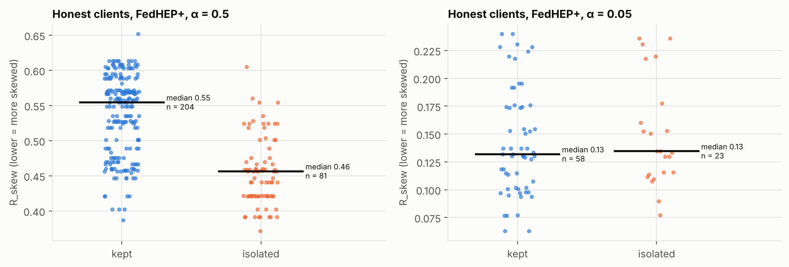
At α = 0.5 the isolated honest clients are **more skewed** (median R_skew 0.46 vs 0.55 for those kept). At α = 0.05 there is no difference. Caveats: the same clients appear in several runs (same seed, same partition), so these are not independent observations; R_skew here is computed offline from the true labels. As you note, a client's own R_skew is self-reported and forgeable, so a skew-aware threshold would need a server-side estimate (for example a small trusted validation set, as FLTrust uses). Not enabled.

**4. Adaptive attacks (ALIE, Min-Max).** Not in any earlier run. Implemented in the follow-up and checked here: attackers train honestly, then upload mean − z·std (ALIE, with the paper's z = 0.43 for 15 clients and 3 attackers; the follow-up had used 1.0) or the Min-Max point at the edge of the honest updates' spread. On the toy task, ALIE already slips past FLAME and Bulyan unflagged. ⏳ `followup_attacks.yaml` (24 runs) on CIFAR-100 against Defended FedHEP, FedHEP+, FLAME and Bulyan.

**5. Other settings.** See the harder-settings table: the sign-flip gain holds and grows at 5 attackers; backdoor protection weakens at 5 attackers; the gain disappears at α = 0.05. ⏳ `followup_q.yaml` (36 runs) uses the authors' rule with q = 0.1 / 0.3 / 0.4 (1–10 attackers depending on the seed; q = 0.4 gives an attacker majority on seed 42). ⏳ `followup_holdout.yaml` (10 runs) is a setting never used in development: α = 0.2, 20 clients, 4 attackers, seed 2026.

**6. Reporting.** Yes, accuracy includes the honest clients that were wrongly isolated; they keep training their own heads and are scored on their own test images. Precision, recall and false-isolation rate separately:

FedHEP+ flags about 11% of honest clients per round on average, against 25–33% for Bulyan, FLAME and FLTrust. Defended FedHEP, median and trimmed mean flag no one, so they have no false isolations but also no recall.

**Why only 15 clients and 3 attackers?** 15 clients is the paper's setup, and the paper's q = 0.2 means 3 attackers on average. We fixed exactly 3 (D15) so that every method faces the same attackers in a given seed; the authors' random rule gives 1 to 3 depending on the seed, which made their attack table hard to compare. Nothing in the code limits this: Phase 5 already ran 5 attackers, and the queued sweeps cover 1–10 attackers (q) and 20 clients.

**Why does Defended FedHEP keep high accuracy without removing attackers?**
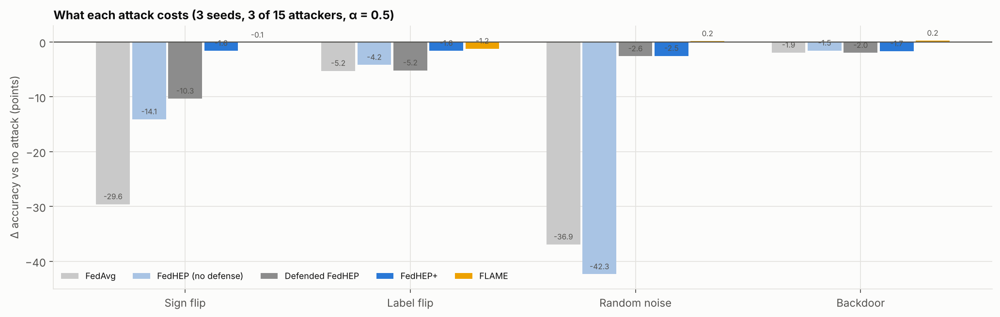
It does drop: **sign flipping costs Defended FedHEP 10.3 points** (48.4 → 38.1), the size of drop you expected, against 1.6 for FedHEP+. The other attacks cost it little for specific reasons:
- *Random noise:* norm bounding scales each upload to at most 3× the lower-quartile norm, and BatchNorm buffers are taken by median, so the noise is shrunk and averages out (−2.6).
- *Label flip:* 3 of 15 clients with flipped labels still produce updates that point roughly with the consensus, so SCCF only partly down-weights them (−5.2).
- *Backdoor:* designed to keep normal accuracy; its damage is the 79% backdoor success, not accuracy.
- *Personalisation:* each client's local and parent heads are trained on its own data, and unseen classes are masked out at prediction. That alone halves the damage: undefended FedHEP loses 14.1 to sign flipping, FedAvg 29.6.

**Weights-only grouping vs the defense.** Agreed: weights-only grouping changed clean accuracy by +0.3 over three seeds, while the defense changed sign-flip accuracy by +8.3 (+12.6 with 5 attackers) and backdoor success by −58 points. The defense is the more promising direction.

### Run plan for your Mac (superseded by the 2026-11-13 run plan below)
1. `followup_diagnostics.yaml`: MAD per round at full scale, absolute floor 0.01 / 0.03, patience 3 (36 runs).
2. `followup_attacks.yaml`: ALIE and Min-Max vs Defended FedHEP, FedHEP+, FLAME, Bulyan (24 runs).
3. `followup_q.yaml`: q = 0.1 / 0.3 / 0.4 (36 runs).
4. `followup_holdout.yaml`: held-out setting (10 runs).

`followup_generalization.yaml` (108 runs) is superseded by 2 and 3: about 30 of its runs repeat existing ones.

## 2026-11-12 · Finding · Why honest z-scores get extreme mid-training
The professor asked why the MAD shrinks and z goes down in FedHEP+. Raw scores were not logged in the historical runs, but two things that were logged identify the mechanism (all 15 FedHEP+ runs: 5 settings × 3 seeds):
- **Which term set z's denominator.** Without the floor, the MAD of a round's z-scores is exactly $1/1.4826 = 0.674$ (using torch's median, as screening does). A smaller value means the floor $0.1\,|\operatorname{med} s|$ was larger than $1.4826\cdot\mathrm{MAD}$ and set the scale that round.
- **The spread of cosines.** SCCF's logged weights are $w_i = \mathrm{softmax}(c_i/T)$, so $T\ln w_i$ recovers each client's cosine $c_i$ up to a constant ($T \approx 0.5$; reference = mean direction rather than median, same root-head signal). Their spread is a proxy for the spread of the screening scores.

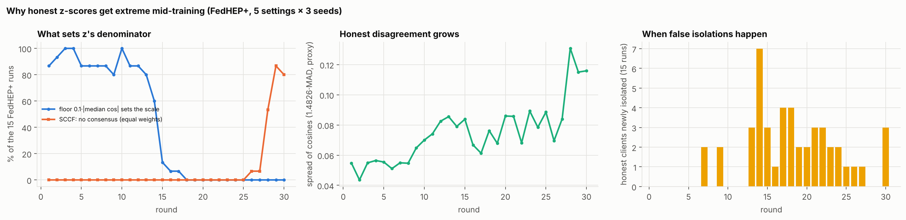

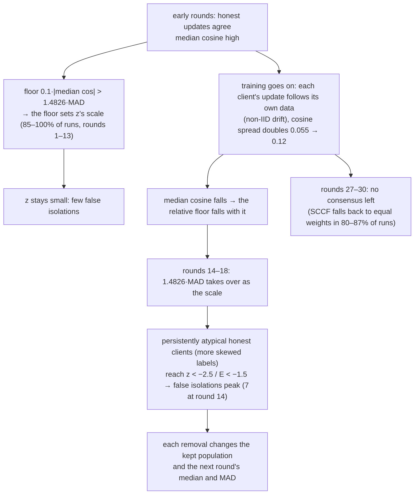

**What the data shows: the MAD does not shrink. The consensus does.**
1. In rounds 1–13, the floor sets the scale in 85–100% of runs: honest updates agree strongly, so $0.1\,|\operatorname{med} s|$ exceeds $1.4826\cdot\mathrm{MAD}$, and z stays small.
2. As training goes on, each client's update follows its own data. The spread of cosines **doubles** (0.055 → 0.085 by round 12, 0.12 by round 28), and the median cosine falls.
3. Between rounds 14 and 18 the floor stops binding in every run, so z is divided by the raw MAD from then on.
4. **False isolations peak in exactly those rounds** (7 new honest isolations in round 14; none before round 7). The clients that cross the cut are the persistently atypical ones, which at α = 0.5 are the more skewed ones (skew chart).
5. By rounds 27–30 there is no consensus left: SCCF falls back to equal weights in 80–87% of runs.

So "the MAD shrinks" is not what happens. What changes is that the protection from the relative floor disappears when the median cosine falls. That points to a fix: a floor that does not fall with the median (the absolute `plus.mad_floor`, queued), or a cut that adapts to how much consensus is left. Caveat: step 2 relies on the SCCF proxy; the queued `followup_diagnostics` runs log the real median, MAD and scale every round.

## 2026-11-12 · Professor's requests: no-defense baselines, larger experiments (code done, runs need your Mac)
- **No-defense baselines** added to the queued sweeps: undefended FedHEP in `followup_attacks` (FedAvg can't run ALIE/Min-Max: those need FedHEP's upload hook) and FedAvg + undefended FedHEP in `followup_q`. The main Phase 2 settings already have both (`p2__fedavg`, `p2__fedhep`).
- **Larger experiments:** `followup_scale.yaml`, 30 clients with 6 / 9 / 12 attackers (20 / 30 / 40%), sign flip and backdoor, for FedAvg, undefended FedHEP, Defended FedHEP, FedHEP+ and FLAME (105 runs). A toy check at 12 of 30 shows FedHEP+'s first-round margin is thin at 40% (attackers' z ≈ −3 against the −2.5 cut, 8 of 12 left out in round 1); all 12 were isolated in round 2.

### Run plan (2026-11-13: split into self-contained chunks)
Measured on your Mac: about 11–14 minutes per run (the earlier estimate of 8 was too low), so the full queue is about 2 days of GPU time. Each file below contains its own baselines (no-defense FedAvg and undefended FedHEP where they apply), so every file can run on either machine without mixing devices inside one comparison. Run them in priority order; each can be stopped and resumed.

| Priority | Sweep | Runs | About | Question it answers |
|---|---|---|---|---|
| 1 | `followup_diagnostics.yaml` (running; 9 of 36 done) | 36 | 5 h left | real MAD per round; absolute floor 0.01 / 0.03; patience 3 |
| 2 | `followup_attacks.yaml` | 30 | 6 h | ALIE and Min-Max vs no defense, Defended FedHEP, FedHEP+, FLAME, Bulyan |
| 3 | `followup_n20_sign.yaml` | 45 | 8 h | 20 clients, 5 / 7 sign flippers (25 / 35%), plus no attack |
| 4 | `followup_n20_backdoor.yaml` | 30 | 6 h | 20 clients, 5 / 7 backdoor attackers |
| 5 | `followup_holdout.yaml` | 10 | 2 h | held-out setting: α = 0.2, 20 clients, 4 attackers, seed 2026 |
| 6 | `followup_q_sign.yaml` | 36 | 6 h | q = 0.1 / 0.3 / 0.4, sign flip |
| 7 | `followup_q_backdoor.yaml` | 36 | 6 h | q = 0.1 / 0.3 / 0.4, backdoor |
| 8 | `followup_n30_sign.yaml` | 60 | 11 h | 30 clients, 6 / 9 / 12 sign flippers (20–40%), plus no attack |
| 9 | `followup_n30_backdoor.yaml` | 45 | 8 h | 30 clients, 6 / 9 / 12 backdoor attackers |

`followup_generalization.yaml` is superseded (kept for the record; do not run).

**Two machines.** The Mac runs priorities 1–4 in order. If the Acer's Intel GPU turns out to be usable (one 2-round benchmark decides, below), it takes files from the bottom of the list (9, 8, 7, …) and the two meet in the middle. A file is never split between machines: results for the same seed differ slightly between Apple and Intel GPUs, so all methods in one comparison must run on the same device. Each run records its device in `metrics.json`.

**Setting up the Acer as a second runner** (Ubuntu, Core Ultra 5 226V, Intel Arc 130V, 16 GB). Its integrated GPU is reached through PyTorch's `xpu` device, which RFL Lab now picks automatically (`run.device: auto` tries cuda, then xpu, then mps, then cpu).
1. Install Intel's GPU driver packages for Ubuntu (Intel's "client GPU" instructions), then PyTorch with XPU support: `pip install torch torchvision --index-url https://download.pytorch.org/whl/xpu`. Check with `python -c "import torch; print(torch.xpu.is_available())"`.
2. `git clone https://github.com/BinhPhamTieSinger/RFL_Lab.git` into `/srv/projects`, install with `pip install -e ".[dev]"`, and copy CIFAR-100 from the Mac (`Paper_Reproduction/data/cifar-100-python`, 178 MB) to the matching `../Paper_Reproduction/data` path.
3. Benchmark 2 rounds: `time python scripts/run.py configs/cifar100_fedhep_defended.yaml --set run.rounds=2 run.eval_every=2 name=bench run.output_dir=outputs_bench`. One round on the Mac takes about 25 s (12 min / 30 rounds). The Acer is worth using if its round takes under about 1 minute; on CPU alone it will be far slower.
4. Run sweeps from the bottom of the list, then copy their run folders back into the Mac's `outputs/` (`scp -r`). Every run folder holds only `metrics.json` and `config.yaml`.
