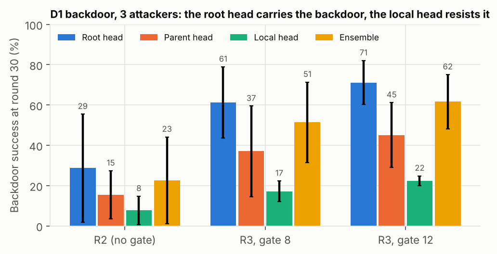

# Predictions before the GPU campaign

2026-11-16, written while the lab GPU server is being set up and before any run on it has finished. Each prediction names the run that tests it, the number we expect, and what would prove it wrong. The point of writing this first is that the GPU results will then confirm or refute something stated in advance rather than explain something after the fact. Nothing here is a result.

## 1. What we know going in

Evidence from our own runs (CIFAR-100, ResNet-9, D1 = α 0.5, 15 clients, 3 attackers; D2 = α 0.2, 20 clients, 4 attackers), all in `EXPERIMENT_LOG.md`:

| Fact | Numbers |
|---|---|
| Honest clients are isolated when data is heterogeneous | D2, no attack: about 9 of 20 per run (FedHEP+); R3 with gate 8: 3 |
| Two-sided screening catches ALIE and Min-Max; one-sided catches none | 9 of 9 and 9 of 9 isolated in round 3 |
| The gap gate removes false isolations but hides the backdoor | D1: honest isolations 13 → 3 → 0 (gate 8 → 12); backdoor success 23% → 51% → 62% |
| The influence bound (L0) neutralizes ALIE without isolating anyone | D1 ALIE: L0 47.56, identical to L0 with no attack |
| Isolating ALIE attackers costs accuracy | R3 under ALIE: 45.7–45.9 on every seed, 1.0–2.3 below L0; the same step appears in Phase 3: one-sided FedHEP+ (isolates none) 47.6, two-sided (isolates all three) 45.5 |
| The backdoor outlives its attackers | stop test: 4–13% success at round 10 → 28–53% at round 30 after poisoning stops, no defense |
| The backdoor lives in the shared head, not the personal ones | per-head success (figure below): root 29–71%, parent 15–45%, local 8–22%, across R2, R3-gate-8 and R3-gate-12 |
| Whole-model signals see the backdoor; the root-head cosine does not | FLAME rejects backdoor attackers in 27–28 of 30 rounds; Phase 3 whole-update screening gave 0.3% success (seed 42) |
| The depth-exit guard works on a toy problem | success 93.6% → 6.4%, accuracy 100 → 99.6, 9% of clean inputs flagged |

Evidence from the literature that bears on what comes next:

- **Keeping the classifier local blocks backdoors** (Qin et al., KDD 2023, [arXiv 2302.01677](https://arxiv.org/pdf/2302.01677)): the shared feature extractor learns the trigger features, but a classifier trained only on clean local data never maps them to the target label. FedRep held BadNet below 10% and Blended below 20% where FedAvg and Ditto reached 89–98%. Re-initializing and retraining only the classifier on local data ("Simple-Tuning") cut success by 56.6% on average. This is the same gradient as our root → parent → local heads: FedHEP's local head is a FedRep-style classifier.
- **Attacks built for personalized FL defeat that protection** (Bad-PFL, ICLR 2025; DCInject, [arXiv 2602.18489](https://arxiv.org/html/2602.18489), 2026): triggers made from natural features or global frequency statistics survive personalization with 92–100% success on CIFAR-100 at 100 clients, α 0.5, 10% attackers. Our pixel-patch backdoor is the easy case for personal heads; the paper must include one of these.
- **Theory of what each defense family can and cannot do** (Hammer and Anvil, [arXiv 2509.08089](https://arxiv.org/pdf/2509.08089)): with δ the distance between the mean benign and mean malicious update, robust aggregation and detection remove backdoors above some δ₁ (large deviations are visible), post-hoc removal by fine-tuning works below some δ₂ (small deviations are easy to overwrite), and either alone leaves an exploitable window. Norm bounding is broken by one adaptive client at any usable threshold (90% success at m = 1). Our gap gate is exactly a δ threshold, and our per-head finding plus removal (H8) is the second family; the paper's claim should be the combination.
- **The 2026 evaluation bar** (BackFed, [arXiv 2507.04903](https://arxiv.org/html/2507.04903v2)): 100 clients with 10 per round at α 0.5, a 300-round attack window followed by 300 rounds without attack, metrics ASR over the last 30 attack rounds, peak ASR, and *lifespan* (rounds with success above 50% after the attack stops); detector false-positive rates reported (FLAME 39%, DeepSight 26%, FLDetector 5% on FEMNIST). Fixed-pattern backdoors lived 263 rounds after the attack under FedAvg; a higher server learning rate (0.4–0.6) forgot them faster. Dynamic attacks (A3FL, IBA) defeated nearly every defense.
- **Two-stage trust-then-inspect with layer-level statistics** ([arXiv 2605.19253](https://www.alphaxiv.org/abs/2605.19253.md), 2026): per-layer sign counts, kurtosis, cosine to a trusted reference, clustered per layer, with a median/MAD reputation after a warm-up; 9–11% success on CIFAR-10 ResNet-9 at 20 clients with 6 attackers, but no false-positive rate reported. Close to our L1 design; our contribution over it is the false-isolation measurement and the gate.
- **Recovery after detection** (FAUN, [arXiv 2605.02110](https://arxiv.org/abs/2605.02110); SCRUB-FL, [arXiv 2606.22700](https://arxiv.org/abs/2606.22700), both 2026): both keep only a short window of the removed clients' updates or a synthesized trigger distribution, and report near-zero success after a few unlearning rounds. They confirm H8's premise (detection alone leaves the backdoor in the model) and give the storage budget the paper should match: a window of updates, not the full history.

## 2. Predictions for the queued experiments

Confidence is a subjective probability that the prediction holds as stated. "Refuted if" is the number that would make us drop the idea.

### `gpu_d1_signals` (150 runs, first batch on the server)

| # | Prediction | Confidence | Refuted if |
|---|---|---|---|
| P1 | The CUDA baselines (FedHEP, Defended, FedHEP+, L0, R3) land within 1 point of the Mac numbers with no attack, and the ordering between them is the same | 0.8 | any baseline moves by more than 2 points, or L0 stops beating R3 under ALIE |
| P2 | `weights` and `critical` signals both cut backdoor success below 25% (from 51% with the root-head signal), with `critical` the lower of the two | 0.6 | both stay above 40% |
| P3 | Those two signals bring back false isolations: 2–5 honest clients per run with no attack, because whole-model and layer cosines are noisier under heterogeneity than the root-head cosine | 0.6 | zero honest isolations and success below 25% at the same time (then the signal is simply better and the gate is unnecessary) |
| P4 | `sign_align` isolates every sign flipper and no honest client, but does not see the backdoor (success above 40%): the trigger changes few coordinates' signs | 0.65 | success below 25% |
| P5 | `probe_logits` and `head_gap` catch sign flippers and nothing else; neither moves the backdoor below 40%, because probe images never contain the trigger | 0.75 | either reaches below 25% |
| P6 | The depth-exit guard cuts the ensemble's backdoor success at least in half in every backdoor run, at a cost of 0.5–1.5 points of accuracy, flagging 5–10% of clean inputs | 0.55 | success falls by less than a third, or accuracy drops by more than 2 points |
| P7 | The exit guard flags a larger share of clean inputs for the bottom-10% clients than for the rest, so the bottom-10% accuracy falls more than the pooled accuracy | 0.6 | bottom-10% falls no more than pooled |

### The ALIE accuracy puzzle (30 runs, to queue after the first batch)

Isolating the ALIE attackers under R3 lowers accuracy by 1.0–2.3 points on every seed, while L0 alone, which isolates nobody, is unaffected. Three explanations, each with its run:

| Candidate | Test | Prediction |
|---|---|---|
| (a) Isolation triggers regrouping, which reshuffles parents mid-training | R3 under ALIE with `plus.regroup: false` | small effect: at most 0.5 of the gap |
| (b) ALIE updates are honest updates shifted by 0.43σ, so they still carry the attackers' data; isolating them forfeits 20% of the training data | compare R3 under ALIE with R3 under sign flip and Min-Max | **most of the gap**: R3 scores 45.9–46.2 under all three attacks, which is "12 honest clients" accuracy, while L0 under ALIE keeps all 15 |
| (c) After 3 isolations the trimmed mean's f falls to 0, so L0 degenerates to a plain mean over the remaining 12 | R3 under ALIE with `global_f` held at 3 | a measurable part: 0.3–0.8 points, since the trimmed mean over honest clients only acts as a mild regularizer |

Confidence that (b) explains more than half: 0.7. Consequence for the paper, if confirmed: for attacks that keep attackers near the honest mean, **bounding beats isolating**, and the method should isolate only when the bound is insufficient (sign flip) or the harm is targeted (backdoor). That is an argument for soft, reversible trust (H3) rather than permanent isolation, made with numbers.

### Recovery, H8 (60 runs)

| # | Prediction | Confidence | Refuted if |
|---|---|---|---|
| P8 | Rewinding the trunk and the root head to the Global model from before the first suspicious round, then training on without the isolated clients, cuts final backdoor success to below 15% from 51% (R3, gate 8), at a cost under 1 point, when detection happens by round 10 | 0.6 | success stays above 30% |
| P9 | Rewinding the trunk alone, keeping all heads, leaves success above 30%: the root head's mapping from trigger features to the target label is re-learned from the still-poisoned parent models unless they are also rewound | 0.5 | trunk-only rewind reaches below 15% |
| P10 | Replaying stored honest updates (variant b) recovers the accuracy lost by the rewind (within 0.3 points of no rewind) but costs 4 GB of stored updates per 20-client run, so variant (a) is what the paper proposes | 0.6 | variant (a) loses more than 1.5 points |

### Head-level inference (new idea 9 in `IDEAS.md`; about one hour to implement, evaluation-only)

The per-head numbers suggest a zero-cost defense: when the root head's prediction is not supported by the parent and local heads, let the personal heads decide. This is the exit-guard decision rule applied to the heads FedHEP already has, so it needs no extra classifiers, no held-out split and no threshold fitting.

| # | Prediction | Confidence | Refuted if |
|---|---|---|---|
| P11 | Head-agreement inference lowers ensemble backdoor success to within 5 points of the local head's own rate (8–22%) in every backdoor run, at a cost below 0.5 points with no attack, because the local head is already the best head on each client's own data at α 0.5 | 0.65 | success stays within 10 points of the ensemble's current rate, or accuracy drops by more than 1 point |
| P12 | Against a natural-feature trigger (Bad-PFL style), the local head's advantage shrinks to under 10 points and head-agreement inference no longer helps | 0.6 | the local head still resists by 20 points or more |

### Scale and protocol (Stage 3)

| # | Prediction | Confidence | Refuted if |
|---|---|---|---|
| P13 | At 100 rounds the gap gate's cost appears: with the root-head signal, backdoor success keeps rising to above 80% by round 100 in runs where it was 51% at round 30 (our stop test shows it grows without attackers) | 0.7 | it plateaus below 60% |
| P14 | At 50 and 100 clients with 10 per round, false isolations per round fall (more clients, fewer per-round outliers) but the fraction of honest clients ever isolated over 100 rounds rises above the 30-round figures, so "isolated at least once" must be reported, not the per-round count | 0.6 | the ever-isolated fraction is lower at 100 clients |
| P15 | At 40% attackers, L0 fails first (NNM mixes attackers into honest neighbours once attackers are 8 of 20) and the two-sided screen with the gate still isolates the sign flippers, so the full method degrades gracefully to about the FedHEP+ numbers | 0.5 | the full method falls below Defended FedHEP at 40% |
| P16 | A defense-aware adaptive attack that keeps every signal inside the gate's band (our planned attack) achieves at most half the backdoor success of the plain attack, because staying inside the band bounds its per-round deviation and L0 bounds its influence; this is the δ window of Hammer and Anvil and is where recovery (H8) must do the work | 0.5 | the adaptive attack reaches the plain attack's success |

## 3. The model we expect to publish

If the predictions above mostly hold, the published method is:

1. **L0, influence bound**, always on: ARC clipping → NNM → trimmed mean. Carries ALIE and Min-Max on its own (P1).
2. **Two-sided robust screen with a gap gate**, on a layer-level signal (P2), with the gate set so that nobody is blamed unless the round's scores split (gate 12 on D1; the D2 value comes from the ladder).
3. **Isolation that is soft and reversible** rather than permanent, justified by the ALIE puzzle (bounding beats isolating when attackers sit near the mean) and by H3.
4. **Head-agreement inference** (P11): the personal heads overrule the shared head when they disagree with it. New, hierarchy-native, zero training cost.
5. **Rewind on detection** (P8): the trunk and the root head return to the last Global model before the first suspicious round. Storage: one Global model per round (6.9 MB), a window of 10 rounds.

Expected D1 numbers for this model, against the strongest baselines on the same device (mean of 3 seeds; the table is the claim the paper has to defend):

| | No attack | Sign flip | ALIE | Min-Max | Backdoor success | Honest clients isolated |
|---|---|---|---|---|---|---|
| Defended FedHEP (published) | 48.4 | 38.1 | 47.5 | 45.2 | 79% | 0 |
| FedHEP+ (Phase 3, one-sided) | 47.9 | 46.3 | 47.6 | 44.9 | 21% | 13 (no attack) |
| FedHEP+ two-sided | — | — | 45.5 | 45.7 | — | — |
| FLAME | 42.8 | 42.7 | — | — | 0.5% | many |
| **Expected FedHEP-Guard** | **47.3 ± 0.3** | **46.2 ± 0.5** | **47.0 ± 0.5** | **46.0 ± 0.5** | **below 10%** | **0–1** |

The honest claim, if this holds: within 1 point of the undefended model with no attack, no honest client isolated, every tested untargeted attack neutralized, and the backdoor held below 10% at prediction time and removed after detection, at the cost of one extra forward pass per prediction and one stored model per round. What it does not claim: resistance to natural-feature triggers (P12) and to attackers above 40%.

Things that would change the model:
- If P2 fails (layer-level signals do not see the backdoor), the backdoor defense rests entirely on heads and rewind, and the screen stays on the root-head signal.
- If P11 fails, the depth-exit guard (P6) is the fallback at prediction time, at a higher cost.
- If P8 fails, the paper's backdoor claim is prediction-time only, and the lifespan metric (BackFed) becomes the headline negative result.

## 4. The campaign: what "thousands of runs" buys

Throughput is unknown until the pilot finishes. For planning, one 30-round D1 run is about 13 minutes on the Mac; a single RTX PRO 4500 should be at least three times faster, and three runs per GPU across four GPUs give roughly 10–20 runs per minute of wall time at the queue, so 100–200 runs per hour. The pilot replaces these guesses. The campaign in order, with the decision each stage feeds:

| Stage | Runs | Hours at 150 per hour | Decides |
|---|---|---|---|
| C1 `gpu_d1_signals` | 150 | 1 | P1–P7: the signal and whether the exit guard is worth its cost |
| C2 ALIE puzzle | 30 | 0.2 | (a), (b), (c): isolate or bound |
| C3 head-agreement inference | 0 new (re-evaluate C1's saved models) or 45 | 0.3 | P11 |
| C4 D2 ladder on CUDA (L0, R2, R3 gate 8 and 12, best signal) | 75 | 0.5 | the gate value at α 0.2 |
| C5 recovery H8 (variants a, b, trunk-only; 3 attack timings) | 60 | 0.4 | P8–P10 |
| C6 100-round durability: best two rungs and three baselines, backdoor on, then off at round 50 | 45 | 1 | P13; lifespan metric |
| C7 scale: 20, 50, 100 clients × 10%, 20%, 30%, 40% attackers × 5 attacks × 5 methods × 3 seeds | 900 | 6–12 (longer runs at 100 clients) | P14, P15; the paper's main table |
| C8 adaptive attacks: defense-aware, layer-wise poisoning, natural-feature trigger, on-off attacker | 120 | 1 | P12, P16 |
| C9 baselines at the 2026 bar: Krum, RFA, centred clipping, NNM + ARC alone, FLDetector, AlignIns, Ditto and FedRep under attack | 480 | 3 | the comparison table |
| C10 efficiency: sketching k ∈ {512, 2048, 8192}, timing and memory for every method | 90 | 0.6 | H6; the cost table |
| C11 five seeds for every headline table (seeds 2027–2029 added) | about 600 | 4 | confidence intervals |
| C12 held-out: α 0.1 with 50 clients; FEMNIST with 100 clients; frozen method | 150 | 2–4 | Stage 4 |
| Total | about 2,700 | 20–30 hours of queue time | |

So the whole programme is one to two days of the four GPUs, or a week on two. The binding constraint is not compute but the order of decisions: C1–C3 fix the method, C4–C6 fix its parameters, and only then is C7–C12 worth running, because every run in C7–C12 would have to be repeated if the method changed. Nothing in C7–C12 is queued until C1–C6 are read.

Runs that are cheap on the server and were out of reach on the laptops: 100 rounds (C6), 100 clients (C7), five seeds everywhere (C11). These are the three things a 2026 reviewer asks for first.

## 5. Risks to the predictions

- **The Mac and CUDA disagree by more than noise (P1 fails).** Then every published number is CUDA-only and the Mac runs become development evidence. Already allowed for by the device rule.
- **Several runs per GPU change results.** The pilot checks this by repeating seeds across 1, 2 and 4 runs per GPU; cuDNN non-determinism can make results differ at the fourth decimal even on one process, which is harmless, but a systematic shift would be a bug.
- **The exit guard's 20% held-out split starves small clients at 100 clients.** Then the guard needs the exit classifiers fitted on fewer images, and its cost rises for exactly the clients that matter.
- **Natural-feature triggers (P12) may defeat the heads and the rewind together**, because the trigger is in the honest data too. That would be an honest limitation, not a failure of the paper.

## Sources

- Qin et al., Revisiting Personalized Federated Learning: Robustness Against Backdoor Attacks, KDD 2023 — https://arxiv.org/pdf/2302.01677
- DCInject (2026) — https://arxiv.org/html/2602.18489
- Bad-PFL, ICLR 2025 — https://proceedings.iclr.cc/paper_files/paper/2025/file/6225ca7eaef477a05d01e90b0615ab4f-Paper-Conference.pdf
- Hammer and Anvil: Toward a Theory of Backdoors in Federated Learning — https://arxiv.org/pdf/2509.08089
- BackFed benchmark — https://arxiv.org/html/2507.04903v2
- Two-stage robust aggregation for OTA-FL (2026) — https://www.alphaxiv.org/abs/2605.19253.md
- FAUN, adversarial update-based federated unlearning (2026) — https://arxiv.org/abs/2605.02110
- SCRUB-FL (2026) — https://arxiv.org/abs/2606.22700
- H+ similarity-aware aggregation — https://arxiv.org/html/2509.24330v1
- FedSurrogate, AlignIns, Orion, CrowdGuard, FedREDefense, BackdoorIndicator: see `IDEAS.md` and `LITERATURE_REVIEW.md`
