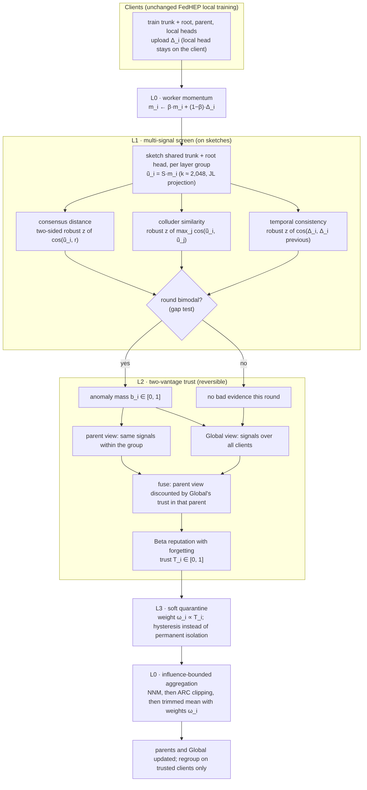
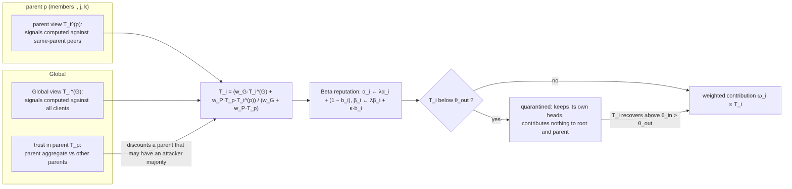
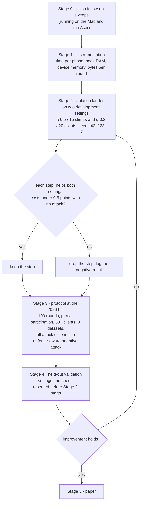

# Research plan: a hierarchy-native, resource-efficient defense for FedHEP

Status: proposal, 2026-11-14. Nothing in this document is a result. Every component below is a hypothesis with a test that can reject it, and it enters the method only if the test passes. Evidence for the design comes from two places: the team's own runs (`docs/EXPERIMENT_LOG.md`) and the literature review (`docs/LITERATURE_REVIEW.md`, 170 sources, cited below by section).

## 1. What the evidence says the method must solve

**From our runs.**

1. FedHEP+ falsely isolates honest clients, and it gets worse with heterogeneity. At α = 0.5 with 15 clients it isolated 24 of 117 honest client-runs (no attack, sign flip and backdoor, 3 seeds); in the held-out setting (α = 0.2, 20 clients) it isolated 10 of 20 honest clients with no attack, from round 4, and lost to Defended FedHEP in four of five settings.
2. The same honest clients are isolated whatever the attack. Their data, not the attack, makes them look anomalous.
3. No defense we tested (Defended FedHEP, FedHEP+, Bulyan, FLAME) isolated a single ALIE or Min-Max attacker. Their z-scores sit far *above* the honest ones: the attackers are closer to the consensus than honest clients are.
4. The scale of the robust z collapses late in training (the median cosine falls toward zero), so a single round can give z = −11 and isolate a client for good.
5. Bulyan and FLAME stop backdoors (0.5% success) but cost 4–6 points of accuracy with no attack.

**From the literature** (review, sections "Non-IID data breaks distance-based aggregators", "Seven open gaps").

- Distance from consensus is a weak signal in both directions: non-IID drift pushes honest clients away from it, and in-distribution attacks (ALIE, Min-Max, mimic) sit inside it. No filter can separate attackers that lie within the honest spread, and an error floor of order (f/n)·G² remains even with perfect filtering (Allouah et al., AISTATS 2023).
- The durable results either **bound what any client can do** (worker momentum, nearest-neighbour mixing (NNM), adaptive robust clipping (ARC), trimmed mean) or **anchor trust outside cross-client geometry** (a client's own history, colluder similarity, a trusted probe).
- Permanent isolation is rare in the literature and poorly supported; reversible reputation (forgetting factors, pardon rules, asymmetric steps) is the norm.
- No published defense is designed for a hierarchical, multi-head personalized model. Fused parent and Global scoring, discounting a parent by the Global's trust in it, and head disagreement as a signal appear to be open (to be confirmed against two sources the review could not read in full: TWRM and arXiv 2610.24036).
- No defense paper reports peak server memory, and published overhead numbers disagree by orders of magnitude, so measured cost on our hardware is itself a contribution.

**Problem statement.** Keep a hierarchical personalized model accurate when some clients are malicious, **without mistaking honest-but-different clients for attackers**, while bounding the harm of attackers no screen can see, at a measured and small cost in time and memory.

## 2. Proposed method (working name: FedHEP-Guard)

One round, with the layer each step belongs to:

### L0 · Influence bound (always on)
The safety net for attackers the screen misses (fact 3).

$$m_i^t = \beta\, m_i^{t-1} + (1-\beta)\,\Delta_i^t$$

$$\hat m_i = \frac{1}{n-f}\sum_{j \in \mathcal N_{n-f}(i)} m_j \quad\text{(NNM: mean of the } n-f \text{ nearest neighbours, itself included)}$$

ARC then clips the $\lfloor 2(f/n)(n-f) \rfloor$ largest $\hat m_i$ to the next-largest norm, and the root and trunk step is a trimmed mean of the clipped $\hat m_i$, weighted by trust $\omega_i$ (L3). Here $f$ is an assumed upper bound on attackers, set once (for example $0.3n$), not the true count.

Applied to what FedHEP shares across groups (trunk and root head). Parent heads keep FedHEP's own aggregation within the group, weighted by $\omega_i$.

### L1 · Multi-signal screen (on sketches)
Three signals, each a robust z-score over the round's clients, computed on a random projection of the shared parameters:

$$\tilde u_i = S\, m_i,\quad S \in \mathbb R^{k\times d},\ S_{ab} \sim \mathcal N(0, 1/k),\ k \approx 2048$$

By the Johnson–Lindenstrauss lemma, cosines are preserved within a small error with high probability, so screening costs $O(nkd)$ for the projection and $O(n^2k)$ for pairwise statistics instead of $O(n^2d)$, and $S$ is regenerated from a seed rather than stored. The sketch is taken per layer group (trunk blocks, root head) because backdoor-critical layers are often convolutional (review, Gap 3).

| Signal | Statistic | Attacks it targets | Direction flagged |
|---|---|---|---|
| Consensus distance | $c_i = \cos(\tilde u_i, r)$, $r$ = trimmed mean of NNM-mixed sketches | sign flip, noise, scaled backdoors | both sides (fact 3) |
| Colluder similarity | $\rho_i = \max_{j\ne i}\cos(\tilde u_i, \tilde u_j)$ | ALIE, Min-Max, Sybils (colluders send near-identical vectors) | high |
| Temporal consistency | $\tau_i = \cos(\Delta_i^t, \Delta_i^{t-1})$ | PoisonedFL-style fixed directions; on-off attackers | both sides |

Each z uses a scale that cannot collapse (fact 4):

$$z_i = \frac{x_i - \operatorname{med}(x)}{\max\!\big(1.4826\,\mathrm{MAD}(x),\ \varepsilon_{\text{abs}}\big)}$$

**Bimodality gate.** Before any client gets bad evidence, test whether the round's scores contain a separate group at all (gap statistic or a two-component mixture likelihood ratio). If not, the round produces no bad evidence. This is the direct answer to facts 1 and 2: a heterogeneous but attack-free round has a long tail, not a second mode.

Anomaly mass per client: $b_i = \min\!\big(1,\ \max_s \max(0, |z_i^{(s)}| - \tau_s)/\tau_s\big)$ over the signals $s$ that flag it in their direction.

### L2 · Two-vantage, reversible trust (hierarchy-native)

Each client is scored twice: against its own parent's members ($T_i^{(p)}$) and against all clients ($T_i^{(G)}$). The Global also scores each parent's aggregate against the other parents ($T_p$). The parent's view counts only as much as the Global trusts that parent, because a parent with an attacker majority ranks its honest members as outliers (review, Gap 5):

$$T_i = \frac{w_G\,T_i^{(G)} + w_P\,T_p\,T_i^{(p)}}{w_G + w_P\,T_p}$$

Trust accumulates as a Beta reputation with forgetting $\lambda$ and an asymmetric penalty $\kappa > 1$, so it falls quickly on clear evidence and recovers slowly:

$$\alpha_i \leftarrow \lambda\alpha_i + (1-b_i),\qquad \beta_i \leftarrow \lambda\beta_i + \kappa\, b_i,\qquad T^{(\cdot)}_i = \frac{\alpha_i}{\alpha_i+\beta_i}$$

### L3 · Soft quarantine instead of permanent isolation
Weight $\omega_i \propto T_i$. A client whose trust falls below $\theta_{\text{out}}$ contributes nothing to root or parent but keeps training its own heads; it is readmitted when trust recovers above $\theta_{\text{in}} > \theta_{\text{out}}$ (hysteresis). Regrouping uses trusted clients only, so an attacker cannot steer group formation (review, Gap 5: cluster-poisoning).

### Components deliberately left for later
- **Head disagreement** (root vs parent vs local predictions on a server probe set): needs a synthetic probe and per-parent thresholds, because entropy on class-balanced synthetic data penalises honest clients with narrow label sets (SD-CSFL, review Gap 4). Stage 2b, only if L0–L3 leave backdoors uncovered.
- **Same-parent peer voting** (the "Among Us" idea): published forms need an honest voter majority, and sending weights to peers adds privacy cost. Novelty would lie in voting restricted to same-parent peers, ballots weighted by the voter's own trust, and votes on heads rather than full weights. Stage 2c.
- **Dynamic networks** (early exits, width scaling) for compute savings: mature for efficiency, untested as a defense signal. Considered only after Stage 1 shows where time and memory go.

## 3. Hypotheses and how each can fail

| ID | Hypothesis | Test | Rejected if |
|---|---|---|---|
| H1 | Two-sided consensus distance catches ALIE and Min-Max | `followup_two_sided` | **Confirmed 2026-11-15**: 9 of 9 ALIE and 9 of 9 Min-Max attackers isolated in round 3 at α = 0.5, 12 of 12 Min-Max at α = 0.2. Accuracy gain small or negative because these attacks were weak at this scale; false isolations unchanged. |
| H2 | The bimodality gate removes most false isolations | Stage 2 ladder | **Confirmed on D1 (2026-11-15)**: gap gate 8 cut false isolations from 13 to 3 (no attack) and 5 to 2 (sign flip) over 3 seeds while every sign flipper was still isolated in round 3; accuracy within noise of FedHEP+. Cost: it also blocks backdoor detection (success 55% vs 21%), because backdoor attackers never split off in cosine space. D2 pending. |
| H3 | Reversible trust beats permanent isolation | Stage 2 ladder; on-off attacker | accuracy not higher at α = 0.2, or on-off attackers regain influence |
| H4 | L0 bounds the damage of attackers the screen misses | `phase6_l0`, `phase6_l0_a02` | **Partly confirmed 2026-11-15**: best or equal under ALIE, Min-Max and backdoor at α = 0.5; best defense at α = 0.2 with no attack and under the backdoor (+1.6, +1.4 over FedHEP+, zero false isolations). **Fails under sign flip at α = 0.5** (−4.7): NNM mixes reversed updates into honest ones. Momentum dropped (D33). |
| H5 | Parent discounting helps when a parent has an attacker majority | placement attack: attackers concentrated in one group | no gain over Global view alone |
| H6 | Sketching keeps detection while cutting cost | k ∈ {512, 2048, 8192, full} | detection F1 drops > 0.02 at k = 2048, or no measurable time saving |
| H7 | The full method stays within 0.5 points of FedHEP with no attack | every setting | L0 alone: −0.4 (α = 0.5), −1.4 (α = 0.2) against undefended FedHEP; −0.5 against Defended FedHEP at α = 0.2. Full method pending. |
| H8 | A backdoor implanted before detection can be removed after it (added 2026-11-14, D32). **2026-11-15: the stop test shows the backdoor grows after poisoning stops even with no defense** (4–13% at round 10 → 28–53% at round 30), so removal is required, not optional; per-head success is now logged to locate it (`followup_backdoor_heads`) | two variants of the published recovery idea (FedEraser, IWQoS 2021; FedRecover, commonly cited as IEEE S&P 2023): (a) rewind the shared layers to the stored Global model from before the isolated clients' first suspicious round and continue training without them; (b) also replay the stored honest updates since then. The model has 1.72 M floats (6.9 MB), so keeping every Global model costs about 0.2 GB per 30-round run, while keeping every client update for replay costs about 4 GB at 20 clients. Compare both to doing nothing | success not reduced by at least half, or accuracy cost > 1 point |

## 4. Experiment stages

### Stage 0 · Finish the follow-up sweeps (running)
Assignment per machine is in the experiment log ("Run plan update (2026-11-14)").

### Stage 1 · Instrumentation (code, about one day)
Add to every run's `metrics.json`: wall time per phase (local training, screening, aggregation, evaluation), peak process memory (RSS), peak device memory (`torch.mps.driver_allocated_memory`, `torch.xpu.max_memory_allocated`, `torch.cuda.max_memory_allocated`), and bytes uploaded and downloaded per round. Re-run one setting per existing method to fill the cost columns. Without this, no efficiency claim can be made.

### Stage 2 · Ablation ladder (development settings only)
Two development settings, seeds 42, 123, 7: **D1** α = 0.5, 15 clients, 3 attackers (Phases 2–5) and **D2** α = 0.2, 20 clients, 4 attackers (`followup_alpha02`). Attacks: none, sign flip, backdoor, ALIE, Min-Max. Each rung adds one component to the previous rung:

| Rung | Adds | Runs (2 settings × 5 attacks × 3 seeds) |
|---|---|---|
| R0 | FedHEP+ (reference) | reuse existing where available |
| R1 | patience 3 + absolute scale floor | 30 |
| R2 | two-sided distance | 30 |
| R3 | bimodality gate | 30 |
| R4 | reversible Beta trust + soft quarantine (replaces permanent isolation) | 30 |
| R5 | L0 influence bound (momentum, NNM, ARC, trimmed mean) | 30 |
| R6 | colluder similarity + temporal consistency | 30 |
| R7 | parent view + discounting | 30 |
| R8 | sketching (k = 2,048) | 30 |

About 240 runs, roughly 50 hours on one machine or 25 hours on both. A rung that fails the gate in the diagram is dropped and logged as a negative result; later rungs build on the last kept rung. Ablations that remove one component at a time from the final method follow at the end of the stage.

### Stage 3 · Protocol that meets the 2026 bar (review, Gap 7)
| Dimension | Now | Target |
|---|---|---|
| Rounds | 30 | 100 (durability and late-start attacks need more) |
| Participation | full | full and 50% sampled per round |
| Clients | 15–30 | 20, 50, 100 |
| Datasets | CIFAR-100 subset | CIFAR-10, CIFAR-100, FEMNIST (natural partition) |
| Attacker fraction | 20% | 10, 20, 30, 40% |
| Untargeted attacks | sign flip, label flip, noise, ALIE, Min-Max | add Min-Sum, IPM, Fang (trim attack), mimic, on-off |
| Backdoors | pixel pattern | add DBA, Neurotoxin, A3FL; pFL-aware: PFedBA, BapFL |
| Adaptive | ALIE, Min-Max | a defense-aware attack that knows FedHEP-Guard's signals and keeps every z inside its band |
| Baselines | FedAvg, FedHEP, Defended FedHEP, FedHEP+, median, trimmed mean, Bulyan, FLAME, FLTrust | add Krum, RFA, centered clipping, NNM + ARC, FLDetector, AlignIns; pFL baselines Ditto and FedRep under attack |
| Metrics | accuracy, bottom-10%, backdoor success, detection P/R/F1 | add per-head backdoor success (root, parent, local, ensemble), false isolation over rounds, time and memory |
| Statistics | mean ± sd, 3 seeds | 5 seeds, paired bootstrap confidence intervals |

The full grid is far beyond two laptops (100-round runs take about 40 minutes each). Plan: all methods on CIFAR-100 at the main setting; a reduced method set (FedAvg, best two baselines, Defended FedHEP, FedHEP-Guard) across the other dimensions. The exact grid will be sized after Stage 1 measures run time at 50 and 100 clients.

### Stage 4 · Held-out validation
Reserved now, before Stage 2 starts, and not touched until Stage 4: seeds 2027, 2028, 2029; α = 0.1 with 50 clients; FEMNIST with 100 clients. The method is frozen before these run. Seed 2026 (the first held-out setting) is spent and now serves only as a development data point.

### Stage 5 · Paper
Candidate venues, with dates as the review found them (unverified dates must be rechecked): AAMAS 2027 has passed (paper deadline 8 October 2026). IJCAI 2027 is reported by an aggregator, unverified, at 11 January 2027, which is too early for Stage 3. ICML 2027 and KDD 2027 cycle 2 are not yet announced. A realistic target is a mid-2027 deadline or a journal (IEEE TIFS, IEEE TDSC).

Draft contributions, each conditional on the stated stage passing:
1. A measurement study: honest-client false isolation over training rounds under non-IID data, which no paper reports (our data already shows it), and evidence that no tested defense isolates ALIE or Min-Max attackers because they sit inside the consensus.
2. FedHEP-Guard: a defense native to hierarchical personalized FL, combining an influence bound, multi-signal screening with a bimodality gate, and two-vantage reversible trust.
3. Measured cost (time per phase, peak memory on Apple and Intel laptop GPUs) for every compared defense.
4. A protocol that meets current evaluation standards, including a defense-aware adaptive attack.

## 5. Resource efficiency plan
Measure first (Stage 1), then optimise only what the measurements show matters. Candidates, each to be measured and kept only if it helps without changing results:

| Candidate | Expected effect | Risk |
|---|---|---|
| Sketch screening signals (L1) | screening memory and time from O(n²d) to O(nkd + n²k) | detection loss; tested by H6 |
| Keep one flattened copy of each update, reuse it across signals | lower peak memory in screening | none expected |
| Store per-client heads and momentum in float16 on the device | lower memory for 50–100 clients | small numerical drift; compare to float32 on one setting |
| `channels_last` and mixed precision for local training | faster training on MPS and XPU | backend support varies; results must match within seed noise |
| Evaluate every 5 rounds (current) and only on the final round in large grids | less evaluation time | lose convergence curves; keep for the main setting |

Efficiency results will be reported per device (Apple M5 MPS, Intel Arc XPU), never mixed.

## 6. Risks
- **The bimodality gate may also hide a minority of attackers** (20% attackers in a heterogeneous round may not form a clear mode). Mitigation: L0 bounds what they can do; report it honestly if it happens.
- **Colluder similarity can be evaded** by adding independent noise to each colluder's update (DarkFed adds a loss term for this). The defense-aware adaptive attack must include this evasion.
- **Two-vantage scoring needs groups of useful size**; with 3 parents and 15 clients a group has about 5 members. Test with 3 and 5 parents.
- **Compute**: Stage 3 may need cloud GPU time if laptops are too slow at 100 clients; decided after Stage 1.
- **FedHEP citation**: the review could not find the FedHEP paper in any public index; the paper must cite the team's own copy.

## 7. Progress

- **2026-11-14:** L0 is implemented (`robust.rule: arc_nnm_tm`, `robust.momentum`, decision D31) and queued as rung R5 ahead of the screening rungs: `phase6_l0.yaml` (D1) and `phase6_l0_a02.yaml` (D2). Stage 1 is partly done: every run now records per-round time and peak memory. Per-phase timing (training vs defense) is still to do. New evidence: on 20 clients a backdoor keeps growing after all its attackers are isolated, which adds H8.
- Reversible trust (H3) must be tested against the failure recorded in D22: readmission brought attackers back late in training.

- **2026-11-15:** H1 confirmed, H4 partly confirmed, momentum dropped (D33). The ladder is reordered: L0 is the base; rung R2 is L0 + two-sided screening with patience 3; R3 adds the bimodality gate; R4 reversible trust; R6 extra signals; R7 parent view; R8 sketching. The backdoor-stop test shows that honest training amplifies an implanted backdoor in FedHEP, so H8 (recovery) is now on the critical path, with per-head success logged to find where the backdoor lives.

- **2026-11-16:** four new screening signals (layer-level, sign alignment, probe outputs, head gap) and a depth-exit guard against backdoors at prediction time are implemented and tested, waiting for the A1000 (`a1000_d1_signals`). Ranked rationale in `IDEAS.md`. Peer voting is published in its basic form (FedReview, BaFFLe, CrowdGuard); only a same-parent, trust-weighted version would be new.

## 8. Next steps
1. Finish Stage 0 sweeps on both machines; sync the Acer with `bash scripts/sync_acer.sh`.
2. Implement Stage 1 instrumentation and re-run one setting per method for cost numbers.
3. Implement L0 (momentum, NNM, ARC, trimmed mean) and the bimodality gate first: they address the two failures we have measured (adaptive attackers missed, honest clients isolated).
4. Run rungs R1–R5 of the ablation ladder on D1 and D2.
