# RFL Lab in plain words

What we tried, what we found, and what comes next, from the first run (2026-11-06) to the start of Phase 6 (2026-11-14). Every number here comes from a recorded run; the full details, tables and settings are in [`EXPERIMENT_LOG.md`](EXPERIMENT_LOG.md).

## The problem

In **federated learning**, many devices ("clients") train one shared model together without sending their data anywhere. Each round, every client trains a copy of the model on its own data and sends back only the change it made (its "update"). The server combines the updates into a new shared model.

The weakness: the server cannot see the data, so it cannot check whether a client is honest. A few **malicious clients** can send harmful updates and damage the shared model. A **defense** is a rule on the server that tries to limit that damage.

Our goal: find, test and improve defenses for **FedHEP**, our team's personalized federated learning method, and eventually propose a new defense that is both stronger and cheaper to run.

## A few words used throughout

| Word | Meaning |
|---|---|
| Round | One cycle: clients train, send updates, the server combines them. Our runs use 30 rounds. |
| Non-IID, α | Clients have different kinds of data (for example, one client has mostly cats, another mostly cars). Smaller α means more different. We mostly use α = 0.5 (moderately different) and α = 0.2 (more different). |
| Sign flip | An attacker sends its update reversed, to push the model the wrong way. |
| Label flip | An attacker trains on deliberately wrong labels. |
| Backdoor | An attacker teaches the model a secret rule: any image with a small sticker becomes class X. The model still looks normal on ordinary images. |
| Backdoor success | The share of stickered test images that the model wrongly labels as class X. Lower is better; 0.6% is pure chance. |
| ALIE, Min-Max | "Clever" attacks that hide their update inside the normal range of honest updates, so it is hard to spot. |
| Isolate | The defense decides a client is malicious and stops using its updates. |
| False isolation | The defense isolates an honest client by mistake. |
| Seed | A fixed random starting point. We repeat each experiment with 3 seeds and report the average ± spread. |

## The starting point: FedHEP

FedHEP gives every client one shared "trunk" (the part that learns general image features) and three small classifier "heads": a **root** head shared by everyone, a **parent** head shared within a group of similar clients, and a **local** head private to the client. The final prediction combines all three. Similar clients are grouped under a "parent"; a "Global" server sits on top.

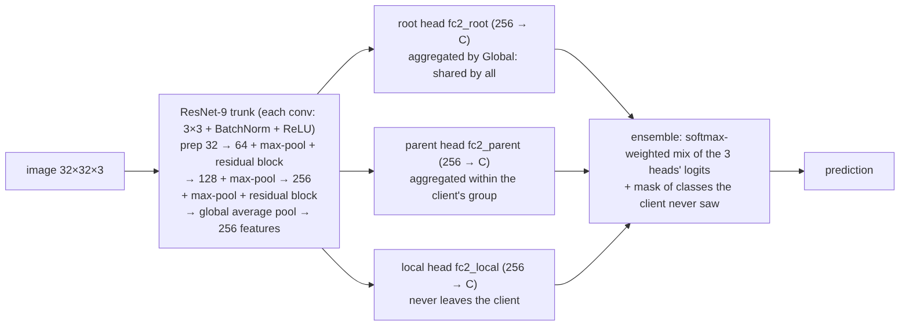

Our test bed throughout: the CIFAR-100 image dataset (100 classes), 15 clients (20 or 30 in larger tests), 3 of them attackers unless stated otherwise.

## Step 1 · Rebuild FedHEP and check it matches (Phase 1)

**Question:** can we rebuild FedHEP and its defended version ("Defended FedHEP") in clean, tested code, and get the same results as the authors?

**What we did:** rewrote everything in a modular framework, tested it line by line against the authors' code, and re-ran the paper's main experiments on the Mac.

**Result: yes.** Our numbers match the authors' code within the normal spread between runs, for example FedHEP at α = 0.05: 65.5% (paper 65.5%), and Defended FedHEP with no attack: 48.4% (paper 47.9%). Along the way we found a quirk in the original code: a BatchNorm counter, not the actual learning, dominated how FedHEP grouped its clients.

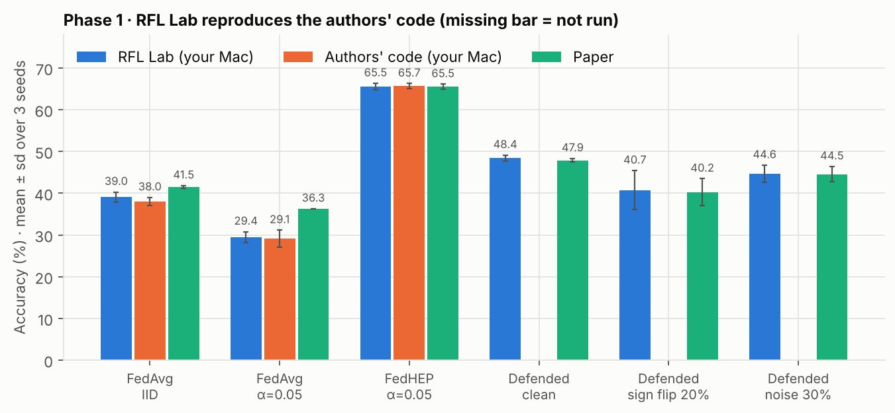

## Step 2 · Test the existing defenses fairly (Phase 2)

**Question:** how well do the existing methods resist attacks, measured the same way for all?

**What we did:** a benchmark of FedAvg (the standard, undefended method), Multi-Krum (a classic defense), FedHEP and Defended FedHEP under five attacks, including a backdoor the paper did not test. We also scored, every round, whether each defense could tell attackers from honest clients.

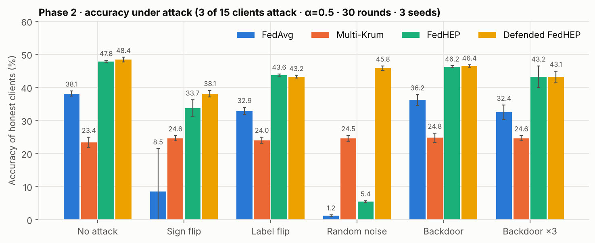

**What we learned:**
- Defended FedHEP was the most accurate method under every attack (for example 45.8% under random noise, where plain FedHEP collapsed to 5.4%).
- But it **never removed an attacker**. It only gave them less weight, so sign flip still cost it 10 points (48.4% to 38.1%).
- It did **nothing against the backdoor**: 79% backdoor success, the same as no defense. Backdoor attackers even looked *more* trustworthy than honest clients, because half their data is normal.
- Multi-Krum blocked every attack, but only by throwing away 12 of 15 clients every round, which left accuracy near 24%.

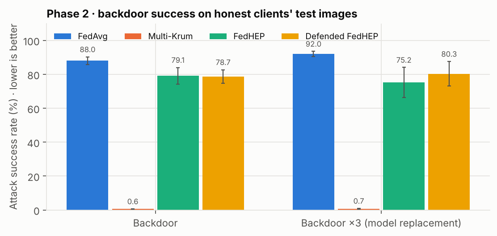

## Step 3 · Our first improvement: FedHEP+ (Phase 3)

**Idea:** instead of only lowering an attacker's weight, find it and remove it for good.

**How FedHEP+ works:** each round, measure how similar every client's update is to the "typical" update (the median of all updates). Turn that into a **z-score**: how many typical spreads a client is away from the others. A client that is far below the others several times is isolated permanently. Groups are then re-formed from the clients that remain.

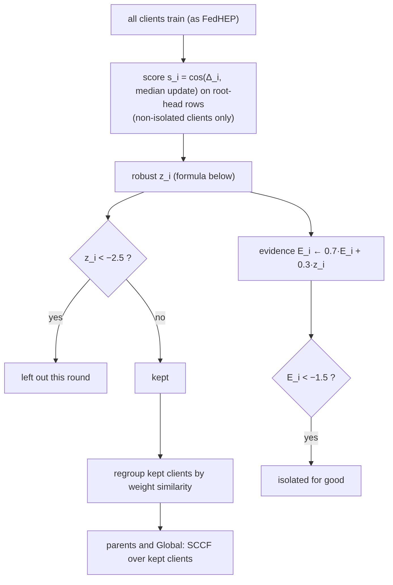

**Result (3 seeds), compared with Defended FedHEP:**
- Sign flip: **+8.3 points** (38.1% to 46.3%), every attacker removed in round 1.
- Label flip: **+3.1 points**.
- Backdoor success: **79% down to 21%**.
- Cost with no attack: −0.5 points.

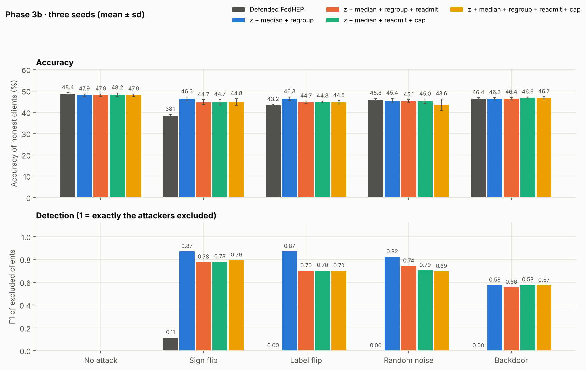

**A problem we found on the way:** the first version kept isolating honest clients one after another (a "cascade"), because each isolation made the remaining group look tighter, so the next-most-different honest client looked suspicious. Re-forming the groups and scoring only against the clients still kept fixed most of this.

## Step 4 · Checking groups first, then members (Phase 4): did not work

**Idea:** first ask which *group* contains attackers, then look for the attackers inside that group.

**Result: not adopted.** We tested it with the attackers placed together in one group ("concentrated") and spread across groups. The group check worked: when it flagged a group holding backdoor attackers, it was right 85% of the time. But the member check could not tell attackers from their honest neighbours. Members of one FedHEP group are genuinely alike, so with concentrated backdoor attackers it either missed them (backdoor success rose from 21.5% to 39.7%) or, in a second design, removed honest neighbours (backdoor success 1.9%, but accuracy −1.1 to −1.7 points). We kept FedHEP+ and recorded both negative results.

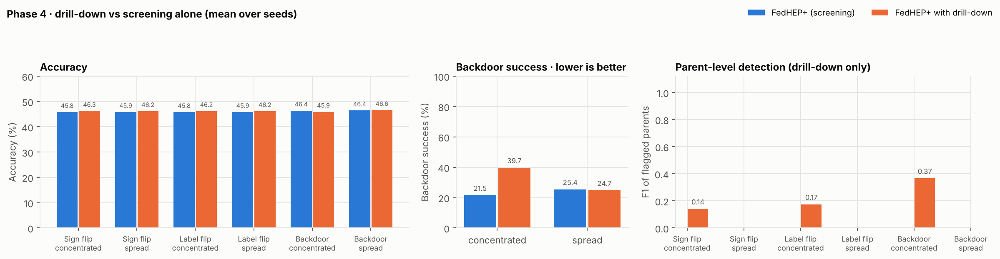

## Step 5 · Comparing with well-known defenses (Phase 5)

**Question:** would a famous published defense, plugged into FedHEP, do better than FedHEP+?

**What we did:** tested five established rules inside FedHEP: median, trimmed mean, Bulyan, FLAME and FLTrust, on 3 seeds and in harder settings.

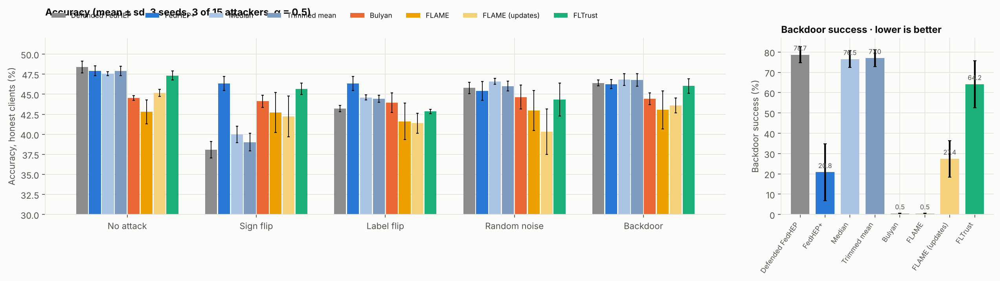

**Result:** none beat FedHEP+ overall. Bulyan and FLAME **stopped the backdoor completely** (0.5%), but they cost 4 to 6 points of accuracy even when nobody attacks, because they throw out several honest clients every round. FedHEP+ kept the best balance at α = 0.5 with 15 clients.

## Step 6 · The professor's questions, and the results that changed the picture (follow-up)

The professor asked why the defense's statistics behave as they do, for no-defense baselines, for clever attacks, and for larger experiments. The answers changed what we believe about FedHEP+.

### 6a · Why honest clients get flagged

The z-score divides "how far from typical" by "how spread out everyone is" (the MAD), and a minimum value (a "floor") stops that spread from being too small. We logged both every round. The spread does **not** shrink; it grows six- to eightfold after round 14. What happens is that the floor fades as training goes on, and around round 14 the denominator is at its smallest. Then a normal difference looks extreme, and an honest client can be isolated for good from a single bad round. Requiring 3 bad rounds in a row ("patience 3") cut false isolations by 42%.

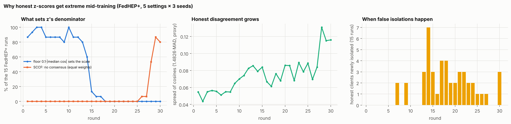
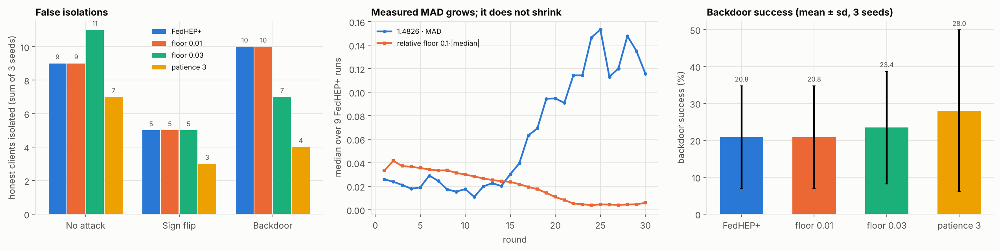

### 6b · Clever attacks slip through every defense

Under ALIE and Min-Max, **no defense isolated a single attacker**. The reason is the opposite of what we expected: these attackers are *closer* to the typical update than honest clients are (their z-scores are far above the others), while FedHEP+ only looks for clients far below. We have built a version that looks in both directions; it is queued. Min-Max cost about 3 points under most defenses.

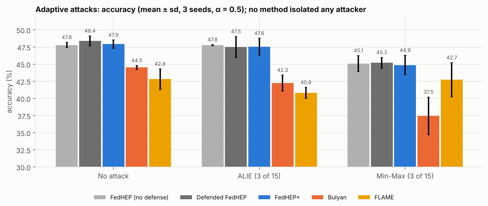

### 6c · The improvement did not carry over to a new setting

We had set aside one setting that was never used for tuning: more different data (α = 0.2) and 20 clients. There, FedHEP+ **isolated 10 of 20 honest clients with no attack at all**, starting in round 4, and did worse than Defended FedHEP in four of five tests. The same honest clients were flagged whatever the attack, so their unusual data, not any attack, made them look suspicious. (One seed only; it is now being repeated on three seeds.)

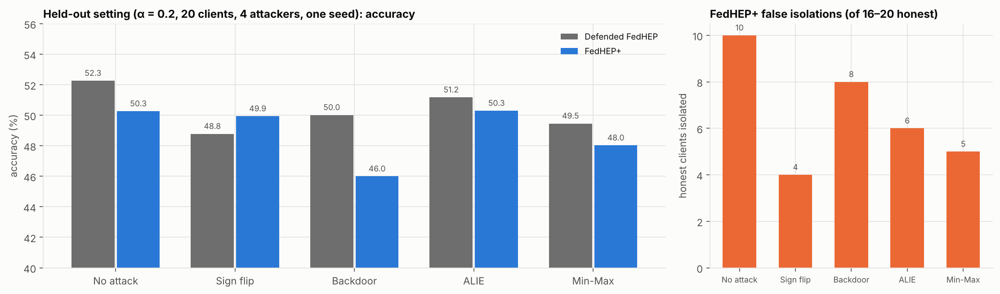

### 6d · A backdoor stays after its attackers are removed

With 20 clients and 5 backdoor attackers, FedHEP+ isolated every attacker by rounds 11 to 15. But backdoor success on honest clients' models **kept rising afterwards**, by 17 to 47 points by round 30. Once the backdoor is in the shared part of the model, removing the attackers does not remove it. FLAME, which blocks the backdoor from the start, stayed at 0.6%.

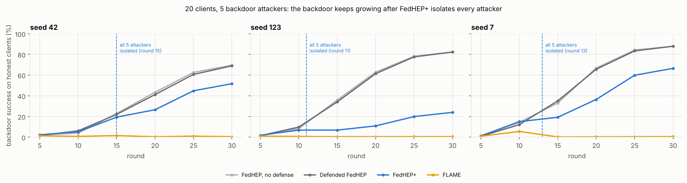

**The lesson of Step 6:** "far from the typical update" is a poor sign of an attacker. Honest clients with unusual data are far from it, and clever attackers are close to it.

## Step 7 · What the research literature says

We reviewed 170 papers and sources (saved in [`LITERATURE_REVIEW.md`](LITERATURE_REVIEW.md)). In short:
- Our two failures are well known in theory: under non-IID data, no filter can separate attackers that hide inside the honest spread.
- The defenses that hold up best do two things: they **limit how much any one client can change the model**, whether or not it is caught, and they use **evidence beyond distance**: a client's own history, suspiciously similar updates from colluding attackers, or checks against trusted data.
- Very few defenses isolate clients permanently; most let trust recover.
- No published defense is designed for a hierarchical, personalized model like FedHEP. That is our opening for a new paper.
- No defense paper reports how much memory it uses, so measuring cost carefully is a contribution in itself.

## Step 8 · What comes next: FedHEP-Guard (Phase 6, started)

Our proposed method, built from the evidence above (full plan in [`RESEARCH_PLAN.md`](RESEARCH_PLAN.md)):

1. **Safety net (L0):** limit any single client's influence (clip unusually large updates, average each update with its nearest neighbours, then a trimmed mean), so even an uncaught attacker can do only limited harm.
2. **Several signals instead of one:** distance from typical in *both* directions, suspiciously similar updates, and consistency over time. Blame no one in a round unless the round actually contains a separate group of clients.
3. **Two views of every client:** from its own group and from the whole population, combined so that a group taken over by attackers cannot vouch for itself.
4. **Trust that can recover** instead of permanent isolation (tested carefully, because an earlier experiment showed that letting clients back in also let attackers back in).
5. **Removing a backdoor after detection**, by rewinding the shared model to before the attack.
6. **Cost measured** in time and memory for every method.

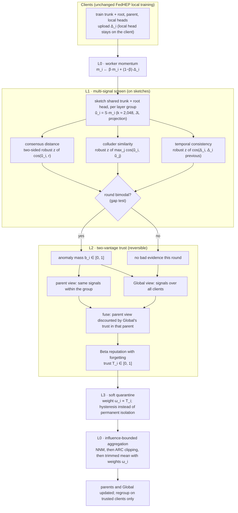

Each part is a hypothesis with a test that can reject it, and it is added only if it helps in both development settings. Settings for the final check are set aside now and will not be used before then.

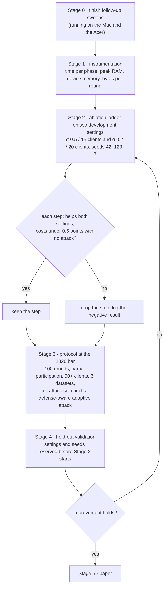

**Status on 2026-11-14:** the safety net (L0) and time and memory measurement are built and tested; their first experiments are queued on the Mac. The Mac and the Acer laptop are finishing the remaining follow-up experiments: 20 and 30 clients, the authors' attack-rate rule, α = 0.2 on three seeds, and the two-direction screen.

## Summary

| Step | Question | Answer |
|---|---|---|
| 1 | Can we rebuild FedHEP faithfully? | Yes, within run-to-run spread of the authors' code and the paper. |
| 2 | How good are existing defenses? | Defended FedHEP is the most accurate but never removes attackers and does nothing against backdoors. |
| 3 | Does finding and removing attackers help? | Yes at α = 0.5 with 15 clients: +8.3 points under sign flip, backdoor success 79% to 21%. |
| 4 | Does checking groups first help? | No; members of a group are too alike to separate. |
| 5 | Do famous defenses do better? | No overall; Bulyan and FLAME stop backdoors but cost 4 to 6 points with no attack. |
| 6 | Does FedHEP+ hold up under closer inspection? | Not yet: it flags honest clients with unusual data, misses clever attacks, and a backdoor stays after the attackers are removed. |
| 7 | What does the literature recommend? | Limit every client's influence, use more than one signal, let trust recover. |
| 8 | What next? | FedHEP-Guard, built and tested one part at a time. |
