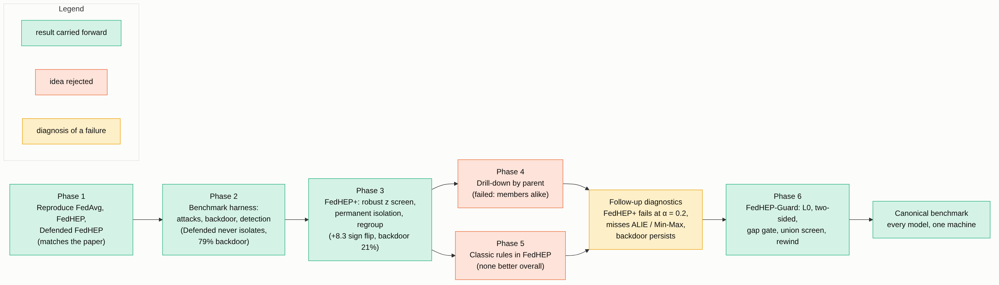

# RFL Lab research report

**Robust federated learning for FedHEP.** We reproduced FedHEP and its published defense, tried several improvements, and propose a defense of our own, **FedHEP-Guard**. The report first describes the models, then every result, then the ideas that failed, what is still open, and every configuration key.

## The story in one minute

1. **FedHEP**, our team's personalized FL model, and its **published defense** were rebuilt and reproduced: every number is within 2 standard errors of the authors' code (chapters 2, 3, 6.2).
2. **The published defense never removes an attacker** and does nothing against a backdoor: 79% backdoor success, the same as no defense (6.4).
3. **FedHEP+**, our first model, removes crude attackers: +8.3 points under sign flip, backdoor success 79% → 21%. It leaves three failures: honest clients with unusual data are isolated, adaptive attackers are not seen, and a backdoor that got in stays (chapter 4, 6.5–6.7).
4. **FedHEP-Guard fixes failures 2 and 3, not failure 1, as far as tested.** Its screen catches adaptive attackers (9 of 9 at D1, 12 of 12 at D2) and holds up best when the model is poisoned; the full model keeps the plain backdoor at 0.3% for 100 rounds. The full model has so far been run only against backdoors, on the Acer; most numbers come from its screen without the rewind (chapter 5, 6.8–6.13).
5. **Many ideas failed** along the way: FedHEP+'s variants, checking groups first, the classic robust rules, seven Phase 6 components and the peer reference. Each failure shaped the next design (chapter 7).
6. **Still open:** FedHEP-Guard isolates more honest clients than FedHEP+, and more with more clients: 22 of 50 per run at 50 clients. A fix for one of the two causes is being tested (chapter 8). The benchmark of every model in every setting is queued on the GPU server (6.1).

## Chapters

| # | Chapter | What it holds |
|---|---|---|
| 1 | [Federated learning, attacks and metrics](01_federated_learning.md) | what FL is, the data split, the test bed, the attacks, what the numbers mean, notation |
| 2 | [FedHEP](02_fedhep.md) | the model: parts, one round, formulas, why each part, what it changes against FedAvg |
| 3 | [Defended FedHEP](03_defended_fedhep.md) | what the published defense adds and changes, formulas, why each part |
| 4 | [FedHEP+](04_fedhep_plus.md) | our first model: what it adds, changes and removes, formulas, why each part, its variants |
| 5 | [FedHEP-Guard](05_fedhep_guard.md) | our current model: seven mechanisms with formulas and reasons, its rungs, the exact configuration |
| 6 | [Results](06_results.md) | **6.1 the benchmark** (every model, every condition, every setting, one machine), then the diagnostic results model by model |
| 7 | [Ideas that did not work](07_ideas_that_did_not_work.md) | every rejected idea of Phases 3–7: formula, diagram, hypothesis, experiment, why it failed |
| 8 | [Open problems](08_open_problems.md) | what is not solved, why, and what is running now |
| 9 | [Configuration reference](09_configuration_reference.md) | every config key, symbol, preset, sweep file and run prefix |

**General and diagnostic charts.** The benchmark (6.1) holds the general charts: every model under the same conditions on one machine, with accuracy, detection F1, attackers caught, honest clients isolated, the round in which each happens, and backdoor success. The rest of chapter 6 holds the diagnostic charts: they explain a behaviour (for example why honest z-scores grow mid-training) and often exist for only some models or machines.

## The models at a glance

| Model | Built on | What it adds | Best result | Main weakness |
|---|---|---|---|---|
| FedAvg | — | weighted mean of updates | baseline, 38.1% at D1 | collapses under sign flip and noise |
| FedHEP | FedAvg | three heads (root, parent, local), hierarchy | 47.8% at D1, 65.5% at α = 0.05 | no defense: sign flip −14 points |
| Defended FedHEP | FedHEP | SCCF trust weights, trust ledger | most accurate under attack in Phase 2 | never removes anyone; backdoor 79% |
| FedHEP+ | Defended FedHEP | robust z screen, permanent isolation, regrouping | sign flip +8.3, backdoor 79% → 21% | isolates unusual honest clients; blind to ALIE and Min-Max; backdoor stays |
| **FedHEP-Guard** | FedHEP+ | L0 bound, two-sided union screen, gap gate, patience, rewind, optional exit guard | adaptive attackers 9 of 9 caught; plain backdoor 0.3% over 100 rounds on every seed; best worst case under model poisoning in every GPU setting | isolates honest clients, more with more clients (22 of 50 per run at 50 clients), half of them whole parent groups; one late-caught stealth seed at 34%; D2 not yet run |

## Did FedHEP-Guard fix FedHEP+'s failures?

| FedHEP+ failure | Verdict | Evidence |
|---|---|---|
| 1. Honest but unusual clients isolated | **Not fixed** (screen) | fewer than FedHEP+ only at 15 clients, α = 0.1 (1.7 per run against 7.7). Elsewhere more, growing with the number of clients: 14.7 against 4.3 at 30 clients (α = 0.5), 22.0 against 1.0 at 50 clients (α = 0.1) |
| 2. Adaptive attackers not seen | **Fixed** (screen) | ALIE and Min-Max 9 of 9 caught against 0 of 9; stealth backdoor 0.2–0.5% against 56–75% |
| 3. Backdoors that persist | **Fixed when caught early** (full model) | 0.3% over 100 rounds against 5–42% at 30 rounds (Acer); 2.5% against 13.9% over 100 rounds with its whole-update half (GPU); not at α = 0.1, at D2, or after a late catch |

"Screen" means FedHEP-Guard without the rewind (`r3wc`), which most runs so far used; "full model" means with it. The full model under every condition comes with the benchmark. The scorecard, with the model behind every number, is [chapter 6.8](06_results.md).

## Presenting kit: which chart answers which question

Paths starting `figures/` are in `docs/figures/`; `report/figures/` is `docs/report/figures/`.

| Question | Chart | Section |
|---|---|---|
| **The models** | | |
| How does each model work? | `report/figures/diagrams/03_fedhep_round.png`, `04_defended_round.png`, `05_fedhep_plus_round.png`, `08_fedhep_guard_round.png` | 2.2, 3.1, 4.1, 5 |
| Why is each part in the model? | "Why each part" tables | 2.2, 3.1, 4.1, 5.1 |
| Where does each FedHEP-Guard mechanism act? | `report/figures/guard_coverage.png` | 5 |
| **The benchmark** | | |
| Which model is best, per condition and setting? | `figures/bench/overview_<setting>.png` | 6.1 |
| When does each model catch attackers or blame honest clients? | `figures/bench/<setting>__<condition>.png` | 6.1 |
| **Diagnostic results** | | |
| Did we reproduce the paper? | `figures/phase1_parity.png` | 6.2 |
| Why do we need a new defense? | `figures/phase2_accuracy.png`, `figures/phase2_backdoor_asr.png`, `figures/defended_failure_diagnosis.png` | 6.4 |
| What did FedHEP+ achieve? | `figures/phase3b_confirm.png` | 6.5 |
| Why do honest z-scores grow mid-training? | `figures/why_z_grows.png` | 6.6a |
| Why is FedHEP+ not enough? | `figures/followup_alpha02.png`, `figures/followup_adaptive.png`, `figures/followup_backdoor_persists.png` | 6.6 |
| What did FedHEP-Guard fix from FedHEP+? | `figures/phase6_honest_isolation_summary.png`, `figures/phase6_guard_durability.png` | 6.8 |
| Which part of FedHEP-Guard fixes what? | `figures/phase6_d1.png`, `figures/phase6_d2.png`, `figures/phase6_gpu_d2.png` | 6.9 |
| Does it remove a backdoor, over 100 rounds? | `figures/phase6_rewind.png`, `figures/phase6_guard_durability.png`, `figures/phase6_gpu_durability.png`, `figures/phase6_gpu_rewind.png` | 6.10 |
| Does it survive an adaptive backdoor? | `figures/phase6_stealth.png` | 6.11 |
| What if the attacker count is unknown? | `figures/phase6_fmis.png` | 6.12 |
| Does it hold at 30 and 50 clients and under strong skew? | `figures/phase6_isolation_rounds_n15.png`, `figures/phase6_isolation_rounds_n30.png` | 6.13 |
| Every model run at D1, per machine | `figures/all_models_mac_<attack>.png`, `figures/all_models_gpu_<attack>.png` | 6.14 |
| **What failed** | | |
| FedHEP+'s variants: readmission, the cap, the full-population yardstick | `figures/phase3_variants_explained.png` | 7.1 |
| Why not just use FLAME or Bulyan? | `figures/phase5_three_seeds.png` | 7.3 |
| Components dropped in Phase 6 | `figures/phase6_dropped_components.png`, `figures/phase6_signals.png`, diagrams `11`–`17` | 7.4 |
| The peer reference | `figures/phase7_peer_paired.png`, `figures/phase7_peer_outcomes.png` | 7.5 |
| **Open problems** | | |
| Why are honest clients isolated? | `figures/phase6_gap_gate_tradeoff.png`, `figures/phase6_group_isolations.png` | 8.2 |
| What is being tested now? | `report/figures/diagrams/18_shared_signal.png` | 8.3 |

## Conventions

- **Every number** is a mean over seeds 42, 123 and 7 unless marked, from runs stored in `outputs*/`.
- **Every table names its machine.** Methods are only compared within one machine ([chapter 1.3](01_federated_learning.md)); the benchmark uses the GPU server only.
- **D1** = 15 clients, α = 0.5, 3 attackers. **D2** = 20 clients, α = 0.2, 4 attackers.
- **Diagrams** colour what each model changes against the previous one: green new, yellow changed, red dashed removed, grey unchanged. Their labels are typeset in LaTeX (`scripts/draw_report_diagrams.py`).
- **Click any figure or diagram** in the visualizer to enlarge it; inside the enlarged view use Fit page, Fit width or the zoom buttons, and press Escape to close.

## The lab notebook

This report is the organized account. The raw, dated record stays in `docs/` and is not rewritten:
- `EXPERIMENT_LOG.md`: every run batch, as it happened.
- `DECISIONS.md`: every design decision and why.
- `PREDICTIONS.md`: predictions made before runs, and their outcomes.
- `IDEAS.md`, `RESEARCH_PLAN.md`, `LITERATURE_REVIEW.md`, `PAPER_PLAN.md`.
- `OPERATIONS.md`: machines, commands and the branch workflow.

**Section numbers changed on 2026-11-23** (twice). Older log entries use one of the earlier numberings. The layout before today's second change, and where each section is now:

| Before | Now | Before | Now |
|---|---|---|---|
| 2.1–2.3, 3.1–3.2, 4.1–4.2 | unchanged | 5.1 drill-down | 7.2 |
| 2.4 FedHEP reproduction | 6.2 | 5.2 classic rules | 7.3 |
| 2.5 grouping counter | 6.3 | 5.3 dropped Phase 6 parts (a–g) | 7.4 (a–g) |
| 3.3 Defended reproduction | 6.2 | 5.4 peer reference | 7.5 |
| 3.4–3.5 Phase 2 benchmark, failures | 6.4 | 6.1–6.8 FedHEP-Guard model | 5.1–5.8 |
| 4.3 FedHEP+ results | 6.5 | 7.1–7.7 FedHEP-Guard results | 6.8–6.14 |
| 4.4 (a–d) FedHEP+ variants | 7.1 (a–d) | 8.x open problems | 8.x |
| 4.5 (a–e) follow-up diagnostics | 6.6 (a–e) | 9 canonical benchmark | 6.1 |
| 4.6 what FedHEP+ fixed | 6.7 | 10.x configuration | 9.x |

Entries written before 2026-11-23, when chapter 6 held the model, its results and the open problems, use this numbering:

| Before 2026-11-23 | Now | Before 2026-11-23 | Now |
|---|---|---|---|
| 6.1–6.7 FedHEP-Guard mechanisms | 5.1–5.7 | 6.13 what is open | 8.1 |
| 6.8 the ladder | 6.9 | 6.14 exact configuration | 5.8 |
| 6.9 backdoor recovery | 6.10 | 6.15 peer reference | 7.5 |
| 6.10 adaptive backdoor | 6.11 | 6.16 shared signal (Phase 8) | 8.3 |
| 6.11 wrong $f$ | 6.12 | 7.1–7.4 canonical benchmark | 6.1 |
| 6.12 at scale | 6.13 and 8.2 | 7.5 every model, per machine | 6.14 |
| | | 8.x configuration | 9.x |
