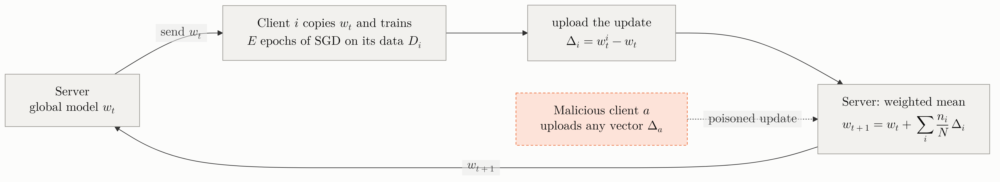

# 1. Federated learning, attacks and how we measure them

This chapter covers the background every other chapter assumes:
- federated learning and its standard algorithm, FedAvg;
- the data split, model and settings used in every experiment;
- the attacks we test against, with their exact formulas;
- the numbers we report.

The notation table at the end applies to the whole report. Each chapter adds a legend for its own symbols.

## 1.1 Federated learning in one round

In **federated learning (FL)**, $n$ clients train one model together without sharing their data. A server holds the **global model** $w_t$. In every **round** $t$:

1. The server sends $w_t$ to every client.
2. Client $i$ trains a copy on its own data $D_i$ for $E$ local epochs of SGD, which gives $w_t^i$.
3. The client uploads only its **update** $\Delta_i = w_t^i - w_t$, never its data.
4. The server **aggregates** the updates into a new global model.

**FedAvg** (McMahan et al., 2017) aggregates with a mean weighted by data size:

$$\Delta = \sum_{i=1}^{n} \frac{n_i}{N}\,\Delta_i, \qquad w_{t+1} = w_t + \Delta, \qquad N = \sum_i n_i$$

**The weakness.** The server never sees the data, so it cannot check a client. A single client can upload any vector $\Delta_a$. Because FedAvg is a mean, one large enough vector moves the model anywhere. A **defense** is a server-side rule that limits this damage. Most defenses replace the mean with something more robust, or decide which clients to trust.

**Personalization.** When clients hold different kinds of data, one global model fits none of them well. **Personalized FL** gives each client parts of the model of its own. FedHEP (chapter 2) is a personalized method.

## 1.2 Non-IID data: the Dirichlet split

Clients rarely hold the same kind of data ("non-IID"). We split CIFAR-100 with a **Dirichlet label partition**. For every class $c$, the share of its images given to each client is drawn from $\mathrm{Dir}(\alpha, \dots, \alpha)$.

| α | What clients look like | Where we use it |
|---|---|---|
| none (IID) | every client has every class in equal proportion | Phase 1 reproduction |
| 1.0 | mild skew | — |
| 0.5 | moderate skew: each client has most classes, unevenly | **D1**, the main development setting |
| 0.2 | strong skew | **D2**, the held-out setting |
| 0.1 | very strong skew: a client has a handful of classes | GPU grid |
| 0.05 | extreme skew | Phase 1 and Phase 5 checks |

Smaller α makes honest clients look more different from each other. That is the central difficulty for any defense that flags clients for looking different (chapters 4 and 6).

## 1.3 The test bed

All experiments use the authors' CIFAR-100 setup unless a chapter says otherwise.

| Item | Value |
|---|---|
| Data | CIFAR-100: 100 classes, 32×32 colour images. 10,000 training and 3,000 test images, split across clients by the Dirichlet partition (each client's test images follow its own label mix) |
| Model | ResNet-9: one head for FedAvg, three heads for FedHEP (chapter 2) |
| Rounds | 30; the Phase 1 reproduction uses 25, as the paper does |
| Local training | FedHEP family 5 epochs, FedAvg 3; SGD with Nesterov momentum 0.9, weight decay $10^{-4}$, batch 32 |
| Learning rate | cosine schedule from $\eta_0 = 0.05$ to $\eta_{\min} = 0.001$: $\eta_r = \eta_{\min} + \tfrac{\eta_0-\eta_{\min}}{2}\bigl(1+\cos\tfrac{\pi(r-1)}{R-1}\bigr)$ |
| Seeds | 42, 123 and 7. Every number is a mean over the three, ± one standard deviation |

**The two named settings:**

| Setting | Clients $n$ | α | Attackers $m$ | Role |
|---|---|---|---|---|
| **D1** | 15 | 0.5 | 3 (20%) | development: every method was tuned here |
| **D2** | 20 | 0.2 | 4 (20%) | held out until Phase 6: checks that a method carries over to stronger skew |

**One machine per table.** The Mac (Apple `mps`), the Acer (Intel `xpu`) and the lab GPU server (NVIDIA `cuda`) produce slightly different numbers for the same seed. On 105 identical runs, Mac and GPU differ by 0.72 points on average, about as much as one seed from another (0.79). Every table and chart in this report therefore compares methods run on the same machine, and its caption names it.

## 1.4 The attacks

Attackers are exactly $m$ randomly chosen clients, the same clients for every method in a given seed. With $w$ the round's global model and $\hat w_a$ the attacker's honestly trained model, $\Delta_a = \hat w_a - w$ is what an honest client would upload.

| Attack | What the attacker uploads | Type |
|---|---|---|
| Sign flip | $w - 1.5\,\Delta_a$ (the honest step, reversed and enlarged) | model poisoning |
| Gradient ascent | $w - 5\,\Delta_a$ | model poisoning |
| Random noise | $w + \varepsilon$ with $\varepsilon_j \sim \mathcal N(0, 2^2)$ | Byzantine |
| Label flip | trains on label $C - 1 - y$ instead of $y$, uploads the result | data poisoning |
| Backdoor (BadNets) | stamps a 3×3 white patch on 50% of its images, relabels them class 0, trains normally | backdoor |
| Model replacement | backdoor, then uploads $w + \lambda\,\Delta_a$ with $\lambda = 3$ ("boosted") | backdoor |
| ALIE | $w + \mu - z\,\sigma$, where $\mu, \sigma$ are the per-coordinate mean and standard deviation of the attackers' own honest updates | adaptive |
| Min-Max | $w + \mu - \gamma\,\sigma$ with the honest updates' statistics, and the largest $\gamma$ such that $\max_j \lVert \Delta_{mal} - \Delta_j\rVert \le \max_{j,k} \lVert \Delta_j - \Delta_k\rVert$ | adaptive |
| Stealth backdoor (ours) | trains the backdoor, then uploads $\bar h + \lambda^\star(u_a - \bar h)$, pulled toward the honest mean $\bar h$ just enough to satisfy Min-Max's bound | adaptive backdoor |

**ALIE's strength** (Baruch et al., 2019). The attackers need $s = \lfloor n/2 + 1 \rfloor - m$ honest supporters, and they set $z = \Phi^{-1}\!\bigl((n - s)/n\bigr)$, with $\Phi$ the standard normal distribution function. That gives $z = 0.43$ for D1 and $0.39$ for D2. The update is small enough to sit inside the honest spread.

**Min-Max** (Shejwalkar and Houmansadr, 2021) pushes as far as possible, while never looking farther from any honest client than two honest clients look from each other.

**The stealth backdoor** (chapter 6.7) adapts that same bound to a backdoor:

$$\tilde u_a = \bar h + \lambda^\star (u_a - \bar h), \qquad \lambda^\star = \max\Bigl\{\lambda\in[0,1] : \max_i \lVert \bar h + \lambda(u_a - \bar h) - h_i\rVert^2 \le \max_{i,j}\lVert h_i - h_j\rVert^2\Bigr\}$$

**How many attackers.** Each run has exactly $m$ attackers (`attack.count`), placed at random. Two Phase 4 tests place them all in one group ("concentrated") or one per group ("spread"). The authors' own rule instead makes each client an attacker with probability $q$ (`attack.rate`); we use it only to reproduce their tables.

## 1.5 What we measure

| Measure | Definition | Better |
|---|---|---|
| **Accuracy** | correct predictions over all **honest** clients' test images pooled, each client predicting with its own (personalized) model. Honest clients that a defense wrongly isolates are still scored | higher |
| **Bottom-10%** | mean accuracy of the worst 10% of honest clients: the fairness of the model to unusual clients | higher |
| **Backdoor success (ASR)** | share of honest clients' test images of classes other than the target that, once stamped with the trigger, are predicted as the target. 0.6% is chance for 100 classes | lower |
| **Honest isolated** | honest clients removed for good by the end of the run, summed over the three seeds unless a table says "per run" | lower |
| **Precision, recall, F1** | per round, with flagged set $F$ and attackers $A$: precision $= \lvert F \cap A\rvert / \lvert F\rvert$, recall $= \lvert F \cap A\rvert/\lvert A\rvert$, F1 their harmonic mean | higher |
| **False-isolation rate** | $\lvert F \cap H\rvert / \lvert H\rvert$, with $H$ the honest clients | lower |
| **AUROC** | how well a method's per-client trust score ranks attackers below honest clients (1 = perfect, 0.5 = chance) | higher |
| **Cost** | seconds per round and peak memory, recorded for every run | lower |

## 1.6 Notation used throughout

| Symbol | Meaning | Config key |
|---|---|---|
| $n$ | number of clients | `data.num_clients` |
| $m$ | number of attackers | `attack.count` |
| $f$ | number of attackers a robust rule assumes | `robust.assumed_attackers`, `plus.global_f` |
| $A$, $H$ | sets of attackers and of honest clients | — |
| $t$, $R$ | round index, number of rounds | `run.rounds` |
| $E$ | local epochs per round | `train.local_epochs` |
| $w_t$ | global model at the start of round $t$ | — |
| $\Delta_i$ | client $i$'s update, $w_t^i - w_t$ | — |
| $n_i$, $N$ | client $i$'s training images, total over clients | — |
| $\alpha$ | Dirichlet concentration of the label split | `data.alpha` |
| $C$ | number of classes (100) | — |
| $K$ | number of groups ("parents") in FedHEP | `fedhep.num_groups` |
| $\cos(a,b)$ | cosine similarity $a\cdot b / (\lVert a\rVert\lVert b\rVert)$ | — |
| $\operatorname{med}$, MAD | median, and median absolute deviation $\operatorname{med}_j \lvert s_j - \operatorname{med}(s)\rvert$ | — |

Every configuration key is explained in [chapter 10](10_configuration_reference.md).
