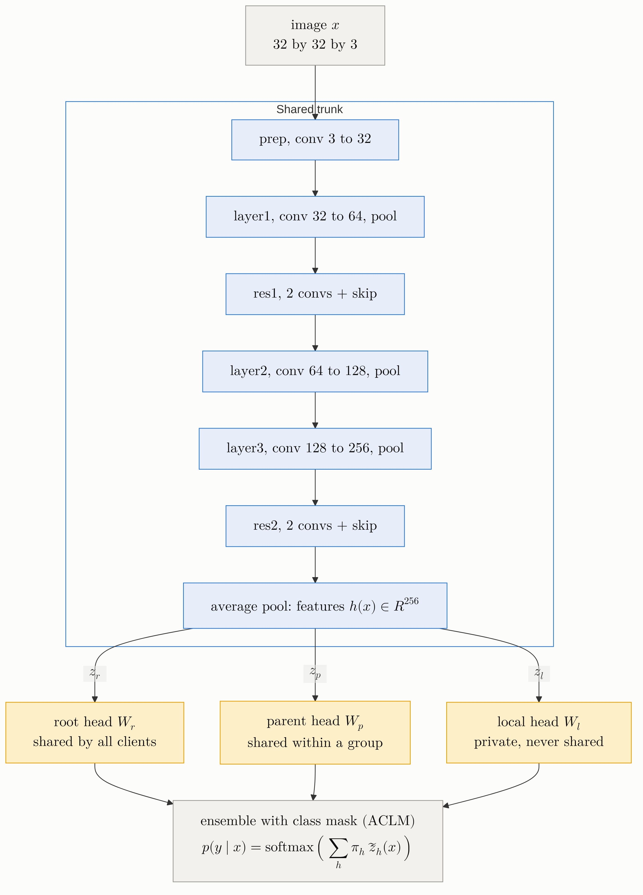
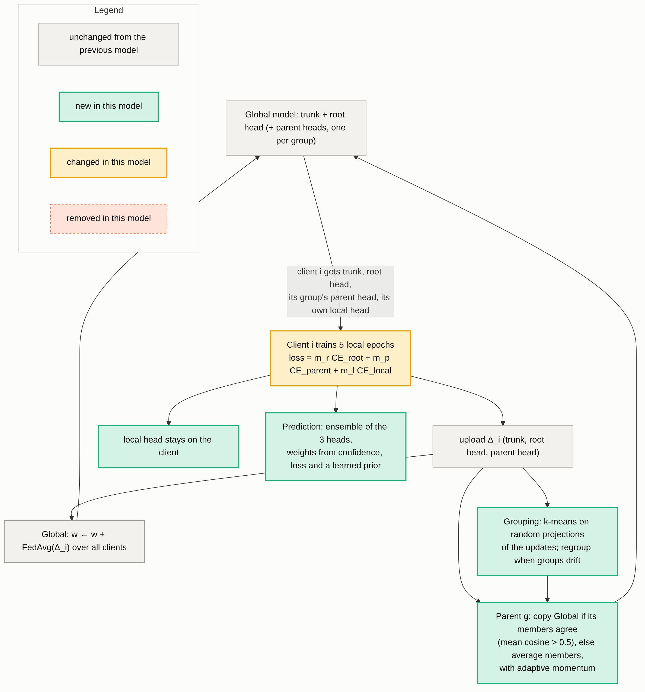
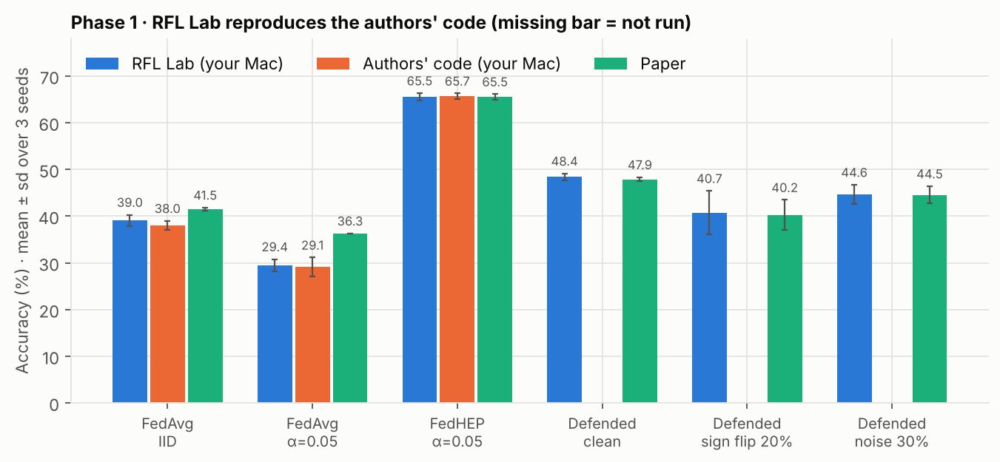
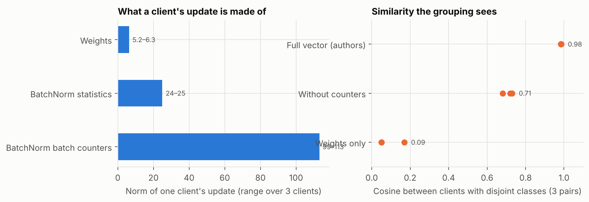
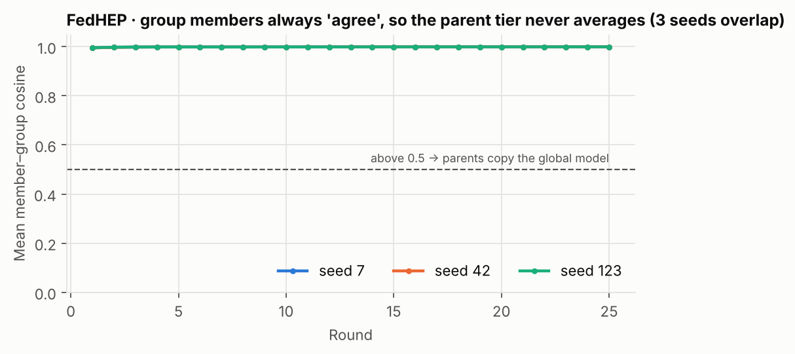

# 2. FedHEP: the model we start from (Phase 1)

**Phase 1 goal:** rebuild FedHEP and Defended FedHEP, our team's published methods, in clean and tested code, and reproduce the paper's numbers. This chapter covers FedHEP. [Chapter 3](03_defended_fedhep.md) covers Defended FedHEP.

## 2.1 What FedHEP is

FedHEP is **personalized** federated learning with a **hierarchy**. It makes two changes to FedAvg:

1. **Three classifier heads on one shared trunk.** Each head is shared at a different level, so each client gets a mix of general and personal knowledge.
2. **Groups of similar clients ("parents")** between the clients and the server. Each group keeps its own head.

| Part | Shared by | Aggregated by | Holds |
|---|---|---|---|
| Trunk (prep → res2, 256-d features $h(x)$) | all clients | Global | general image features |
| Root head $W_r$ (256 → 100) | all clients | Global | the population's decision rule |
| Parent head $W_p$ (256 → 100) | the clients of one group | the group's parent | what similar clients share |
| Local head $W_l$ (256 → 100) | one client only | never leaves the client | the client's own label mix |

## 2.2 One FedHEP round

**Local training.** Client $i$ receives the trunk and root head from Global, its group's parent head, and its own local head from last round. It trains all of them for $E = 5$ epochs on a weighted sum of three cross-entropy losses:

$$\mathcal L_i = m_r\,\mathrm{CE}\bigl(z_r, y\bigr) + m_p\,\mathrm{CE}\bigl(\tilde z_p, y\bigr) + m_l\,\mathrm{CE}_{\text{class-weighted}}\bigl(\tilde z_l, y\bigr)$$

The weights depend on how skewed the client's labels are, measured by the **label-skew score**:

$$r_i = \frac{e^{H(p_i)} - 1}{C - 1}, \qquad H(p_i) = -\sum_c p_{i,c}\log p_{i,c}$$

$r_i = 1$ for perfectly uniform labels and $0$ for a single class. The head weights are binomial in $r_i$, then normalized to sum to 1:

$$m_l = (1-r_i)^2, \qquad m_p = 2\,r_i(1-r_i), \qquad m_r = a + (1-a)\,r_i^2, \qquad a = \max\!\Bigl(\tfrac{1}{2K}, \tfrac{\lvert Y_i\rvert}{C}\Bigr)$$

A skewed client leans on its local head; a balanced one on the root head.

**Active-class logit masking (ACLM).** The parent and local heads never predict a class the client does not hold:

$$\tilde z_{h,c} = \begin{cases} z_{h,c} & c \in Y_i \\ -10^9 & c \notin Y_i \end{cases}, \qquad h \in \{p, l\}$$

**Aggregation:**
- **Global:** a FedAvg mean of all clients' updates; it updates the trunk and the root head.
- **Parent $g$:** if its members' updates agree (mean pairwise cosine above 0.5), the parent copies the new Global model. Otherwise it averages its members. Either way it applies adaptive momentum.
- **Grouping:** clients are clustered by k-means on random projections of their updates, and regrouped when the groups drift.

**Prediction.** Each client mixes its three heads' logits:

$$p(y \mid x) = \operatorname{softmax}\Bigl(\sum_{h} \pi_h\, \tilde z_h(x)\Bigr), \qquad \pi = \operatorname{softmax}\bigl((-H_h - \beta\,\ell_h + \log \alpha_h)/T\bigr)$$

The mixing weights come from each head's confidence (entropy $H_h$), its recent loss $\ell_h$ and a learned prior $\alpha_h$. A near-uniform client uses the root head only.

**Legend:**

| Symbol | Meaning |
|---|---|
| $z_r, z_p, z_l$ | logits of the root, parent and local heads |
| $\tilde z$ | logits after ACLM masking |
| $p_{i,c}$ | share of client $i$'s training images in class $c$ |
| $Y_i$ | the classes client $i$ holds |
| $m_r, m_p, m_l$ | loss weights of the three heads |
| $\pi_h$ | prediction mixing weight of head $h$ |
| $H_h$, $\ell_h$, $\alpha_h$ | head $h$'s prediction entropy, recent loss and learned prior |
| $T$, $\beta$ | temperature and loss weight of the mixing rule (authors' values) |

### Why each part is in FedHEP

FedHEP is the authors' design. The reasons below are its design rationale; our own runs test the model as a whole, not each part separately (except the parents, 2.5).

| Part | What it is for | Why it is in the model | Evidence |
|---|---|---|---|
| Three heads on one trunk | general features learned from everyone; decision rules at three levels | under label skew one classifier cannot fit every client. The trunk can still learn from all data while each client keeps its own decision rule | at α = 0.05: FedHEP 65.5% against FedAvg 29.4% |
| Loss weights from label skew ($m_r, m_p, m_l$) | how much each head learns on each client | a client with a few classes is served best by its local head, a balanced client by the root head | design choice; not tested separately |
| Class mask (ACLM) | the parent and local heads predict only the client's own classes | heads trained on a few classes would otherwise give probability to classes the client never sees | design choice; not tested separately |
| Parents (groups) | a middle tier shared by similar clients | clients with similar label mixes should help each other more than the whole population does | on CIFAR-100 the parents always copied Global (2.5), so this tier changed nothing measurable |
| Local head kept on the client | the most personal part is never shared | it needs no aggregation, and other clients cannot poison it | — |
| Ensemble mixing weights ($\pi_h$) | choose, per input, which head to trust | a head's reliability varies by client and input; confidence and recent loss pick the better one | design choice; not tested separately |

## 2.3 What FedHEP changes against FedAvg

| | FedAvg | FedHEP |
|---|---|---|
| Model | one ResNet-9 | ResNet-9 trunk + root, parent and local heads |
| Shared parts | the whole model | trunk and root head (all clients), parent head (group) |
| Personal parts | none | local head; mixing weights; class mask |
| Server tiers | one | two: parents (groups) and Global |
| Local loss | cross-entropy | three weighted cross-entropies, weights from label skew |
| Prediction | the global model | per-client ensemble of the three heads |
| Robustness | none | none (FedHEP has no defense) |

## 2.4 Reproduction results

We ported the authors' code function by function and checked it with 100 parity tests that call their functions directly. The tests cover model and initial weights, skew score, head weights, grouping, parent momentum, one full local round to $10^{-5}$, and the test-time ensemble. Planted one-line errors break the tests.

| Run (Mac, 3 seeds) | Ours | Authors' code (same machine) | Paper |
|---|---|---|---|
| FedAvg, IID | 39.04 ± 1.25 | 38.04 ± 0.94 | 41.46 ± 0.36 |
| FedAvg, α = 0.05 | 29.44 ± 1.33 | 29.07 ± 2.05 | 36.29 |
| **FedHEP, α = 0.05** | **65.51 ± 0.80** | 65.68 ± 0.57 | 65.49 ± 0.61 |
| FedHEP, α = 0.05, bottom-10% | 49.57 ± 1.91 | 50.23 ± 1.50 | 53.92 ± 0.63 |

**Verdict: reproduced.** Every number is within 2 standard errors of the authors' code. FedHEP also matches the paper. The paper's FedAvg numbers are higher than both implementations, a gap between the authors' released code and their paper.

The five baselines the paper compares against (FedProx, SCAFFOLD, Ditto, FedRep, Multi-Krum) were ported with 43 further parity tests. FedAvg and Multi-Krum are used in the benchmark ([chapter 7](07_benchmark.md)).

## 2.5 A finding along the way: the grouping signal is mostly a counter

FedHEP decides groups, and whether a parent copies Global, from the cosine between **full** flattened updates. That vector includes BatchNorm's batch counter, which grows by the number of local steps (about 105 per layer per round) and has the same sign for every client. The counter dominates:

| Part of the update | Norm |
|---|---|
| weights | 5.2–6.3 |
| BatchNorm running statistics | 24–25 |
| batch counters | 99–113 |

On CIFAR-100, members' agreement was 0.995–0.999 in every round, so **parents always copied Global and never averaged their members**. The middle tier therefore adds no group-specific information, as run in the authors' code. We kept the faithful port for the reproduction. FedHEP+ later groups on weights only (chapter 4).

## 2.6 What this chapter hands on

- FedHEP is the most accurate method in our settings with no attack: 47.8% at D1, against 38.1% for FedAvg.
- It has **no defense**. Under sign flip it falls to 33.7%, and under random noise to 5.4%: its personal heads do not protect the shared trunk. [Chapter 3](03_defended_fedhep.md) adds the authors' defense.
