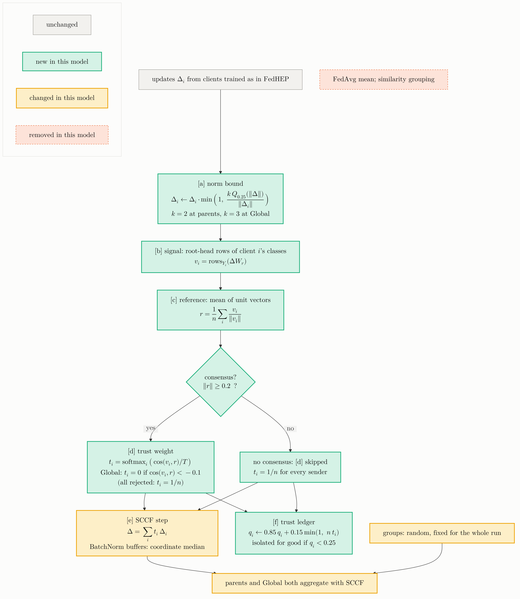
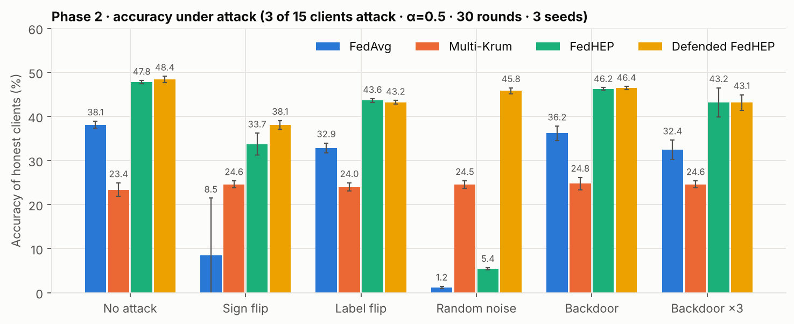
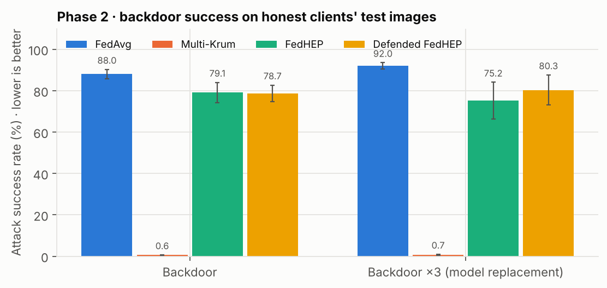
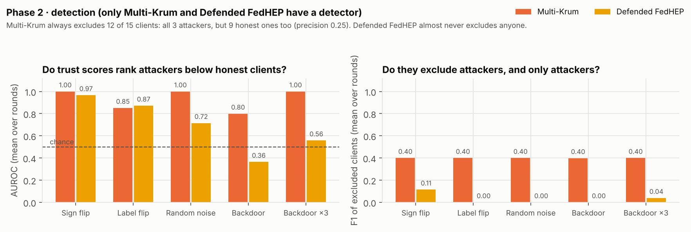
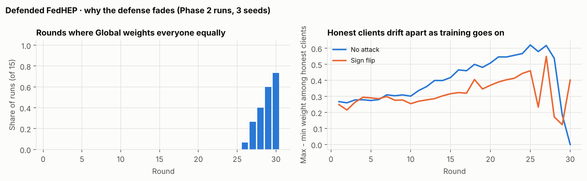

# 3. Defended FedHEP: the published defense (Phases 1c and 2)

**Goal:** reproduce the authors' defended variant (Phase 1c), then test it fairly against a wider set of attacks than the paper, including a backdoor (Phase 2).

## 3.1 What Defended FedHEP adds to FedHEP

Defended FedHEP keeps FedHEP's model and local training. It replaces **every aggregation**, at the parents and at Global, with **SCCF** (soft-cosine consensus filtering), and adds a **trust ledger** that can isolate a client for good.

**[a] Norm bound.** Each update is scaled down to at most $k$ times the lower-quartile norm of the round's updates ($k = 2$ at parents, $3$ at Global):

$$\mathrm{bound}(\Delta_i) = \Delta_i \cdot \min\Bigl(1, \frac{k\,Q_{0.25}(\lVert\Delta\rVert)}{\lVert\Delta_i\rVert}\Bigr)$$

**[b] Signal.** Trust looks only at the **root head's weight rows for the classes client $i$ holds**: $v_i = \mathrm{rows}_{Y_i}(W_r)$ of the bounded update. The trunk, the other heads and BatchNorm play no part.

**[c] Reference.** The mean of the unit vectors, $r = \frac1n\sum_i v_i/\lVert v_i\rVert$. If $\lVert r\rVert < 0.2$ there is no consensus, and every sender gets the same weight $1/n$.

**[d] Trust weight.** Each sender's weight is a softmax of its cosine to the reference, at temperature $T$:

$$t_i = \frac{\exp\bigl(\cos(v_i, r)/T\bigr)}{\sum_j \exp\bigl(\cos(v_j, r)/T\bigr)}$$

$T = 0.5$, multiplied by 0.9 when the cosines vary and by 1.05 otherwise. At Global, a sender with $\cos(v_i, r) < -0.1$ is rejected outright ($t_i = 0$).

**[e] SCCF step.** The aggregate is the trust-weighted sum of the bounded updates. BatchNorm buffers take the coordinate-wise median instead:

$$\Delta = \sum_i t_i\,\mathrm{bound}(\Delta_i)$$

**[f] Trust ledger.** After every aggregation (parents and Global), each client's score is updated from its share of the weight. A score below 0.25 isolates the client for good, in both tiers:

$$q_i \leftarrow 0.85\,q_i + 0.15\,\min(1,\ n\,t_i), \qquad q_i < 0.25 \Rightarrow i \text{ isolated}$$

**Groups** are random and fixed for the whole run. The defended code never calls FedHEP's similarity grouping.

**Legend:**

| Symbol | Meaning |
|---|---|
| $Q_{0.25}(\lVert\Delta\rVert)$ | lower quartile of the round's update norms |
| $k$ | norm-bound multiplier (2 at parents, 3 at Global) |
| $v_i$ | client $i$'s signal: root-head rows of its classes |
| $r$ | reference direction (mean of unit signals) |
| $t_i$ | SCCF trust weight of client $i$ in this aggregation |
| $T$ | softmax temperature |
| $q_i$ | ledger score of client $i$, starting at 1 |
| $n$ | number of senders in this aggregation ($n\,t_i = 1$ is an equal share) |

### Why each part is in Defended FedHEP

| Part | What it is for | Why it is in the model | What we measured |
|---|---|---|---|
| [a] Norm bound | caps each update's length | one huge update (noise, gradient ascent, a boosted backdoor) would otherwise dominate any weighted sum | random noise: FedHEP 5.4% → Defended FedHEP 45.8% |
| [b] Root-head signal | what trust is computed on | the root head's rows for a client's own classes are small, cheap to compare and class-specific | it misses backdoors, which live mostly in the trunk (chapter 6.4) |
| [c] Mean-direction reference | what "normal" looks like | the direction most honest clients share | a coordinated minority pulls it: backdoor attackers looked *more* trustworthy than honest clients (AUROC 0.36) |
| [d] Softmax trust, hard reject | down-weight dissenters smoothly; drop clearly reversed updates | a soft weight keeps honest but unusual clients; a hard cut removes updates pointing backwards | sign flip +4.4 over FedHEP, but the weights flatten late in training (3.5) |
| [e] BatchNorm median | robust BatchNorm statistics | running means and variances are not checked by the cosine signal and are easy to poison | part of the noise robustness |
| [f] Trust ledger | memory across rounds, and removal | an attacker should be removed, not only down-weighted every round | never isolated anyone in 24 runs |
| Random fixed groups | groups that do not depend on the updates | the authors' code does not say why; our reading is that attackers then cannot steer which group they join | — |

## 3.2 What it changes against FedHEP

| | FedHEP | Defended FedHEP |
|---|---|---|
| Global aggregation | FedAvg mean | SCCF (norm bound, root-head trust, softmax weights) |
| Parent aggregation | copy Global or average, with momentum | SCCF |
| Groups | similarity k-means, regrouped | random, fixed |
| BatchNorm buffers | averaged | coordinate median |
| Removing a client | never | trust ledger: $q_i < 0.25$ isolates for good |

## 3.3 Reproduction (Phase 1c)

149 parity tests match the authors' SCCF, trust weights, attacker choice and attack uploads. On CIFAR-100 (D1 data, the paper's attack rule with probability $q$, Mac, 3 seeds):

| Setting | Ours | Paper |
|---|---|---|
| No attack | 48.39 ± 0.72 | 47.88 ± 0.46 |
| Sign flip, $q = 0.2$ | 40.75 ± 4.65 | 40.22 ± 3.24 |
| Random noise, $q = 0.3$ | 44.63 ± 2.07 | 44.53 ± 1.86 |

**Verdict: reproduced**, all within 2 standard errors of the paper.

## 3.4 The fair benchmark (Phase 2)

**Question:** how well do the published methods resist attacks when all are measured the same way, including a backdoor the paper did not test?

**Setup:** D1, exactly 3 attackers (the same for every method), 30 rounds, Mac, 3 seeds, 72 runs (`phase2_core.yaml`). Detection is scored every round.

| Model | No attack | Sign flip | Label flip | Random noise | Backdoor (acc.) | Backdoor success |
|---|---|---|---|---|---|---|
| FedAvg | 38.1 ± 0.8 | 8.5 ± 12.9 | 32.9 ± 1.1 | 1.2 ± 0.3 | 36.2 ± 1.6 | 88.0% |
| Multi-Krum | 23.4 ± 1.6 | 24.6 ± 0.8 | 24.0 ± 1.0 | 24.5 ± 0.9 | 24.8 ± 1.4 | 0.6% |
| FedHEP | 47.8 ± 0.4 | 33.7 ± 2.5 | 43.6 ± 0.4 | 5.4 ± 0.3 | 46.2 ± 0.3 | 79.1% |
| **Defended FedHEP** | **48.4 ± 0.7** | **38.1 ± 1.0** | 43.2 ± 0.4 | **45.8 ± 0.7** | **46.4 ± 0.4** | 78.7% |

## 3.5 What improved, and what still fails

**Improved over FedHEP:**
- **The most accurate method under every attack.** Its biggest win is random noise (45.8% against 5.4%), where the norm bound and the BatchNorm median do the work.
- **Under sign flip it gains 4.4 points** over FedHEP (38.1% against 33.7%).

**Still fails:**
1. **It never removes an attacker.** No client was isolated in any of 24 runs (9 in Phase 1c, 15 attacked runs in Phase 2). Attackers keep a 0.5–0.8 share of the weight every round. A ledger score settles near the average of $\min(1, n t_i)$, so it never reaches 0.25, and sign flip still costs 10.3 points.
2. **It does nothing against the backdoor**: 78.7% success, the same as no defense. Backdoor attackers even look **more** trustworthy than honest clients (AUROC 0.36), because half their data is normal and their root-head updates point with the consensus.
3. **The defense fades during training.** The temperature is fixed while all cosines shrink. When the mean direction gets short ($\lVert r\rVert < 0.2$), everyone gets equal weight; this happens in 7–73% of runs in each of the last five rounds. The trust scores often rank attackers correctly (AUROC 0.97 for sign flip) but never act on that ranking.

**Other models:**
- Multi-Krum blocks every attack only by keeping 3 of 15 clients every round, which leaves accuracy near 24%.
- FedAvg collapses under sign flip and noise.

## 3.6 What this chapter hands on

Three concrete problems for our first improvement (chapter 4):
1. Turn the trust ranking into **removal**.
2. Use a cut that **does not fade** as updates shrink.
3. Use a **reference that a coordinated minority cannot pull**, so that backdoor attackers stand out.
