# 4. FedHEP+: find attackers and remove them (Phase 3 and the follow-up diagnostics)

**Idea:** Defended FedHEP already ranks attackers below honest clients, but never acts on the ranking ([chapter 3](03_defended_fedhep.md)). FedHEP+ turns the ranking into removal. It uses a cut that keeps its meaning as training goes on, and a reference that a minority cannot pull.

## 4.1 What FedHEP+ changes in Defended FedHEP

FedHEP+ keeps SCCF for aggregation and replaces the trust ledger with **screening**. Screening decides which clients enter both tiers. It also re-forms the groups by weight similarity.

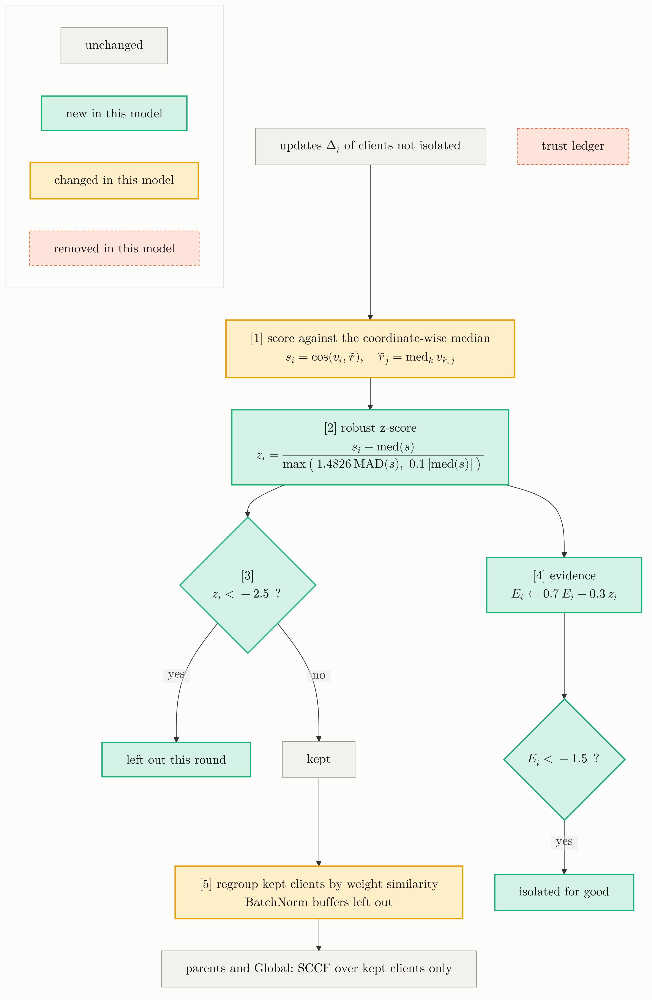

**[1] Score.** The cosine of each client's (norm-bounded) root-head signal $v_i$ to the **coordinate-wise median** update $\tilde r$. A median is not pulled by a minority the way a mean is:

$$s_i = \cos(v_i, \tilde r), \qquad \tilde r_j = \operatorname{med}_k\, v_{k,j}$$

**[2] Robust z-score.** How far client $i$ falls below the typical score, in units of the typical spread:

$$z_i = \frac{s_i - \operatorname{med}(s)}{\max\bigl(1.4826\cdot\mathrm{MAD}(s),\ \rho\,\lvert\operatorname{med}(s)\rvert,\ a\bigr)}$$

- $1.4826\cdot\mathrm{MAD}$ estimates the standard deviation from the middle of the data, so a few attackers cannot inflate it.
- The floor $\rho\lvert\operatorname{med}(s)\rvert$ ($\rho = 0.1$) stops a very tight consensus from turning tiny differences into huge z.
- The z-score is unchanged when every cosine shrinks together. This is the property that Defended FedHEP's fixed temperature lacks.
- Fewer than 5 senders are not screened.

**[3] Exclusion.** A client with $z_i < -2.5$ is left out of this round's aggregation.

**[4] Evidence and isolation.** An exponential moving average of z decides permanent isolation, so one bad round is not enough:

$$E_i \leftarrow 0.7\,E_i + 0.3\,z_i, \qquad E_i < -1.5 \Rightarrow i \text{ isolated for good}$$

**[5] Regrouping.** Kept clients are re-grouped by the similarity of their **weight** updates, with BatchNorm counters left out (the counter problem of [chapter 2.5](02_fedhep.md)).

**Legend:**

| Symbol | Meaning | Config key, value |
|---|---|---|
| $v_i$ | client $i$'s signal: root-head rows of its classes, norm-bounded | `plus.signal: root_head` |
| $\tilde r$ | coordinate-wise median of the signals | `plus.reference: median` |
| $s_i$ | client $i$'s score | — |
| $\rho$ | relative floor of the scale | `plus.relative_floor: 0.1` |
| $a$ | absolute floor of the scale (0 = off) | `plus.mad_floor: 0` |
| $-2.5$ | exclusion cut | `plus.z_cut: 2.5` |
| $E_i$, $0.7$ | evidence and its decay | `plus.evidence_decay: 0.7` |
| $-1.5$ | isolation cut | `plus.evidence_cut: 1.5` |

### Why each part is in FedHEP+

Each part answers one of Defended FedHEP's failures ([chapter 3.5](03_defended_fedhep.md)).

| Part | What it is for | Why it is in the model (the failure it answers) | Evidence it helps |
|---|---|---|---|
| [1] Median reference | what "normal" looks like | the mean is pulled toward a coordinated minority, so backdoor attackers looked more trustworthy than honest clients (AUROC 0.36) | backdoor success, seed 42: 80% with the mean reference → 33% with the median |
| [2] Robust z-score | how unusual a client is, in units that do not drift | Defended FedHEP ranked sign flippers correctly (AUROC 0.97) but never acted: its fixed temperature fades as all cosines shrink. A z-score is unchanged when everything shrinks together | sign and label flippers isolated in round 1 |
| [3] Exclusion at $z < -2.5$ | keep a suspicious update out this round | evidence takes rounds to build, and the damage happens meanwhile | not measured on its own |
| [4] Evidence and permanent isolation | remove persistent offenders, forgive one bad round | the trust ledger never removed anyone; letting isolated clients back in readmitted attackers (backdoor 21% → 39%) | sign flip +8.3, label flip +3.1, backdoor 79% → 21% |
| [5] Regrouping by weights | groups that reflect real similarity after removals | FedHEP's grouping cosine is dominated by BatchNorm counters (2.5), and isolations empty groups | limited the false-isolation cascade (4.4) |

## 4.2 What it changes against Defended FedHEP

| | Defended FedHEP | FedHEP+ |
|---|---|---|
| Reference | mean of unit vectors | coordinate-wise **median** update |
| Turning scores into a decision | softmax at a fixed temperature | **robust z-score** (scale-free) |
| Removing a client | ledger score below 0.25 (never happened) | left out at $z < -2.5$; **isolated for good** at $E < -1.5$ |
| Who is aggregated | everyone, down-weighted | only kept clients (SCCF over them) |
| Groups | random, fixed | **regrouped** by weight similarity |

## 4.3 Results (Phases 3 and 3b)

D1, 3 attackers, Mac, 3 seeds. The comparison rows are the Phase 2 runs with the same seeds and attackers.

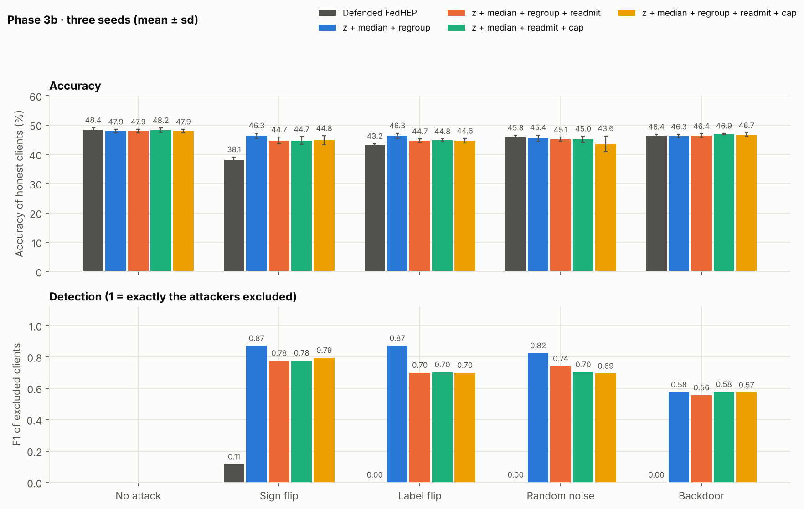

**Reading the Phase 3b charts.** Each bar is one model. The chart labels name FedHEP+'s parts:
- grey "Defended FedHEP" is the baseline;
- blue "z + median + regroup" is **FedHEP+**: [2] robust z, [1] median reference, [5] regrouping;
- the orange, green and yellow bars are two variants tested in the same runs and rejected: readmission and the cap (4.4).

The detection panel shows the F1 of the clients left out each round: 1 means exactly the attackers.

| Model | No attack | Sign flip | Label flip | Random noise | Backdoor (acc.) | Backdoor success |
|---|---|---|---|---|---|---|
| Defended FedHEP | 48.39 ± 0.72 | 38.08 ± 1.01 | 43.23 ± 0.40 | 45.80 ± 0.70 | 46.42 ± 0.37 | 78.7% |
| **FedHEP+** | 47.92 ± 0.60 | **46.34 ± 0.87** | **46.34 ± 0.87** | 45.41 ± 1.15 | 46.26 ± 0.56 | **20.8%** |
| Change, paired by seed | −0.47 | **+8.26** | **+3.11** | −0.38 | −0.16 | **−57.9 points** |

- The gains under sign flip, label flip and backdoor hold **on every seed**, by far more than the seed spread. This is the project's first confirmed improvement.
- Sign and label flippers are isolated in round 1. That is why both rows are identical: from round 2 on, the same 12 honest clients train alone.
- The median reference is what exposes the backdoor: with the mean reference, backdoor success stays near 80% (seed 42: 33% against 80%).

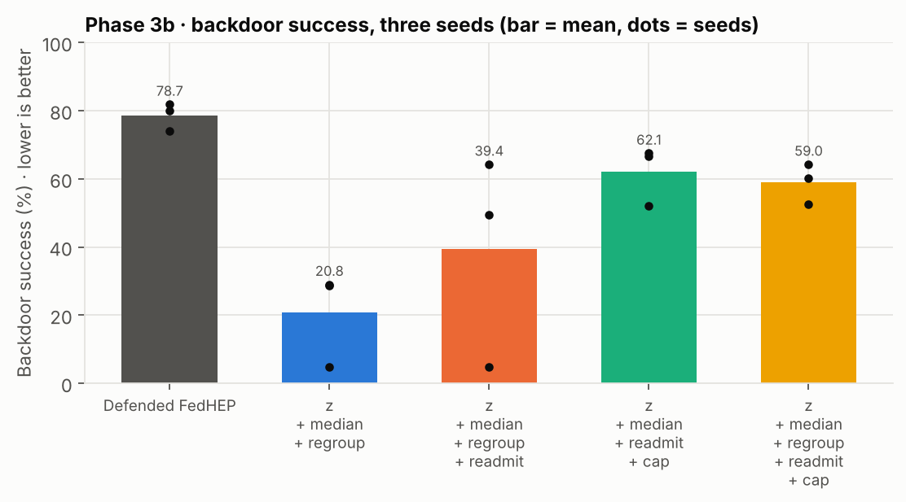

## 4.4 Variants tried and rejected inside Phase 3

Three changes were tested against FedHEP+ on the same seeds (D1, 3 attackers, Mac). Each answered a worry about FedHEP+. None was kept. The table gives the results; the subsections explain each change, why we tried it and why it failed.

| Model (chart label) | Config | No attack | Sign flip | Label flip | Noise | Backdoor success | Honest clients ever isolated (15 runs) |
|---|---|---|---|---|---|---|---|
| **FedHEP+** (z + median + regroup) | — | 47.92 | **46.34** | **46.34** | 45.41 | **20.8%** | 46 |
| + readmission | `plus.readmit: true` | 47.91 | 44.67 | 44.69 | 45.14 | 39.4% | 54 |
| + readmission + cap, no regrouping | `readmit`, `max_excluded: 0.34`, `regroup: false` | 48.19 | 44.71 | 44.78 | 45.05 | 62.1% | 69 |
| + readmission + cap | `readmit`, `max_excluded: 0.34` | 47.93 | 44.81 | 44.62 | 43.60 | 59.0% | 52 |
| full population, no regrouping | `population: all`, `regroup: false` | 48.00 | 46.44 | 45.72 | 45.13 | 54.1% | 87 |
| full population, isolation cut 2.0 | `population: all`, `evidence_cut: 2.0`, `regroup: false` | 48.09 | 46.41 | 46.12 | 45.76 | 74.2% | 36 |
| full population | `population: all` | 47.54 | 46.17 | 45.30 | 45.43 | 52.1% | 82 |

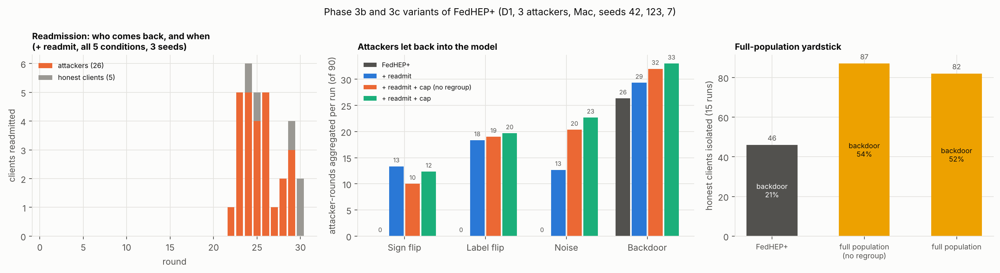

### 4.4a Readmission (`plus.readmit: true`)

**What it does.** In FedHEP+, an isolated client is no longer scored, so it can never come back. With readmission it is still scored every round, against the reference and spread of the clients currently kept. Its evidence keeps updating, and it returns once the evidence recovers to half the isolation cut:

$$E_i \leftarrow 0.7\,E_i + 0.3\,z_i \ \text{(every round, isolated or not)}, \qquad i \text{ isolated and } E_i > -\tfrac{1.5}{2} = -0.75 \Rightarrow i \text{ readmitted}$$

The gap between the isolation cut ($-1.5$) and the readmission cut ($-0.75$) stops a client from flickering in and out.

**Why we tried it.** The cascade (below) isolates honest clients for good. If an honest client was isolated by mistake, it should be allowed back once it looks normal again.

**What happened.**
- Readmission brought back **26 attackers and 5 honest clients** over 15 runs. Every readmission came in rounds 22–30 (left panel of the chart).
- Honest isolations did not fall: 50 honest clients were still isolated at the end, against 46 without readmission.
- The readmitted attackers cost 1.7 points under sign flip and label flip. Backdoor success rose from 20.8% to 39.4%.

**Why it failed.** The two kinds of client recover for different reasons:
- **Honest clients isolated by the cascade stay unusual,** because their data are unusual. Their evidence stays low, so they rarely qualify.
- **Attackers look normal again late in training,** when every update is small and its direction carries little information. Their z drifts toward the middle and their evidence passes $-0.75$.

Readmission therefore works in reverse: it frees the clients it was meant to keep out.

### 4.4b The cap (`plus.max_excluded: 0.34`)

**What it does.** At most a fixed share of all clients may be left out in one round: $\lfloor 0.34 \times 15 \rfloor = 5$ at D1. When more qualify (isolated, or below the exclusion cut this round), only the 5 with the lowest evidence stay out. The others are aggregated this round, even if they are marked as isolated.

$$\text{excluded} = \text{the } \min\big(\lvert Q\rvert,\ \lfloor c\,n \rfloor\big) \text{ members of } Q \text{ with the lowest } E_i \ \text{(ties: lowest } z_i\text{)}, \qquad Q = \text{isolated} \cup \{i : z_i < -2.5\}$$

**Legend:** $Q$ is the set of clients that qualify for exclusion this round, $c = 0.34$ is the cap (`plus.max_excluded`, 1.0 = no cap), and $n$ is the number of clients.

**Why we tried it.** The cascade can in principle remove clients until too few are left to train on. Robust aggregation usually assumes fewer than a third of the clients attack, so never removing more than a third is a natural safety limit. It was tested together with readmission, so that clients pushed out by the limit could still come back.

**What happened.** Under attack the cap was reached in 15–41 of the 90 rounds of each condition (3 runs × 30 rounds). In those rounds it let attackers back into the aggregate: 10–57 attacker-rounds per condition without regrouping, and 7–50 with it. Backdoor success rose to 59–62%, and accuracy under noise fell to 43.6%.

**Why it failed.** The cap keeps out the clients with the **lowest evidence**. Honest clients isolated by the cascade carry very low evidence, because they stay unusual round after round. When the cap is reached, they keep their places outside, and attackers with less extreme evidence are the ones let back in. A backdoor needs only a few rounds inside the model to take hold (4.5e), so a handful of such rounds is enough.

### 4.4c Full-population yardstick (`plus.population: all`, Phase 3c)

**What it does.** The median reference, and the median and MAD of the z-score, are taken over **every client not banned**, isolated ones included, instead of over the clients still kept. Isolation stays permanent; isolated clients are only part of the yardstick.

$$z_i = \frac{s_i - \operatorname{med}_{j \in A}(s_j)}{\max\big(1.4826\,\mathrm{MAD}_{j \in A}(s_j),\ 0.1\,\lvert\operatorname{med}_{j \in A}(s_j)\rvert\big)}, \qquad A = \text{all clients not banned (FedHEP+: } A = \text{kept clients)}$$

**Why we tried it.** At the time, the cascade was thought to come from a shrinking yardstick: each isolation removes a client from the group the next z-scores are measured against, so the spread shrinks and the next honest client looks more extreme. A yardstick that never shrinks should stop it.

**What happened.**

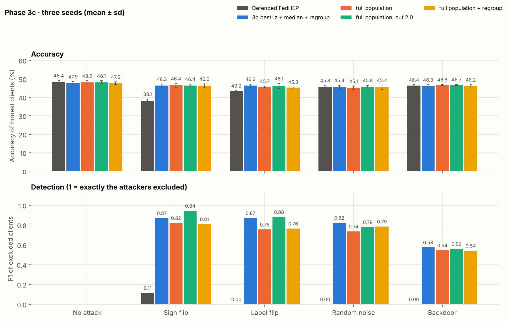

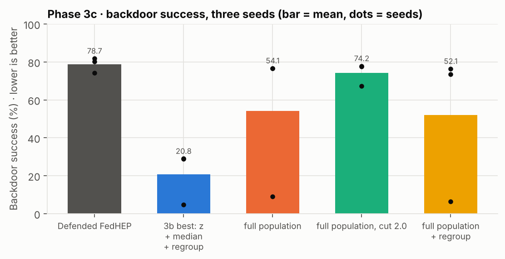

- **More honest clients were isolated, not fewer:** 87 against 46 (82 with regrouping).
- **The backdoor got through:** 52–54%. Attackers were left out in only 154–155 of 270 attacker-rounds, against 191 for FedHEP+. A likely reason, not tested on its own: isolated backdoor attackers stay in the yardstick and pull it toward the ones still active.
- A stricter isolation cut ($-2.0$) brought honest isolations down to 36, but backdoor success rose to 74%.

**Why it failed.** The premise was wrong. The follow-up diagnosis (4.5a) found that the spread does not shrink; it grows six- to eightfold after round 14. What fades is the floor of the z-score's scale, which is what makes honest z-scores extreme mid-training. Keeping the population fixed does not touch that, and it brings isolated attackers back into the yardstick.

### 4.4d Whole-update signal, one-sided (`plus.signal: weights`)

The cosine of the whole update (BatchNorm buffers left out) instead of the root head. It brought backdoor success to 0.3% on seed 42, but isolated many honest clients with a one-sided screen, so it was not adopted then. It returns in Phase 6, with the two-sided screen, the gap gate and patience, as half of FedHEP-Guard's union screen (chapter 6.4).

### The cascade

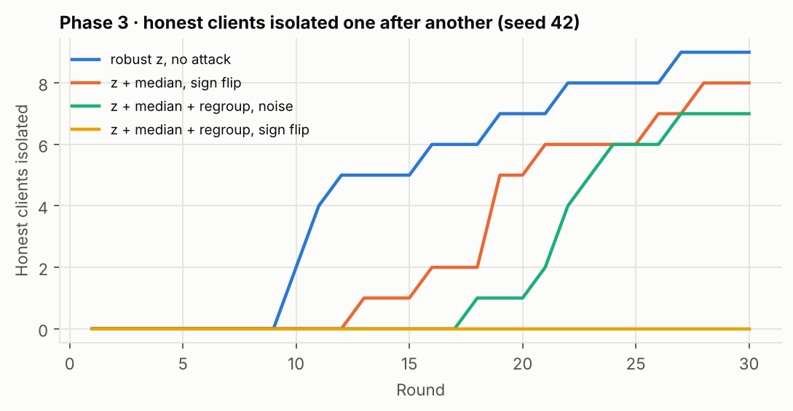

**The cascade.** In FedHEP+ honest clients are isolated one after another as training goes on. The first explanation, a yardstick that shrinks with each removal, led to the variants above, and 4.4c refuted it. The actual cause, a scale floor that fades mid-training, is in 4.5a. Regrouping and scoring only the clients still kept limited the cascade but did not remove it.

## 4.5 Where FedHEP+ fails: the follow-up diagnostics

The professor's questions led to five tests that changed the picture (Mac and Acer, `followup_*.yaml`).

**a) Why honest clients get extreme z mid-training.** The spread does **not** shrink: it grows six- to eightfold after round 14. What fades is the floor. Around round 14 the denominator is at its smallest, so a normal difference looks extreme, and one bad round can isolate an honest client for good. Requiring 3 bad rounds in a row (patience 3) cut false isolations by 42%.

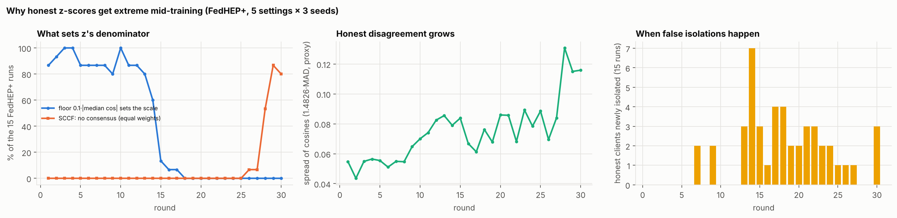

**b) Adaptive attacks are invisible to a one-sided screen.** Under ALIE and Min-Max, no defense isolated a single attacker. These attackers sit **closer** to the reference than honest clients do, so their z is far **above** the others, while FedHEP+ looks only below. Min-Max cost about 3 points under most defenses.

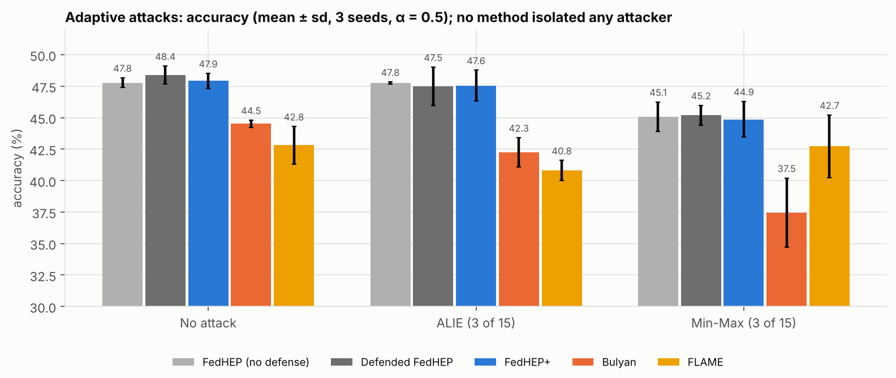

**c) It does not carry over to stronger skew.** In the held-out D2 (α = 0.2, 20 clients), FedHEP+ isolated about 9 of 20 **honest** clients per run with no attack. It lost 2 points to Defended FedHEP on every seed, and the bottom-10% lost 4. The clients it flags are the ones with unusual data. It still won under sign flip (+1.5 on every seed). No method stopped the backdoor there (43–47%).

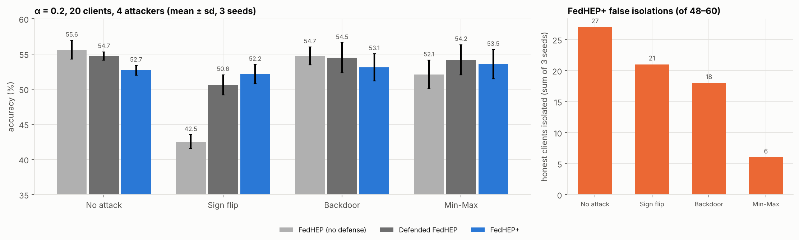

**d) Many sign flippers: far ahead.** With 5 or 6 of 15 attackers, FedHEP+ kept 40–44%, while Defended FedHEP fell to 27–32% and undefended methods collapsed. With 10 of 15 (a majority) every method failed, as theory predicts.

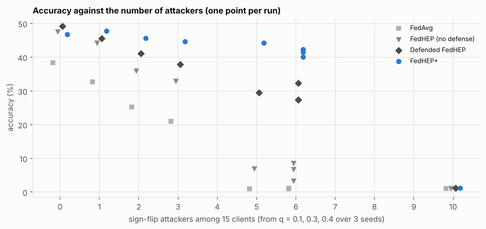

**e) A backdoor outlives its attackers.** With 20 clients and 5 backdoor attackers, FedHEP+ isolated every attacker by rounds 11–15. Backdoor success then **kept rising** by 17–47 points by round 30. Once a backdoor is in the shared trunk, removing the attackers does not remove it.

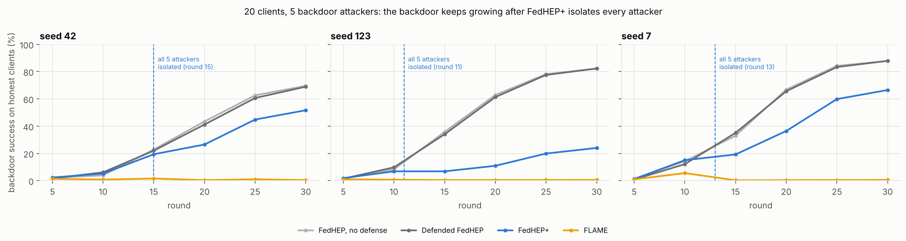

## 4.6 What improved, and what still fails

**Improved over Defended FedHEP (D1):** sign flip +8.3, label flip +3.1, backdoor success 79% → 21%, and the bottom-10% under sign flip 31.2 → 40.8. All of this costs 0.5 points with no attack.

**Still fails:**
1. **Honest but unusual clients look like attackers**: about 9 of 20 isolated at α = 0.2.
2. **Adaptive attackers are not seen**, because the screen is one-sided.
3. **A backdoor that got in stays**, even after its attackers are removed.
4. **More colluders pull the median**: with 5 backdoor attackers, success rises to 56% (chapter 5.2).

The lesson: "far from the typical update" catches crude attacks well, even many of them. But honest clients with unusual data are also far from typical, and clever attackers stay close to it. The next two chapters follow this lesson: [chapter 5](05_ideas_that_did_not_work.md) covers what did not fix it, and [chapter 6](06_fedhep_guard.md) what did.
