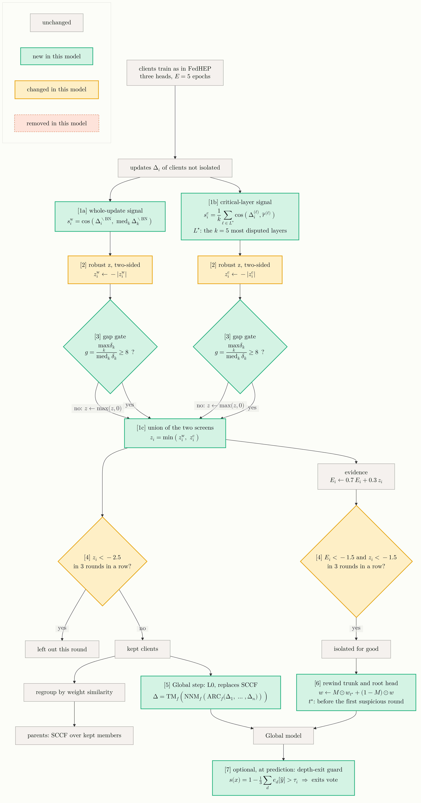
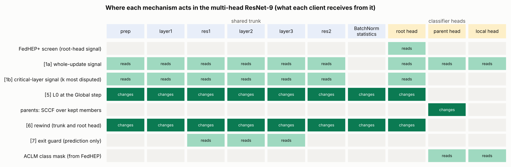

# 5. FedHEP-Guard: the model (Phase 6)

**Goal:** keep FedHEP+'s strength against crude attacks, and fix its three failures ([chapter 6.7](06_results.md)):
1. honest but unusual clients isolated;
2. adaptive attackers not seen;
3. backdoors that persist.

The design follows the literature review: bound every client's influence whether or not it is caught, use more than one signal, and blame no one in a round that shows no separate group.

This chapter describes the model: what each mechanism does, its formula, where it acts and why it is there. Its results are in chapter 6.1 and 6.8–6.13, and what is still open in [chapter 8](08_open_problems.md).

FedHEP-Guard is FedHEP+ with seven changes, numbered [1]–[7] below. It was built one change at a time as a **ladder**: L0, then R2, then R3, then the union screen and the rewind. Each step was kept only if it helped.





## 5.1 Summary of the changes

Each row says what the mechanism does, **why it is in the model** (the failure it answers, with the run that showed the failure), and the evidence that it helps. Sections 5.2–5.7 give each one's formula, legend and full reasoning.

| # | Mechanism | What it does | Why it is in the model | Evidence it helps | Config |
|---|---|---|---|---|---|
| [1a] | Whole-update signal | scores the whole update, not just the root head | the root head is 1.5% of the weights; a backdoor lives mostly in the trunk, so the root-head screen missed it (32 / 70 / 68% success, GPU) | backdoor 0.6% on 2 of 3 seeds | `plus.signal: weights_critical` |
| [1b] | Critical-layer signal | scores the 5 layers where clients disagree most | one cosine over 1.7 million weights dilutes a backdoor that sits in a few layers | caught the seed the whole update missed (0.5%) | (same) |
| [1c] | Union of the two | either signal can flag a client | each signal alone missed the backdoor on a different seed | stealth backdoor 0.2–0.5% on every seed | (same) |
| [2] | Two-sided screen | also flags clients too close to the typical update | ALIE and Min-Max hide by sitting *closer* to the median than honest clients; the one-sided screen caught none of them | 9 of 9 ALIE and 9 of 9 Min-Max attackers caught (D1) | `plus.two_sided: true` |
| [3] | Gap gate | blames no one in a round whose scores do not split into two groups | with the two-sided screen and strong skew, honest clients were flagged every round (R2 at D2: 38 honest isolations over 3 runs, no attack) | 38 → 2–3 honest isolations; +2.6 points at D2 | `plus.gap_gate: 8` |
| [4] | Patience 3 | needs 3 bad rounds in a row before acting | around round 14 the z denominator is smallest, and one ordinary round could isolate an honest client for good | false isolations −42% | `plus.exclusion_patience: 3`, `plus.isolation_patience: 3` |
| [5] | L0 influence bound | clips, mixes and trims every update at the Global step | a screen acts only after evidence builds, and misses some attackers; whatever it lets through must still have bounded influence | best D2 accuracy under sign flip (54.26, with [2]–[4]) | `plus.global_rule: arc_nnm_tm`, `plus.global_f` |
| [6] | Rewind on isolation | resets trunk and root head to before the attacker's first suspicious round | removing an attacker does not remove its backdoor: success kept rising 17–47 points after isolation | 100 rounds: 1 / 17 / 1% → 0 / 1 / 0% | `plus.rewind: trunk_root` |
| [7] | Depth-exit guard (optional) | at prediction, early-layer classifiers vote when they disagree with the final answer | every training-time screen misses some backdoors; a trigger fools the last layers more than the early ones | undetected backdoor halved (79 → 42%) | `fedhep.exit_guard: true` |

**Unchanged from FedHEP+:** median reference, robust z with relative floor, evidence $E_i$ with exclusion at $-2.5$ and isolation at $-1.5$, permanent isolation, regrouping by weight similarity, and SCCF at the parents.

**Replaced:** SCCF at the Global step by L0 [5] (SCCF stays at the parents); the root-head signal by the union of two signals [1]; the one-sided cut by a two-sided one [2]. **Removed:** nothing else; FedHEP+ had already removed Defended FedHEP's trust ledger (chapter 4.2).

## 5.2 [5] L0: bound every client's influence

> **Why it is in the model.** A screen can only act after evidence builds up over rounds. Until then, and for every attacker it never catches, the attacker's update enters the Global step. FedHEP+ used SCCF there, whose trust weights flatten late in training ([chapter 6.4](06_results.md)), so a missed attacker had nearly full influence. Phase 5 also showed that robust rules and screening fail in complementary ways ([chapter 7.3](07_ideas_that_did_not_work.md)). L0 makes the Global step itself robust: no single update, caught or not, can move the model far.
>
> **What it buys.** Alone, L0 is the most accurate defense at D2 with no attack, and it has the lowest D2 backdoor success (37.7%). Under the screen, it gives the best D2 accuracy under sign flip (54.26, R3).
>
> **What it costs.** It needs an assumed attacker count $f$, which hardly matters under the screen (6.12). Alone at D1 it lets sign flip through (41.65), because mixing pulls reversed updates in. That is why it sits under a screen, not instead of one.

The Global step replaces SCCF with three robust operations in sequence (Allouah et al., 2023 and 2024):

$$\Delta = \mathrm{TM}_f\Bigl(\mathrm{NNM}_f\bigl(\mathrm{ARC}_f(\Delta_1, \dots, \Delta_n)\bigr)\Bigr)$$

**ARC (adaptive robust clipping).** Clip the $k$ largest updates down to the norm of the $(k+1)$-th largest:

$$k = \Bigl\lfloor 2\,\frac{f}{n}\,(n - f)\Bigr\rfloor$$

**NNM (nearest-neighbour mixing).** Replace every update by the mean of its $n - f$ nearest neighbours (itself included). An outlier is pulled toward its honest neighbours:

$$\tilde\Delta_i = \frac{1}{n-f}\sum_{j \in N_{n-f}(i)} \Delta_j$$

**TM (coordinate-wise trimmed mean).** Drop the $f$ largest and $f$ smallest values of each coordinate, and average the rest.

Under the screen, $f$ shrinks by the number of clients the screen already excluded, $f \leftarrow \max(0, \min(f_0 - \lvert\text{excluded}\rvert, \lfloor (n_{\text{kept}}-1)/2\rfloor))$, and every kept client gets weight $1/n_{\text{kept}}$.

| Symbol | Meaning | Config |
|---|---|---|
| $f_0$ | attackers assumed before screening | `plus.global_f` (FedHEP-Guard); `robust.assumed_attackers` (L0 alone) |
| $k$ | number of updates clipped by ARC | — |
| $N_{n-f}(i)$ | the $n-f$ updates nearest to $\Delta_i$ | — |
| $\mathrm{TM}_f$ | trimmed mean dropping $f$ values per side | — |

**L0 alone** (`method: fedhep_robust`, `robust.rule: arc_nnm_tm`) is the ladder's first rung. It never removes anyone. It is the best defense at α = 0.2 with no attack, but fails against sign flip at α = 0.5: mixing pulls reversed updates in, as the table in 6.9 shows.

## 5.3 [2] Two-sided screen and [3] gap gate

> **Why the two-sided screen is in the model.** ALIE and Min-Max are built to sit inside the honest spread. Their updates are *closer* to the median than honest clients' are, so their z is far above everyone else's. FedHEP+ looked only below, and isolated none of them in any run.
>
> **Why the gap gate is in the model.** Looking both ways has a price. Under strong skew, honest clients spread widely, and some are always far from the median on one side or the other. R2 (two-sided, no gate) isolated 38 honest clients over 3 runs at D2 with no attack. The gate asks one question first: do the round's scores actually split into two groups? Attackers usually form a separate group; honest skew usually does not.
>
> **What they buy.** Every ALIE and Min-Max attacker is caught at D1 (9 of 9 each). Honest isolations at D2 fall from 38 to 2–3, and D2 accuracy with no attack rises from 52.13 (R2) to 54.72 (R3).
>
> **What they cost.** In rounds without a clear gap, attackers collect no evidence either. With the root-head signal, R3 let the backdoor in (51–62% at D1), which [1] fixes.

**Two-sided.** A client is suspicious if its score is far from the others in **either** direction. ALIE and Min-Max attackers sit right on the reference, so their z is far above everyone's:

$$z_i \leftarrow -\lvert z_i\rvert$$

**Gap gate.** Before anyone gathers bad evidence, the round's scores must actually split into two groups. Sort the scores and compare the largest gap between neighbours with the typical gap:

$$g = \frac{\max_k \bigl(s_{(k+1)} - s_{(k)}\bigr)}{\operatorname{med}_k \bigl(s_{(k+1)} - s_{(k)}\bigr)}, \qquad g < \gamma \;\Rightarrow\; z_i \leftarrow \max(z_i, 0)\ \ \forall i$$

With $\gamma = 8$, a round of honest but spread-out clients has no outstanding gap, so nobody is blamed. A round with attackers usually has one.

| Symbol | Meaning | Config |
|---|---|---|
| $s_{(k)}$ | the $k$-th smallest score of the round | — |
| $g$ | gap ratio, logged every round as `score_stats.gap_ratio` | — |
| $\gamma$ | gate threshold (0 = off; 8 and 12 tested) | `plus.gap_gate` |

**Why 8 and not 12.** Both were tested on the ladder (6.9), with the root-head signal:
- **Accuracy** is the same within 0.2 points at D1, under every attack.
- **Gate 12 isolates fewer honest clients:** 0–0.3 per run at D1 against 0.7–1.0, and 2 / 1 / 0 / 6 over 3 runs at D2 against 3 / 6 / 8 / 7.
- **Gate 12 lets more backdoor in:** 62% against 51% at D1, because the gate also stops the attackers' evidence when their split is weaker than 12.

The decision came with the union screen. FedHEP-Guard needs the backdoor attackers caught, and in the GPU grid their split is weak. In the rounds where the largest gap separated exactly the backdoor attackers (union screen, 15 clients, α = 0.5), the gap ratio reached 8 in 76% of rounds but 12 in only 45%. In honest rounds the gate opened 25% of the time at 8 and 11% at 12. Gate 12 would roughly halve the chance openings, and also lose about four in ten backdoor catches. Gate 12 with the union screen has not been run; this comes from the logs, not from a run. Why no fixed threshold solves this is in chapter 8.2.

## 5.4 [1] Two signals and their union

> **Why it is in the model.** What a defense cannot see, it cannot screen. FedHEP+ scored only the root head's rows for each client's classes, a small part of the root head, which is itself 1.5% of the model's 1.72 million weights. A backdoor is learned mostly in the trunk, so the root-head screen missed it on every seed at D1 on the GPU (32 / 70 / 68%).
>
> - **[1a] The whole update** sees the trunk, but one cosine over every weight averages a few poisoned layers with many normal ones.
> - **[1b] The critical-layer signal** looks only where clients disagree most, so a backdoor in a few layers stays visible.
> - **[1c] The union.** The two signals fail on different seeds, and the union keeps the stronger alarm of the two.
>
> **What it buys.** Backdoor success under 1.5% on every seed at D1 (Mac), including the stealth backdoor that beat the whole-update signal alone (6.11).
>
> **What it costs.** More honest isolations: 14 over 3 runs against 9 (stealth runs), and 4–6 per run with no attack (Acer). This is the main open problem (8.1).

**[1a] Whole update.** The cosine of every weight in the update (trunk and all three heads, BatchNorm buffers excluded) to the median update:

$$s^{\mathrm{w}}_i = \cos\bigl(\Delta_i^{\setminus\mathrm{BN}},\ \operatorname{med}_k \Delta_k^{\setminus\mathrm{BN}}\bigr)$$

**[1b] Critical layers** (after FedSurrogate, 2026). For every shared layer $\ell$ (trunk and root head; the personal heads differ by design), take each client's layer cosine $c_{i\ell} = \cos(\Delta_i^{(\ell)}, \tilde r^{(\ell)})$. The round's $k = 5$ most disputed layers are those whose cosines vary most across clients. The score is the mean over them:

$$L^\star = \operatorname{top}_k\ \operatorname{std}_i(c_{i\ell}), \qquad s^{\mathrm{c}}_i = \frac{1}{k}\sum_{\ell \in L^\star} c_{i\ell}$$

**[1c] Union.** Each signal is z-scored, made two-sided and gap-gated on its own. The client keeps the lower of its two z-values, so either signal alone can exclude or isolate it:

$$z_i = \min\bigl(\tilde z^{\,\mathrm{w}}_i,\ \tilde z^{\,\mathrm{c}}_i\bigr)$$

**Why two signals.** On the GPU (D1, 3 seeds), the whole-update signal missed the backdoor on seed 42 and the critical-layer signal on seeds 123 and 7. Their union covers every seed (table in [chapter 7.4](07_ideas_that_did_not_work.md)). Against the stealth backdoor (6.11), the union caught every attacker where the whole update alone missed one seed.

| Symbol | Meaning | Config |
|---|---|---|
| $\Delta^{\setminus\mathrm{BN}}$ | the update without BatchNorm running statistics and counters | — |
| $c_{i\ell}$ | client $i$'s cosine on layer $\ell$ | — |
| $k$ | number of critical layers | `plus.critical_k: 5` |
| $\tilde z^{\,\mathrm{w}}, \tilde z^{\,\mathrm{c}}$ | two-sided, gated z of each signal | — |

## 5.5 [4] Patience

> **Why it is in the model.** The follow-up diagnostics ([chapter 6.6a](06_results.md)) showed that around round 14 the z-score's denominator is at its smallest. An ordinary round can then give an honest client an extreme z. With patience 1, one such round excluded it, and a few isolated it for good. Real attackers misbehave every round, so asking for 3 bad rounds in a row costs little against them.
>
> **What it buys.** 42% fewer false isolations in the follow-up test.
>
> **What it costs.** Attackers are acted on two rounds later. L0 bounds their influence in the meantime.

A client is left out only after $z_i < -2.5$ in **3 consecutive rounds**. It is isolated only when $E_i < -1.5$ **and** $z_i < -1.5$ in 3 consecutive rounds. In the follow-up diagnostics this alone cut false isolations by 42% ([chapter 6.6a](06_results.md)).

## 5.6 [6] Rewind on isolation

> **Why it is in the model.** Isolating an attacker stops new poison, but not what is already in the model. With 20 clients and 5 backdoor attackers, FedHEP+ isolated every attacker by rounds 11–15, and backdoor success still rose 17–47 points by round 30 ([chapter 6.6e](06_results.md)). Over 100 rounds on the Acer, a late catch let the backdoor grow from 13% to 17% with no attacker left (6.10). The only way to remove what is already learned is to go back to a model from before it was learned.
>
> **What it buys.** With the whole-update signal over 100 rounds, backdoor success goes from 1 / 17 / 1% to 0 / 1 / 0%.
>
> **What it costs.** 0.4 points of accuracy on average, and one skipped Global step per rewind. It does nothing when nobody is caught, so it depends on [1].

A backdoor that reached the trunk before its attackers were caught keeps growing without them ([chapter 6.6e](06_results.md)). When clients $I_{\text{new}}$ are isolated in round $r$, the trunk and root head go back to the Global model stored before their suspicion began:

$$t^\star = \min_{c \in I_{\text{new}}}\ \min\bigl\{t \le r : z_{c,t'} < -2.5\ \ \forall\, t' \in [t, r)\bigr\}, \qquad w \leftarrow M \odot w_{t^\star} + (1 - M)\odot w$$

That round's Global aggregation is skipped. Parents are restored too.

| Symbol | Meaning | Config |
|---|---|---|
| $t^\star$ | start of the earliest unbroken suspicious trail among the newly isolated | — |
| $M$ | mask of restored coordinates: trunk, or trunk and root head, or all | `plus.rewind: trunk`, `trunk_root`, `all` |
| window | Global models kept for rewinding (one per round) | `plus.rewind_window: 10` |

## 5.7 [7] Depth-exit guard (prediction time, optional)

> **Why it is in the model.** Every training-time defense misses some backdoors (6.11: up to 20% with 5 plain attackers). The guard is a last line of defense at prediction time that does not depend on catching anyone. A trigger mostly changes what the last layers conclude, while early layers still see an ordinary image. When the early-layer classifiers disagree with the final answer, the input is suspect and the exits decide.
>
> **What it buys.** An undetected backdoor is roughly halved (79% → 42%, GPU; 72% → 39% over 100 rounds, Acer).
>
> **What it costs.** 0.3 points of accuracy with no attack, because 3% of clean inputs are answered by the exits. It is optional because training is unchanged.

After Orion (IJCAI 2023). Each honest client fits three small linear classifiers ("exits") on its own training images. They read pooled features after `res1`, `layer2` and `layer3`. A backdoor trigger usually fools the final head but not the early exits:

$$u_d = \frac{\mathrm{pool}(h_d(x)) - \mu_d}{\max(\sigma_d, 10^{-6})}, \qquad e_d = \operatorname{softmax}\bigl(\operatorname{mask}_{C_i}(W_d u_d + b_d)\bigr), \qquad s(x) = 1 - \tfrac13\sum_d e_d[\hat y]$$

An input with $s(x) > \tau_i$, where $\tau_i$ is the 95th percentile of $s$ on the client's held-out 20%, takes the exits' vote instead. Training is unchanged; only predictions change. No attack: −0.3 points (3% of clean inputs flagged). An undetected backdoor: about halved (79% → 42%).

| Symbol | Meaning |
|---|---|
| $h_d(x)$ | trunk features at depth $d \in \{$res1, layer2, layer3$\}$ |
| $\mu_d, \sigma_d$ | their mean and standard deviation on the client's training images |
| $W_d, b_d$ | the linear exit at depth $d$ |
| $\hat y$ | the ensemble's prediction |
| $\tau_i$ | client $i$'s flag threshold |

## 5.8 FedHEP-Guard's exact configuration

FedHEP-Guard is **R3 with gate 8** (the L0 Global step, two-sided screen, gap gate 8, patience 3) plus **the union screen** [1] and **the trunk-and-root rewind** [6]. "R3" alone in a table or chart means the ladder rung with the root-head signal, not FedHEP-Guard.

**What has been run so far.** The full model has been run only over 100 rounds against the two backdoors (Acer); every other condition waits for the GPU benchmark:

| Run | Has | Lacks | Where |
|---|---|---|---|
| FedHEP-Guard without rewind (`r3wc`) | everything but the rewind | [6] | GPU grid (all attacks), Mac stealth study, Acer |
| R3 whole update with rewind (`r3w_tr`) | rewind; whole-update half of the union | critical-layer half of [1] | Mac (30 rounds), Acer (100 rounds) |
| FedHEP-Guard (`r3wc_tr`, `guard`) | all parts | — | Acer, 100 rounds, both backdoors (`x9__*__r3wc_tr`, 6.10); queued: the benchmark's `guard` model (every condition, every setting) |


```yaml
config: configs/cifar100_fedhep_defended.yaml    # FedHEP model and training, Defended FedHEP's SCCF at parents
method: fedhep_plus
plus.reference: median
plus.regroup: true
plus.two_sided: true            # [2]
plus.gap_gate: 8                # [3]
plus.exclusion_patience: 3      # [4]
plus.isolation_patience: 3      # [4]
plus.global_rule: arc_nnm_tm    # [5]
plus.global_f: 3                # [5] = attackers assumed (3 at D1, 4 at D2)
plus.signal: weights_critical   # [1]
plus.rewind: trunk_root         # [6]
fedhep.exit_guard: true         # [7] optional, prediction only
```

It is the `guard` model of the benchmark (`scripts/make_benchmark.py`).
