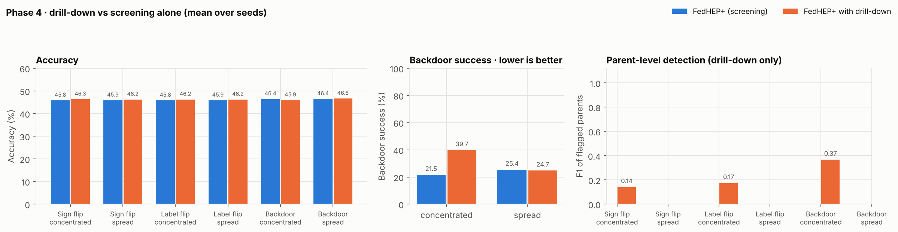
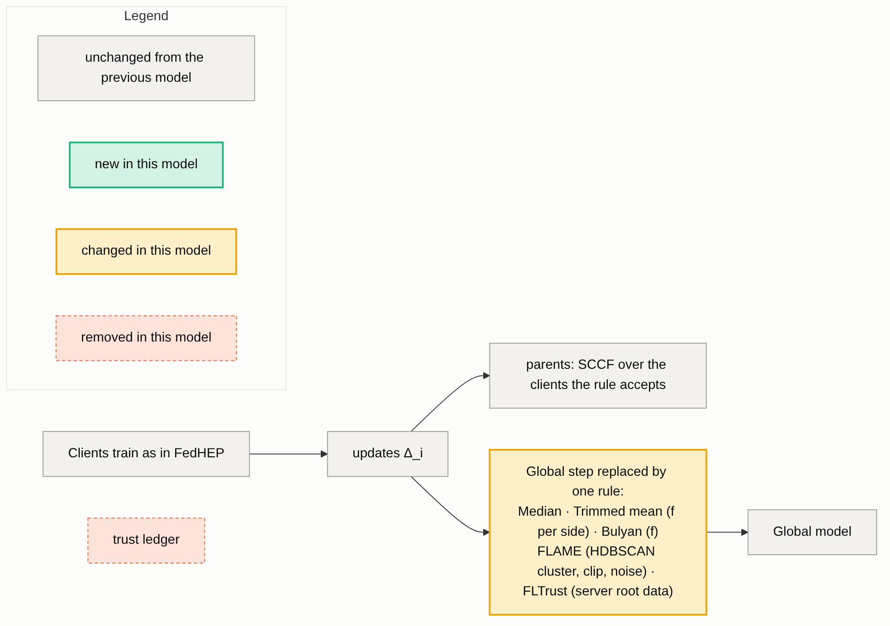
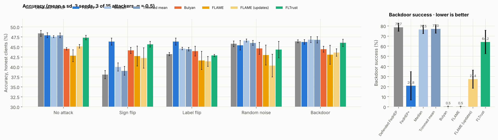
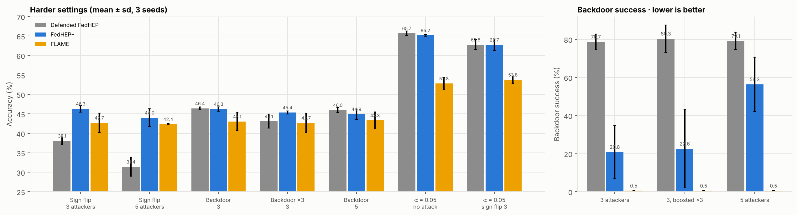
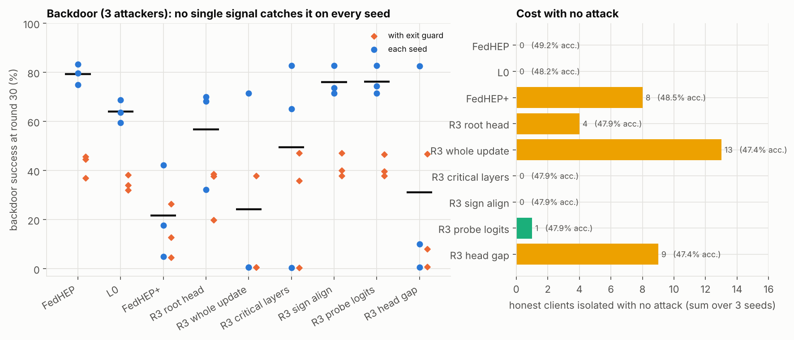

# 5. Ideas that did not work (Phases 4, 5 and parts of 6)

Each idea here was a hypothesis with a pass criterion set before the runs. None met its criterion. They are reported in full because each one explains part of FedHEP-Guard's design ([chapter 6](06_fedhep_guard.md)).

| Phase | Idea | Why we tried it | What it changed | Why it failed |
|---|---|---|---|---|
| 4 | Drill-down v1 | FedHEP+ still let 21% of the backdoor through; attackers pushing one direction should stand out more **together** than alone (in a synthetic test, 3 backdoor attackers each looked normal, z > −0.4, while their group scored −2.5 to −4.3) | flagged groups' members face a stricter cut | one-round exclusion hid the backdoor attackers: backdoor 21.5% → 39.7% |
| 4b | Drill-down v2 | v1 failed because a one-round exclusion hides the attacker; evidence that builds over rounds does not | flagged groups' members gain evidence if they share the group's direction | members of a FedHEP group are genuinely alike: honest groups isolated together (−1.1 to −1.7 points) |
| 5 | Classic robust rules at FedHEP's Global step | before inventing a defense, check whether a published one already fixes FedHEP+'s weak spots | Median, Trimmed mean, Bulyan, FLAME, FLTrust | none beats FedHEP+ overall; Bulyan and FLAME stop the backdoor but cost 3.9–5.6 points with no attack |
| 6 | Worker momentum under L0 | the robust-learning literature shows that averaging each client's updates over rounds shrinks the noise attackers hide in | each client's update averaged over rounds before aggregation | worse in every setting |
| 6 | Output-space and sign signals | a backdoor might show in what the model predicts (probe images) or in the sign pattern of the update (AlignIns), where a cosine might miss it | probe logits, head gap, sign alignment | miss the backdoor or the sign flippers |
| 6 | Head-agreement inference | personal heads are trained only on the client's own clean data, so they might not carry the backdoor | personal heads overrule the ensemble when they agree against it | removes only 3–9 points of backdoor success (Mac; 0.5–19 on the GPU): the parent head carries it too |
| 6 | Holding f fixed | R3 lost 1.8 points under ALIE; lowering $f$ after exclusions might let ALIE back into the trimmed mean | L0 keeps assuming $f$ attackers after the screen removed them | −1.1 points under ALIE: it made things worse |
| 6 | Rewinding every shared weight | the personal heads might also hold part of the backdoor | rewind personal heads too | costs about 0.8 points for no gain |

## 5.1 Phase 4: check groups first, then their members

**Hypothesis.** Attackers pushing one direction (one backdoor) stand out more **together** than one by one. So first find the group (parent) that contains them, then look inside it.

**Parent check (both versions).** The cosine of each parent's mean update to the reference is compared with 64 random groups of the same size, a permutation test:

$$z_g = \frac{\cos(\bar v_g, \tilde r) - \operatorname{med}(\text{null})}{\max\bigl(1.4826\,\mathrm{MAD}(\text{null}),\ 0.01\lvert\operatorname{med}(\text{null})\rvert\bigr)}, \qquad z_g < -2 \Rightarrow \text{parent flagged}$$

**v1 (`plus.drill_down: true`, `drill_mode: exclude`).** Members of a flagged parent face a stricter cut that round: $z_i < -1$ instead of $-2.5$.

**v2 (`drill_mode: evidence`).** v2 asks which members of a flagged parent share its unusual direction. It runs only for parents flagged by the parent check, and works in three steps.

**Step 1: each member's residual.** What is left of member $i$'s signal once the shared part, the median reference, is taken out:

$$u_i = v_i - \tilde r$$

The residual is client $i$'s own deviation from what everyone does. Honest clients' residuals are mostly their own data and noise, so they point in unrelated directions. Attackers pushing the same backdoor share one extra direction, so their residuals point the same way.

**Step 2: alignment with the rest of the group.**

$$d_{-i} = \frac{1}{\lvert g\rvert - 1}\sum_{j \in g,\ j\neq i} u_j, \qquad a_i = \cos\bigl(u_i,\ d_{-i}\bigr)$$

- $d_{-i}$ is the mean residual of the **other** members of $g$. Leaving $i$ out ($j \neq i$) matters: if $u_i$ were in the mean, $a_i$ would be high partly because $i$ is compared with itself.
- $a_i$ is high when $i$ deviates in the same direction as its group-mates. Several attackers in one parent coordinating on one backdoor all get a high $a_i$. An honest member next to them does not, because its residual has nothing in common with theirs.
- Averaging over the other members builds up what they share and cancels what is individual, so the shared attack direction stands out in $d_{-i}$.
- The assumption is that honest members share nothing beyond the reference. In FedHEP it is false: members of one parent train from the same parent head, so honest residuals share a group direction too. This is why v2 failed (below).

**Step 3: is $a_i$ unusually high? A null from outside the parent.** Any residual is somewhat aligned with a group mean by chance, so $a_i$ needs a yardstick. It is the same cosine for clients that are **not** in $g$, against the same leave-one-out directions:

$$N_g = \bigl\{\cos(u_k,\ d_{-i}) : k \notin g,\ i \in g\bigr\}, \qquad z^{\text{align}}_i = \frac{a_i - \operatorname{med}(N_g)}{\max\bigl(1.4826\,\mathrm{MAD}(N_g),\ 0.1\,\lvert\operatorname{med}(N_g)\rvert\bigr)}$$

$N_g$ pools every outside client against every member's direction $d_{-i}$, which gives $(n - \lvert g\rvert) \times \lvert g\rvert$ values, enough for a stable median. With fewer than 5 values every $z^{\text{align}}_i$ is 0. A member is suspicious when $z^{\text{align}}_i$ is large and **positive**: more aligned with its group-mates than outsiders are.

**How it feeds the decision.** High alignment is turned into bad evidence. For members of a flagged parent the evidence update uses the worse of the two signals; nobody is left out for a round on alignment alone:

$$E_i \leftarrow 0.7\,E_i + 0.3\,\min\bigl(z_i,\ -z^{\text{align}}_i\bigr)$$

**Legend:**

| Symbol | Meaning |
|---|---|
| $\bar v_g$ | parent $g$'s mean signal (parent check) |
| null | the parent check's cosine for 64 random groups of the same size |
| $v_i$, $\tilde r$ | member $i$'s signal and the median reference (chapter 4.1) |
| $u_i$ | member $i$'s residual: its signal minus the reference |
| $g$, $\lvert g\rvert$ | the flagged parent and its number of eligible (not isolated) members, at least 3 (`plus.min_group`) |
| $d_{-i}$ | the mean residual of $g$'s other members |
| $a_i$ | member $i$'s alignment with the rest of its group |
| $N_g$ | the null: outside clients' cosines to the members' leave-one-out directions |
| $z^{\text{align}}_i$ | robust z of $a_i$ against $N_g$; same scale floor as the screen (0.1 of the median) |
| $z_i$, $E_i$ | the screen's z and evidence (chapter 4.1) |

**Results** (D1, Mac, 3 seeds; "concentrated" = all 3 attackers in one parent):

| Setting | FedHEP+ alone | v1 | v2 |
|---|---|---|---|
| No attack: accuracy | 48.07 | 47.95 | 46.95 |
| No attack: honest isolated (3 seeds) | 10 | 8 | 19 |
| Concentrated backdoor: success | 21.5% | **39.7%** | **1.9%** |
| Concentrated backdoor: accuracy | 46.42 | 45.92 | 44.69 |

**Why it failed:**
- **The parent check works.** It flagged the attackers' parent with precision 0.85.
- **v1's one-round exclusion made attackers harder to catch.** With the backdoor kept out of the model, honest updates no longer pushed against it, so the attackers' z moved toward normal and isolation came later (seed 42: never).
- **v2 catches the attackers in rounds 2–3, but it also isolates honest groups.** Members of a FedHEP parent train from the same parent head, so their updates share a parent-specific direction. Honest members' alignment z (median 1.0, and up to 2.8 in falsely flagged parents) overlaps the attackers' (3.0–3.6). No cut separates them.

**What carried forward:** removing a client for one round can hide it; evidence that builds over rounds does not. Group-level coordination is real, but in FedHEP honest groups are coordinated too.

## 5.2 Phase 5: established robust rules inside FedHEP

**Question:** would a published defense, plugged into FedHEP's Global step, beat FedHEP+?

| Rule | Global step | Reference |
|---|---|---|
| Median | coordinate-wise median of the updates | Yin et al., 2018 |
| Trimmed mean | per coordinate, drop the $f$ largest and $f$ smallest values, average the rest: $\mathrm{TM}_f(X)_j = \frac{1}{n-2f}\sum_{i=f+1}^{n-f} X_{(i),j}$ | Yin et al., 2018 |
| Bulyan | pick $n - 2f$ updates by repeated Krum, then a trimmed mean around the median per coordinate | El Mhamdi et al., 2018 |
| FLAME | HDBSCAN on cosine distances keeps the majority cluster; clip to the median norm; add Gaussian noise $\lambda S$ with $\lambda = 0.001$ | Nguyen et al., 2022 |
| FLTrust | trust $= \mathrm{ReLU}(\cos(\Delta_i, \Delta_0))$, with $\Delta_0$ the server's update on 100 clean root images; updates rescaled to $\lVert\Delta_0\rVert$ | Cao et al., 2021 |

Parents keep SCCF over the clients the rule accepts. $f = 3$ at D1.

**Results** (D1, Mac, 3 seeds):

| Model | No attack | Sign flip | Label flip | Noise | Backdoor success | Honest left out per round |
|---|---|---|---|---|---|---|
| Defended FedHEP | **48.39** | 38.08 | 43.23 | 45.80 | 78.7% | 0 |
| **FedHEP+** | 47.92 | **46.34** | **46.34** | 45.41 | 20.8% | 1.1–1.9 |
| Median | 47.57 | 39.97 | 44.59 | **46.59** | 76.5% | 0 |
| Trimmed mean | 47.91 | 39.03 | 44.44 | 46.01 | 77.0% | 0 |
| Bulyan | 44.52 | 44.13 | 43.94 | 44.64 | **0.5%** | 3.0–6.0 |
| FLAME | 42.81 | 42.72 | 41.61 | 42.97 | **0.5%** | 2.6–5.1 |
| FLTrust | 47.33 | 45.66 | 42.85 | 44.34 | 64.2% | 2.6–3.6 |

**Harder settings:**
- With **5 sign flippers**, FedHEP+ gains 12.6 points over Defended FedHEP.
- With **5 backdoor attackers**, FedHEP+'s backdoor success rises to 56%: five colluders pull the median toward themselves. FLAME holds at 0.5%.
- At **α = 0.05**, FedHEP+'s gain disappears (62.75 against 62.81), and FLAME loses 13 points with no attack.

**Why none was adopted:**
- Median and trimmed mean never remove anyone, so sign flippers and backdoors get through.
- Bulyan and FLAME stop the backdoor by leaving out 3–6 honest clients **every round**, which costs 4–6 points with no attack.
- FLTrust's 100 root images are a thin reference for 100 classes.

**What carried forward:**
- FedHEP+'s weak spot (the backdoor) is FLAME's strength, and FLAME's weak spot (honest clients left out) is FedHEP+'s strength. This motivated a layered design: an influence bound underneath a screen.
- The trimmed mean returns in Phase 6 as the last stage of L0.

## 5.3 Phase 6 components that were tested and dropped

| Component | Config | Result | Source run |
|---|---|---|---|
| Worker momentum under L0 ($m_i \leftarrow \beta m_i + (1-\beta)\Delta_i$, $\beta = 0.5$) | `robust.momentum: 0.5` | worse than L0 alone in every D1 setting | `p6__l0m` |
| Probe-logit and head-gap signals (outputs on 200 server images) | `plus.signal: probe_logits`, `head_gap` | miss the sign flippers on CUDA. Head gap catches the backdoor on 2 of 3 seeds but isolates 9 honest clients | `g1__r3p`, `g1__r3h` |
| Sign-alignment signal (AlignIns MPSA) | `plus.signal: sign_align` | isolates every sign flipper and no honest client, but misses the backdoor (71–83%) | `g1__r3s` |
| Critical layers alone | `plus.signal: critical` | catches the backdoor on 1 of 3 seeds | `g1__r3c` |
| Head-agreement inference | `fedhep.head_agreement` | costs 0.1–0.4 points and removes 3–9 points of backdoor success on the Mac (0.5–19 on the GPU): the parent head carries the backdoor too | `g1__*`, `m6__*` |
| Holding $f$ fixed after exclusions | `plus.global_f_fixed` | −1.1 points under ALIE on the Mac, −1.24 on CUDA | `m6__r3_ffixed`, `c2__*` |
| Rewinding every shared weight | `plus.rewind: all` | about 0.8 points below rewinding only the trunk and root head, with no gain against the backdoor | `m6__r3w_all` |
| Readmission, cap, full-population yardstick | see [chapter 4.4](04_fedhep_plus.md) | all worse | `p3b__*`, `p3c__*` |

The signal comparison (GPU, D1, 3 seeds) is the reason FedHEP-Guard uses two signals at once. No single signal catches the backdoor on every seed:

| Signal (R3, D1, GPU) | Backdoor success, seeds 123 / 42 / 7 | Honest isolated with no attack (3 seeds) |
|---|---|---|
| Root head | 32 / 70 / 68% | 4 |
| Whole update | **0.6** / 71 / **0.6**% | 13 |
| Critical layers | 65 / **0.5** / 83% | 0 |
| Sign alignment | 74 / 71 / 83% | 0 |
| Probe logits | 74 / 71 / 83% | 1 |
| Head gap | 10 / **0.7** / 83% | 9 |

The whole-update and critical-layer signals miss on **different seeds**, so their union catches all three ([chapter 6.4](06_fedhep_guard.md)).
