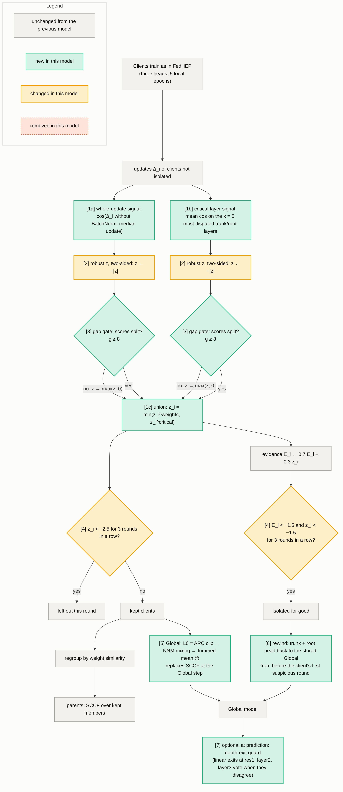
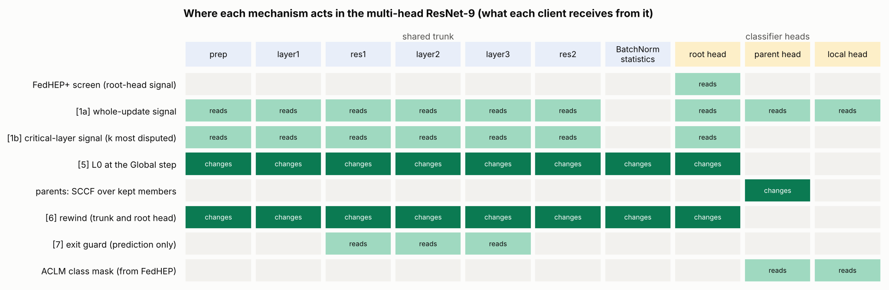
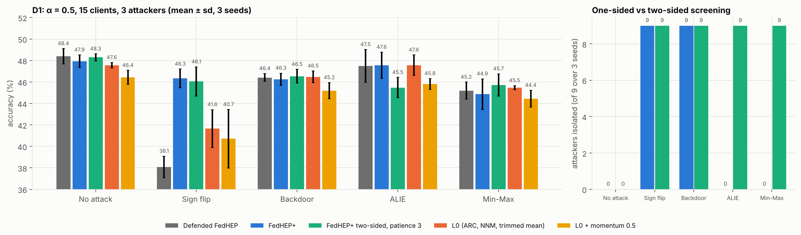
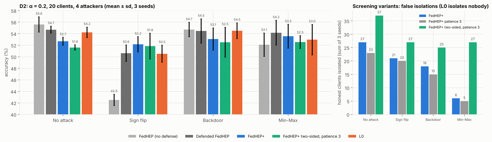
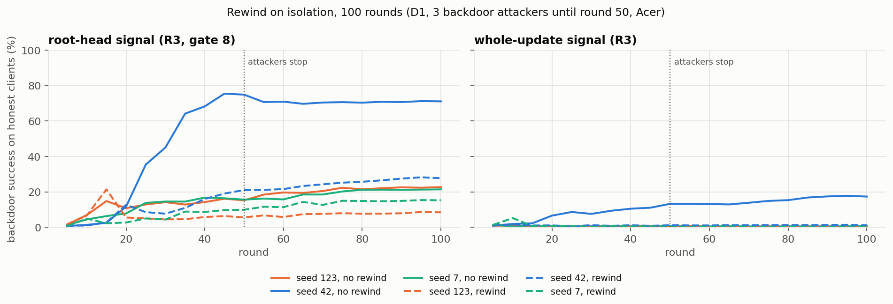
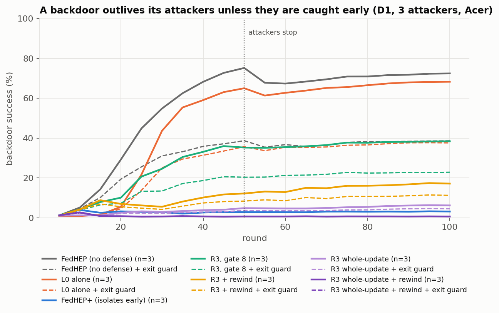
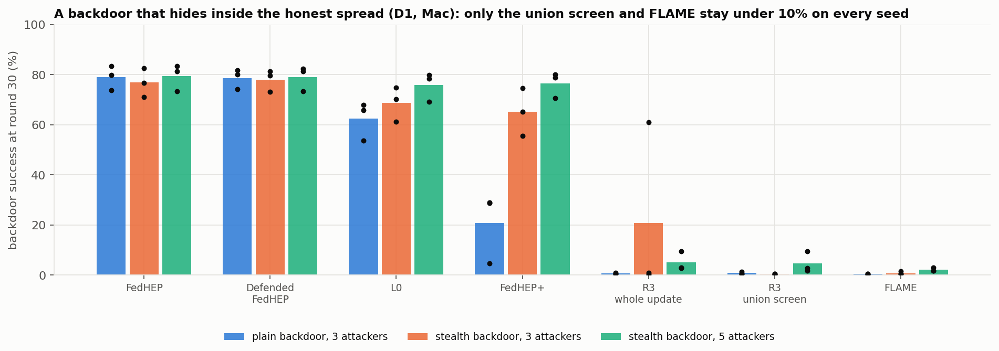
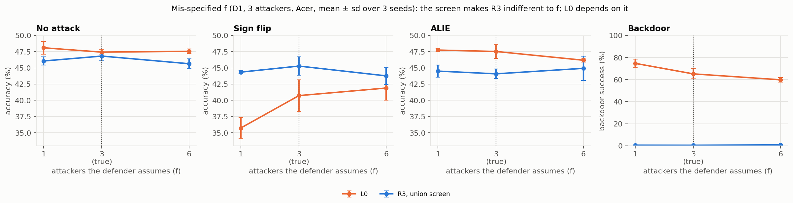

# 6. FedHEP-Guard: the current best model (Phase 6)

**Goal:** keep FedHEP+'s strength against crude attacks, and fix its three failures ([chapter 4.6](04_fedhep_plus.md)):
1. honest but unusual clients isolated;
2. adaptive attackers not seen;
3. backdoors that persist.

The design follows the literature review: bound every client's influence whether or not it is caught, use more than one signal, and blame no one in a round that shows no separate group.

FedHEP-Guard is FedHEP+ with seven changes, numbered [1]–[7] below. It was built one change at a time as a **ladder**: L0, then R2, then R3, then the union screen and the rewind. Each step was kept only if it helped.





## 6.1 Summary of the changes

| # | Mechanism | Where in the round | What it fixes | Config |
|---|---|---|---|---|
| [1a] | Whole-update signal | screening | the root head alone hides a backdoor that lives in the trunk | `plus.signal: weights_critical` |
| [1b] | Critical-layer signal | screening | the whole update dilutes a backdoor that sits in a few layers | (same) |
| [1c] | Union of the two | screening | each signal misses the backdoor on a different seed | (same) |
| [2] | Two-sided screen | screening | ALIE and Min-Max sit *above* the others | `plus.two_sided: true` |
| [3] | Gap gate | screening | no blame in rounds without a separate group: fewer honest isolations | `plus.gap_gate: 8` |
| [4] | Patience 3 | exclusion and isolation | one bad round no longer isolates an honest client | `plus.exclusion_patience: 3`, `plus.isolation_patience: 3` |
| [5] | L0 influence bound | Global step | an attacker that is not caught still has bounded influence | `plus.global_rule: arc_nnm_tm`, `plus.global_f` |
| [6] | Rewind on isolation | after isolation | removes what a late-caught attacker already put in the trunk | `plus.rewind: trunk_root` |
| [7] | Depth-exit guard (optional) | prediction | halves any backdoor that gets through | `fedhep.exit_guard: true` |

**Unchanged from FedHEP+:** median reference, robust z with relative floor, evidence $E_i$ with exclusion at $-2.5$ and isolation at $-1.5$, permanent isolation, regrouping by weight similarity, and SCCF at the parents.

## 6.2 [5] L0: bound every client's influence

The Global step replaces SCCF with three robust operations in sequence (Allouah et al., 2023 and 2024):

$$\Delta = \mathrm{TM}_f\Bigl(\mathrm{NNM}_f\bigl(\mathrm{ARC}_f(\Delta_1, \dots, \Delta_n)\bigr)\Bigr)$$

**ARC (adaptive robust clipping).** Clip the $k$ largest updates down to the norm of the $(k+1)$-th largest:

$$k = \Bigl\lfloor 2\,\frac{f}{n}\,(n - f)\Bigr\rfloor$$

**NNM (nearest-neighbour mixing).** Replace every update by the mean of its $n - f$ nearest neighbours (itself included). An outlier is pulled toward its honest neighbours:

$$\tilde\Delta_i = \frac{1}{n-f}\sum_{j \in N_{n-f}(i)} \Delta_j$$

**TM (coordinate-wise trimmed mean).** Drop the $f$ largest and $f$ smallest values of each coordinate, and average the rest.

Under the screen, $f$ shrinks by the number of clients the screen already excluded, $f \leftarrow \max(0, \min(f_0 - \lvert\text{excluded}\rvert, \lfloor (n_{\text{kept}}-1)/2\rfloor))$, and every kept client gets weight $1/n_{\text{kept}}$.

| Symbol | Meaning | Config |
|---|---|---|
| $f_0$ | attackers assumed before screening | `plus.global_f` (FedHEP-Guard); `robust.assumed_attackers` (L0 alone) |
| $k$ | number of updates clipped by ARC | — |
| $N_{n-f}(i)$ | the $n-f$ updates nearest to $\Delta_i$ | — |
| $\mathrm{TM}_f$ | trimmed mean dropping $f$ values per side | — |

**L0 alone** (`method: fedhep_robust`, `robust.rule: arc_nnm_tm`) is the ladder's first rung. It never removes anyone. It is the best defense at α = 0.2 with no attack, but fails against sign flip at α = 0.5: mixing pulls reversed updates in, as the table in 6.8 shows.

## 6.3 [2] Two-sided screen and [3] gap gate

**Two-sided.** A client is suspicious if its score is far from the others in **either** direction. ALIE and Min-Max attackers sit right on the reference, so their z is far above everyone's:

$$z_i \leftarrow -\lvert z_i\rvert$$

**Gap gate.** Before anyone gathers bad evidence, the round's scores must actually split into two groups. Sort the scores and compare the largest gap between neighbours with the typical gap:

$$g = \frac{\max_k \bigl(s_{(k+1)} - s_{(k)}\bigr)}{\operatorname{med}_k \bigl(s_{(k+1)} - s_{(k)}\bigr)}, \qquad g < \gamma \;\Rightarrow\; z_i \leftarrow \max(z_i, 0)\ \ \forall i$$

With $\gamma = 8$, a round of honest but spread-out clients has no outstanding gap, so nobody is blamed. A round with attackers usually has one.

| Symbol | Meaning | Config |
|---|---|---|
| $s_{(k)}$ | the $k$-th smallest score of the round | — |
| $g$ | gap ratio, logged every round as `score_stats.gap_ratio` | — |
| $\gamma$ | gate threshold (0 = off; 8 and 12 tested) | `plus.gap_gate` |

## 6.4 [1] Two signals and their union

**[1a] Whole update.** The cosine of every weight in the update (trunk and all three heads, BatchNorm buffers excluded) to the median update:

$$s^{\mathrm{w}}_i = \cos\bigl(\Delta_i^{\setminus\mathrm{BN}},\ \operatorname{med}_k \Delta_k^{\setminus\mathrm{BN}}\bigr)$$

**[1b] Critical layers** (after FedSurrogate, 2026). For every shared layer $\ell$ (trunk and root head; the personal heads differ by design), take each client's layer cosine $c_{i\ell} = \cos(\Delta_i^{(\ell)}, \tilde r^{(\ell)})$. The round's $k = 5$ most disputed layers are those whose cosines vary most across clients. The score is the mean over them:

$$L^\star = \operatorname{top}_k\ \operatorname{std}_i(c_{i\ell}), \qquad s^{\mathrm{c}}_i = \frac{1}{k}\sum_{\ell \in L^\star} c_{i\ell}$$

**[1c] Union.** Each signal is z-scored, made two-sided and gap-gated on its own. The client keeps the lower of its two z-values, so either signal alone can exclude or isolate it:

$$z_i = \min\bigl(\tilde z^{\,\mathrm{w}}_i,\ \tilde z^{\,\mathrm{c}}_i\bigr)$$

**Why two signals.** On the GPU (D1, 3 seeds), the whole-update signal missed the backdoor on seed 42 and the critical-layer signal on seeds 123 and 7. Their union covers every seed (table in [chapter 5.3](05_ideas_that_did_not_work.md)). Against the stealth backdoor (6.10), the union caught every attacker where the whole update alone missed one seed.

| Symbol | Meaning | Config |
|---|---|---|
| $\Delta^{\setminus\mathrm{BN}}$ | the update without BatchNorm running statistics and counters | — |
| $c_{i\ell}$ | client $i$'s cosine on layer $\ell$ | — |
| $k$ | number of critical layers | `plus.critical_k: 5` |
| $\tilde z^{\,\mathrm{w}}, \tilde z^{\,\mathrm{c}}$ | two-sided, gated z of each signal | — |

## 6.5 [4] Patience

A client is left out only after $z_i < -2.5$ in **3 consecutive rounds**. It is isolated only when $E_i < -1.5$ **and** $z_i < -1.5$ in 3 consecutive rounds. In the follow-up diagnostics this alone cut false isolations by 42% ([chapter 4.5a](04_fedhep_plus.md)).

## 6.6 [6] Rewind on isolation

A backdoor that reached the trunk before its attackers were caught keeps growing without them ([chapter 4.5e](04_fedhep_plus.md)). When clients $I_{\text{new}}$ are isolated in round $r$, the trunk and root head go back to the Global model stored before their suspicion began:

$$t^\star = \min_{c \in I_{\text{new}}}\ \min\bigl\{t \le r : z_{c,t'} < -2.5\ \ \forall\, t' \in [t, r)\bigr\}, \qquad w \leftarrow M \odot w_{t^\star} + (1 - M)\odot w$$

That round's Global aggregation is skipped. Parents are restored too.

| Symbol | Meaning | Config |
|---|---|---|
| $t^\star$ | start of the earliest unbroken suspicious trail among the newly isolated | — |
| $M$ | mask of restored coordinates: trunk, or trunk and root head, or all | `plus.rewind: trunk`, `trunk_root`, `all` |
| window | Global models kept for rewinding (one per round) | `plus.rewind_window: 10` |

## 6.7 [7] Depth-exit guard (prediction time, optional)

After Orion (IJCAI 2023). Each honest client fits three small linear classifiers ("exits") on its own training images. They read pooled features after `res1`, `layer2` and `layer3`. A backdoor trigger usually fools the final head but not the early exits:

$$u_d = \frac{\mathrm{pool}(h_d(x)) - \mu_d}{\max(\sigma_d, 10^{-6})}, \qquad e_d = \operatorname{softmax}\bigl(\operatorname{mask}_{C_i}(W_d u_d + b_d)\bigr), \qquad s(x) = 1 - \tfrac13\sum_d e_d[\hat y]$$

An input with $s(x) > \tau_i$, where $\tau_i$ is the 95th percentile of $s$ on the client's held-out 20%, takes the exits' vote instead. Training is unchanged; only predictions change. No attack: −0.3 points (3% of clean inputs flagged). An undetected backdoor: about halved (79% → 42%).

| Symbol | Meaning |
|---|---|
| $h_d(x)$ | trunk features at depth $d \in \{$res1, layer2, layer3$\}$ |
| $\mu_d, \sigma_d$ | their mean and standard deviation on the client's training images |
| $W_d, b_d$ | the linear exit at depth $d$ |
| $\hat y$ | the ensemble's prediction |
| $\tau_i$ | client $i$'s flag threshold |

## 6.8 Results: the ladder (Mac, D1 and D2)

D1: 15 clients, α = 0.5, 3 attackers. D2: 20 clients, α = 0.2, 4 attackers. Mac, 3 seeds, 30 rounds. R2 = L0 + two-sided screen + patience; R3 = R2 + gap gate. All rungs here use the root-head signal.

**D1:**

| Model | No attack | Sign flip | ALIE | Min-Max | Backdoor success | Honest isolated per run (clean / sign / ALIE / Min-Max) |
|---|---|---|---|---|---|---|
| Defended FedHEP | **48.39** | 38.08 | 47.49 | 45.19 | 78.7% | 0 / 0 / 0 / 0 |
| FedHEP+ | 47.92 | **46.34** | 47.55 | 44.87 | **20.8%** | 3.0 / 1.7 / 2.0 / 1.0 |
| L0 | 47.56 | 41.65 | **47.56** | 45.47 | 62.5% | 0 / 0 / 0 / 0 |
| R2 | 46.99 | 46.00 | 45.65 | 45.96 | 22.6% | 4.3 / 1.7 / 3.0 / 3.7 |
| R3, gate 8 | 47.36 | 46.14 | 45.74 | 46.02 | 51.4% | 1.0 / 0.7 / 0.7 / 0.7 |
| R3, gate 12 | 47.31 | 46.20 | 45.87 | **46.07** | 61.6% | **0.0 / 0.7 / 0.0 / 0.3** |



**D2 (held out):**

| Model | No attack | Sign flip | Min-Max | Backdoor success | Honest isolated, 3 seeds (clean / sign / Min-Max / backdoor) |
|---|---|---|---|---|---|
| FedHEP | **55.59** | 42.51 | 52.10 | 46.9% | 0 / 0 / 0 / 0 |
| Defended FedHEP | 54.70 | 50.62 | **54.16** | 44.3% | 0 / 0 / 0 / 0 |
| FedHEP+ | 52.68 | 52.15 | 53.55 | 43.3% | 27 / 21 / 6 / 18 |
| L0 | 54.23 | 50.52 | 52.96 | **37.7%** | 0 / 0 / 0 / 0 |
| R2 | 52.13 | 51.86 | 52.62 | 44.1% | 38 / 29 / 29 / 33 |
| R3, gate 8 | 54.72 | **54.26** | 53.34 | 45.3% | 3 / 6 / 8 / 7 |
| R3, gate 12 | **54.73** | 54.19 | 52.51 | 45.3% | **2 / 1 / 0 / 6** |



**What the ladder shows:**
- **The gap gate solves FedHEP+'s held-out failure.** At D2, honest isolations with no attack fall from 27 (FedHEP+) and 38 (R2) to 2–3. R3 is the best model under sign flip (+3.6 over Defended FedHEP) and within 1 point of undefended FedHEP with no attack.
- **The two-sided screen catches every ALIE and Min-Max attacker**, where the one-sided screen caught none.
- **But the root-head signal with the gate lets the backdoor in** (51–62% at D1). That led to the signal search ([chapter 5.3](05_ideas_that_did_not_work.md)), the union screen [1] and the rewind [6].

## 6.9 Results: recovering from a backdoor (Mac and Acer)

**30 rounds, attackers plant the backdoor in rounds 1–10, then train honestly (Mac, D1).** Backdoor success at round 30, seeds 123 / 42 / 7:

| Variant | Backdoor success | Attackers caught (of 9) | Accuracy |
|---|---|---|---|
| R3, root head (with or without rewind) | 19 / 3 / 47% | 1 | 46.7–48.1 |
| R3, whole update | 0.5 / 0.5 / 0.9% | 9 (rounds 3–6) | 46.10 |
| R3, whole update + trunk-and-root rewind | 0.2 / 0.4 / 0.3% | 9 | 45.83 |

**100 rounds, attackers plant the backdoor until round 50, then train honestly (Acer, D1).** Backdoor success at round 100:

| Model | Seeds 123 / 42 / 7 | Mean | With exit guard | Accuracy | Honest isolated (3 seeds) |
|---|---|---|---|---|---|
| FedHEP | 69 / 74 / 75 | 72.4 | 38.6 | 43.55 | 0 |
| L0 | 64 / 70 / 71 | 68.3 | 37.6 | 44.38 | 0 |
| FedHEP+ | 2 / 5 / 2 | 3.1 | 2.8 | 43.68 | 24 |
| R3, root head | 23 / 71 / 21 | 38.4 | 22.9 | 43.63 | 1 |
| R3, root head + rewind | 8 / 28 / 15 | 17.1 | 11.2 | 42.54 | 2 |
| R3, whole update | 1 / 17 / 1 | 6.2 | 4.5 | 42.19 | 18 |
| **R3, whole update + rewind** | **0 / 1 / 0** | **0.6** | 0.6 | 41.81 | 12 |





- **A backdoor nobody catches stays at 64–75%** for 50 rounds after the attack ends.
- **The rewind matters when the catch is late.** On seed 42 the whole-update screen isolated the attackers after part of the backdoor had reached the trunk, and it grew to 17% after they stopped. With the rewind, the same seed stayed at 1%. It costs 0.4 points on average.

## 6.10 Results: an adaptive backdoor (Mac, D1)

The stealth backdoor ([chapter 1.4](01_federated_learning.md)) hides inside the honest spread. Backdoor success at round 30, seeds 123 / 42 / 7:

| Model | Plain, 3 attackers | Stealth, 3 attackers | Stealth, 5 attackers |
|---|---|---|---|
| FedHEP | 74 / 80 / 84 | 71 / 77 / 83 | 73 / 81 / 84 |
| Defended FedHEP | 74 / 80 / 82 | 73 / 80 / 81 | 73 / 81 / 82 |
| L0 | 54 / 66 / 68 | 61 / 70 / 75 | 69 / 79 / 80 |
| FedHEP+ | 5 / 29 / 29 | 56 / 75 / 65 | 71 / 79 / 80 |
| R3, whole update | 0.5 / 0.5 / 0.9 | 0.2 / **61** / 0.9 | 2.9 / 9.5 / 3.0 |
| **R3, union screen** | 0.5 / 0.5 / 1.4 | **0.2 / 0.5 / 0.4** | 2.9 / 9.5 / 1.7 |
| FLAME | 0.6 / 0.4 / 0.5 | 1.5 / 0.4 / 0.4 | 1.7 / 3.0 / 1.8 |



- Hiding costs the attacker almost nothing: undefended, it still reaches 71–83%.
- It defeats single-view screens: FedHEP+, and the whole-update screen on one seed.
- **The union screen catches every stealth attacker on every seed.** The price is more honest isolations (14 over 3 runs, against 9) and 1.2 points against undefended FedHEP.

## 6.11 Results: a wrong guess of the attacker count (Acer, D1)

The defender assumes $f_0$ = 1, 3 (true) or 6 while 3 attack. Accuracy, or backdoor success where stated:

| Attack | L0, $f_0$ = 1 / 3 / 6 | R3 union, $f_0$ = 1 / 3 / 6 |
|---|---|---|
| None | 48.10 / 47.43 / 47.56 | 46.07 / 46.82 / 45.64 |
| Sign flip | **35.73** / 40.73 / 41.89 | 44.35 / 45.28 / 43.77 |
| ALIE | 47.75 / 47.53 / 46.19 | 44.50 / 44.09 / 44.93 |
| Backdoor success | 70–78% / 60–69% / 58–62% | 0.5–0.6% / 0.4–0.5% / 0.4–1.5% |



The screen makes R3 almost indifferent to $f_0$: every attacker is caught under every attack and every guess. L0 depends on the guess under sign flip.

## 6.12 Results at scale (GPU server)

The large grid `gpu_grid_n{15,30,50}` runs 15, 30 and 50 clients × α 0.1 and 0.5 × 10, 20 and 30% attackers × 8 models, 1,872 runs. Its results are written in here when the GPU server pushes them. The canonical benchmark ([chapter 7](07_benchmark.md)) compares FedHEP-Guard with every other model on one machine.

## 6.13 What it costs, and what is still open

**Strengths, with evidence:**
- At D1, every sign-flip, ALIE and Min-Max attacker caught. At D2, the best accuracy under sign flip, with 2–3 honest clients isolated over 3 runs with no attack (R3).
- Plain and stealth backdoors held under 1.5% at D1 (Mac).
- A backdoor that slipped in early removed by the rewind (0–1% over 100 rounds, Acer).
- Indifferent to a wrong guess of $f$.

**Costs and open problems:**
1. **Honest isolations.** The union screen isolates 4–6 honest clients per run with no attack at D1 (Acer). That leaves it 0.6–2.0 points below L0 when nobody attacks, and 1.3–3.4 points below under ALIE with 3 attackers, an attack that barely hurts L0. Reducing these isolations is the main open problem.
2. **Strong skew and backdoors.** At D2, no model tested so far stops the plain backdoor (37.7% for L0 to 46.9% for FedHEP; R3 45.3%). FedHEP-Guard's union screen and rewind have not yet been run at D2. The canonical benchmark covers it.
3. **The root-head-only gate** (R3 as in 6.8) has the best no-attack accuracy but lets backdoors in. FedHEP-Guard trades about 1 point for backdoor protection.

## 6.14 FedHEP-Guard's exact configuration

```yaml
config: configs/cifar100_fedhep_defended.yaml    # FedHEP model and training, Defended FedHEP's SCCF at parents
method: fedhep_plus
plus.reference: median
plus.regroup: true
plus.two_sided: true            # [2]
plus.gap_gate: 8                # [3]
plus.exclusion_patience: 3      # [4]
plus.isolation_patience: 3      # [4]
plus.global_rule: arc_nnm_tm    # [5]
plus.global_f: 3                # [5] = attackers assumed (3 at D1, 4 at D2)
plus.signal: weights_critical   # [1]
plus.rewind: trunk_root         # [6]
fedhep.exit_guard: true         # [7] optional, prediction only
```

It is the `guard` model in `configs/sweeps/bench_fedhep_family.yaml`.
