# 7. The canonical benchmark: every model, one machine

Earlier chapters compare models within one phase, often on different machines. This chapter compares **every model from every phase under the same attacks, settings, seeds and machine**: the comparison to show when someone asks which model is best.

## 7.1 Design

| | |
|---|---|
| Machine | lab GPU server (NVIDIA RTX PRO 4500, CUDA, deterministic kernels) |
| Settings | D1 (15 clients, α = 0.5, 3 attackers) and D2 (20 clients, α = 0.2, 4 attackers) |
| Attacks | none, sign flip, label flip, ALIE, Min-Max, backdoor, stealth backdoor |
| Seeds | 42, 123, 7; the same attackers for every model in a given seed |
| Rounds | 30 |
| $f$ given to robust rules | the true attacker count |
| Sweep files | `configs/sweeps/bench_fedhep_family.yaml` (546 runs), `configs/sweeps/bench_fedavg_family.yaml` (48 runs) |
| Figures and tables | `python scripts/plot_benchmark.py outputs` rewrites the figures below and the tables in this chapter |

**Models:**

| Model | Phase | Chapter | In one line |
|---|---|---|---|
| FedAvg | baseline | 1 | weighted mean, no defense, one head |
| Multi-Krum | baseline | 3 | keeps the 3 most central updates |
| FedHEP | 1 | 2 | three heads, hierarchy, no defense |
| Defended FedHEP | 1 | 3 | SCCF trust weights and trust ledger |
| FedHEP+ | 3 | 4 | robust z screen, permanent isolation, regrouping |
| FedHEP+ drill-down | 4 | 5.1 | FedHEP+ with the v2 parent check |
| Median, Trimmed mean, Bulyan, FLAME, FLTrust | 5 | 5.2 | classic rules at FedHEP's Global step |
| L0 | 6 | 6.2 | ARC → NNM → trimmed mean, no screen |
| R2 | 6 | 6.8 | L0 + two-sided screen + patience |
| R3 | 6 | 6.8 | R2 + gap gate 8 (root-head signal) |
| **FedHEP-Guard** | 6 | 6 | R3 + union screen + rewind |

FedAvg and Multi-Krum use one model, not a FedHEP server, so they face only no attack, sign flip, label flip and the plain backdoor. Every FedHEP-family run also records its accuracy and backdoor success with the depth-exit guard.

## 7.2 How to read the figures

- **Accuracy:** one panel per attack, one bar per model, coloured by phase. The error bar is ± one standard deviation over seeds.
- **Backdoor:** bars are mean success, dots are seeds, and the vertical mark is the same model with the exit guard.
- **Trade-off:** each point is a model. Left panel: accuracy with no attack against worst accuracy under the four poisoning attacks (best: top right). Right panel: accuracy against backdoor success (best: top left).
- **Cost:** honest clients isolated per run with no attack, and seconds per round.

## 7.3 Results

<!-- BENCH:figures START -->
**Status: running on the GPU server.** The figures and tables appear here once its results are pushed and `python scripts/plot_benchmark.py outputs` has run.
<!-- BENCH:figures END -->

### D1: 15 clients, α = 0.5, 3 attackers

<!-- BENCH:d1 START -->
Pending.
<!-- BENCH:d1 END -->

### D2: 20 clients, α = 0.2, 4 attackers

<!-- BENCH:d2 START -->
Pending.
<!-- BENCH:d2 END -->

## 7.4 What the benchmark will decide

These are set before the results, so the results can refute them (in the style of `PREDICTIONS.md`):
1. **FedHEP-Guard against FedHEP+.** FedHEP-Guard wins under ALIE, Min-Max and both backdoors at D1. At D2 it loses less than 1 point with no attack, where FedHEP+ loses 2.
2. **FedHEP-Guard against FLAME and Bulyan.** It matches their backdoor protection (under 2%) at D1, with 3–6 points more accuracy with no attack.
3. **The open question:** whether any model stops the backdoor at D2. None did on the Mac.

## 7.5 Until the benchmark is in: every model tested so far, one chart per attack

Before the benchmark runs, the runs already made give one chart per attack and machine. Each chart holds every model ever run in setting D1 on that machine. Machines are never mixed (chapter 1.3), so the Mac and the GPU server each get their own set.

**What is included:**
- Setting D1: 15 clients, α = 0.5, 10,000 training images, 30 rounds. Under attack, exactly 3 attackers, placed at random, with no boost and no stop.
- Only models with all three seeds (42, 123, 7). The bar is the mean, the line ±1 standard deviation.
- **Models are identified by their training configuration**, so a model run in two studies appears once. Evaluation-only switches such as the exit guard do not count.
- FedAvg and Multi-Krum use the authors' 3 local epochs (E = 3); every FedHEP-family model uses 5.
- **Colours are model families:** grey baselines, dark grey the published FedHEP models, blue the established robust rules (Phase 5), orange FedHEP+ and its variants (Phases 3–4), green L0, R2, R3 and their variants (Phase 6), yellow FedHEP-Guard's union screen.
- The Acer's 30-round D1 runs hold only L0 and the union screen with different $f$ (chapter 6.11), so it has no charts here.

The charts are made by `python scripts/plot_all_models.py outputs`, which also writes the numbers to `docs/results/all_models.json`.

### Mac (MPS)

| Attack | Chart | Models | Best accuracy | Note |
|---|---|---|---|---|
| No attack | `figures/all_models_mac_clean.png` | 31 | Defended FedHEP 48.4 | the FedHEP family sits within 1.5 points; FLAME 42.8, Multi-Krum 23.4 |
| Sign flip | `figures/all_models_mac_sign_flip.png` | 23 | FedHEP+ (full population) 46.4, R3 46.1–46.2 | every screen holds; Defended FedHEP 38.1, FedHEP 33.7, FedAvg 8.5 |
| Label flip | `figures/all_models_mac_label_flip.png` | 17 | FedHEP+ 46.3 | the FedHEP+ family takes the top 7 places |
| Random noise | `figures/all_models_mac_random_noise.png` | 17 | Median 46.6 | FedHEP 5.4 and FedAvg 1.2 collapse |
| ALIE | `figures/all_models_mac_alie.png` | 14 | FedHEP 47.8, L0 47.6, FedHEP+ 47.6 | the two-sided screens lose 1.7–3.1 points (the ALIE puzzle, 5.3f); FLAME 40.8 |
| Min-Max | `figures/all_models_mac_min_max.png` | 11 | R3 46.0–46.1 | Bulyan 37.5 |
| Backdoor | `figures/all_models_mac_backdoor.png` | 31 | R3, gate 12 47.0 | success under 1%: whole-update screen (with or without rewind), union screen, Bulyan, FLAME, Multi-Krum |
| Stealth backdoor | `figures/all_models_mac_stealth_backdoor.png` | 7 | L0 46.9 | success under 1%: union screen (0.4%) and FLAME (0.8%) |

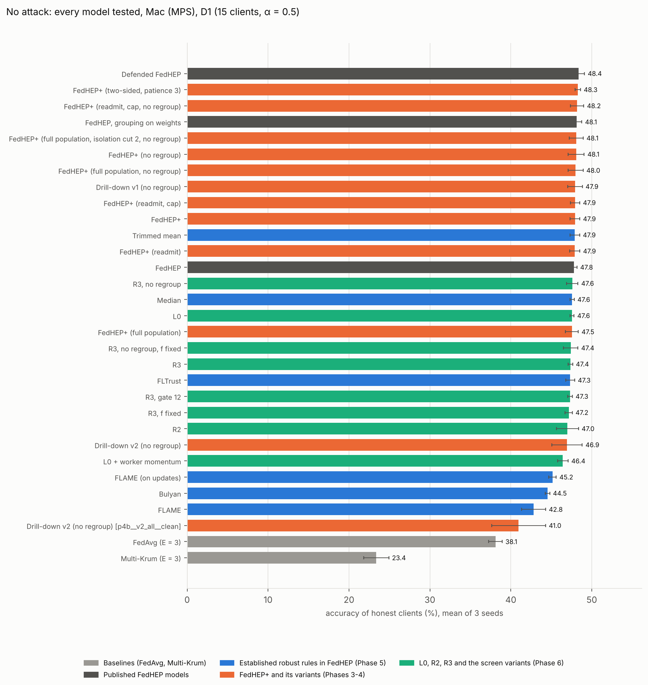

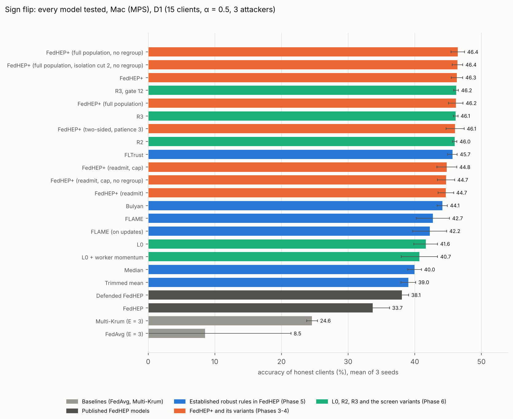

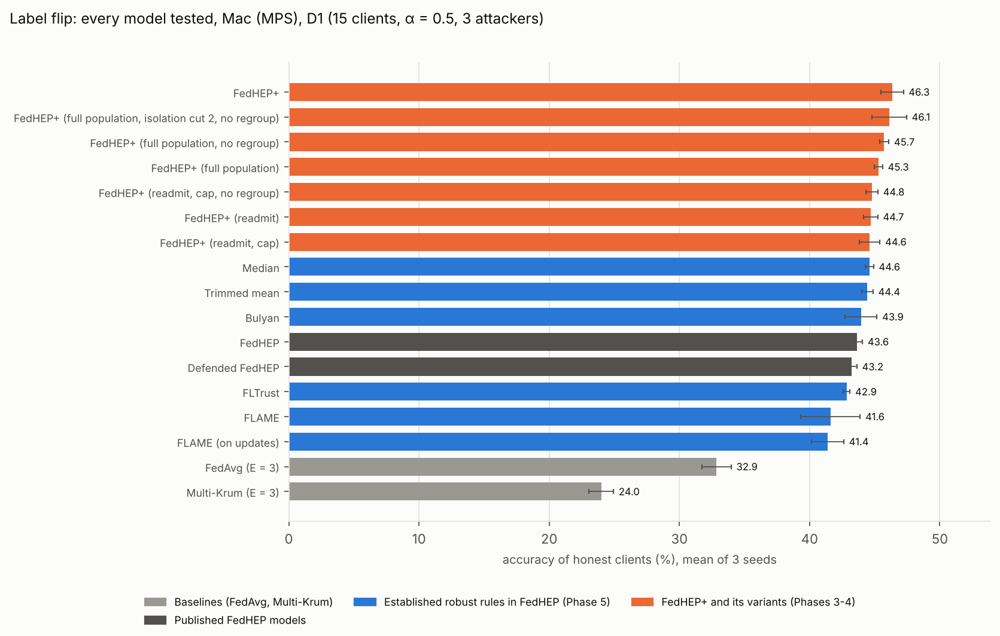

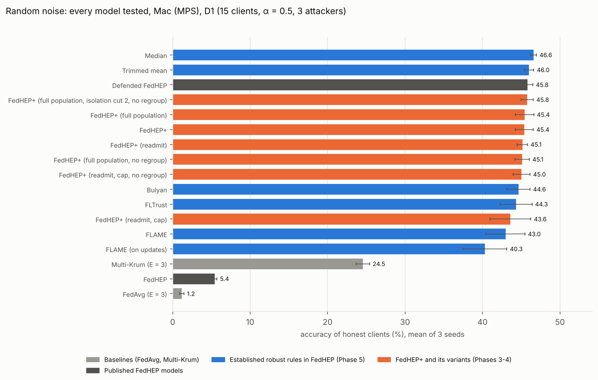

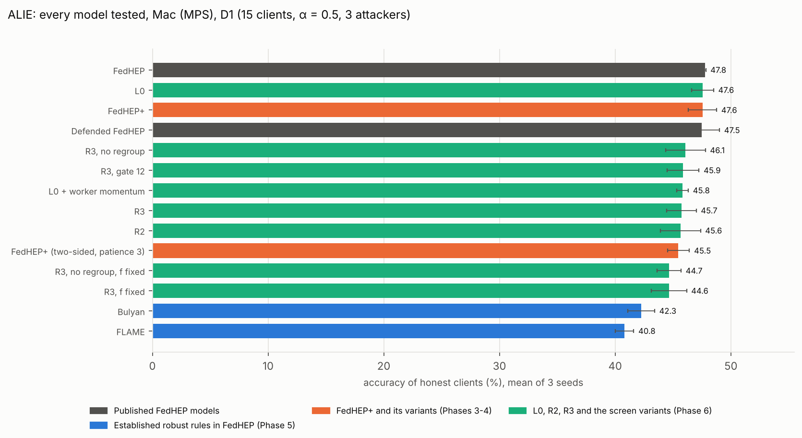

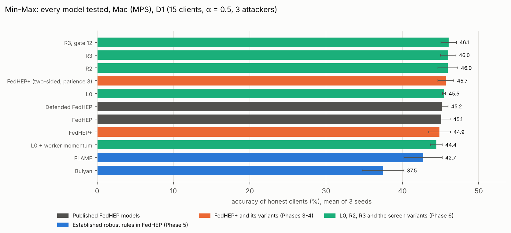

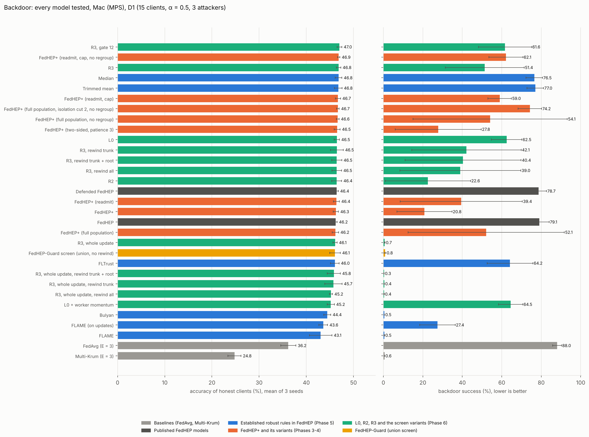

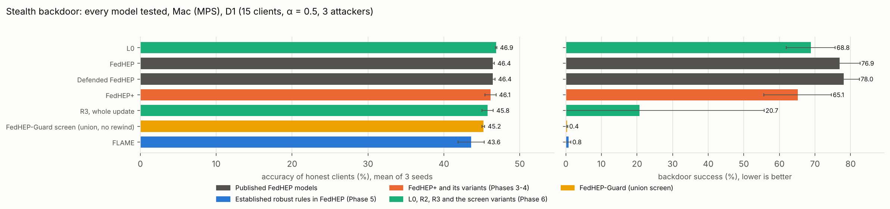

### GPU server (CUDA)

| Attack | Chart | Models | Best accuracy | Note |
|---|---|---|---|---|
| No attack | `figures/all_models_gpu_clean.png` | 16 | FedHEP 49.2 | R3 and its variants 47.4–48.1; FLAME 43.1 |
| Sign flip | `figures/all_models_gpu_sign_flip.png` | 13 | FedHEP+ 46.3, R3 46.1 | L0 41.6, Defended FedHEP 38.8, FedHEP 33.8 |
| ALIE | `figures/all_models_gpu_alie.png` | 16 | FedHEP+ 47.8 | union screen 45.3; FLAME 41.7 |
| Min-Max | `figures/all_models_gpu_min_max.png` | 12 | R3 with sign alignment 46.4 | FLAME 43.1 |
| Backdoor | `figures/all_models_gpu_backdoor.png` | 12 | Defended FedHEP 47.5 | success under 1%: union screen (0.6%) and FLAME (0.5%) only |

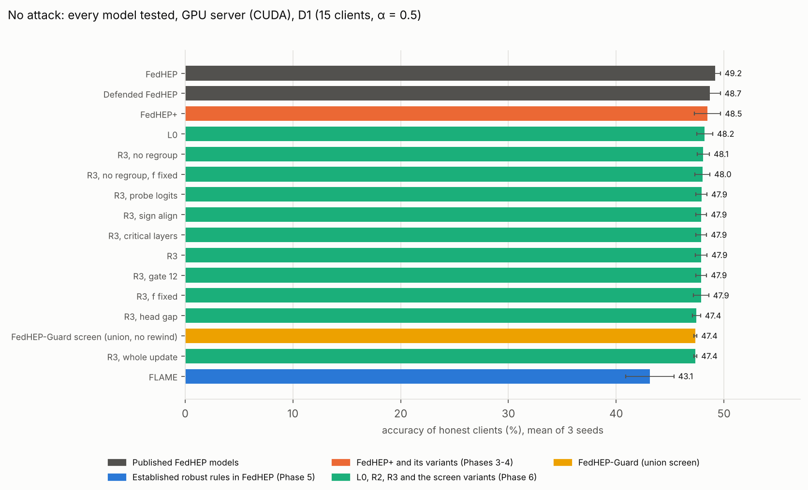

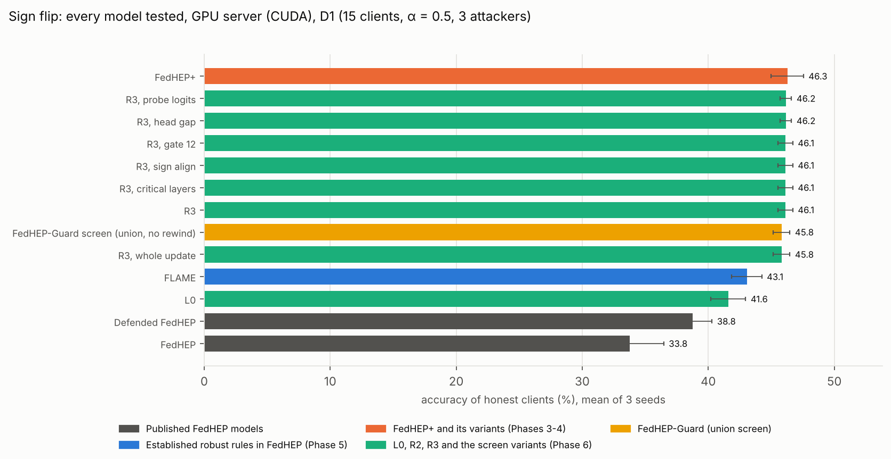

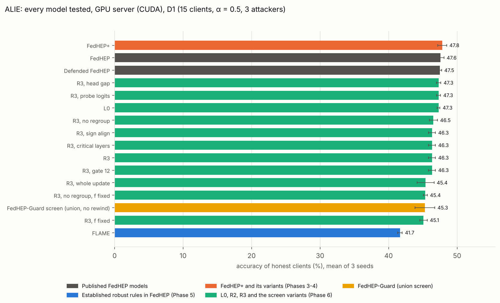

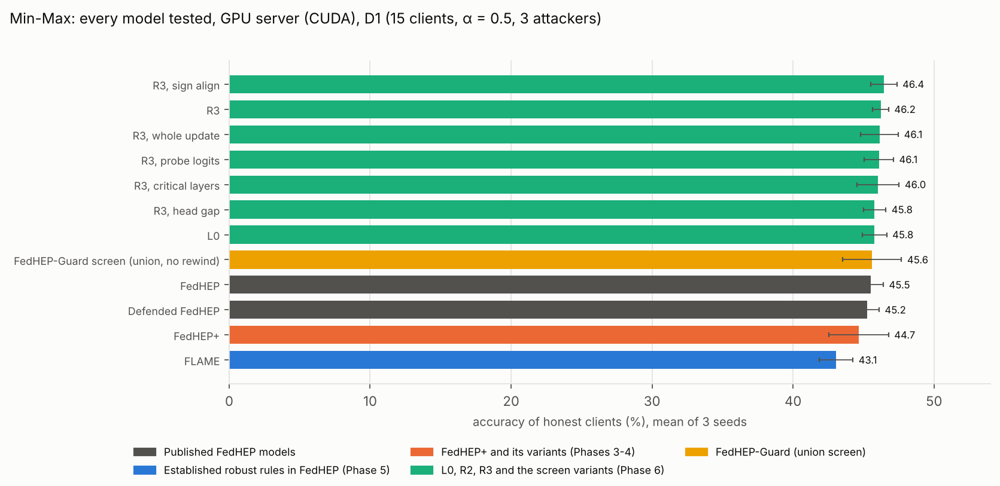

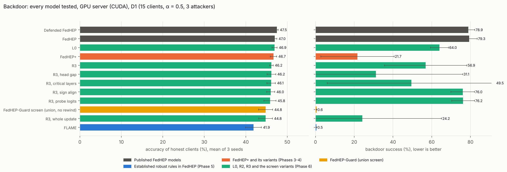

**How to read them together.** No single model is best everywhere:
- The undefended and lightly defended models are the most accurate with no attack and under ALIE, and collapse under sign flip, noise or the backdoor.
- The screens give up 1–2 points with no attack and hold under every attack.
- Only two models stay under 1% backdoor success on both machines, and against the stealth backdoor on the Mac: FedHEP-Guard's union screen and FLAME. The union screen is about 3 points more accurate than FLAME under the backdoor on both machines (46.1 against 43.1 on the Mac, 44.8 against 41.9 on the GPU).

The benchmark (7.3) will replace these charts with one machine, one set of attackers and every model, including D2.
