# 7. FedHEP-Guard: results

Every result of FedHEP-Guard and its rungs, one experiment per section. Each table names its machine; methods are only compared within one machine. Section 7.1 answers the main question: what did FedHEP-Guard fix?

**Which runs are "FedHEP-Guard" here.** The full model (union screen + rewind) has been run only over 100 rounds against the two backdoors, on the Acer (7.3). Elsewhere the closest run is the union screen without the rewind (`r3wc`). The full model under every attack comes with the GPU benchmark (chapter 9).

## 7.1 Scorecard: what FedHEP-Guard fixed from FedHEP+

FedHEP+ left three failures ([chapter 4.6](04_fedhep_plus.md)).

| | FedHEP+ | FedHEP-Guard | Verdict |
|---|---|---|---|
| **1. Honest but unusual clients isolated** (per run, no attack, GPU) | 15 clients: 2.7 (α 0.5), 7.7 (α 0.1). 30 clients: 4.3, 2.3. 50 clients, α 0.1: 1.0. D2: 8.7 | 15 clients: 4.3, **1.7**. 30 clients: 14.7, 7.0. 50 clients, α 0.1: **22.0**. D2: not run (root-head R3: 1.7) | **Not fixed.** Fewer than FedHEP+ only at 15 clients with α = 0.1. In the other four grid settings it isolates more, and the count grows with the number of clients: at 50 clients it isolates 22 of 50 honest clients per run. About half come as whole parent groups (8.2). The root-head R3 does fix it (0.7–6.0), but lets the backdoor in |
| **2. Adaptive attackers not seen** | ALIE and Min-Max: 0 of 9 attackers isolated each (GPU, D1); 0 of 12 each at D2 (GPU); stealth backdoor 56–75% (Mac) | 9 of 9 each (GPU, D1); at D2 both of its signals catch 12 of 12 each (GPU); stealth backdoor 0.2–0.5% (Mac, 30 rounds), 0.4% on 2 of 3 seeds over 100 rounds (Acer) | **Fixed.** Cost under ALIE: 45.3 against FedHEP+'s 47.8 (GPU). Weak ALIE barely hurts, so removing its attackers costs more than leaving them in |
| **3. Backdoors that persist** | all attackers isolated, yet 18 / 5 / 42% stays (GPU, 30 rounds); 21% (Mac); 13.9% after 100 rounds (GPU) | 0.5–0.6% (GPU), 0.8% (Mac); 0.3% on every seed over 100 rounds (Acer); 2.5% over 100 rounds with the whole-update half alone (GPU) | **Fixed at α = 0.5 when the attackers are caught early** (rounds 3–6). **Not fixed** at α = 0.1 (15–31%), with a third of the clients attacking (12% at 15 clients, 5% at 30), or after a late catch (one stealth seed at 34%). At D2 it is untested; there every rung except the whole update leaves 38–46% |
| Accuracy with no attack | 48.48 (GPU) | 47.36 (GPU) | about 1 point lower |
| Worst accuracy under sign flip, ALIE and Min-Max (GPU grid: 15 / 30 clients × α 0.5 / 0.1) | 34.7 / 54.0 / 26.6 / 50.7 | 43.3 / 57.8 / 40.2 / 54.4 | **better in all four** |

**In short:** FedHEP-Guard is an improvement on FedHEP+ against attackers, not yet for honest clients.
- It fixes failure 2 in every setting tested (at D2 through each of its two signals), and failure 3 at α = 0.5. It holds up best when the model is poisoned.
- It does not fix failure 1. The 50-client runs make this clear: with no attack it isolates 22 of 50 honest clients per run, where FedHEP+ isolates 1. An earlier version of this scorecard called failure 1 "fixed under strong skew", from the 15-client setting alone. The 30- and 50-client settings do not support that.
- Honest isolations are the main open problem. The Phase 8 experiment targets the whole-group part of it (chapter 8).

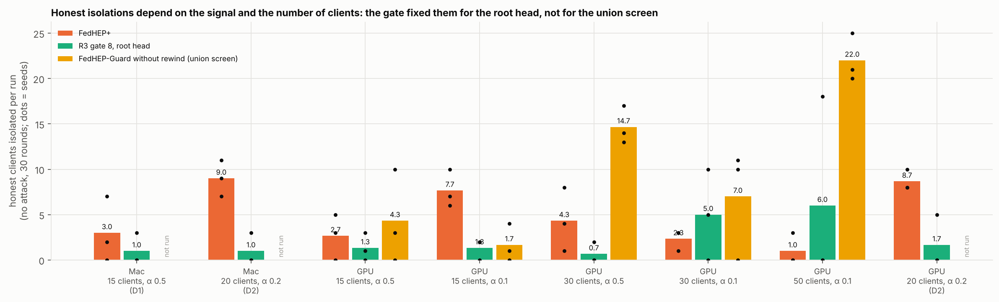

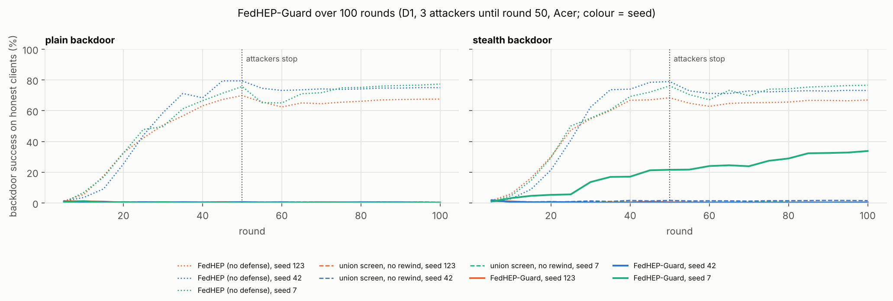

## 7.2 The ladder (Mac, D1 and D2; GPU server, D2)

D1: 15 clients, α = 0.5, 3 attackers. D2: 20 clients, α = 0.2, 4 attackers. Mac, 3 seeds, 30 rounds. R2 = L0 + two-sided screen + patience; R3 = R2 + gap gate. All rungs here use the root-head signal.

**D1:**

| Model | No attack | Sign flip | ALIE | Min-Max | Backdoor success | Honest isolated per run (clean / sign / ALIE / Min-Max) |
|---|---|---|---|---|---|---|
| Defended FedHEP | **48.39** | 38.08 | 47.49 | 45.19 | 78.7% | 0 / 0 / 0 / 0 |
| FedHEP+ | 47.92 | **46.34** | 47.55 | 44.87 | **20.8%** | 3.0 / 1.7 / 2.0 / 1.0 |
| L0 | 47.56 | 41.65 | **47.56** | 45.47 | 62.5% | 0 / 0 / 0 / 0 |
| R2 | 46.99 | 46.00 | 45.65 | 45.96 | 22.6% | 4.3 / 1.7 / 3.0 / 3.7 |
| R3, gate 8 | 47.36 | 46.14 | 45.74 | 46.02 | 51.4% | 1.0 / 0.7 / 0.7 / 0.7 |
| R3, gate 12 | 47.31 | 46.20 | 45.87 | **46.07** | 61.6% | **0.0 / 0.7 / 0.0 / 0.3** |

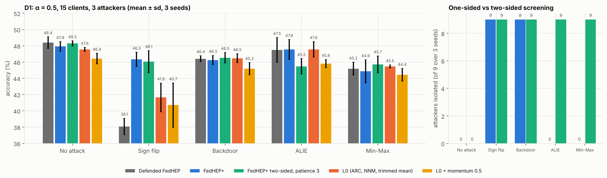

**D2 (held out):**

| Model | No attack | Sign flip | Min-Max | Backdoor success | Honest isolated, 3 seeds (clean / sign / Min-Max / backdoor) |
|---|---|---|---|---|---|
| FedHEP | **55.59** | 42.51 | 52.10 | 46.9% | 0 / 0 / 0 / 0 |
| Defended FedHEP | 54.70 | 50.62 | **54.16** | 44.3% | 0 / 0 / 0 / 0 |
| FedHEP+ | 52.68 | 52.15 | 53.55 | 43.3% | 27 / 21 / 6 / 18 |
| L0 | 54.23 | 50.52 | 52.96 | **37.7%** | 0 / 0 / 0 / 0 |
| R2 | 52.13 | 51.86 | 52.62 | 44.1% | 38 / 29 / 29 / 33 |
| R3, gate 8 | 54.72 | **54.26** | 53.34 | 45.3% | 3 / 6 / 8 / 7 |
| R3, gate 12 | **54.73** | 54.19 | 52.51 | 45.3% | **2 / 1 / 0 / 6** |

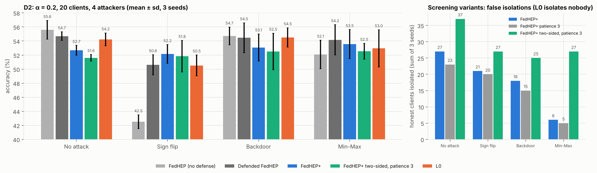

**What the ladder shows:**
- **The gap gate solves FedHEP+'s held-out failure.** At D2, honest isolations with no attack fall from 27 (FedHEP+) and 38 (R2) to 2–3. R3 is the best model under sign flip (+3.6 over Defended FedHEP) and within 1 point of undefended FedHEP with no attack.
- **The two-sided screen catches every ALIE and Min-Max attacker**, where the one-sided screen caught none.
- **But the root-head signal with the gate lets the backdoor in** (51–62% at D1). That led to the signal search ([chapter 5.3](05_ideas_that_did_not_work.md)), the union screen [1] and the rewind [6].

**D2 on the GPU server (`gpu_c4_d2`).** The same ladder, plus the two signals that make up FedHEP-Guard's union screen, each on its own: the whole update and the critical layers. The union screen itself and the full model were not in this batch; they come with the benchmark (chapter 9). CUDA, 3 seeds, 30 rounds.

| Model | No attack | Sign flip | ALIE | Min-Max | Backdoor success, seeds 123 / 42 / 7 | Honest isolated per run, no attack | Attackers caught, ALIE / Min-Max (of 12 each) |
|---|---|---|---|---|---|---|---|
| FedHEP | **54.48** | 42.99 | 55.09 | 52.42 | 47 / 46 / 46% | 0 | 0 / 0 |
| Defended FedHEP | 53.81 | 50.28 | **55.37** | 54.39 | 48 / 42 / 41% | 0 | 0 / 4 |
| FedHEP+ | 52.73 | 52.04 | 55.18 | 53.97 | 46 / 38 / 44% | 8.7 | 0 / 0 |
| L0 | 53.77 | 49.71 | 55.18 | 53.32 | 44 / 36 / 35% | 0 | 0 / 0 |
| R3 gate 8, root head | 54.20 | 53.41 | 54.36 | 53.45 | 47 / 41 / 47% | 1.7 | 9 / 12 |
| R3 gate 12, root head | 54.20 | **53.75** | 55.09 | 52.50 | 47 / 41 / 47% | 1.0 | 2 / 8 |
| R3, whole update | 53.93 | 53.66 | 54.27 | **54.44** | 47 / 40 / **4.7%** | 1.7 | **12 / 12** |
| R3, critical layers | 54.13 | 53.57 | 53.85 | 54.11 | 47 / 41 / 47% | 2.3 | **12 / 12** |

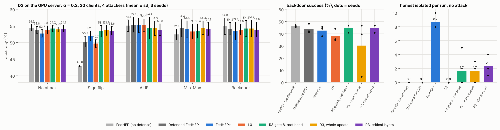

- **The GPU repeats the Mac's D2 result for honest clients.** The gap gate brings FedHEP+'s 8.7 honest isolations per run down to 1.0–1.7, and the two whole-model signals stay at 1.7–2.3. At D2 the whole-model signals do not bring back the honest isolations they cause at 30 and 50 clients (7.6).
- **Adaptive attackers are caught at D2 too.** Both signals of the union screen catch all 12 ALIE and all 12 Min-Max attackers. FedHEP+ catches none.
- **The backdoor is not solved at D2.** Every model stays at 35–48%, except the whole update on one seed (4.7%). At α = 0.2 with 4 attackers, the backdoor attackers look like honest clients to every signal tested. Whether the union screen does better at D2 is the open question for the benchmark.
- **Accuracy hardly moves under attack at D2.** ALIE leaves every model at 54–55%, within 0.6 points of its no-attack accuracy, because strong skew makes the personal heads carry most of the prediction. Only sign flip hurts undefended FedHEP (−11.5 points).

## 7.3 Recovering from a backdoor (Mac, Acer and GPU server)

**30 rounds, attackers plant the backdoor in rounds 1–10, then train honestly (Mac, D1).** Backdoor success at round 30, seeds 123 / 42 / 7:

| Variant | Backdoor success | Attackers caught (of 9) | Accuracy |
|---|---|---|---|
| R3, root head (with or without rewind) | 19 / 3 / 47% | 1 | 46.7–48.1 |
| R3, whole update | 0.5 / 0.5 / 0.9% | 9 (rounds 3–6) | 46.10 |
| R3, whole update + trunk-and-root rewind | 0.2 / 0.4 / 0.3% | 9 | 45.83 |

**100 rounds, attackers plant the backdoor until round 50, then train honestly (Acer, D1).** Backdoor success at round 100:

| Model | Seeds 123 / 42 / 7 | Mean | With exit guard | Accuracy | Honest isolated (3 seeds) |
|---|---|---|---|---|---|
| FedHEP | 69 / 74 / 75 | 72.4 | 38.6 | 43.55 | 0 |
| L0 | 64 / 70 / 71 | 68.3 | 37.6 | 44.38 | 0 |
| FedHEP+ | 2 / 5 / 2 | 3.1 | 2.8 | 43.68 | 24 |
| R3, root head | 23 / 71 / 21 | 38.4 | 22.9 | 43.63 | 1 |
| R3, root head + rewind | 8 / 28 / 15 | 17.1 | 11.2 | 42.54 | 2 |
| R3, whole update | 1 / 17 / 1 | 6.2 | 4.5 | 42.19 | 18 |
| **R3, whole update + rewind** | **0 / 1 / 0** | **0.6** | 0.6 | 41.81 | 12 |

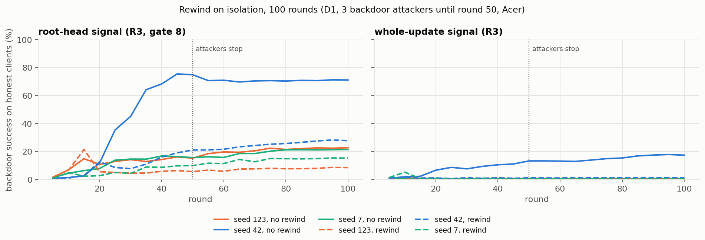

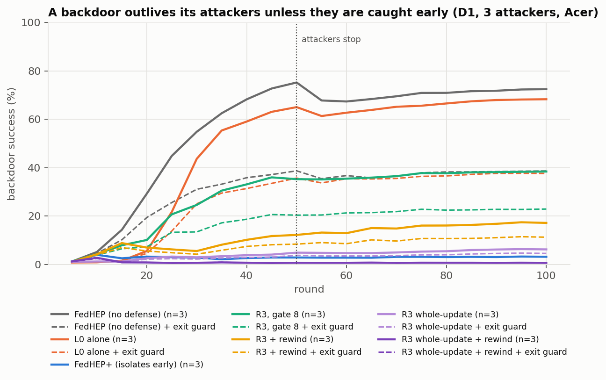

- **A backdoor nobody catches stays at 64–75%** for 50 rounds after the attack ends.
- **The rewind matters when the catch is late.** On seed 42 the whole-update screen isolated the attackers after part of the backdoor had reached the trunk, and it grew to 17% after they stopped. With the rewind, the same seed stayed at 1%. It costs 0.4 points on average.
- **Why seed 42 is different.** Seed 42 draws attackers 0, 9 and 11. It is the hard seed for every signal and machine: 70–71% for the root head and the whole update on the GPU too (chapter 5.3).
  - **The attackers stay hidden for 15 rounds.** With the root head, their z stays between −2.2 and +1.1 for the first 15 rounds, and no round's gap ratio reaches 8 before round 16. On seeds 123 and 7 their z falls below −2 by rounds 6–10, and they are isolated in rounds 13–14. Their data sizes (540–705 images) are ordinary (honest clients: 470–873).
  - **When they are caught:** without the rewind, attackers 9 and 11 are isolated only in round 40 and attacker 0 never. By then the backdoor is at 70%, and nothing removes it after the attack stops: the flat 71% line.
  - **With the rewind:** this is a separate run, and XPU runs are not bit-for-bit repeatable, so the two runs part ways early. Here the attackers are caught in rounds 21–24 and the model is rewound to rounds 19–22. Success drops from 13% to 8%, but the rewind reaches back only as far as the attackers' evidence trail (at most 10 rounds). The poisoning from rounds 1–18 stays in, and it grows back to 28% by round 100, as a backdoor does once it is in (chapter 4.5e).
  - **The whole-update screen catches them earlier,** in rounds 12–17. With the rewind, seed 42 then stays at 1%.
- **Honest isolations are the price of the whole-update signal.** Over 100 rounds the root-head screens isolate 1–2 honest clients in 3 runs, the whole-update screens 12–18, or 4–6 per run. FedHEP-Guard's union screen contains the whole-update signal, so it pays the same price (7.6, 8.1). The gap gate removed FedHEP+'s honest isolations for the root-head signal (7.2). It has not done so for the signals that catch the backdoor.

**The same experiments on the GPU server (`gpu_c5_recovery`, `gpu_c6_durability`).** These repeat the Mac's recovery runs and the Acer's 100-round runs with the two single signals; the union screen was not in these batches.

*30 rounds, backdoor in every round (D1, 3 attackers).* Backdoor success at round 30, seeds 123 / 42 / 7:

| Signal | No rewind (`g1__`) | Rewind trunk | Rewind trunk + root head | Rewind everything |
|---|---|---|---|---|
| R3, root head | 32 / 70 / 68% | 21 / 64 / 51% | 18 / 63 / 47% | 18 / 63 / 47% |
| R3, whole update | 0.6 / 71 / 0.6% | 0.5 / 71 / 0.4% | 0.4 / 71 / 0.5% | 0.2 / 71 / 0.4% |

- **For the whole update the rewind changes nothing in 30 rounds.** It catches the attackers in rounds 3–4, before anything has to be undone, or not at all (seed 42).
- **For the root head the rewind lowers success from 57% to 42–45%** on average, but not below 15%: the attackers are caught in rounds 12–21, and part of the backdoor is older than the rewind's reach (prediction P8, not met here either).
- **With the attack stopped after round 10**, the whole update ends at 0.2 / 2.7 / 0.4%, and the root head at 27 / 2.7 / 56% with any rewind. On seed 42 the backdoor faded on its own, with nobody caught.

*100 rounds, attackers until round 50 (D1, 3 attackers).* Backdoor success at round 100:

| Model | Seeds 123 / 42 / 7 | Mean | With exit guard | Accuracy | Honest isolated (3 runs) | Attackers caught in round |
|---|---|---|---|---|---|---|
| FedHEP | 68 / 72 / 78 | 72.9 | 40.4 | 43.93 | 0 | never |
| L0 | 64 / 64 / 75 | 67.7 | 37.1 | 44.55 | 0 | never |
| FedHEP+ | 1.6 / 11 / 29 | 13.9 | 8.9 | **44.63** | 25 | 8–14 |
| R3, root head | 7 / 71 / 49 | 42.3 | 23.8 | 43.33 | 1 | 12–20; one never |
| R3, root head + rewind | 4 / 70 / 34 | 36.1 | 22.2 | 43.54 | 0 | 12–20; one never |
| R3, whole update | 0.5 / 52 / 0.7 | 17.8 | 9.2 | 42.87 | 15 | 3–4; seed 42: one in round 42, two never |
| **R3, whole update + rewind** | **0.6 / 6.5 / 0.5** | **2.5** | **2.2** | 42.19 | 11 | 3–4; seed 42: all in round 20 |

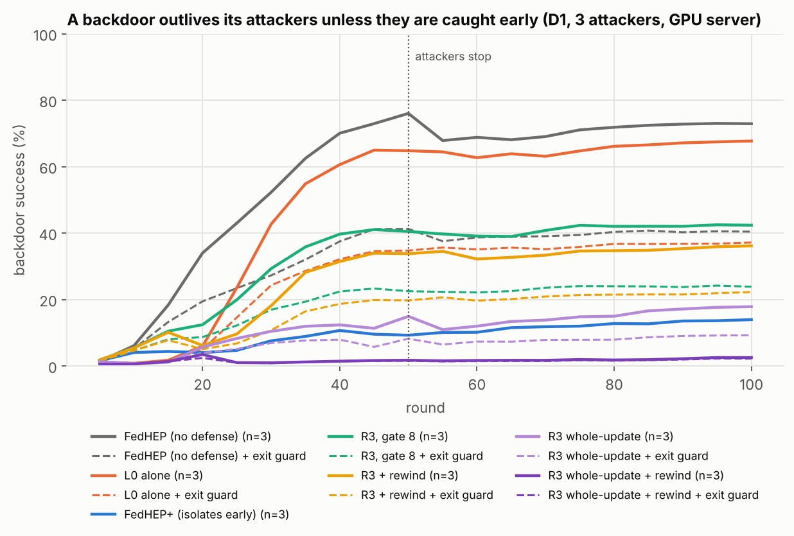

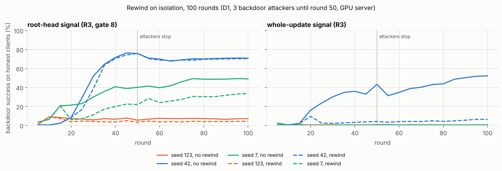

- **The GPU confirms the Acer's ranking.** A backdoor nobody catches stays at 64–78%. The whole update with the rewind is lowest (2.5%; 0.6% on the Acer), and the rewind matters most on the seed where the catch is late.
- **Seed 42 needs care.** GPU runs are repeatable, so the whole-update runs with and without rewind are identical until the first rewind, which an honest isolation triggered. After that they part ways: the rewind run caught all three attackers in round 20, the other run caught one, in round 42. The rewind changed the run's path; whether it reliably leads to an earlier catch cannot be told from one seed.
- **FedHEP+ holds the backdoor to 13.9% here, against 3.1% on the Acer.** It catches every attacker, but in rounds 8–14, later than the whole update, and pays 25 honest isolations in 3 runs.
- The union screen and the full FedHEP-Guard have not yet run over 100 rounds on the GPU (only on the Acer, below).

**FedHEP-Guard itself over 100 rounds (Acer, `acer_c9_final_durability`).** These are the first runs of the full model (union screen + trunk-and-root rewind), in the same setting: 3 attackers until round 50. Backdoor success at round 100, seeds 123 / 42 / 7:

| Model | Plain backdoor | Stealth backdoor | With exit guard (plain / stealth, mean) | Accuracy (plain / stealth) | Honest isolated (3 runs, plain / stealth) |
|---|---|---|---|---|---|
| FedHEP (no defense) | 67 / 75 / 77% | 67 / 73 / 77% | 41.7 / 37.6% | 43.06 / 43.51 | 0 / 0 |
| Union screen, no rewind | 0.3 / 0.4 / 0.6% | 0.5 / 1.6 / 0.4% | 0.4 / 0.8% | 43.47 / 42.30 | 8 / 16 |
| **FedHEP-Guard** | **0.3 / 0.3 / 0.3%** | 0.4 / 0.4 / **33.8%** | 0.3 / 6.3% | 41.66 / 43.96 | 18 / 10 |

- **The plain backdoor is held on every seed for 100 rounds,** including seed 42, which beat the root-head and whole-update screens (above). The union screen isolates seed 42's attackers in rounds 3–4, against round 40 for the root head and rounds 12–17 for the whole update.
- **One stealth seed got through FedHEP-Guard.**
  - On seed 7 the attackers were isolated late, in rounds 15–18. The rewinds reached back only to rounds 15–16, so the poisoning from rounds 1–14 stayed in. It grew from 22% at round 50 to 33.8% at round 100 (17.9% with the exit guard).
  - In the run without rewind, the same seed's attackers were caught in round 6 and success stayed at 0.4%. XPU runs are not repeatable bit for bit, so the two runs part ways early.
  - In the FedHEP-Guard run, an honest pair was isolated in round 7 and the model rewound to round 5. Whether that delayed the catch cannot be told from one run.
  - **What it shows:** the rewind cannot undo poisoning older than its 10-round reach when the catch is late.
- **Accuracy.** With the plain backdoor, FedHEP-Guard is 1.8 points below the union screen without rewind and 18 honest isolations against 8. With the stealth backdoor it is 1.7 points above, with 10 against 16. These differences track the honest isolations more than the rewind: rewinds triggered by honest isolations discarded only 1–7 rounds per run.
- **Most of these honest isolations are whole parent groups.** Mass isolations of 4–5 honest clients happened in rounds 13–16; the cause is in chapter 8.2.
## 7.4 An adaptive backdoor (Mac, D1)

The stealth backdoor ([chapter 1.4](01_federated_learning.md)) hides inside the honest spread. Backdoor success at round 30, seeds 123 / 42 / 7:

| Model | Plain, 3 attackers | Stealth, 3 attackers | Plain, 5 attackers | Stealth, 5 attackers |
|---|---|---|---|---|
| FedHEP | 74 / 80 / 84 | 71 / 77 / 83 | 75 / 82 / 84 | 73 / 81 / 84 |
| Defended FedHEP | 74 / 80 / 82 | 73 / 80 / 81 | 74 / 81 / 82 | 73 / 81 / 82 |
| L0 | 54 / 66 / 68 | 61 / 70 / 75 | 69 / 77 / 79 | 69 / 79 / 80 |
| FedHEP+ | 5 / 29 / 29 | 56 / 75 / 65 | 40 / 64 / 65 | 71 / 79 / 80 |
| R3, whole update | 0.5 / 0.5 / 0.9 | 0.2 / **61** / 0.9 | 20 / 4.4 / 3.8 | 2.9 / 9.5 / 3.0 |
| **R3, union screen** | 0.5 / 0.5 / 1.4 | **0.2 / 0.5 / 0.4** | 20 / 4.0 / 0.7 | 2.9 / 9.5 / 1.7 |
| FLAME | 0.6 / 0.4 / 0.5 | 1.5 / 0.4 / 0.4 | 0.4 / 0.6 / 0.4 | 1.7 / 3.0 / 1.8 |

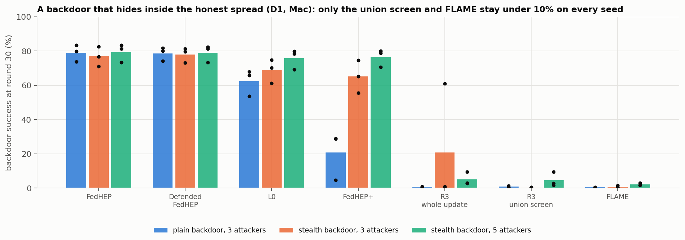

- Hiding costs the attacker almost nothing: undefended, it still reaches 71–83%.
- It defeats single-view screens: FedHEP+, and the whole-update screen on one seed.
- **The union screen catches every stealth attacker on every seed.** The price is more honest isolations (14 over 3 runs, against 9) and 1.2 points against undefended FedHEP.
- **With 5 attackers (a third of the clients)** both R3 screens catch all 15 attackers, plain or stealth, but on one seed the plain backdoor gets in first (20%). FLAME holds under 1% at about 3 points of accuracy.

## 7.5 A wrong guess of the attacker count (Acer, D1)

The defender assumes $f_0$ = 1, 3 (true) or 6 while 3 attack. Accuracy, or backdoor success where stated:

| Attack | L0, $f_0$ = 1 / 3 / 6 | R3 union, $f_0$ = 1 / 3 / 6 |
|---|---|---|
| None | 48.10 / 47.43 / 47.56 | 46.07 / 46.82 / 45.64 |
| Sign flip | **35.73** / 40.73 / 41.89 | 44.35 / 45.28 / 43.77 |
| ALIE | 47.75 / 47.53 / 46.19 | 44.50 / 44.09 / 44.93 |
| Backdoor success | 70–78% / 60–69% / 58–62% | 0.5–0.6% / 0.4–0.5% / 0.4–1.5% |

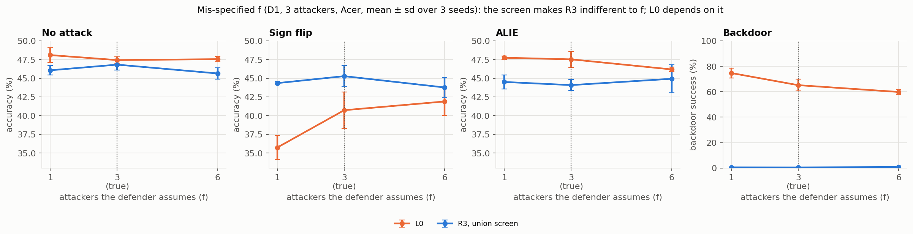

The screen makes R3 almost indifferent to $f_0$: every attacker is caught under every attack and every guess. L0 depends on the guess under sign flip.

## 7.6 At scale (GPU server)

The large grid (`gpu_grid_n{15,30,50}`, 1,872 runs) repeats 8 models at 15, 30 and 50 clients, α = 0.5 and 0.1, with 10, 20 and 30% attackers, 3 seeds, 30 rounds. On 2026-11-23, 1,308 runs were finished: the 15- and 30-client parts complete, and the 50-client, α = 0.1 part with no attack and with 5 sign-flip attackers. The rest of the 50-client part is running. Its FedHEP-Guard column is the **screen without the rewind** (R3 + union screen); the rewind arrives with the canonical benchmark.

**The 15-client, α = 0.5, 3-attacker cell repeats GPU batch 1** under new names, and its whole-update runs give the same backdoor numbers (0.6 / 71.4 / 0.6%): the GPU server reproduces itself across jobs.

**Summary per setting.** Columns:
- *Worst under poisoning*: the lowest accuracy over sign flip, ALIE and Min-Max at all three attacker shares.
- *Backdoor*: success at 10 / 20 / 30% attackers.
- *Honest isolated*: per run, with no attack.

| Setting | Model | No attack | Worst under poisoning | Backdoor | Honest isolated |
|---|---|---|---|---|---|
| 15 clients, α = 0.5 | FedHEP | 49.19 | 24.1 | 70 / 79 / 80% | 0 |
| | Defended FedHEP | 48.68 | 32.1 | 72 / 79 / 80% | 0 |
| | FedHEP+ | 48.48 | 34.7 | 2.0 / 22 / 58% | 2.7 |
| | L0 | 48.21 | 37.0 | 40 / 64 / 76% | 0 |
| | R3 (root head) | 47.89 | **44.6** | 14 / 57 / 71% | 1.3 |
| | **FedHEP-Guard screen** | 47.36 | 43.3 | **0.4 / 0.6 / 12%** | 4.3 |
| | FLAME | 43.12 | 38.8 | 0.4 / 0.5 / 0.4% | 0 |
| 15 clients, α = 0.1 | FedHEP | 61.09 | 29.6 | 20 / 30 / 32% | 0 |
| | Defended FedHEP | 60.76 | 46.4 | 21 / 25 / 26% | 0 |
| | FedHEP+ | 59.93 | 54.0 | 22 / 29 / 29% | 7.7 |
| | L0 | 60.32 | 52.5 | 19 / 23 / 23% | 0 |
| | R3 (root head) | 60.43 | 29.9 | 18 / 28 / 32% | 1.3 |
| | **FedHEP-Guard screen** | 60.21 | **57.8** | 15 / 20 / 31% | 1.7 |
| | FLAME | 49.76 | 46.5 | **0.8 / 1.0 / 3.4%** | 0 |
| 30 clients, α = 0.5 | FedHEP | 45.22 | 22.8 | 63 / 73 / 74% | 0 |
| | Defended FedHEP | 44.28 | 25.7 | 62 / 72 / 74% | 0 |
| | FedHEP+ | 44.41 | 26.6 | 22 / 58 / 67% | 4.3 |
| | L0 | 44.69 | 36.6 | 17 / 61 / 68% | 0 |
| | R3 (root head) | 44.34 | 39.5 | 34 / 61 / 69% | 0.7 |
| | **FedHEP-Guard screen** | 43.30 | **40.2** | **0.5 / 0.9 / 5.3%** | **14.7** |
| | FLAME | 38.29 | 30.1 | 0.5 / 0.5 / 0.7% | 0 |
| 30 clients, α = 0.1 | FedHEP | 56.13 | 41.0 | 16 / 23 / 27% | 0 |
| | Defended FedHEP | 55.62 | 47.5 | 13 / 21 / 24% | 0 |
| | FedHEP+ | 55.64 | 50.7 | 16 / 21 / 25% | 2.3 |
| | L0 | 55.11 | 49.0 | 6.0 / 19 / 23% | 0 |
| | R3 (root head) | 55.29 | 40.3 | 15 / 23 / 25% | 5.0 |
| | **FedHEP-Guard screen** | 55.36 | **54.4** | 1.0 / 17 / 25% | 7.0 |
| | FLAME | 45.01 | 39.3 | **0.6 / 1.9 / 3.5%** | 0 |

**50 clients, α = 0.1 (partial).** Only the no-attack and 5-attacker sign-flip cells are complete, so there is no worst case or backdoor column yet:

| Model | No attack | Sign flip, 5 attackers | Honest isolated per run, no attack |
|---|---|---|---|
| FedHEP | **50.64** | 46.52 | 0 |
| Defended FedHEP | 49.37 | 47.87 | 0 |
| FedHEP+ | 49.68 | **48.10** | 1.0 |
| L0 | 49.28 | 47.27 | 0 |
| R3 (root head) | 49.54 | 47.80 | 6.0 |
| R3, whole update | 49.41 | 47.82 | 16.7 |
| **FedHEP-Guard screen** | 49.08 | 47.42 | **22.0** |
| FLAME | 39.92 | 39.39 | 0 |

**What the grid shows:**
- **The most robust model against model poisoning.** FedHEP-Guard's screen has the best worst-case accuracy in three of four settings. In the fourth it is 1.3 points behind R3. It never collapses: its worst case stays within 1–4 points of its no-attack accuracy. R3 with the root-head signal falls to 29.9 and 40.3 at α = 0.1.
- **The best backdoor defense short of FLAME at α = 0.5.** With 10 and 20% attackers it holds the backdoor under 1%. With 30% it lets through 12% at 15 clients and 5.3% at 30 clients (1.2 / 11 / 3.5% by seed; all 9 attackers caught by rounds 3–8). FLAME stops every backdoor in every setting, but costs 6–11 points with no attack and has a lower worst case.
- **At α = 0.1 the backdoor is not solved.** The screen lets through up to 31%; only FLAME holds. Strong skew makes honest clients as different from each other as attackers are.
- **Honest isolations grow with the number of clients, under both skews.** Per run with no attack: 4.3 at 15 clients and 14.7 at 30 (α = 0.5); 1.7, 7.0 and **22.0** at 15, 30 and 50 clients (α = 0.1). At 50 clients that is 44% of the clients, against FedHEP+'s 1.0. Accuracy hardly suffers (49.08 against 49.68), because isolated clients keep training on their own and keep their personal heads. It is still wrong to blame them, and it would make the detection numbers of a paper meaningless. The charts below show when it happens.

**In which rounds honest clients are isolated.** Cumulative honest clients isolated per round, mean of 3 runs, at the middle attacker share. Where the green line hides the orange one, the whole-update screen and the union screen isolated the same clients.

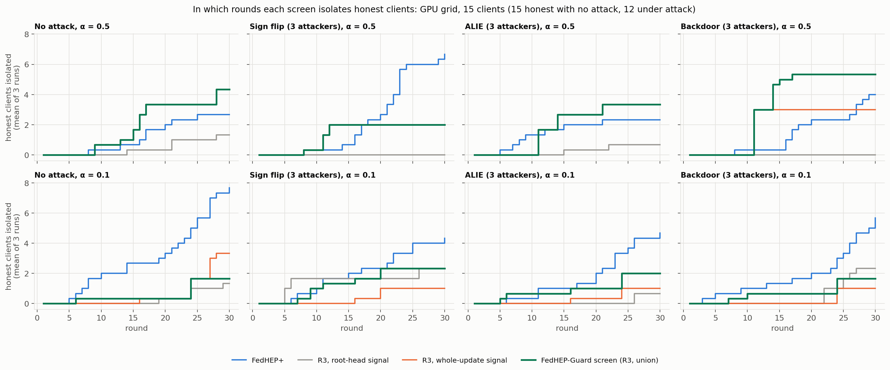

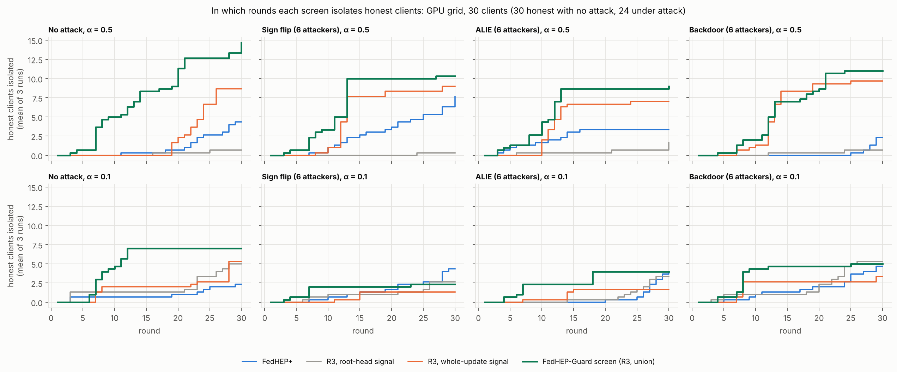

Why honest isolations grow with the number of clients, and why a larger gate would not fix it, is in chapter 8.2.

## 7.7 Every model tested so far, one chart per attack

Before the benchmark runs, the runs already made give one chart per attack and machine. Each chart holds every model ever run in setting D1 on that machine. Machines are never mixed (chapter 1.3), so the Mac and the GPU server each get their own set.

**What is included:**
- Setting D1: 15 clients, α = 0.5, 10,000 training images, 30 rounds. Under attack, exactly 3 attackers, placed at random, with no boost and no stop.
- Only models with all three seeds (42, 123, 7). The bar is the mean, the line ±1 standard deviation.
- **Models are identified by their training configuration**, so a model run in two studies appears once. Evaluation-only switches such as the exit guard do not count.
- FedAvg and Multi-Krum use the authors' 3 local epochs (E = 3); every FedHEP-family model uses 5.
- **Colours are model families:** grey baselines, dark grey the published FedHEP models, blue the established robust rules (Phase 5), orange FedHEP+ and its variants (Phases 3–4), green L0, R2, R3 and their variants (Phase 6), yellow FedHEP-Guard's union screen.
- The Acer's 30-round D1 runs hold only L0 and the union screen with different $f$ (chapter 7.5), so it has no charts here.

The charts are made by `python scripts/plot_all_models.py outputs`, which also writes the numbers to `docs/results/all_models.json`.

### Mac (MPS)

FedHEP-Guard itself (union screen **and** rewind) has not been run yet; its first runs are the benchmark (`bm_*__guard`) and the Acer's `x9__` sweep. The charts therefore mark its closest relative, **FedHEP-Guard without rewind** (the union screen, `r3wc`), in bold. "R3 gate 8, root head" is the Phase 6 rung FedHEP-Guard is built on, not FedHEP-Guard (chapter 7.2, 6.8).

| Attack | Chart | Models | Best accuracy | FedHEP-Guard without rewind | Note |
|---|---|---|---|---|---|
| No attack | `figures/all_models_mac_clean.png` | 31 | Defended FedHEP 48.4 | not run on the Mac | the FedHEP family sits within 1.5 points; FLAME 42.8, Multi-Krum 23.4 |
| Sign flip | `figures/all_models_mac_sign_flip.png` | 23 | FedHEP+ (full population) 46.4; R3 gate 8 and 12, root head, 46.1–46.2 | not run on the Mac | every screen holds; Defended FedHEP 38.1, FedHEP 33.7, FedAvg 8.5 |
| Label flip | `figures/all_models_mac_label_flip.png` | 17 | FedHEP+ 46.3 | not run on the Mac | the FedHEP+ family takes the top 7 places |
| Random noise | `figures/all_models_mac_random_noise.png` | 17 | Median 46.6 | not run on the Mac | FedHEP 5.4 and FedAvg 1.2 collapse |
| ALIE | `figures/all_models_mac_alie.png` | 14 | FedHEP 47.8, L0 47.6, FedHEP+ 47.6 | not run on the Mac | the two-sided screens lose 1.7–3.1 points (the ALIE puzzle, 5.3f); FLAME 40.8 |
| Min-Max | `figures/all_models_mac_min_max.png` | 11 | R3 gate 8 and 12, root head, 46.0–46.1 | not run on the Mac | Bulyan 37.5 |
| Backdoor | `figures/all_models_mac_backdoor.png` | 31 | R3 gate 12, root head, 47.0 (success 62%) | 46.1, rank 21 of 31; success **0.8%** | success under 1%: whole-update screen (with or without rewind), union screen, Bulyan, FLAME, Multi-Krum |
| Stealth backdoor | `figures/all_models_mac_stealth_backdoor.png` | 7 | L0 46.9 (success 69%) | 45.2, rank 6 of 7; success **0.4%** | success under 1%: union screen and FLAME (0.8%) only |

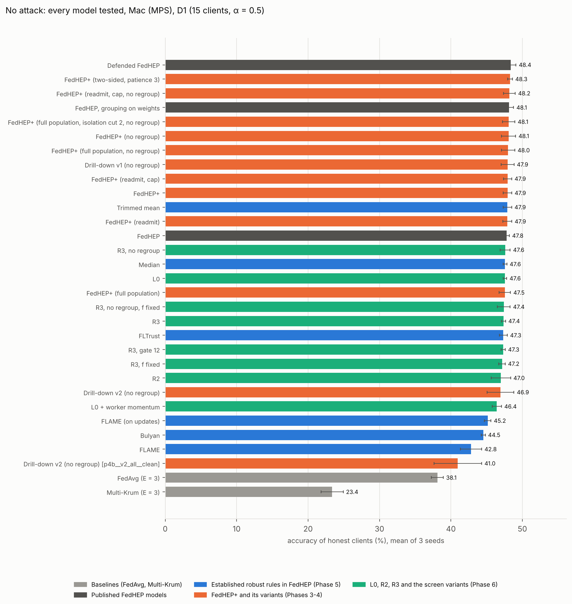

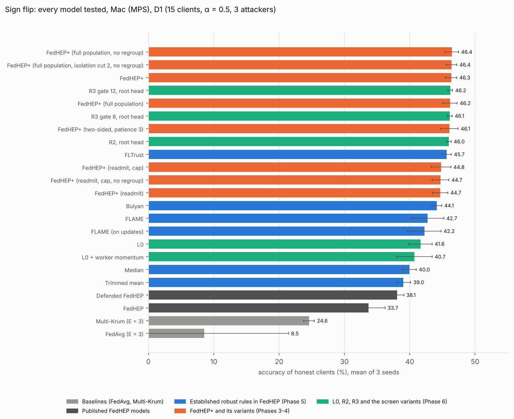

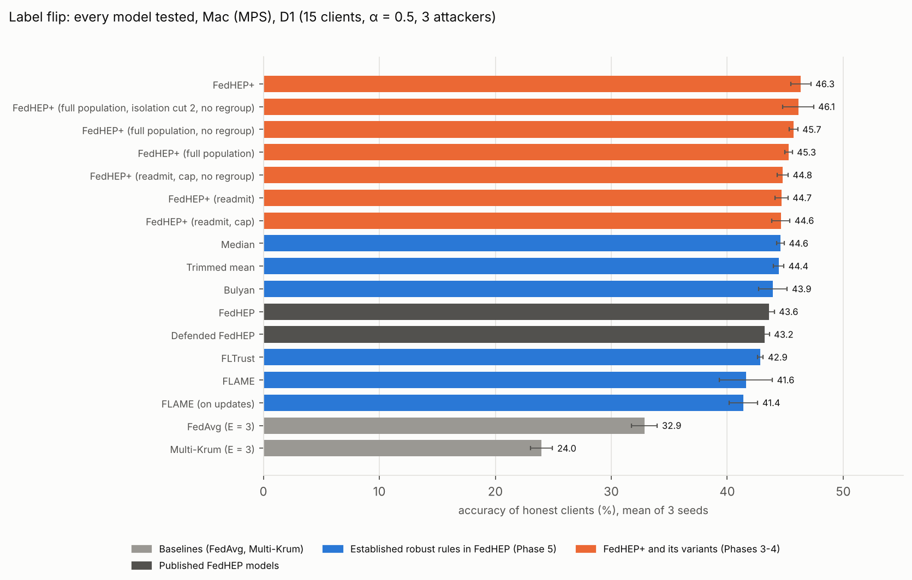

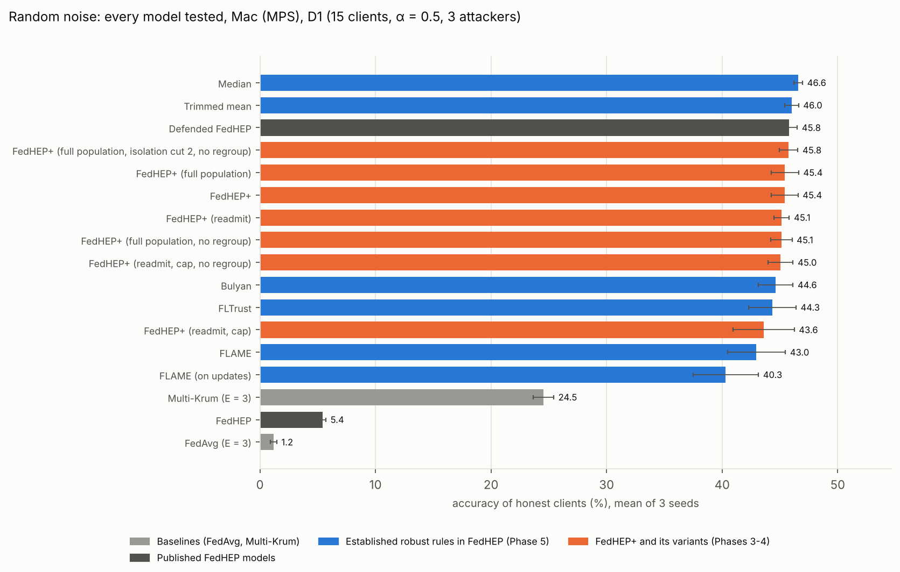

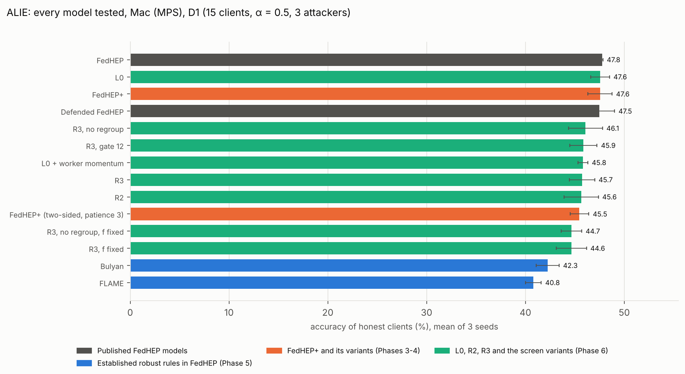

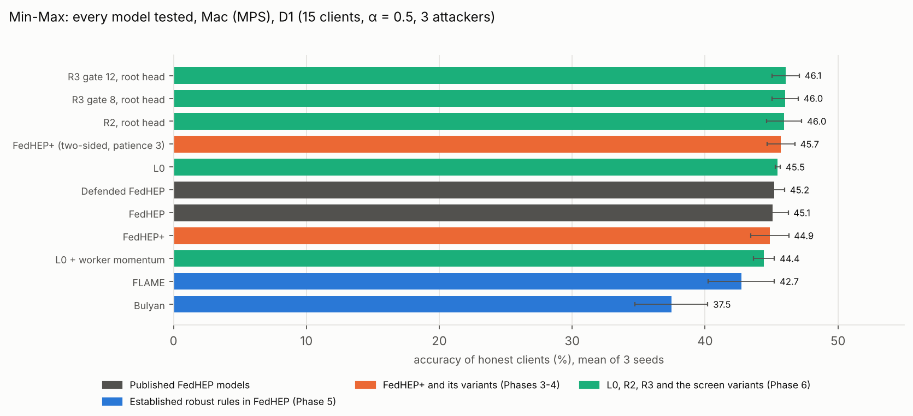

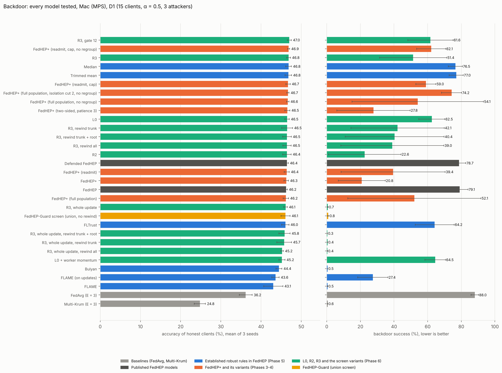

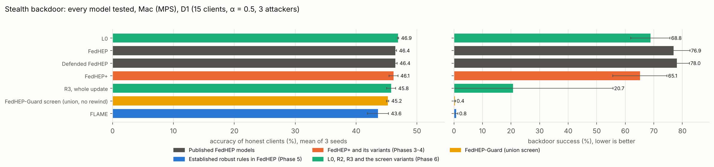

### GPU server (CUDA)

| Attack | Chart | Models | Best accuracy | FedHEP-Guard without rewind | Note |
|---|---|---|---|---|---|
| No attack | `figures/all_models_gpu_clean.png` | 16 | FedHEP 49.2 | 47.4, rank 15 of 16 | R3 and its variants 47.4–48.1; FLAME 43.1 |
| Sign flip | `figures/all_models_gpu_sign_flip.png` | 13 | FedHEP+ 46.3; R3 gate 8, root head, 46.1 | 45.8, rank 9 of 13 | L0 41.6, Defended FedHEP 38.8, FedHEP 33.8 |
| ALIE | `figures/all_models_gpu_alie.png` | 16 | FedHEP+ 47.8 | 45.3, rank 14 of 16 | FLAME 41.7 |
| Min-Max | `figures/all_models_gpu_min_max.png` | 12 | R3 gate 8, sign alignment, 46.4 | 45.6, rank 8 of 12 | FLAME 43.1 |
| Backdoor | `figures/all_models_gpu_backdoor.png` | 18 | Defended FedHEP 47.5 (success 79%) | 44.8, rank 15 of 18; success **0.6%** | success under 1%: union screen and FLAME (0.5%) only; the six rewind variants (`c5__`) stay at 24–45% |

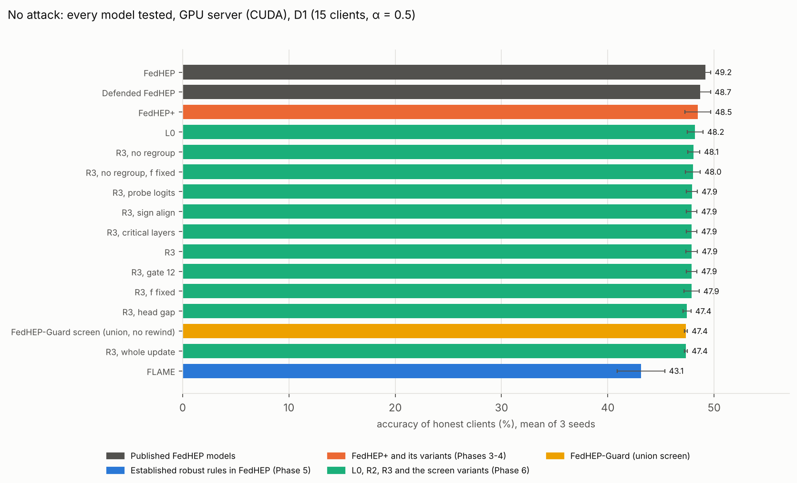

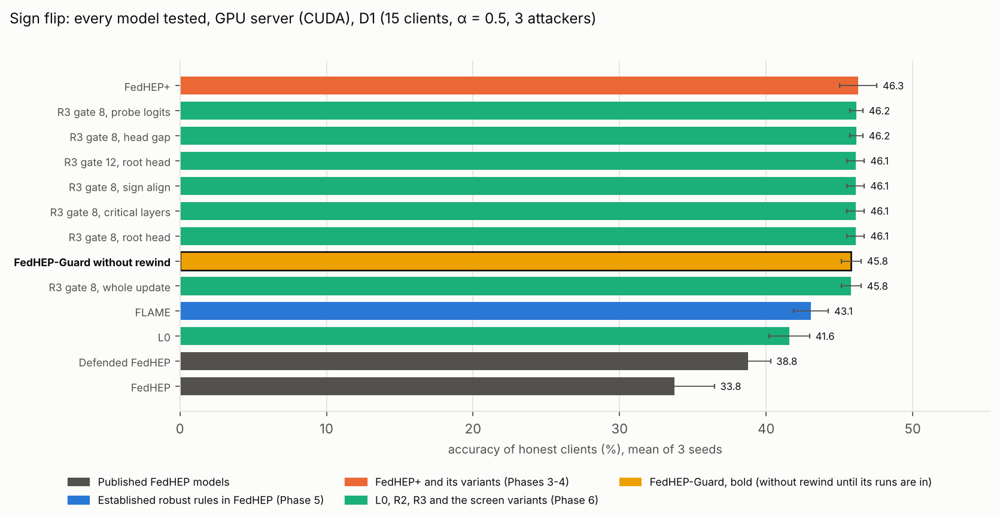

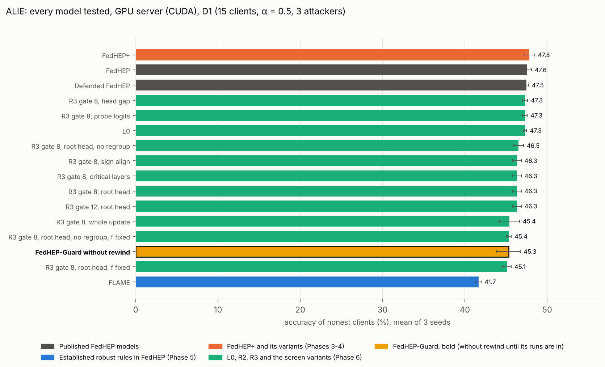

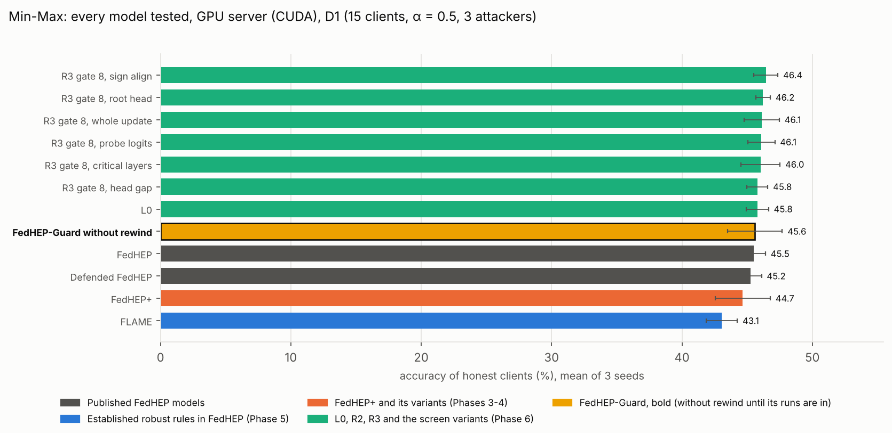

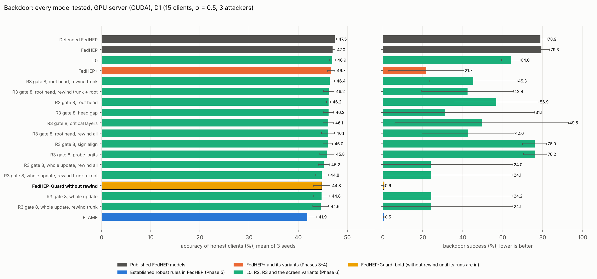

**How to read them together.** No single model is best everywhere:
- The undefended and lightly defended models are the most accurate with no attack and under ALIE, and collapse under sign flip, noise or the backdoor.
- The screens give up 1–2 points with no attack and hold under every attack.
- Only two models stay under 1% backdoor success on both machines, and against the stealth backdoor on the Mac: FedHEP-Guard's union screen and FLAME. The union screen is about 3 points more accurate than FLAME under the backdoor on both machines (46.1 against 43.1 on the Mac, 44.8 against 41.9 on the GPU).

The benchmark (9.3) will replace these charts with one machine, one set of attackers and every model, including D2.
