# 7. Ideas that did not work (Phases 3–8)

Each idea here was a hypothesis with a pass criterion set before the runs. None met its criterion. They are reported in full, each with its formula, diagram, hypothesis, experiment and the reason it failed, because each one explains part of FedHEP+'s and FedHEP-Guard's design ([chapter 4](04_fedhep_plus.md), [chapter 5](05_fedhep_guard.md)).

| Phase | Idea | Why we tried it | What it changed | Why it failed |
|---|---|---|---|---|
| 3 | Readmission | honest clients isolated by mistake should be allowed back | isolated clients are still scored and return when their evidence recovers | attackers recover late in training, honest outliers do not: 26 attackers and 5 honest clients readmitted, backdoor 21% → 39% |
| 3 | The cap | never remove more than a third of the clients | at most 34% left out per round | when reached, it let attackers back in: backdoor 59–62% |
| 3 | Full-population yardstick | the cascade was thought to come from a shrinking yardstick | median and MAD over every client not banned | the premise was wrong (the spread grows); more honest isolations, backdoor 52–54% |
| 4 | Drill-down v1 | FedHEP+ still let 21% of the backdoor through; attackers pushing one direction should stand out more **together** than alone (in a synthetic test, 3 backdoor attackers each looked normal, z > −0.4, while their group scored −2.5 to −4.3) | flagged groups' members face a stricter cut | one-round exclusion hid the backdoor attackers: backdoor 21.5% → 39.7% |
| 4b | Drill-down v2 | v1 failed because a one-round exclusion hides the attacker; evidence that builds over rounds does not | flagged groups' members gain evidence if they share the group's direction | members of a FedHEP group are genuinely alike: honest groups isolated together (−1.1 to −1.7 points) |
| 5 | Classic robust rules at FedHEP's Global step | before inventing a defense, check whether a published one already fixes FedHEP+'s weak spots | Median, Trimmed mean, Bulyan, FLAME, FLTrust | none beats FedHEP+ overall; Bulyan and FLAME stop the backdoor but cost 3.9–5.6 points with no attack |
| 6 | Worker momentum under L0 | the robust-learning literature shows that averaging each client's updates over rounds shrinks the noise attackers hide in | each client's update averaged over rounds before aggregation | worse in every setting |
| 6 | Output-space and sign signals | a backdoor might show in what the model predicts (probe images) or in the sign pattern of the update (AlignIns), where a cosine might miss it | probe logits, head gap, sign alignment | miss the backdoor or the sign flippers |
| 6 | Head-agreement inference | personal heads are trained only on the client's own clean data, so they might not carry the backdoor | personal heads overrule the ensemble when they agree against it | removes only 1–13 points of backdoor success on average: the parent head carries it too |
| 6 | Holding f fixed | R3 lost 1.8 points under ALIE; lowering $f$ after exclusions might let ALIE back into the trimmed mean | L0 keeps assuming $f$ attackers after the screen removed them | −1.1 points under ALIE: it made things worse |
| 6 | Rewinding every shared weight | the personal heads might also hold part of the backdoor | rewind personal heads too | costs 0.6 points against rewinding the trunk and root head, for no gain |
| 7 | Peer reference | an honest client with unusual classes looks like an attacker against one global median; BoBa compares clients only with similar ones | each client scored against the median of the third of clients with the most similar class sets | separated attackers worse at α 0.1, and doubled honest isolations at α 0.5; one α 0.5 seed let 44% of the backdoor in |
| 8 | Shared signal | whole-group honest isolations come from the shared parent head | FedHEP-Guard's whole-update signal without the personal heads | it cut honest isolations by three quarters, but the heads also carry part of the backdoor: one seed in three let it through (78–80%) |

## 7.1 Phase 3: variants of FedHEP+

Three changes were tested against FedHEP+ on the same seeds (D1, 3 attackers, Mac). Each answered a worry about FedHEP+. None was kept. The table gives the results; the subsections explain each change, why we tried it and why it failed.

| Model (chart label) | Config | No attack | Sign flip | Label flip | Noise | Backdoor success | Honest clients ever isolated (15 runs) |
|---|---|---|---|---|---|---|---|
| **FedHEP+** (z + median + regroup) | — | 47.92 | **46.34** | **46.34** | 45.41 | **20.8%** | 46 |
| + readmission | `plus.readmit: true` | 47.91 | 44.67 | 44.69 | 45.14 | 39.4% | 54 |
| + readmission + cap, no regrouping | `readmit`, `max_excluded: 0.34`, `regroup: false` | 48.19 | 44.71 | 44.78 | 45.05 | 62.1% | 69 |
| + readmission + cap | `readmit`, `max_excluded: 0.34` | 47.93 | 44.81 | 44.62 | 43.60 | 59.0% | 52 |
| full population, no regrouping | `population: all`, `regroup: false` | 48.00 | 46.44 | 45.72 | 45.13 | 54.1% | 87 |
| full population, isolation cut 2.0 | `population: all`, `evidence_cut: 2.0`, `regroup: false` | 48.09 | 46.41 | 46.12 | 45.76 | 74.2% | 36 |
| full population | `population: all` | 47.54 | 46.17 | 45.30 | 45.43 | 52.1% | 82 |

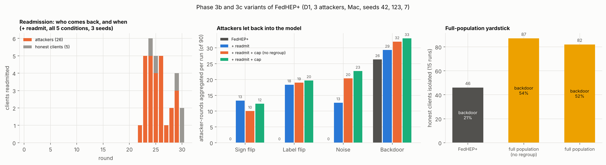

### 7.1a Readmission (`plus.readmit: true`)

**What it does.** In FedHEP+, an isolated client is no longer scored, so it can never come back. With readmission it is still scored every round, against the reference and spread of the clients currently kept. Its evidence keeps updating, and it returns once the evidence recovers to half the isolation cut:

$$E_i \leftarrow 0.7\,E_i + 0.3\,z_i \ \text{(every round, isolated or not)}, \qquad i \text{ isolated and } E_i > -\tfrac{1.5}{2} = -0.75 \Rightarrow i \text{ readmitted}$$

The gap between the isolation cut ($-1.5$) and the readmission cut ($-0.75$) stops a client from flickering in and out.

**Why we tried it.** The cascade (below) isolates honest clients for good. If an honest client was isolated by mistake, it should be allowed back once it looks normal again.

**What happened.**
- Readmission brought back **26 attackers and 5 honest clients** over 15 runs. Every readmission came in rounds 22–30 (left panel of the chart).
- Honest isolations did not fall: 50 honest clients were still isolated at the end, against 46 without readmission.
- The readmitted attackers cost 1.7 points under sign flip and label flip. Backdoor success rose from 20.8% to 39.4%.

**Why it failed.** The two kinds of client recover for different reasons:
- **Honest clients isolated by the cascade stay unusual,** because their data are unusual. Their evidence stays low, so they rarely qualify.
- **Attackers look normal again late in training,** when every update is small and its direction carries little information. Their z drifts toward the middle and their evidence passes $-0.75$.

Readmission therefore works in reverse: it frees the clients it was meant to keep out.

### 7.1b The cap (`plus.max_excluded: 0.34`)

**What it does.** At most a fixed share of all clients may be left out in one round: $\lfloor 0.34 \times 15 \rfloor = 5$ at D1. When more qualify (isolated, or below the exclusion cut this round), only the 5 with the lowest evidence stay out. The others are aggregated this round, even if they are marked as isolated.

$$\text{excluded} = \text{the } \min\big(\lvert Q\rvert,\ \lfloor c\,n \rfloor\big) \text{ members of } Q \text{ with the lowest } E_i \ \text{(ties: lowest } z_i\text{)}, \qquad Q = \text{isolated} \cup \{i : z_i < -2.5\}$$

**Legend:** $Q$ is the set of clients that qualify for exclusion this round, $c = 0.34$ is the cap (`plus.max_excluded`, 1.0 = no cap), and $n$ is the number of clients.

**Why we tried it.** The cascade can in principle remove clients until too few are left to train on. Robust aggregation usually assumes fewer than a third of the clients attack, so never removing more than a third is a natural safety limit. It was tested together with readmission, so that clients pushed out by the limit could still come back.

**What happened.** Under attack the cap was reached in 15–41 of the 90 rounds of each condition (3 runs × 30 rounds). In those rounds it let attackers back into the aggregate: 10–57 attacker-rounds per condition without regrouping, and 7–50 with it. Backdoor success rose to 59–62%, and accuracy under noise fell to 43.6%.

**Why it failed.** The cap keeps out the clients with the **lowest evidence**. Honest clients isolated by the cascade carry very low evidence, because they stay unusual round after round. When the cap is reached, they keep their places outside, and attackers with less extreme evidence are the ones let back in. A backdoor needs only a few rounds inside the model to take hold (6.6e), so a handful of such rounds is enough.

### 7.1c Full-population yardstick (`plus.population: all`, Phase 3c)

**What it does.** The median reference, and the median and MAD of the z-score, are taken over **every client not banned**, isolated ones included, instead of over the clients still kept. Isolation stays permanent; isolated clients are only part of the yardstick.

$$z_i = \frac{s_i - \operatorname{med}_{j \in A}(s_j)}{\max\big(1.4826\,\mathrm{MAD}_{j \in A}(s_j),\ 0.1\,\lvert\operatorname{med}_{j \in A}(s_j)\rvert\big)}, \qquad A = \text{all clients not banned (FedHEP+: } A = \text{kept clients)}$$

**Why we tried it.** At the time, the cascade was thought to come from a shrinking yardstick: each isolation removes a client from the group the next z-scores are measured against, so the spread shrinks and the next honest client looks more extreme. A yardstick that never shrinks should stop it.

**What happened.**

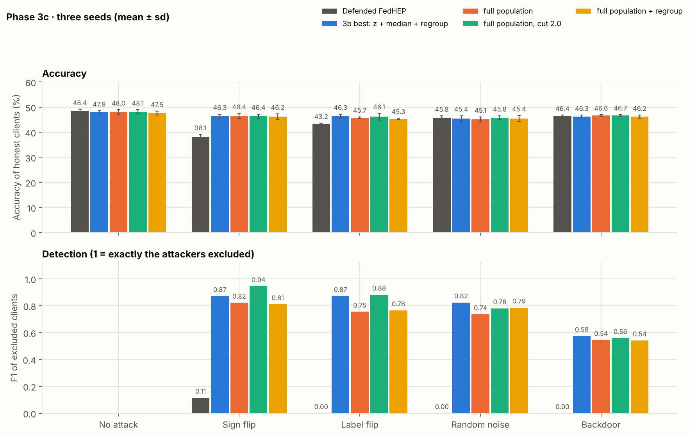

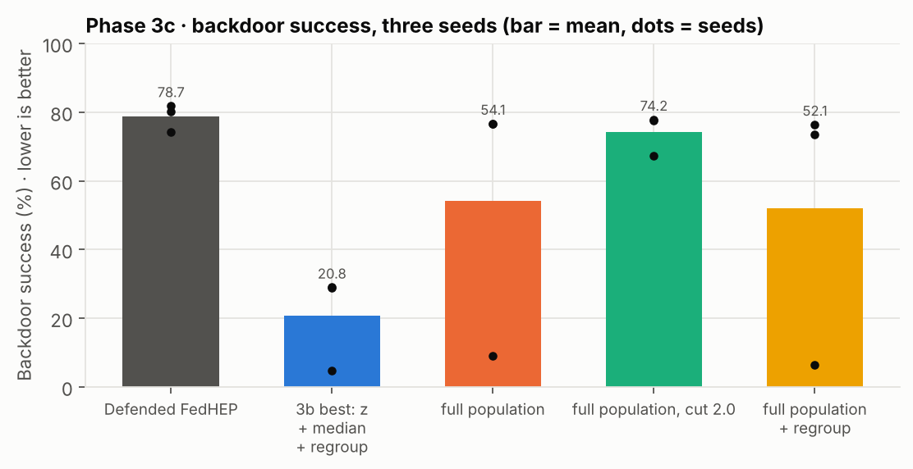

- **More honest clients were isolated, not fewer:** 87 against 46 (82 with regrouping).
- **The backdoor got through:** 52–54%. Attackers were left out in only 154–155 of 270 attacker-rounds, against 191 for FedHEP+. A likely reason, not tested on its own: isolated backdoor attackers stay in the yardstick and pull it toward the ones still active.
- A stricter isolation cut ($-2.0$) brought honest isolations down to 36, but backdoor success rose to 74%.

**Why it failed.** The premise was wrong. The follow-up diagnosis (6.6a) found that the spread does not shrink; it grows six- to eightfold after round 14. What fades is the floor of the z-score's scale, which is what makes honest z-scores extreme mid-training. Keeping the population fixed does not touch that, and it brings isolated attackers back into the yardstick.

### 7.1d Whole-update signal, one-sided (`plus.signal: weights`)

The cosine of the whole update (BatchNorm buffers left out) instead of the root head. It brought backdoor success to 0.3% on seed 42, but isolated many honest clients with a one-sided screen, so it was not adopted then. It returns in Phase 6, with the two-sided screen, the gap gate and patience, as half of FedHEP-Guard's union screen (chapter 5.4).

## 7.2 Phase 4: check groups first, then their members

**Hypothesis.** Attackers pushing one direction (one backdoor) stand out more **together** than one by one. So first find the group (parent) that contains them, then look inside it.

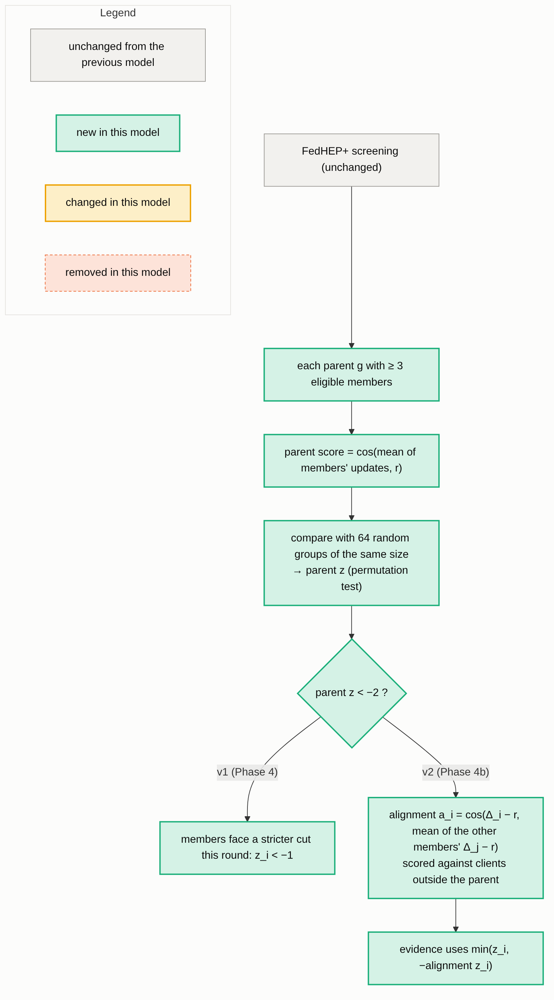

**Parent check (both versions).** The cosine of each parent's mean update to the reference is compared with 64 random groups of the same size, a permutation test:

$$z_g = \frac{\cos(\bar v_g, \tilde r) - \operatorname{med}(\text{null})}{\max\bigl(1.4826\,\mathrm{MAD}(\text{null}),\ 0.01\lvert\operatorname{med}(\text{null})\rvert\bigr)}, \qquad z_g < -2 \Rightarrow \text{parent flagged}$$

**v1 (`plus.drill_down: true`, `drill_mode: exclude`).** Members of a flagged parent face a stricter cut that round: $z_i < -1$ instead of $-2.5$.

**v2 (`drill_mode: evidence`).** v2 asks which members of a flagged parent share its unusual direction. It runs only for parents flagged by the parent check, and works in three steps.

**Step 1: each member's residual.** What is left of member $i$'s signal once the shared part, the median reference, is taken out:

$$u_i = v_i - \tilde r$$

The residual is client $i$'s own deviation from what everyone does. Honest clients' residuals are mostly their own data and noise, so they point in unrelated directions. Attackers pushing the same backdoor share one extra direction, so their residuals point the same way.

**Step 2: alignment with the rest of the group.**

$$d_{-i} = \frac{1}{\lvert g\rvert - 1}\sum_{j \in g,\ j\neq i} u_j, \qquad a_i = \cos\bigl(u_i,\ d_{-i}\bigr)$$

- $d_{-i}$ is the mean residual of the **other** members of $g$. Leaving $i$ out ($j \neq i$) matters: if $u_i$ were in the mean, $a_i$ would be high partly because $i$ is compared with itself.
- $a_i$ is high when $i$ deviates in the same direction as its group-mates. Several attackers in one parent coordinating on one backdoor all get a high $a_i$. An honest member next to them does not, because its residual has nothing in common with theirs.
- Averaging over the other members builds up what they share and cancels what is individual, so the shared attack direction stands out in $d_{-i}$.
- The assumption is that honest members share nothing beyond the reference. In FedHEP it is false: members of one parent train from the same parent head, so honest residuals share a group direction too. This is why v2 failed (below).

**Step 3: is $a_i$ unusually high? A null from outside the parent.** Any residual is somewhat aligned with a group mean by chance, so $a_i$ needs a yardstick. It is the same cosine for clients that are **not** in $g$, against the same leave-one-out directions:

$$N_g = \bigl\{\cos(u_k,\ d_{-i}) : k \notin g,\ i \in g\bigr\}, \qquad z^{\text{align}}_i = \frac{a_i - \operatorname{med}(N_g)}{\max\bigl(1.4826\,\mathrm{MAD}(N_g),\ 0.1\,\lvert\operatorname{med}(N_g)\rvert\bigr)}$$

$N_g$ pools every outside client against every member's direction $d_{-i}$, which gives $(n - \lvert g\rvert) \times \lvert g\rvert$ values, enough for a stable median. With fewer than 5 values every $z^{\text{align}}_i$ is 0. A member is suspicious when $z^{\text{align}}_i$ is large and **positive**: more aligned with its group-mates than outsiders are.

**How it feeds the decision.** High alignment is turned into bad evidence. For members of a flagged parent the evidence update uses the worse of the two signals; nobody is left out for a round on alignment alone:

$$E_i \leftarrow 0.7\,E_i + 0.3\,\min\bigl(z_i,\ -z^{\text{align}}_i\bigr)$$

**Legend:**

| Symbol | Meaning |
|---|---|
| $\bar v_g$ | parent $g$'s mean signal (parent check) |
| null | the parent check's cosine for 64 random groups of the same size |
| $v_i$, $\tilde r$ | member $i$'s signal and the median reference (chapter 4.1) |
| $u_i$ | member $i$'s residual: its signal minus the reference |
| $g$, $\lvert g\rvert$ | the flagged parent and its number of eligible (not isolated) members, at least 3 (`plus.min_group`) |
| $d_{-i}$ | the mean residual of $g$'s other members |
| $a_i$ | member $i$'s alignment with the rest of its group |
| $N_g$ | the null: outside clients' cosines to the members' leave-one-out directions |
| $z^{\text{align}}_i$ | robust z of $a_i$ against $N_g$; same scale floor as the screen (0.1 of the median) |
| $z_i$, $E_i$ | the screen's z and evidence (chapter 4.1) |

**Results** (D1, Mac, 3 seeds; "concentrated" = all 3 attackers in one parent):

| Setting | FedHEP+ alone | v1 | v2 |
|---|---|---|---|
| No attack: accuracy | 48.07 | 47.95 | 46.95 |
| No attack: honest isolated (3 seeds) | 10 | 8 | 19 |
| Concentrated backdoor: success | 21.5% | **39.7%** | **1.9%** |
| Concentrated backdoor: accuracy | 46.42 | 45.92 | 44.69 |

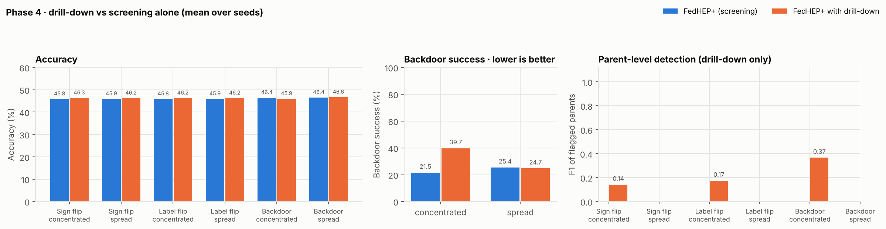

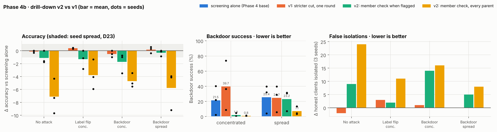

**Why it failed:**
- **The parent check works.** It flagged the attackers' parent with precision 0.85.
- **v1's one-round exclusion made attackers harder to catch.** With the backdoor kept out of the model, honest updates no longer pushed against it, so the attackers' z moved toward normal and isolation came later (seed 42: never).
- **v2 catches the attackers in rounds 2–3, but it also isolates honest groups.** Members of a FedHEP parent train from the same parent head, so their updates share a parent-specific direction. Honest members' alignment z (median 1.0, and up to 2.8 in falsely flagged parents) overlaps the attackers' (3.0–3.6). No cut separates them.

**What carried forward:** removing a client for one round can hide it; evidence that builds over rounds does not. Group-level coordination is real, but in FedHEP honest groups are coordinated too.

## 7.3 Phase 5: established robust rules inside FedHEP

**Question:** would a published defense, plugged into FedHEP's Global step, beat FedHEP+?

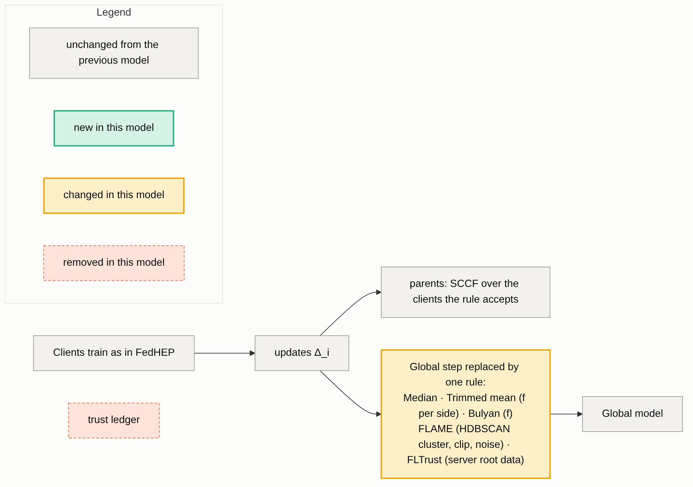

| Rule | Global step | Reference |
|---|---|---|
| Median | coordinate-wise median of the updates | Yin et al., 2018 |
| Trimmed mean | per coordinate, drop the $f$ largest and $f$ smallest values, average the rest: $\mathrm{TM}_f(X)_j = \frac{1}{n-2f}\sum_{i=f+1}^{n-f} X_{(i),j}$ | Yin et al., 2018 |
| Bulyan | pick $n - 2f$ updates by repeated Krum, then a trimmed mean around the median per coordinate | El Mhamdi et al., 2018 |
| FLAME | HDBSCAN on cosine distances keeps the majority cluster; clip to the median norm; add Gaussian noise $\lambda S$ with $\lambda = 0.001$ | Nguyen et al., 2022 |
| FLTrust | trust $= \mathrm{ReLU}(\cos(\Delta_i, \Delta_0))$, with $\Delta_0$ the server's update on 100 clean root images; updates rescaled to $\lVert\Delta_0\rVert$ | Cao et al., 2021 |

Parents keep SCCF over the clients the rule accepts. $f = 3$ at D1.

**Results** (D1, Mac, 3 seeds):

| Model | No attack | Sign flip | Label flip | Noise | Backdoor success | Honest left out per round |
|---|---|---|---|---|---|---|
| Defended FedHEP | **48.39** | 38.08 | 43.23 | 45.80 | 78.7% | 0 |
| **FedHEP+** | 47.92 | **46.34** | **46.34** | 45.41 | 20.8% | 1.1–1.9 |
| Median | 47.57 | 39.97 | 44.59 | **46.59** | 76.5% | 0 |
| Trimmed mean | 47.91 | 39.03 | 44.44 | 46.01 | 77.0% | 0 |
| Bulyan | 44.52 | 44.13 | 43.94 | 44.64 | **0.5%** | 3.0–6.0 |
| FLAME | 42.81 | 42.72 | 41.61 | 42.97 | **0.5%** | 2.6–5.1 |
| FLTrust | 47.33 | 45.66 | 42.85 | 44.34 | 64.2% | 2.6–3.6 |

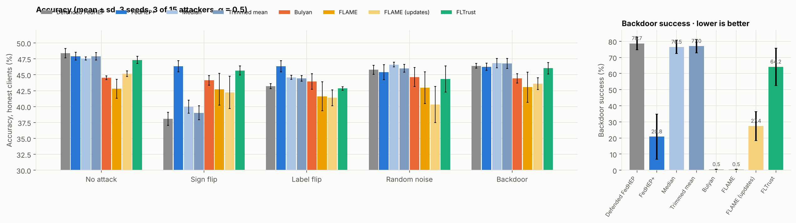

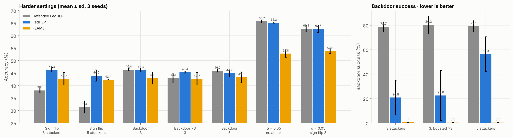

**Harder settings:**
- With **5 sign flippers**, FedHEP+ gains 12.6 points over Defended FedHEP.
- With **5 backdoor attackers**, FedHEP+'s backdoor success rises to 56%: five colluders pull the median toward themselves. FLAME holds at 0.5%.
- At **α = 0.05**, FedHEP+'s gain disappears (62.75 against 62.81), and FLAME loses 13 points with no attack.

**Why none was adopted:**
- Median and trimmed mean never remove anyone, so sign flippers and backdoors get through.
- Bulyan and FLAME stop the backdoor by leaving out 3–6 honest clients **every round**, which costs 4–6 points with no attack.
- FLTrust's 100 root images are a thin reference for 100 classes.

**What carried forward:**
- FedHEP+'s weak spot (the backdoor) is FLAME's strength, and FLAME's weak spot (honest clients left out) is FedHEP+'s strength. This motivated a layered design: an influence bound underneath a screen.
- The trimmed mean returns in Phase 6 as the last stage of L0.

## 7.4 Phase 6 components that were tested and dropped

Seven components were tested while building FedHEP-Guard and left out. Each subsection below gives the formula, where it acts (diagram), why we tried it, the results and why it was dropped.

| Component | Config | Result in one line | Source runs | Section |
|---|---|---|---|---|
| Worker momentum under L0 | `robust.momentum: 0.5` | 0.9–1.7 points worse than L0 alone in every D1 condition | `p6__l0m` | 5.3a |
| Probe-logit and head-gap signals | `plus.signal: probe_logits`, `head_gap` | miss the sign flippers; head gap catches the backdoor on 2 of 3 seeds but isolates 9 honest clients | `g1__r3p`, `g1__r3h` | 5.3b |
| Sign-alignment signal (AlignIns MPSA) | `plus.signal: sign_align` | every sign flipper and no honest client, but misses the backdoor (71–83%) | `g1__r3s` | 5.3c |
| Critical layers alone | `plus.signal: critical` | catches the backdoor on 1 of 3 seeds; kept as half of the union screen | `g1__r3c` | 5.3d |
| Head-agreement inference | `fedhep.head_agreement` | costs 0.18 points, removes 1–13 points of backdoor success: the parent head carries the backdoor too | `g1__*`, `m6__*` | 5.3e |
| Holding $f$ fixed after exclusions | `plus.global_f_fixed: true` | −1.1 points under ALIE on the Mac, −1.2 on CUDA | `m6__r3_ffixed`, `c2__r3_ffixed` | 5.3f |
| Rewinding every shared weight | `plus.rewind: all` | 0.6 points below rewinding only the trunk and root head, no backdoor gain | `m6__r3w_all`, `m6__r3_all` | 5.3g |

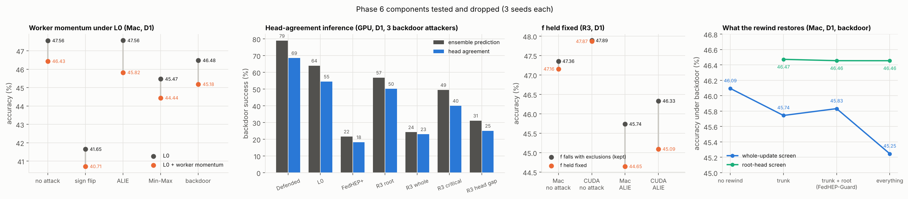

All runs: D1 (15 clients, α = 0.5, 3 attackers), 30 rounds, seeds 42, 123 and 7. Machines are named per result and never mixed in one comparison.

### 7.4a Worker momentum under L0 (`robust.momentum: 0.5`)

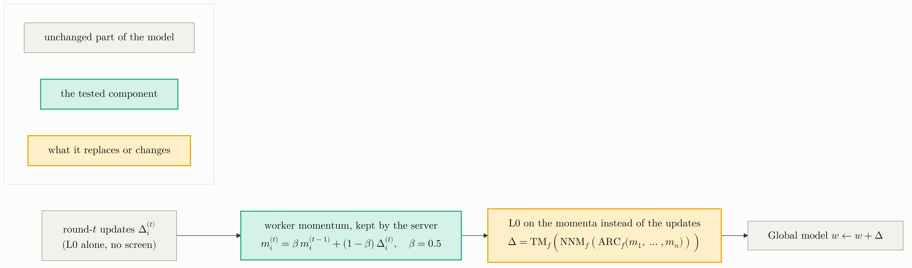

**What it does.** The server keeps a running average of each client's updates and gives L0 the averages instead of this round's updates:

$$m_i^{(t)} = \beta\, m_i^{(t-1)} + (1-\beta)\,\Delta_i^{(t)}, \qquad \Delta = \mathrm{TM}_f\Bigl(\mathrm{NNM}_f\bigl(\mathrm{ARC}_f(m_1^{(t)}, \dots, m_n^{(t)})\bigr)\Bigr)$$

**Legend:** $\Delta_i^{(t)}$ is client $i$'s update in round $t$; $m_i^{(t)}$ is its momentum, set to $\Delta_i^{(1)}$ the first time; $\beta = 0.5$ is the share of the past kept; ARC, NNM and TM are L0's three steps (5.2).

**Why we tried it.** In robust-optimization theory (Karimireddy, He and Jaggi, 2021), attackers hide inside the noise of honest updates. Averaging each client over rounds shrinks that noise, so robust rules separate attackers better.

**Results** (Mac, L0 alone, no screen):

| | No attack | Sign flip | ALIE | Min-Max | Backdoor (acc.) | Backdoor success |
|---|---|---|---|---|---|---|
| L0 | **47.56** | **41.65** | **47.56** | **45.47** | **46.48** | **62.5%** |
| L0 + worker momentum | 46.43 | 40.71 | 45.82 | 44.44 | 45.18 | 64.5% |

**Why it was dropped.** It is worse in every condition, by 0.9–1.7 points, and does not help against the backdoor. A likely reason, not tested on its own: the theory assumes one SGD step per round, where per-round noise is large. Here every upload already averages 5 local epochs, so there is little noise left to average away, and momentum mostly mixes in directions from earlier rounds, after the model has moved on.

### 7.4b Output-space signals: probe logits and head gap (`plus.signal: probe_logits`, `head_gap`)

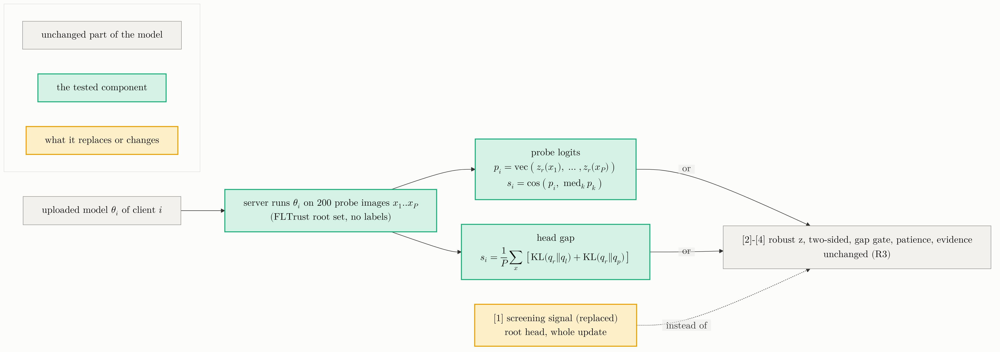

**What they do.** Instead of comparing weights, the server runs each uploaded model on $P = 200$ probe images (the FLTrust root set, images outside every client's data, no labels needed) and compares what the models predict:

$$\text{probe logits: } p_i = \mathrm{vec}\bigl(z_r(x_1), \dots, z_r(x_P)\bigr), \quad s_i = \cos\bigl(p_i,\ \operatorname{med}_k p_k\bigr)$$

$$\text{head gap: } s_i = \frac{1}{P}\sum_{x} \Bigl[\mathrm{KL}\bigl(q_r(x)\,\|\,q_l(x)\bigr) + \mathrm{KL}\bigl(q_r(x)\,\|\,q_p(x)\bigr)\Bigr]$$

The score then goes through the unchanged R3 screen (two-sided robust z, gap gate, patience, evidence).

**Legend:** $z_r(x)$ are the root head's logits of upload $i$ on probe image $x$; $\mathrm{vec}$ stacks them into one vector of $P \times C$ numbers; $q_r, q_p, q_l$ are the softmax outputs of the root, parent and local heads; KL is the Kullback–Leibler divergence; the median is taken over the reference clients.

**Why we tried them.** The backdoor lives in the shared trunk, and the attackers never split off in weight-cosine space (root-head signal: 32–70% backdoor success). A backdoored model may still *behave* differently. The head gap adds a second idea: a backdoor moves all three heads together (small gap), while honest personalization moves the local head alone (larger gap).

**Results** (GPU):

| Signal | Sign flippers isolated | Min-Max isolated | Backdoor success, seeds 42 / 123 / 7 | Honest isolated, no attack (3 runs) |
|---|---|---|---|---|
| Root head (R3, for reference) | 9 of 9 | 9 of 9 | 70 / 32 / 68% | 4 |
| Probe logits | **0 of 9** | 9 of 9 | 71 / 74 / 83% | 1 |
| Head gap | **0 of 9** | 9 of 9 | 0.7 / 10 / 83% | **9** |

**Why they were dropped.** Neither catches the sign flippers, which every weight signal catches in round 1. Probe logits never catch the backdoor. Head gap catches it on two seeds, but at the price of 9 honest isolations, the most of any signal. Both also cost a forward pass of every upload on the probe set every round.

### 7.4c Sign-alignment signal (`plus.signal: sign_align`, AlignIns MPSA)

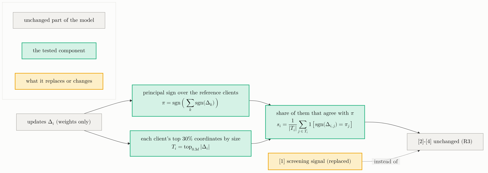

**What it does.** From AlignIns (CVPR 2025): the principal sign is the majority sign of each coordinate over the reference clients. Each client is scored by how many of its largest coordinates agree with it:

$$\pi_j = \mathrm{sgn}\Bigl(\sum_k \mathrm{sgn}(\Delta_{k,j})\Bigr), \qquad s_i = \frac{1}{\lvert T_i\rvert}\sum_{j \in T_i} \mathbb 1\bigl[\mathrm{sgn}(\Delta_{i,j}) = \pi_j\bigr]$$

**Legend:** $\Delta_{i,j}$ is coordinate $j$ of client $i$'s update (weights only, BatchNorm buffers left out); $\pi_j$ is the principal sign; $T_i$ is the set of client $i$'s largest 30% of coordinates by size (`plus.sign_topk: 0.3`); $s_i$ is a share between 0 and 1, higher = more aligned. The score is scale-free: multiplying an update by 100 does not change it.

**Why we tried it.** Cosine scores are dominated by the largest coordinates and by update size. A sign count ignores size, so a backdoor spread over many small coordinates might show.

**Results** (GPU): every sign flipper and every Min-Max attacker isolated, with **no** honest isolation in any condition. Backdoor success 71 / 74 / 83% (seeds 42 / 123 / 7): no backdoor attacker caught.

**Why it was dropped.** It is the cleanest detector of model poisoning, but it misses the backdoor completely. A backdoor attacker trains honestly on half its data, so its largest coordinates mostly carry the majority sign; the trigger sits in a few coordinates the sign count does not weigh. Model poisoning is already caught by the cheaper weight signals.

### 7.4d Critical layers alone (`plus.signal: critical`)

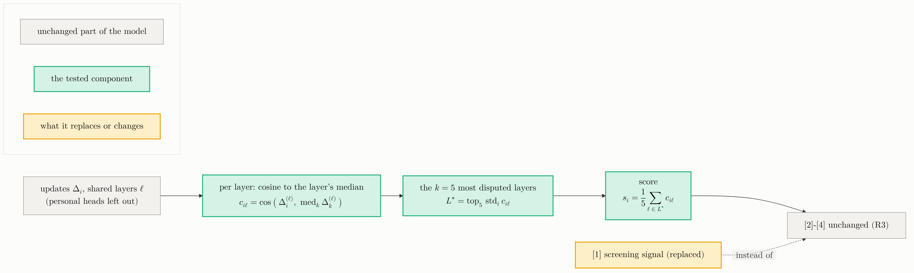

**What it does.** After FedSurrogate (arXiv 2605.11122): score each client layer by layer, and keep only the layers where clients disagree most:

$$c_{i\ell} = \cos\bigl(\Delta_i^{(\ell)},\ \operatorname{med}_k \Delta_k^{(\ell)}\bigr), \qquad L^\star = \mathrm{top}_5\ \mathrm{std}_i\, c_{i\ell}, \qquad s_i = \frac{1}{5}\sum_{\ell \in L^\star} c_{i\ell}$$

**Legend:** $\Delta_i^{(\ell)}$ is client $i$'s update to shared layer $\ell$ (the personal parent and local heads are never scored); $c_{i\ell}$ its cosine to that layer's median; $L^\star$ the 5 layers whose cosines vary most across clients this round (`plus.critical_k: 5`).

**Why we tried it.** A backdoor that sits in a few trunk layers is diluted in the whole-update cosine, which is dominated by the largest layers. Scoring the most disputed layers separately should expose it.

**Results** (GPU): every sign flipper and ALIE attacker isolated, no honest client isolated with no attack. Backdoor success 0.5 / 65 / 83% (seeds 42 / 123 / 7).

**Why it was dropped as a single signal, and kept in the union.** It catches the backdoor on one seed only. But it catches it on a **different** seed from the whole-update signal (0.6 / 71 / 0.6%), so the union of the two catches all three: this is FedHEP-Guard's signal [1] (chapter 5.4).

**The six signals side by side** (GPU, R3 with each signal):

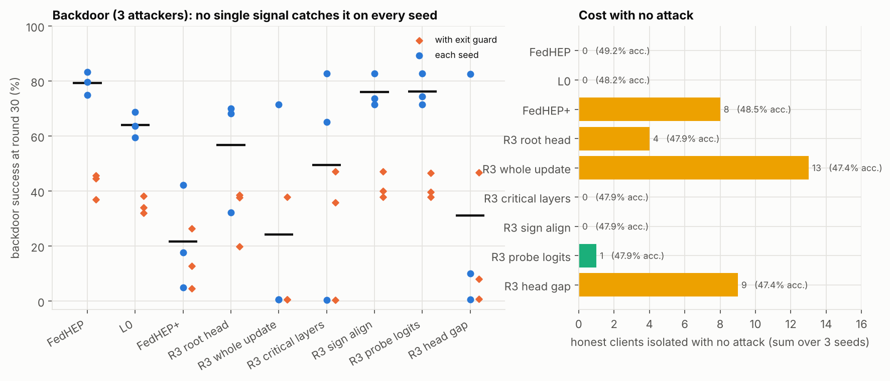

| Signal | Backdoor success, seeds 123 / 42 / 7 | Honest isolated with no attack (3 seeds) |
|---|---|---|
| Root head | 32 / 70 / 68% | 4 |
| Whole update | **0.6** / 71 / **0.6**% | 13 |
| Critical layers | 65 / **0.5** / 83% | 0 |
| Sign alignment | 74 / 71 / 83% | 0 |
| Probe logits | 74 / 71 / 83% | 1 |
| Head gap | 10 / **0.7** / 83% | 9 |

### 7.4e Head-agreement inference (`fedhep.head_agreement: true`)

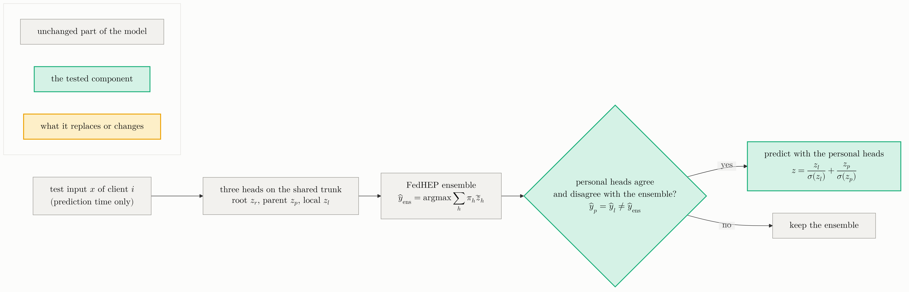

**What it does.** A prediction-time rule only; training is unchanged. For each test input, if the client's two personal heads agree with each other and disagree with the FedHEP ensemble, the personal heads decide:

$$\hat y = \begin{cases} \arg\max\Bigl(\dfrac{z_l}{\sigma(z_l)} + \dfrac{z_p}{\sigma(z_p)}\Bigr) & \text{if } \hat y_p = \hat y_l \neq \hat y_{\mathrm{ens}} \\[6pt] \hat y_{\mathrm{ens}} & \text{otherwise} \end{cases}$$

**Legend:** $z_p, z_l$ are the parent and local heads' logits on the client's classes (ACLM mask); $\hat y_p, \hat y_l, \hat y_{\mathrm{ens}}$ are the classes predicted by the parent head, the local head and the ensemble (chapter 2.2); $\sigma(\cdot)$ is the standard deviation of a head's logits, so neither head dominates by scale. (The code also rescales the sum to the ensemble's spread, which does not change the predicted class.)

**Why we tried it.** The backdoor is learned by the shared trunk and mapped to its target class by the shared root head. The personal heads are trained on the client's own clean data, so they might keep the true label where the ensemble follows the trigger.

**Results.**
- **Cost** (Mac, 19 runs without a backdoor): 3.0% of inputs overruled, 0.18 points of accuracy on average (worst run 0.61).
- **Effect** (GPU, backdoor success with the ensemble → with head agreement):
  - Defended FedHEP 79 → 69%, L0 64 → 55%, R3 with the root head 57 → 50%;
  - FedHEP+ 22 → 18%, whole-update screen 24 → 23%, undefended FedHEP 79 → 78%.
- **Effect** (Mac, root-head screens with each rewind): 3.5–6.6 points on average, up to 11 on one seed.

**Why it was dropped.** It removes 1–13 points of backdoor success, never most of it. The parent head is shared by a group and carries the backdoor too (chart below), so on triggered inputs the personal heads rarely agree **against** the ensemble. Removing the attackers (the screen) and the backdoor (the rewind) does far more.

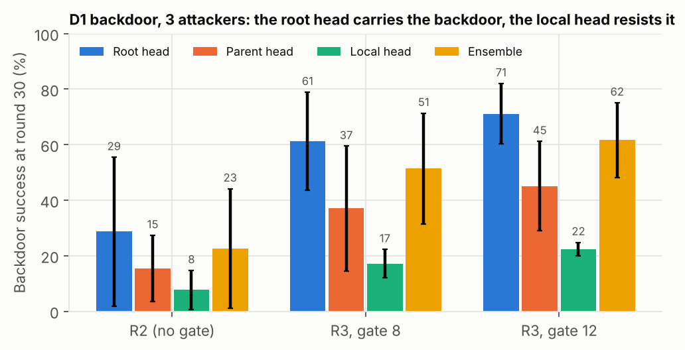

### 7.4f Holding $f$ fixed after exclusions (`plus.global_f_fixed: true`)

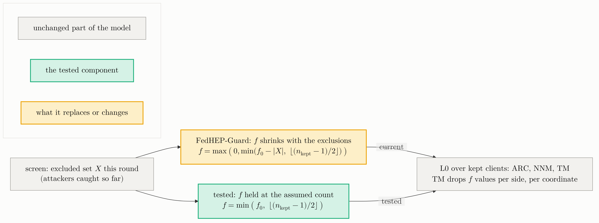

**What it does.** L0's trimmed mean drops $f$ values per side, per coordinate. In FedHEP-Guard, $f$ falls by the number of clients the screen has excluded. The variant keeps $f$ at the assumed count:

$$\text{FedHEP-Guard: } f = \max\bigl(0,\ \min(f_0 - \lvert X\rvert,\ \lfloor (n_{\mathrm{kept}}-1)/2\rfloor)\bigr), \qquad \text{tested: } f = \min\bigl(f_0,\ \lfloor (n_{\mathrm{kept}}-1)/2\rfloor\bigr)$$

**Legend:** $f_0$ is the assumed attacker count (`plus.global_f`, 3 at D1); $X$ is the set of clients excluded this round; $n_{\mathrm{kept}}$ the number of clients aggregated.

**Why we tried it.** R3 lost 1.8 points to L0 under ALIE (the ALIE puzzle). One candidate cause: after the three attackers are isolated, $f$ falls to 0 and the trimmed mean becomes a plain mean, so a fixed $f$ might recover 0.3–0.8 points (prediction in `docs/PREDICTIONS.md`).

**Results** (R3, gate 8):

| | No attack | ALIE | ALIE, seeds 42 / 123 / 7 |
|---|---|---|---|
| Mac, $f$ falls (kept) | **47.36** | **45.74** | 46.63 / 46.30 / 44.28 |
| Mac, $f$ fixed at 3 | 47.16 | 44.65 | 45.86 / 45.15 / 42.93 |
| CUDA, $f$ falls (kept) | **47.89** | **46.33** | 46.87 / 45.85 / 46.27 |
| CUDA, $f$ fixed at 3 | 47.87 | 45.09 | 45.61 / 44.54 / 45.13 |

**Why it was dropped.** The prediction was wrong in direction, on both machines and every seed. Once the attackers are gone, a fixed $f = 3$ makes the trimmed mean discard the 3 highest and 3 lowest **honest** values of every coordinate, every round. That throws information away for nothing. With no attack nobody is excluded, so the two rules coincide and the difference is near zero.

### 7.4g Rewinding every shared weight (`plus.rewind: all`)

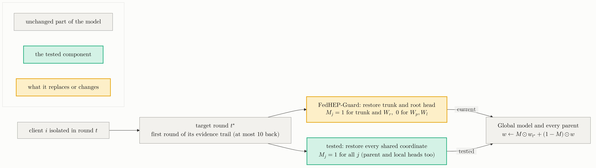

**What it does.** When a client is isolated, the Global model and every parent go back to the stored model from before the client's first suspicious round (chapter 5.6). A mask $M$ chooses which coordinates are restored:

$$w \leftarrow M \odot w_{t^\star} + (1 - M) \odot w, \qquad M_j = \begin{cases} 1 & j \in \text{trunk or root head (FedHEP-Guard, trunk\_root), else } 0 \\ 1 & \text{every } j \text{ (tested: all)} \end{cases}$$

**Legend:** $w$ is a shared model (Global or a parent); $w_{t^\star}$ the Global model stored at the start of round $t^\star$; $\odot$ is element-wise multiplication; `trunk` restores the trunk only.

**Why we tried it.** If the parent head carries the backdoor too (7.4e), rewinding only the trunk and root head might leave part of it in place.

**Results** (Mac, 3 backdoor attackers):

| Rewind | Whole-update screen: accuracy | backdoor success, seeds 42 / 123 / 7 | Root-head screen: accuracy | backdoor success, seeds 42 / 123 / 7 |
|---|---|---|---|---|
| none | **46.09** | 0.5 / 0.5 / 0.9% | — | — |
| trunk | 45.74 | 0.5 / 0.5 / 0.3% | **46.47** | 74 / 23 / 30% |
| trunk + root head (FedHEP-Guard) | 45.83 | 0.4 / 0.2 / 0.3% | 46.46 | 74 / 19 / 29% |
| everything | 45.25 | 0.5 / 0.3 / 0.3% | 46.46 | 74 / 16 / 27% |

**Why it was dropped.** With the whole-update screen it costs 0.6 points against rewinding the trunk and root head, and gains nothing: the attackers are caught by rounds 3–6, so there is little backdoor to remove. With the root-head screen it lowers success by 1–2 points on the seeds where an attacker is caught, at no accuracy cost, but that screen is not the one FedHEP-Guard uses. Rewinding the personal heads also discards the personalization learned since $t^\star$, which the attackers barely touch. With the trunk and root head rewound, the parent head's share of the backdoor plausibly has no trigger features left to respond to.

## 7.5 Phase 7: the peer reference (Acer)

**Idea.** Judge each client against the clients that hold similar data, not against everyone. Under strong skew an honest client with unusual classes is far from the global median, so it looks like an attacker (6.13, chapter 6.6c). Against clients holding similar classes it should look normal, while a backdoor attacker still differs from its peers by the trigger. This follows BoBa (arXiv 2407.09658, 2024), which compares clients only within groups of similar inferred data.

**What changes.** Only the reference in step [1]: each client $i$ gets its own reference $\tilde r_i$ instead of the shared $\tilde r$. Everything after it (robust z, two-sided cut, gap gate, patience, evidence, isolation, rewind) is unchanged.

$$J_{ij} = \frac{\lvert Y_i \cap Y_j\rvert}{\lvert Y_i \cup Y_j\rvert}, \qquad P_i = \text{the } \lceil \kappa\,(m-1) \rceil \text{ clients } j \neq i \text{ with the largest } J_{ij}$$

$$\tilde r_{i} = \operatorname{med}_{j \in P_i}\, v_j \ \text{(coordinate-wise)}, \qquad s_i = \cos(v_i, \tilde r_i)$$

**Legend:**

| Symbol | Meaning | Config key, value |
|---|---|---|
| $Y_i$ | the classes client $i$ holds (the class mask FedHEP already sends for ACLM) | — |
| $J_{ij}$ | Jaccard similarity of two clients' class sets | — |
| $\kappa$ | share of the other clients used as peers | `plus.peer_share: 0.333` |
| $m$ | number of clients currently scored | — |
| $P_i$ | client $i$'s peers (ties go to the lower index) | — |
| $\tilde r_i$ | client $i$'s reference: the coordinate median of its peers' signals | `plus.reference: peer` |
| $s_i$ | client $i$'s score, then the robust z of chapter 4 | — |

For the critical-layer signal, layer $l$ of $\tilde r_i$ is the reference for layer $l$.

**The trade-off in $\kappa$.** A small peer set fits a client's data better, but colluders who all pick each other (for example by reporting one class mask) take over a colluder's peer median once they fill half of its peers. With $\kappa = 1/3$ that happens at 4 colluders of 15 and 6 of 30. A tight cluster pulls a coordinate median before half, so the real margin is smaller. The unit tests check both sides: an honest group of 4 out of 15 is judged by its own kind with $\kappa = 1/3$ but not with $\kappa = 2/3$, and 3 colluders with one shared mask stay caught while 5 do not (`tests/test_peer_reference.py`).

**Shadow scoring.** `plus.shadow_reference` scores the same updates against a second reference and logs it without acting. Every run of the experiment logs both references, so they are compared on identical updates, free of the differences between training runs.

**The experiment** (`configs/sweeps/acer_c10_peer.yaml`, prefix `x10_`, 24 runs on the Acer): the union screen without the rewind, at 15 clients, α = 0.1 and 0.5, with no attack and with 3 backdoor attackers, 3 seeds. One arm acts on the median and logs the peer scores; the other acts on the peer reference and logs the median scores. Predictions P22–P25 were written before the runs (`docs/PREDICTIONS.md`). Charts: `scripts/plot_phase7.py` writes `docs/figures/phase7_peer_paired.png` and `phase7_peer_outcomes.png`.

**Results** (Acer, 3 seeds; per-seed values in `docs/results/phase7_peer.json`):

| | Median reference (FedHEP-Guard's) | Peer reference |
|---|---|---|
| Attacker separation, α 0.1, same updates (AUROC, whole update) | 0.69 / 0.66 | 0.65 / 0.60 |
| Attacker separation, α 0.5, same updates | 0.98 | 0.97–1.00 |
| Honest isolated per run, no attack (α 0.1 / 0.5) | 0.3 / 4.0 | 0.7 / 7.0 |
| Backdoor success, α 0.1 (seeds 123 / 42 / 7) | 0.3 / 12 / 22% | 35 / 21 / 24% |
| Backdoor success, α 0.5 | 0.4 / 0.2 / 0.5% | 0.4 / 0.3 / **44%** |
| Accuracy with no attack (α 0.1 / 0.5) | 60.40 / 47.58 | 60.22 / 46.37 |

The two AUROC values in a cell come from the two arms (acting on the median, acting on the peer reference); both log both references.

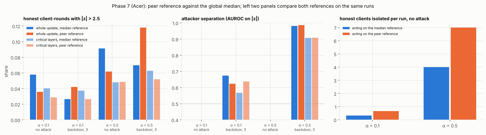

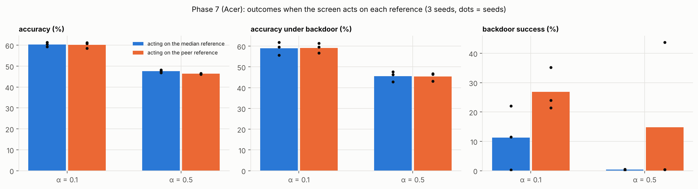

**Verdict.** P22 held only at α = 0.5. P23 was mixed. P24 and P25 were refuted: acting on the peer reference isolated more honest clients and let more backdoor in. It is dropped.

**Why it failed (likely, not tested on its own):**
- **A noisier yardstick.** With $\kappa = 1/3$ each client's reference is the median of only 5 peers, much noisier than the median of all 15. The extra noise outweighs the heterogeneity the peers remove.
- **Arbitrary peers at α = 0.5.** Nearly every client holds nearly every class (about 667 images over 100 classes), so the Jaccard similarities are almost tied and the peers are close to arbitrary.
- **The wrong diagnosis.** The honest isolations it targeted are mostly not "clients with unusual data". At α = 0.5 about half are whole parent groups, split off by the parent head inside the whole-update signal (chapter 8.2).

## 7.6 Phase 8: the shared signal

**The problem it targeted.** About half of the union screen's honest isolations at α = 0.5 are whole parent groups isolated in one round (chapter 8.2, cause 2). The whole-update signal includes the parent head, which the members of one group share, so a group whose data drift together moves away from the median together.

**What it changes.** Only the whole-update half of signal [1]. The new signal scores the update restricted to the coordinates every client shares, the trunk and the root head:

$$v_i^{\mathrm{shared}} = \mathrm{bound}\bigl(\Delta_i\big\vert_{\text{trunk} \,\cup\, W_r}\bigr), \qquad s_i = \cos\bigl(v_i^{\mathrm{shared}},\ \operatorname{med}_k v_k^{\mathrm{shared}}\bigr)$$

It is combined with the critical layers exactly as now: each signal z-scored and gap-gated on its own, and a client's z is the lower of the two.

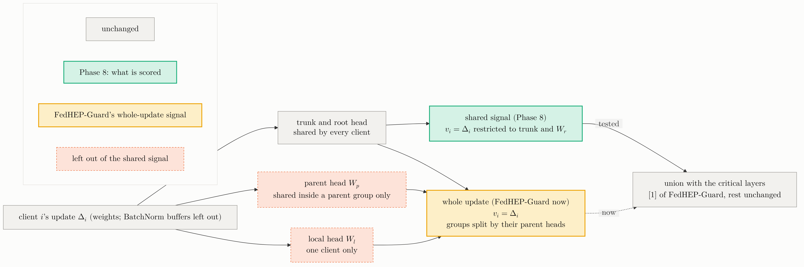

**Legend:**

| Symbol | Meaning | Config key, value |
|---|---|---|
| $\Delta_i\big\vert_{\text{trunk} \cup W_r}$ | client $i$'s weight update restricted to the trunk and the root head (BatchNorm buffers, $W_p$ and $W_l$ left out) | `plus.signal: shared` |
| bound | the norm bound of chapter 3, $k = 3$ | `plus.norm_bound` |
| — | union with the critical layers | `plus.signal: shared_critical` |

**Hypothesis.** Without the personal heads, a drifting group no longer stands out, while backdoor attackers still do, because the backdoor is learned by the shared trunk and root head. The risk was stated before the runs: the parent head also carries part of the backdoor (chapter 7.4e), and on some seeds that part may be what splits the attackers off.

**The experiment** (Acer, 30 rounds unless marked, 3 seeds; predictions P26–P29). The shared union screen (`r3sc`) against the union screen (`r3wc`), both without rewind, and FedHEP-Guard with each signal (with rewind) over 100 rounds. All runs on the Acer. Sweeps: `acer_c11_shared.yaml`, `acer_c11_control.yaml`, `acer_c12_shared_durability.yaml`; controls `x10_*__r3wc_shp`, `x8_f3__*__r3wc`, `x9__*__r3wc_tr`.

| Condition | Honest isolated per run: union screen | shared | Of them in whole-group events: union | shared | Backdoor success, seeds 123 / 42 / 7: union | shared |
|---|---|---|---|---|---|---|
| α 0.5, no attack | 3.8 (6 runs) | 2.3 | 1.0 | 1.0 | — | — |
| α 0.5, sign flip | 3.3 | **0** | 2.3 | 0 | — | — |
| α 0.5, ALIE | 4.7 | **0** | 1.7 | 0 | — | — |
| α 0.5, Min-Max | 2.0 | 1.0 | 0 | 0 | — | — |
| α 0.5, backdoor | 3.2 (6 runs) | 1.0 | 1.2 | 0 | 0.4 / 0.2 / 0.5% | 0.5 / 0.3 / **78%** |
| α 0.1, no attack | 0.3 | 1.3 | 0 | 0 | — | — |
| α 0.1, backdoor | 0 | 1.0 | 0 | 0 | 0.3 / 11.5 / 22% | 35 / 23 / 25% |
| FedHEP-Guard, plain backdoor, 100 rounds | 6.0 | **2.0** | 4.7 | 0 | 0.3 / 0.3 / 0.3% | 0.4 / 0.5 / **80%** |
| FedHEP-Guard, stealth backdoor, 100 rounds | 3.3 | 2.3 | 0 | 0 | 0.4 / 0.4 / 34% | 1.1 / 0.5 / **62%** |

Every sign-flip, ALIE and Min-Max attacker was caught by both screens, in round 3. Accuracy was within half a point except where the shared screen isolated fewer honest clients: 45.76 against 44.09 under ALIE, 46.79 against 45.57 under the backdoor, and 44.18 against 41.66 for FedHEP-Guard over 100 rounds with the plain backdoor.

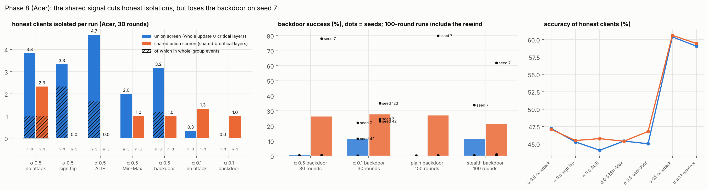

**What happened.**
- **Honest isolations fell by three quarters at α = 0.5:** 0.9 per run over the five conditions, against 3.4 for the union screen. Whole-group events almost disappeared: one event of 3 clients in 15 runs, against 1.2 isolated clients per run in such events. Over 100 rounds FedHEP-Guard with the shared signal isolated 2.0 honest clients per run instead of 6.0 and was 2.5 points more accurate.
- **But the backdoor got through on seed 7**, at 30 rounds (78%) and over 100 rounds (80% plain, 62% stealth). On the other two seeds it stayed under 1.1%.
- **At α = 0.1 it is worse on both counts:** more honest isolations (1.3 against 0.3) and more backdoor (28% on average against 11%; it caught 2 of 9 attackers, the union screen 5).

**Why it failed: the risk stated before the runs came true.**

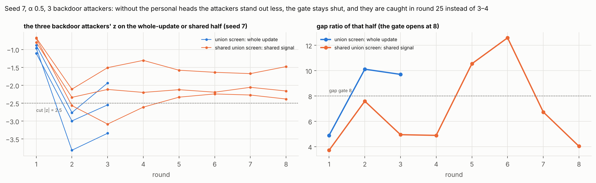

On seed 7 the union screen's whole-update half scored the three backdoor attackers at z = −2.8 to −3.8 in round 2, with a gap ratio of 10, so its gate was open and they were caught in rounds 3–4. Without the personal heads the same attackers scored −2.1 to −2.6, and the gap ratio was 7.6, under the gate of 8. The gate stayed shut while the attackers were still far out. When it opened, in rounds 5–6, their z had risen to −1.6 to −2.3, inside the cut. The critical-layer half flagged them in rounds 2 and 3 and then lost them (z −1.1 to −1.4 in round 4), too briefly for the screen to act. They were caught in round 25, after the backdoor was learned.

So on this seed a large part of what made the attackers stand out was in the personal heads. Backdoor attackers train the heads too, to map the trigger to the target class. The heads carry both the group signature that causes honest isolations and part of the backdoor signature that catches attackers. Removing them removes both.

**What we keep from it.**
- Whole-group honest isolations do come from the personal heads, as chapter 8.2 concluded: without them they almost vanish.
- A signal cannot simply drop the heads. A fix has to tell a group drifting together apart from attackers, not hide both.
- The shared signal stays in the benchmark (`shared`, `guard_shared`) and in the scale test (8.3), which measures how much of the honest-isolation problem it removes at 30 and 50 clients.

Tests: `tests/test_shared_signal.py`. It checks that only the personal heads are left out, and that a drifting parent group is split off by the whole-update signal but not by the shared one. It also runs the shared union end to end.

