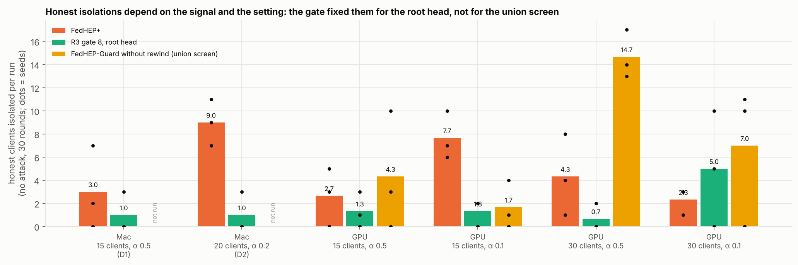
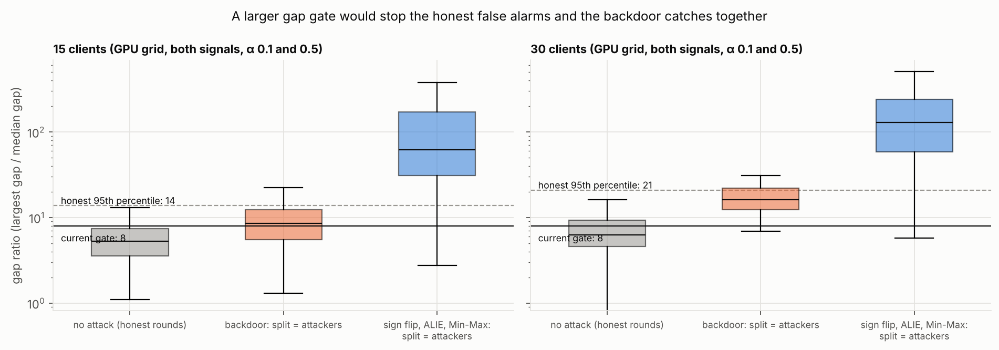
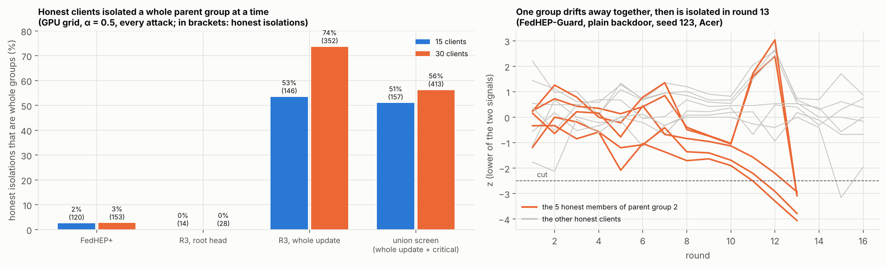
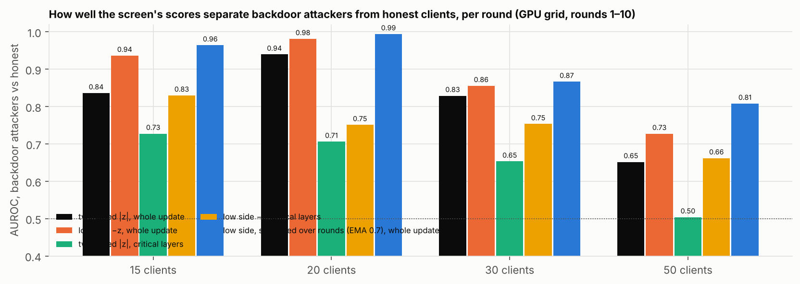
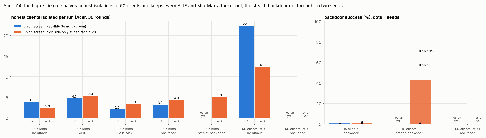

# 8. Open problems and current experiments

What FedHEP-Guard does not solve yet, why, and what is being tested. Each problem gives its evidence and its status. The model is described in [chapter 5](05_fedhep_guard.md), its results in [chapter 6](06_results.md).

## 8.1 What is still open

| # | Problem | Evidence | Status |
|---|---|---|---|
| 1 | **Honest clients isolated, more with more clients** | per run with no attack (GPU): 4.3 and 14.7 at 15 and 30 clients (α = 0.5); 1.7, 7.0 and 22.0 at 15, 30 and 50 clients (α = 0.1). FedHEP+: 1.0–7.7. About half are whole parent groups | two causes found (8.2). The shared signal (Phase 8) removed most whole-group isolations at 15 clients but let the backdoor through on one seed in three, so it was not adopted (7.6); its scale test runs next (8.3). Cause 1 has no fix yet |
| 2 | **A late catch lets a backdoor stay** | one stealth seed over 100 rounds: attackers caught in rounds 15–18, the rewind reaches back only 10 rounds, backdoor grew to 34% (6.10). In the benchmark (30 rounds) the stealth backdoor reaches 81% at D1 on seed 7, where no attacker is caught | repeated with the shared signal in `acer_c12_shared_durability` (8.3) |
| 3 | **Backdoors under strong skew** | α = 0.1: 15–31% get through (GPU). At D2 (benchmark, 2026-11-26) FedHEP-Guard stops the plain and stealth backdoor on two seeds of three (39 / 1 / 1%, 41 / 1 / 0%); on seed 42 the gap gate stays shut while the attackers stand apart (6.1). FLAME stops it on every seed at 6–8 points of accuracy | a lower gate on the low side catches seed 42 in the replay (8.2); live test `gpu_c8_gates.yaml` |
| 3b | **The rewind fires on honest isolations** | it resets the trunk and root head after every isolation: 1–4 times per run with no attack at D2, costing 0.8–1.8 points in every condition; 8 times and 6.5 points at 30 clients (one seed) (6.1) | open; it shrinks with problem 1. Untested idea: rewind only when the isolated client was flagged on the low side, where backdoor attackers sit |
| 4 | **A third of the clients attacking with a backdoor** | 5 of 15: 12% (GPU) and one seed at 20% (Mac); 9 of 30: 5.3% (GPU; one seed at 11%); FLAME holds | open |
| 5 | **Removing ALIE attackers costs accuracy** | catching all 9 ALIE attackers leaves the union screen 2.5 points below FedHEP+, which never catches them (GPU); fixing $f$ made it worse (7.4f) | open |
| 6 | **Untested attacks** | IPM and delayed-onset attacks from the team's `oreh` code; colluders that report one class mask | not scheduled |

## 8.2 Why honest clients are isolated

- **The gap gate fixed them for the root-head signal:** 1.0 per run at D1 and D2 on the Mac (FedHEP+: 3.0 and 9.0), 1.7 at D2 on the GPU (FedHEP+: 8.7), and 0.7–1.3 in three of the GPU grid's settings. It is less reliable at α = 0.1 with many clients: 5.0 at 30 clients and 6.0 at 50 (all 18 of the 50-client ones on one seed).
- **The union screen isolates more honest clients than FedHEP+ in every GPU grid setting but one,** and the count grows with the number of clients:

| Clients | α = 0.5: FedHEP+ / union screen | α = 0.1: FedHEP+ / union screen |
|---|---|---|
| 15 | 2.7 / 4.3 | 7.7 / **1.7** |
| 30 | 4.3 / 14.7 | 2.3 / 7.0 |
| 50 | running | 1.0 / **22.0** |

- **The one exception, 15 clients at α = 0.1,** is where FedHEP+ is at its worst. It was the basis of an earlier claim that FedHEP-Guard fixes honest isolations under strong skew; the larger settings show it does not.
- **The D1 mean of 4.3 comes mostly from one seed** (10, 3 and 0 honest clients isolated). At 50 clients it is every seed (25, 21 and 20), starting in rounds 3–6.

There are two causes, and both act through the whole-update half of signal [1].

**Cause 1: the gap gate opens by chance, more often with more clients.** The gate opens when the largest gap between neighbouring sorted scores is at least 8 times the median gap. With more clients there are more gaps, and the largest of them grows by chance alone. For scores drawn from one normal distribution (no attacker at all):

| Clients | Chance the gate opens with no attacker | Median gap ratio | 95th percentile |
|---|---|---|---|
| 12 | 13% | 4.3 | 11.2 |
| 15 | 18% | 4.9 | 12.1 |
| 20 | 29% | 6.0 | 14.6 |
| 30 | **51%** | 8.1 | 19.2 |
| 50 | **81%** | 12.1 | 27.6 |

The logged gap ratios of the no-attack runs agree. At 30 clients and α = 0.5, the whole-update gate opened in 44% of rounds and the critical-layer gate in 43%, against 32% and 14% at 15 clients. The union acts when either gate is open, so it blames someone in most rounds. The 50-client runs confirm the prediction of this table: at 81% chance of an open gate per signal, the union screen isolates 22 honest clients per run at α = 0.1.

**A larger gate is not the fix.** The obvious repair is a threshold that grows with the number of clients, $\gamma(n)$, for example the 95th percentile of the gap ratio in honest rounds (14 at 15 clients, 21 at 30). The logs show what it would cost. In the rounds where the largest gap split off exactly the backdoor attackers, the gap ratio was only 8.6 (median, 15 clients) and 16.1 (30 clients), inside the honest range. A gate at the honest 95th percentile would have kept 16% (15 clients) and 27% (30 clients) of those catches. Sign flip, ALIE and Min-Max split off at ratios of 60–130 (median) and are not at risk.

So the gap ratio cannot tell an honest outlier from a backdoor attacker: both stand a little apart from the rest.

**A larger scale floor has the same problem** (offline, on the logged scores of the GPU grid; not a run). Raising the floor of the z-score's scale from $0.1\,\lvert\operatorname{med}(s)\rvert$ to $0.2\,\lvert\operatorname{med}(s)\rvert$:
- removes 27–32% of the honest client-rounds that would be flagged with no attack (15 and 30 clients, α = 0.5);
- removes 40–65% of the backdoor attackers' flagged rounds.

**Cause 2: whole parent groups drift away together.** At α = 0.5, about half of the union screen's honest isolations come as a whole parent group: at least 3 honest members of one group isolated in the same round.

- **Which screens do it:** union screen 51% (15 clients) and 56% (30 clients); whole update alone 53% and 74%; FedHEP+ 2–3%; root head 0% (GPU grid, every attack pooled).
- **On the Acer:** FedHEP-Guard's three mass isolations in the 100-round runs (rounds 13, 14 and 16) were exactly parent group 2, mostly group 2, and exactly group 1.
- **The cause.** The whole-update signal is every weight of the update, the personal heads included. The parent head $W_p$ is shared by the members of one group and differs between groups by design.
  - As training goes on, a group's updates drift away from the others together: in the example, the whole-update gap ratio grows from about 3 to about 20 over rounds 9–13, and the group's z-scores fall together until all pass the cut.
  - The critical-layer signal already leaves the personal heads out, and its gap ratio stays low in the same rounds.
- **Why mild skew is worse.** At α = 0.5 the clients' own data differ little, so the group direction dominates the differences between updates.
- **Under strong skew it depends on the number of clients.** At α = 0.1 none of the union screen's honest isolations at 15 and 30 clients were whole groups: they were single clients, which points to cause 1. At 50 clients 44% were whole groups (29 of 66, no attack). So at 50 clients both causes act, and fixing cause 2 alone would remove about half.

**What has been tried.** The peer reference judged each client against the clients with similar classes. It made things worse, because most of these isolations are not clients with unusual data (7.5).

### What the screen's own logs show (offline replay of 220 GPU runs)

Every run of FedHEP-Guard's screen logs, each round, both signals' scores, their median and scale, and their gap ratio. `scripts/replay_screen.py` rebuilds the screen's decisions from these logs. The replay started on 2026-11-25 with the large grid's 196 union-screen runs; on 2026-11-26 the benchmark added its D1 and D2 runs, 220 in all (84 at 15 clients, 24 at 20 clients (D2), 81 at 30, 31 at 50). Replaying the real rule reproduces the real isolations in 218 of the 220; the other two differ by one isolation each. The same logs then show how well the scores separate attackers from honest clients, and what other rules would do.

**Who gets isolated, and how** (every real isolation in the large grid's 196 union-screen runs):

| Isolated clients | Number | Flagged by | Sign of z (whole update, critical layers) | Round (median) | Gap ratio when flagged (median) |
|---|---|---|---|---|---|
| Sign flip, ALIE, Min-Max attackers | 721 | both signals in 88% | high–high 64%, low–low 36% | 3 | 131 |
| Backdoor attackers | 162 | the whole update alone in 54%, both in 23% | **low–low 75%** | 6 | 11 |
| Honest clients, no attack | 205 | one signal in 80% | mixed signs in 53% | 8 | 14 |
| Honest clients, attack runs | 1,095 | one signal in 85% | mixed signs in 49% | 12 | 11 |

**Three findings.**
1. **The gap gate does not tell backdoor rounds from honest ones.** In rounds with no attack it opens in 17–19% of rounds at 15 clients, 30–35% at 30 and 40–49% at 50. In backdoor rounds it opens just as often (15–28%, about 40%, 43–55%). In sign-flip, ALIE and Min-Max rounds it opens in 93–100%. So the gate does its job against model poisoning, but backdoor attackers are caught only when it happens to be open while they stand out.
2. **The two-sided fold costs backdoor separation.** Backdoor attackers sit on the low side: their updates point away from the others. Folding the high side in, which the two-sided screen does to catch ALIE and Min-Max, adds the honest clients that are unusually close to the median. Per-round AUROC of backdoor attackers against honest clients (rounds 1–10), whole-update signal:

| | 15 clients | 20 clients (D2) | 30 clients | 50 clients |
|---|---|---|---|---|
| two-sided $\lvert z\rvert$ (what the screen uses) | 0.84 | 0.94 | 0.82 | 0.65 |
| low side only ($-z$) | 0.93 | 0.98 | 0.85 | 0.73 |
| low side, smoothed over rounds (EMA, 0.7) | **0.96** | **0.99** | **0.86** | **0.81** |
| critical layers, two-sided | 0.74 | 0.71 | 0.65 | 0.50 |

(220 runs; the 2026-11-25 figures, from 196 runs without D2, were 0.82 / 0.81 / 0.65, 0.93 / 0.84 / 0.73, 0.96 / 0.85 / 0.81 and 0.75 / 0.65 / 0.50.)

3. **Separation falls with the number of clients,** for every signal: with more honest clients, more of them are as unusual as an attacker. This is the root of the growing honest isolations (cause 1); the gate opening by chance is how it shows.

**Replayed rules.** Each point is one rule: honest clients isolated per run with no attack, and the share of backdoor attackers caught. Attacker catches of stricter rules are lower bounds: a client the real run isolated is not scored afterwards, so a rule that would have caught it a few rounds later is counted as missing it. The model trajectory is also the real run's.

| Rule (replayed) | Honest per run, no attack: 15 / 20 / 30 / 50 clients | Backdoor attackers caught (plain and stealth) | ALIE caught | Min-Max caught |
|---|---|---|---|---|
| FedHEP-Guard's screen (now) | 3.0 / 3.7 / 10.8 / 23.6 | 68 / 54 / 81 / 57% | 100% everywhere | 100% everywhere |
| high side only when the gap ratio reaches 20 | 2.3 / 2.3 / 8.8 / 10.6 | 67 / 54 / 73 / 43% (lower bounds) | 87 / 100 / 100 / 100% | 100% everywhere |
| high side only at 30 | 2.3 / 2.3 / 8.3 / 9.6 | 67 / 54 / 73 / 43% | 80 / 100 / 97 / 100% | 87 / 100 / 100 / 100% |
| isolation cut 2.0 instead of 1.5 | 1.3 / 2.0 / 4.0 / 7.6 | 48 / 46 / 46 / 13% | 100% everywhere | 100% everywhere |
| low side with no gate, high side at 20 | 5.0 / 5.7 / 13.0 / 18.2 | 98 / 96 / 83 / 55% | 87 / 100 / 100 / 100% | 100% everywhere |
| **low side when the gap ratio reaches 6, high side at 20** | **3.2 / 3.0 / 10.2 / 15.4** | **83 / 96 / 79 / 52%** | 87 / 100 / 100 / 100% | 100% everywhere |

No rule removes honest isolations without losing some backdoor catches: with these two signals the two groups overlap. Two rules stand out.

- **The high-side gate (20)** is the best trade when honest isolations matter most. At 50 clients it halves them; the drop in backdoor catches is partly an artefact of the lower bound. The live test on the Acer agrees (below).
- **A lower gate on the low side (6), with the high-side gate (20)**, is the best trade when the backdoor matters most. Against the screen as it is, it catches 83% of backdoor attackers instead of 68% at 15 clients and 96% instead of 54% at D2, for about the same honest isolations (3.2 against 3.0, 3.0 against 3.7), and isolates a third fewer honest clients at 50 clients (15.4 against 23.6). It catches the three runs the real screen lost in the benchmark: D1 stealth seed 7 (all three attackers in round 4; the real screen caught none) and D2 seed 42, plain and stealth (in round 3). Why it works: the backdoor attackers' low-side z stands apart from round 2 on, but four or more attackers spread over a range make no single large gap, so the gap ratio sits at 4–8 and the gate at 8 stays shut (6.1, "why seed 42 gets through").

**Caveats.** The gate of 6 was picked from 24 replayed combinations (low-side gate 0, 4, 6 or 8; cut 1.5, 2.0 or 2.5; high side at 8 or 20) on the same runs it is scored on, so it may be tuned to them. D2 has only 3 runs per condition. ALIE catches at 15 clients fall to 87% (one seed's attackers are caught late or not at all in the replay). Both rules need the live test, which needs no new code: `plus.gap_gate: 6` with `plus.high_gate: 20`. It is queued as two benchmark models (with and without the rewind), run first in D1 and D2 by `gpu_c8_gates.yaml` (P37–P40).

**The high-side gate, live (Acer, `acer_c14_high_gate.yaml`, 18 of 21 runs, 2026-11-26).** Against the union screen on the Acer, same seeds:

| Condition (30 rounds) | Honest isolated per run: union screen / high-side gate | Attackers caught | Backdoor success, seeds 42 / 123 / 7 |
|---|---|---|---|
| 50 clients, α 0.1, no attack | 22.3 / **12.3** | | |
| 15 clients, no attack | 3.8 / **2.3** | | |
| 15 clients, ALIE | 4.7 / 5.3 | 9 of 9 / 9 of 9 | |
| 15 clients, Min-Max | 2.0 / 3.3 | 9 of 9 / 9 of 9 (seed 7 in round 7) | |
| 15 clients, backdoor | 3.2 / 4.3 | 18 of 18 / 9 of 9 | 0.2–0.5% / 0.4 / 0.5 / **1.7%** |
| 15 clients, stealth backdoor | control running (`acer_c14_control.yaml`) | – / 8 of 9 | – / 0.4 / **71 / 57%** |

- **It does what the replay predicted with no attack:** honest isolations fall by 45% at 50 clients and by 40% at 15 clients, and accuracy at 50 clients rises from 48.4% to 50.4%. Every ALIE and Min-Max attacker is still caught (P33, P34 and P36 held). Under attack it isolates about one more honest client per run than the union screen.
- **The stealth backdoor got through on seeds 123 and 7**, with the attackers caught in rounds 13–23. **The high-side gate is not the cause:** the attackers sit on the low side (z mostly between −1.5 and −5.3 from round 2), and replaying the union screen's own rule on these runs' logs gives the same late isolations. The cause is the gap gate on the low side, as at D2 on the GPU: on both signals the gap ratio fell below 8 every second or third round (4–7.4), and each closed round resets the streak of 3 rounds the screen needs. Replaying the low-side gate of 6 on the same logs isolates all three attackers in rounds 3 (seed 123) and 6 (seed 7). These runs were not among those the gate of 6 was chosen on, so this is a first out-of-sample check, though still offline. The plain backdoor reached 1.7% on seed 7 (caught in round 6, not 4): P35 refuted, narrowly.
- **Next on the Acer:** the same sweep with the low-side gate at 6 (`acer_c15_low_gate.yaml`, 18 runs, P41–P43), paired seed by seed with c14.

The smoothed low-side score separates best of all (0.99 at D2), which points to the next signal to build: a per-client score accumulated over rounds before any gate is applied, as FLDetector and FLTracer do (`LITERATURE_REVIEW.md`).

## 8.3 Phase 8 at scale (Acer)

The shared signal, tested at 15 clients, cut honest isolations by three quarters at α = 0.5 but let the backdoor through on one seed in three, so it was not adopted (chapter 7.6). Its scale test asked how much of the honest-isolation problem at 30 and 50 clients is cause 2, which the shared signal removes, and how much is cause 1, which it does not.

| Sweep | Runs | What it tests | Status |
|---|---|---|---|
| `acer_c13_shared_scale.yaml` (`x13_`) | 18 | the shared union screen against the union screen at 30 clients (α 0.5, no attack and 6 backdoor attackers) and 50 clients (α 0.1, no attack) (P30–P32) | done (30 clients in 7.6, 50 clients below) |

**At 50 clients (α = 0.1, no attack) both causes act, and cause 1 is the larger.**

| Acer, 50 clients, α 0.1, no attack | Union screen | Shared union screen |
|---|---|---|
| Honest clients isolated, seeds 123 / 42 / 7 | 24 / 21 / 22 | 17 / 11 / 17 |
| Per run | **22.3** (GPU: 22.0) | **15.0** |
| In whole-group events (3 runs) | 27 of 67 | 13 of 45 |
| Single clients (3 runs) | 40 of 67 | 32 of 45 |
| First honest isolation | round 3 | round 3 (seed 42: 12) |
| Accuracy | 48.41 | 49.68 |

The shared signal removed a third of the honest isolations (22.3 → 15.0), half of the whole-group ones and a fifth of the single ones (P31 held: less than 60% removed). Even if every whole-group isolation were removed, 13 honest clients per run would still be isolated one by one. So at scale the main cause is cause 1, the gap gate opening on honest outliers, and the next fix has to target it.

**At 30 clients with no attack, cause 1 dominates on the Acer:** the union screen isolated 6.0 honest clients per run, only 1.0 of them in whole-group events, and the shared signal isolated 7.3. On the GPU the same setting gave 14.7 per run with about half in groups (8.2), so the split differs by run and machine; both machines agree that removing the parent head is not enough.

## 8.4 What comes next

- **GPU server:** the benchmark (6.1) and the rest of the 50-client grid; at the next resubmission `gpu_c8_gates.yaml` first (the low-side gate of 6 with the high-side gate of 20, with and without the rewind, D1 and D2, P37–P40); then the stealth study at scale (`gpu_c7_stealth`).
- **Acer:** the end of the high-side gate test (its 50-client backdoor runs, then `acer_c14_control.yaml`, the union-screen stealth control), then the low-side gate (`acer_c15_low_gate.yaml`, P41–P43).
- **A smoothed per-client score.** The replay's best separator is each client's low-side score averaged over rounds (8.2). A screen that gates on that score, rather than on the round's scores, is the next candidate; the replay can test it first. An observe-only mode (score and log every round, never exclude) would remove the replay's lower-bound limit.
- **Cause 2 without dropping the heads.** The heads carry both the group signature and part of the backdoor signature (7.6). A rule that spares a group drifting only in its heads, by requiring the shared signal to agree at a lower bar, can be replayed once both signals are logged on the same updates.
- **After that:** the open problems 3–6 above, in that order.
