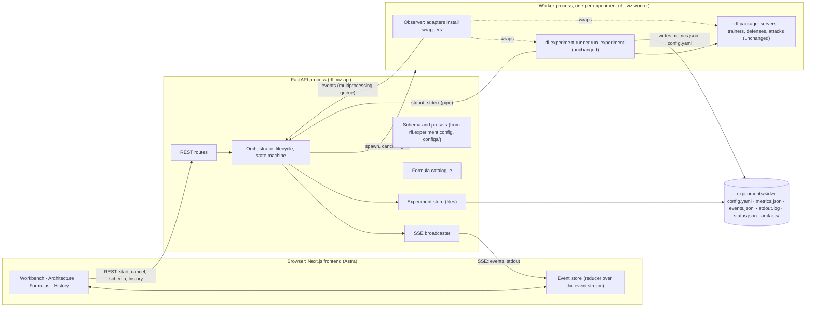
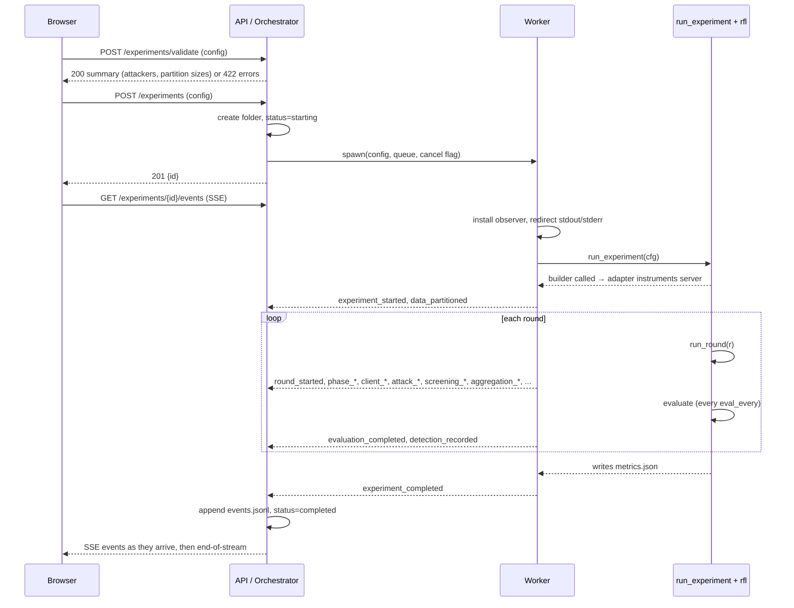
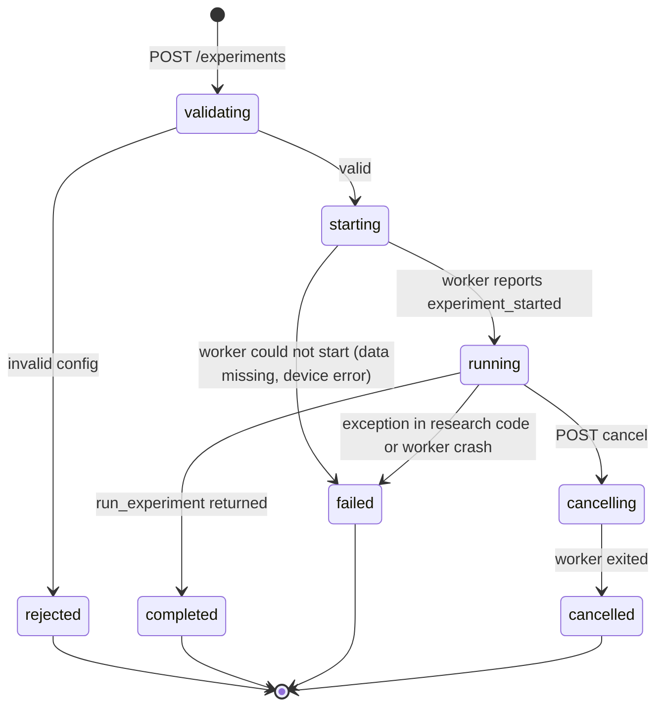

# RFL Lab Visualizer: architecture

Status: **proposal for review**, 2026-11-15. Owner of this document and of the backend: Claude. Frontend design and implementation: Astra. Independent review: ChatGPT. Nothing beyond an observation spike is implemented; implementation starts after review and the owner's decisions (section 15).

Companion documents: [`integration-contracts.md`](integration-contracts.md) (the backend–frontend contract) and [`event-schema.md`](event-schema.md) (every event the backend emits). Reference material: `01_REPOSITORY_INVENTORY.md` (execution specification of all ten methods, read from the source). This document supersedes the earlier draft `02_ARCHITECTURE.md`, which is kept unchanged.

## 1. Goals and non-goals

**Goals**
- Run the repository's real training (`rfl.experiment.runner.run_experiment`) for any of the ten registered methods, with the configurations the experiments actually use.
- Show what happens inside each round as it happens: per-client training, attacks, screening, grouping, aggregation at each tier, evaluation, with measured durations and real values.
- Make every displayed value traceable to the code that produced it.
- Support a one-round smoke test and any number of rounds.
- Keep finished experiments inspectable and reproducible.

**Non-goals**
- No reimplementation of any algorithm, in Python or TypeScript.
- No change to research algorithms to make visualization easier. (One optional, default-off change is proposed for per-batch losses; it needs approval, section 15.)
- No simulated or pre-recorded animation presented as live.
- No multi-user deployment, authentication or cloud hosting in the first version: it runs on the owner's machine.

## 2. System architecture



## 3. Components and responsibilities

| Component | Owner | Responsibility |
|---|---|---|
| `rfl_viz.api` | Claude | HTTP routes, request validation, SSE endpoint. Holds no training state. |
| `rfl_viz.orchestrator` | Claude | Experiment lifecycle and state machine; spawns and cancels workers; receives events and output; assigns sequence numbers; persists; fans out to SSE subscribers. |
| `rfl_viz.worker` | Claude | Process entry point: rebuilds the configuration, installs the observer, redirects stdout and stderr, calls `run_experiment`, reports the outcome. |
| `rfl_viz.observe` | Claude | Installs and removes wrappers (instance-level and module-namespace); guarantees passivity (section 8.3). |
| `rfl_viz.adapters.*` | Claude | One adapter per structural family: topology, phases, wrapped points, how to turn observations into events. |
| `rfl_viz.schema` | Claude | Method list, configuration form per method generated from the config dataclasses, presets from `configs/` and sweep files, validation. |
| `rfl_viz.formulas` | Claude | Formula catalogue: LaTeX, variables, source function, event bindings, and an executable check per formula. |
| `rfl_viz.store` | Claude | Experiment folders, history index, import of existing research runs (read-only). |
| Frontend | Astra | All presentation: layout, design system, topology canvas, timeline, inspector, formulas, terminal, charts, history. Consumes the contract only. |
| `rfl` package | unchanged | The research code. |

## 4. Architectural decisions

Each decision gives the choice, why, and what else was considered.

### AD-1 Observe the unchanged research code from outside
**Choice.** The worker calls the same `run_experiment` the experiments use. An observer wraps the method builders in `rfl.experiment.registry.METHODS`; when a server is built, its adapter installs wrappers on that server's components. Wrappers read arguments and results, measure time and emit events.
**Why.** It is the only option that guarantees the visualized run *is* a research run: same code path, same random numbers, same `metrics.json`. A spike (`visualizer/backend/tests/test_observe_is_passive.py`) shows observed and unobserved runs give identical `metrics.json` for FedHEP+, Defended FedHEP and FedHEP with a backdoor.
**Alternatives.** (a) A separate "visual" implementation of each method: rejected, it would drift from the research code and the visualization could show something the paper's numbers did not come from. (b) Adding callbacks throughout `rfl`: rejected as a default, it changes research code for presentation; kept only as an opt-in option for per-batch losses (section 15). (c) Reading `metrics.json` and `diagnostics` after the run: rejected as the main path, it gives no live view, no timings and no per-client intermediate values; still used for history. (d) `torch.profiler` or `sys.settrace`: rejected, heavy, slow, and they see operators or lines, not algorithmic steps.

### AD-2 Two observation mechanisms
**Choice.** (1) *Instance wrappers*: replace a method on one object (for example `server.trainer.train`, `server.global_defense.aggregate`). (2) *Module-namespace wrappers*: replace a function where a module imported it by name (for example `rfl.experiment.runner.evaluate_clients`, `rfl.server.fedhep_plus_server.screening_scores`). Both are installed inside a context manager and removed on exit.
**Why.** Some steps are methods of objects the server owns; others are module functions the server calls by name. FedHEP+ writes screening values to `diagnostics` only at the end of the round, so without (2) the screening would appear after aggregation. With (2) it appears live and in order, with values identical to the logged ones (tested).
**Alternatives.** Patching classes globally: rejected, it would affect every instance and is harder to undo. Patching the defining module (`rfl.defense.screening.screening_scores`): ineffective, the server holds its own reference.

### AD-3 One worker process per experiment
**Choice.** `multiprocessing` with the `spawn` start method; the API process never imports CUDA, MPS or XPU state.
**Why.** Training occupies the GPU and the interpreter for minutes. A separate process keeps the API responsive, allows safe cancellation (signal, then terminate), contains crashes (out-of-memory, driver errors), and gives each run a clean global random state, which the research code relies on.
**Alternatives.** A thread in the API process: rejected (the GIL, a crash kills the server, global RNG state shared between runs). A task queue (Celery, RQ, Redis): rejected for one user on one machine. Running `scripts/run.py` as a subprocess and parsing its output: rejected, the output has one line per evaluation and no structure.

### AD-4 Server-Sent Events for the stream, REST for commands
**Choice.** One SSE stream per experiment carries events and output lines; starting, cancelling and queries are REST calls.
**Why.** The stream is one-way. SSE reconnects automatically and resumes from the last event id, which matches the replay design (section 7 of the contract). It needs no extra protocol or library in the browser.
**Alternatives.** WebSocket: workable, but bidirectional messaging is not needed and resumption would have to be built. Polling: higher latency and load. gRPC-web: unnecessary complexity.

### AD-5 Files on disk for persistence
**Choice.** One folder per experiment: `config.yaml` and `metrics.json` (written by `run_experiment` itself), `events.jsonl` (append-only), `stdout.log`, `status.json`, `environment.json`, `artifacts/`. The history index is rebuilt by scanning folders.
**Why.** Matches how the research runs are already stored; human-readable; trivially backed up and committed; a crash loses at most the last unflushed line. `metrics.json` in a visualizer run is byte-for-byte what a research run writes, so a visualizer run can join the research record.
**Alternatives.** SQLite: a good later addition for fast queries over many experiments, not needed now. Postgres or an event store: unjustified for one user.

### AD-6 Provenance on every value, and executable formulas
**Choice.** Every event says whether its values are `observed` (read from arguments or results of the running code), `recorded` (written by the research code: `diagnostics`, `metrics.json`, stdout) or `recomputed` (a library function of the repository applied to observed inputs, named in the event). Each formula in the catalogue has a check: a Python function that recomputes the formula's output from the event's inputs and compares it with the observed output.
**Why.** The brief's central requirement is that nothing is fabricated. Provenance lets the interface say where a number came from; executable checks make the LaTeX shown next to a value provably match the code, instead of being a hand-written description that could drift.
**Alternatives.** Free-text formula descriptions only: rejected, unverifiable.

### AD-7 One adapter per structural family; the frontend renders a declared specification
**Choice.** Adapters for consensus, FedHEP, Defended FedHEP, FedHEP+ and robust FedHEP declare a *topology specification* (node kinds and edges) and a *phase specification* (phases in code order, each with the wrapped calls that mark it). The frontend draws whatever the specification declares and has no method-specific layout logic.
**Why.** The families differ structurally (one level vs three; regrouping or not; screening or not; FLTrust's server-side training). A specification keeps those differences in the backend, where they can be tested against the code, and keeps the frontend generic.
**Alternatives.** Per-method frontend components: duplicated logic, untestable against the code. One generic topology for all: wrong for at least four methods (inventory, section 3).

### AD-8 The research configuration is the configuration
**Choice.** The form for a method is generated from `rfl.experiment.config` (types, defaults, comments) plus a relevance map (which sections a method reads). Validation calls `load_config` and the same checks the registry performs. Presets are read from `configs/*.yaml` and every combination in `configs/sweeps/*.yaml`.
**Why.** No second definition of parameters that could drift; the presets are exactly the configurations behind the reported results.
**Alternatives.** A hand-written frontend form: drifts when the config changes.

### AD-9 Timing with device synchronization
**Choice.** Durations use `time.perf_counter()`. In *precise timing* mode (default), each timed wrapper synchronizes the device before reading the clock (`torch.mps.synchronize()`, `torch.cuda.synchronize()`, `torch.xpu.synchronize()`).
**Why.** GPU work is asynchronous; without synchronization a step's time is attributed to whichever later call waits for the GPU. Synchronizing waits for work already queued and does not change any computed value. The cost is some lost overlap, so a visualized run is slower than a research run; its total time is reported with that caveat.
**Alternatives.** No synchronization: misleading per-step times. `torch.profiler`: heavyweight and operator-level.

### AD-10 Summaries, not tensors, on the stream
**Choice.** Model updates (1.72 million floats each) are never streamed. Events carry summaries computed in the worker: norms per parameter tensor, cosines, scores, weights. Images (dataset samples, backdoor-stamped samples) are written as small PNG artifacts and fetched on demand.
**Why.** A round with 15 clients would otherwise stream about 100 MB. Summaries are what the views need; the full vectors stay in the worker.
**Alternatives.** Streaming full vectors or random projections of them: bandwidth cost without a matching view.

### AD-11 One running experiment per machine
**Choice.** The orchestrator runs one experiment at a time and rejects a second start with a clear error (an optional queue is a decision, section 15).
**Why.** The GPU is the bottleneck; two concurrent runs both slow down and their timings mean less. The research sweeps already run on the same machines, which is a separate risk (section 12).

### AD-12 Cancellation: cooperative first, forced second
**Choice.** Cancelling sets a flag in shared memory. Wrappers check it at safe points (before each client's training, before each round) and raise a cancellation exception, which ends `run_experiment` cleanly. If the worker has not exited after a grace period (default 30 s, for example inside a long FLAME clustering), it is terminated.
**Why.** Cooperative cancellation keeps the event log and output consistent; forced termination guarantees the button always works.

### AD-13 The backend runs in the research environment
**Choice.** The backend is a small package (`visualizer/backend/rfl_viz`) installed into the same virtual environment as `rfl` (`.venv` on the Mac, `~/venvs/rfl` on the Acer). Each experiment records the `rfl` git commit and whether the working tree had uncommitted changes.
**Why.** It must import exactly the code the experiments run; recording the commit makes every visualized run reproducible.

## 5. Data flow



## 6. Training lifecycle and experiment state



`status.json` holds the state, the current round and phase, start and end times, and for `failed` the exception type, message and traceback. On API restart, any experiment left in `starting`, `running` or `cancelling` whose worker no longer exists is marked `interrupted` (a terminal state). Within `running`, the round and phase come from the event stream.

## 7. Model adapter design

```python
class Adapter(Protocol):
    family: str                                   # "consensus" | "fedhep" | "defended" | "fedhep_plus" | "robust"
    def applies_to(self, server: object) -> bool: ...
    def topology(self, cfg: ExperimentConfig, server: object) -> TopologySpec: ...
    def phases(self, cfg: ExperimentConfig) -> list[PhaseSpec]: ...
    def install(self, server: object, emit: Emit, ctx: ObserverContext) -> None: ...
    def self_check(self, server: object) -> None:  # raises if an expected attribute or signature is missing
```

`self_check` runs before installation and fails the experiment at start (not silently) if the research code changed in a way the adapter does not know, for example a renamed method. Adapter tests run every method under observation and compare against an unobserved run.

**Where each adapter attaches** (all verified against the code; mechanism 1 = instance wrapper, 2 = module-namespace wrapper):

| Family | Attachment point | Mech. | Events |
|---|---|---|---|
| all | builder in `registry.METHODS` | 1 | `experiment_started`, `data_partitioned` (the builder receives `clients`) |
| all | `runner.evaluate_clients`, `runner.attack_success_rate`, `runner.detection_metrics` | 2 | `evaluation_completed`, `backdoor_evaluated` (per head via the `partial` argument), `detection_recorded` |
| all | `server.run_round` | 1 | `round_started`, `round_completed`, resource sample |
| consensus | `trainer.train` (has `client_id`), `trainer.upload`, `trainer.end_round`, `aggregator.aggregate`, `attack.poison_*` | 1 | client training, attack, aggregation, Multi-Krum selection |
| FedHEP family | `trainer.train` (client from the `HeadMemory` identity), `attack.poison_upload`, `attack.poison_data`, `attack.poison_batch` | 1 | client training, attacks, coordinated attack |
| FedHEP | `grouping.step`; `fedhep_server.mean_member_similarity`, `fedhep_server.adaptive_momentum_beta`; `server._average` | 1, 2 | grouping, agreement and copy rule, parent momentum β, parent and Global means |
| Defended, FedHEP+, robust | `parent_defense.aggregate`, `global_defense.aggregate` (group from the preceding `grouping.members` call), `ledger.update` | 1 | SCCF weights per tier, ledger scores, isolations |
| FedHEP+ | `fedhep_plus_server.screening_scores`, `.robust_z`, `.gap_ratio`; `evidence.update` | 2, 1 | scores, z, gate, evidence, left out, isolated (live, before aggregation) |
| robust | `server._apply`, `server._server_update` (FLTrust) | 1 | rule result (accepted, scores), FLTrust server training |

**Phase boundaries.** A phase starts at the first wrapped call belonging to it in a round and ends when the first call of the next phase begins. Phase durations therefore include unwrapped code between those calls; the contract labels them as boundary-to-boundary times. Per-call durations (`duration_s` on individual events) are exact.

## 8. Integration with the research code

### 8.1 Entry point
`rfl_viz.worker` builds an `ExperimentConfig` with `load_config(overrides=...)`, sets `run.output_dir` to the experiment folder, and calls `run_experiment(cfg)`. The run's `metrics.json` and `config.yaml` are written by the research code.

### 8.2 What the visualizer may and may not change
May: install and remove wrappers in its own worker process; read any object; compute summaries on copies. May not: modify files under `src/rfl`, change arguments or return values, consume random numbers, move or modify tensors the research code uses, or change global state the research code reads.

### 8.3 Passivity guarantees and how they are enforced
| Risk | Guarantee | Enforcement |
|---|---|---|
| A wrapper changes a value | Wrappers return the original result object unchanged | Test: observed `metrics.json` equals unobserved, every method and attack |
| A wrapper consumes random numbers | Summaries use only deterministic operations (norms, cosines) | Same test (any RNG draw changes later results) |
| A summary is computed in place | Summaries work on `.detach()` values and never assign into research tensors | Code review rule; same test |
| An observer bug kills a research run | Wrapper code is wrapped in its own `try/except`; on error it emits `observer_warning` and returns the original result | Fault-injection test: a failing summary still yields identical `metrics.json` |
| Wrappers leak into later runs | Context manager restores every original on exit | Test: originals identical after the block (exists) |

Reading a value with `.item()` or `.tolist()` synchronizes the device but does not change the value.

## 9. What the backend provides for each view

| Domain | Provided by the backend | Provenance |
|---|---|---|
| Dataset and clients | per client: train/test sizes, label histogram, held classes, $r_{\text{skew}}$; partition kind and α; attackers; on request, sample thumbnails per client (and backdoor-stamped samples) | observed / recomputed (`label_stats`) |
| Attacks | per attacking client per round: clean vs sent update norm, cosine, per-layer norm profile; label-flip and backdoor counts; coordinated attacks: observed set, crafted update norm, Min-Max γ | observed / recomputed |
| Client training | duration, samples, epochs, batches, optimizer steps, learning rate, head loss weights, last-batch loss per head, ensemble weights | observed / recomputed (`cosine_lr`, `binomial_head_weights`) |
| Mathematics | formula catalogue; each formula's inputs and output as observed in the run; the check result | catalogue + events |
| Hierarchical topology | topology spec; live assignment of clients to parents; per-round state per node (training, sent, left out, isolated, aggregated) | spec + events |
| Terminal | stdout and stderr lines verbatim, with timestamps; event lines rendered from events and marked as such | recorded / events |
| Metrics and history | evaluation rows, detection, resources; full `metrics.json`; past visualizer runs with replay; past research runs (no events) | recorded |

## 10. Error handling

| Failure | Detection | Result |
|---|---|---|
| Invalid configuration | `load_config`, registry checks, cross-field rules at validation | 422 with field-level errors; nothing started |
| Data missing, device unavailable | exception before `experiment_started` | state `failed`, error shown with the exception text |
| Exception in research code | exception in `run_experiment` | `experiment_failed` with type, message, traceback, last round and phase; partial events kept |
| Observer bug | caught inside the wrapper | `observer_warning`; training continues; experiment marked "observation incomplete" |
| Worker crash (out of memory, driver error) | process exit code without a final event | state `failed`, last stderr lines attached |
| Cancel | flag, then forced termination after the grace period | state `cancelled`; partial events kept; no `metrics.json` |
| Browser disconnect | SSE closed | nothing stops; reconnect replays from the last event id |
| API restart | orphan detection at start | orphaned experiments marked `interrupted` |
| Disk full | write error | experiment failed with that reason; worker stopped |

## 11. Testing and validation

| Level | What | Where it runs |
|---|---|---|
| Unit | schema generation, validation rules, event construction, formula checks, store | here, CI |
| Passivity | every method × every attack kind × observed/unobserved on synthetic data: identical `metrics.json` | here, CI (CPU) |
| Event consistency | per round: clients trained = all clients; evaluation events = `metrics.json` rows; isolations = `diagnostics`; weights sum to 1; every event valid against its JSON Schema | here, CI |
| Phase order | declared phase order = order of wrapped calls in the recorded stream, per family | here, CI |
| Formula checks | every formula's check passes on recorded streams of real runs | here, CI |
| Contract | the API's OpenAPI document and event JSON Schemas are versioned; recorded fixture streams validate against them; Astra develops against these fixtures | here, CI; shared with Astra |
| Lifecycle | cancel at each state; worker crash; observer fault injection; reconnect and replay; API restart with orphans | here, CI |
| End to end | FedHEP+ under sign flip, CIFAR-100, 1, 3 and 5 rounds on the Mac: identical `metrics.json` to a research run of the same config and seed on the same machine | owner's Mac |

Recorded fixture streams come from real synthetic-data runs of every family, not from hand-written mocks.

## 12. Technical risks

| Risk | Likelihood | Impact | Mitigation |
|---|---|---|---|
| Research code changes and an adapter silently stops observing | medium | wrong or missing views | `self_check` fails loudly at start; passivity and consistency tests in CI |
| Observation slows training (synchronization, summaries) | high | slower runs, timing differs from research runs | precise timing can be switched off; overhead measured and shown; summaries are O(model size) per client |
| Visualizer runs compete with research sweeps on the same GPU | high (sweeps run continuously) | both slower; visualizer timings not representative | show a warning when another training process is detected; one experiment at a time |
| Module-namespace wrappers break if the research code changes how it imports | medium | missing events | `self_check` verifies each attachment point exists and is callable |
| Device memory pressure from summaries (MPS) | low | out-of-memory | summaries reduce on device to scalars per tensor; no extra model copies |
| Event volume with per-batch observation | medium if enabled | stream lag | per-batch events batched per epoch; off by default |
| Phase durations misread as exact | medium | misleading interpretation | contract labels them boundary-to-boundary; exact per-call durations kept separately |
| Frontend shows values not in the stream | medium | fabricated display | contract obligation (frontend never synthesizes values); review checklist |

## 13. Dependencies and infrastructure

| Layer | Dependency | Note |
|---|---|---|
| Backend | Python ≥ 3.10 with the `rfl` environment; `fastapi`, `uvicorn`, `pydantic` v2; `sse-starlette` or a plain `StreamingResponse`; `pillow` for thumbnails | installed into the existing virtual environment |
| Frontend | Node.js ≥ 20; Next.js, React, TypeScript, Tailwind, shadcn/ui, `@xyflow/react`, Recharts, KaTeX, xterm.js, Framer Motion | Astra's choice within the brief |
| Runtime | the Mac (MPS) or the Acer (XPU); CIFAR-100 at `../Paper_Reproduction/data` | same as experiments |
| Storage | `visualizer/experiments/` (ignored by git except when an experiment is deliberately committed) | |
| Processes | one API process (`uvicorn`), one worker per running experiment, the Next.js dev server or a static build | local only, bound to 127.0.0.1 |

## 14. Delivery plan

| Step | Owner | Exit check |
|---|---|---|
| Architecture review | ChatGPT, owner | decisions in section 15 made |
| Contract freeze v1 | Claude, Astra | OpenAPI and event JSON Schemas published; first fixture streams recorded |
| Backend for FedHEP+ end to end | Claude | passivity, consistency, formula checks pass; a 3-round synthetic run streamed and persisted |
| Frontend design system and FedHEP+ workbench | Astra | renders fixture streams and live streams |
| Remaining adapters | Claude | passivity for all ten methods |
| End-to-end validation on the Mac | Claude, owner | section 11, last row |

## 15. Decisions requiring the project owner's approval

1. **Per-batch losses.** The trainers keep only the last batch's loss per head. Options: (a) last-batch losses only, plus optimizer step counts and timings (no research code change); (b) an opt-in, default-off callback in the trainers (a change to research code that alters no computation, covered by the passivity test); (c) a global wrapper on PyTorch's `cross_entropy` in the worker (no research code change, but it identifies heads by call order, which is fragile). Recommendation: (b).
2. **Precise timing by default** (device synchronization around timed steps), accepting slower visualized runs. Recommendation: yes.
3. **One experiment at a time**, rejecting a second start, versus a queue. Recommendation: reject for v1.
4. **Running beside research sweeps.** Allow it with a visible warning, or block visualizer runs while a sweep is running. Recommendation: allow with a warning.
5. **Committing visualizer experiments.** Keep `visualizer/experiments/` out of git by default and commit only chosen runs. Recommendation: yes.
6. **First family.** FedHEP+ end to end first (the most complex: screening, isolation, regrouping, two tiers), then robust FedHEP, Defended FedHEP, FedHEP, consensus.
7. **Scope.** Only `RFL_Lab` methods; the authors' code (`Topology-aware-FDL`) and the old `Paper_Reproduction` notebooks are out of scope.
